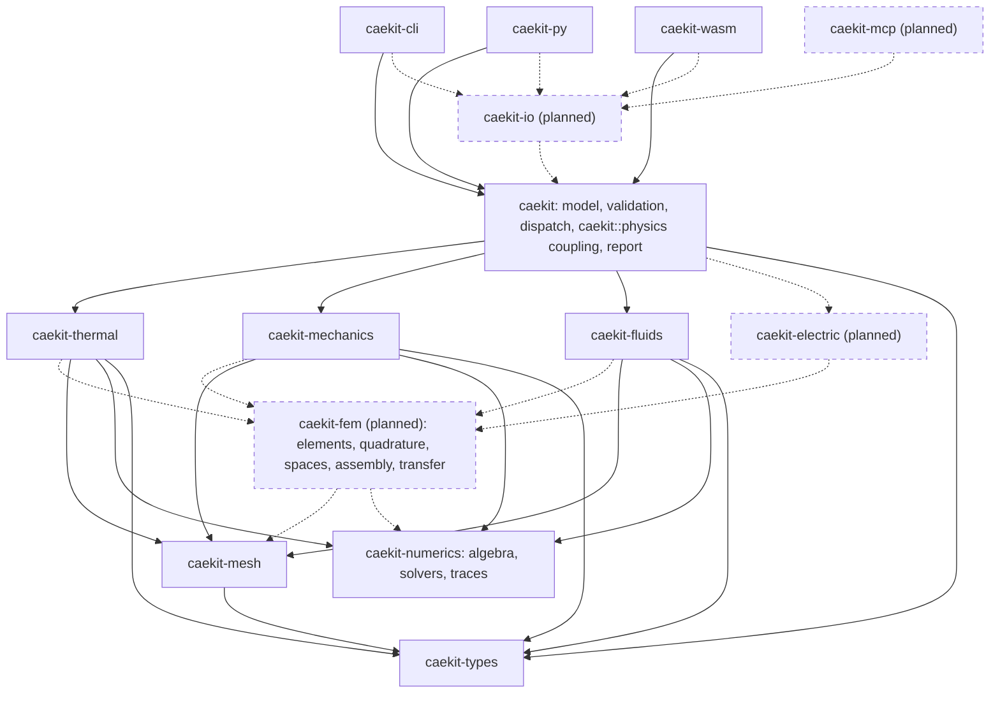
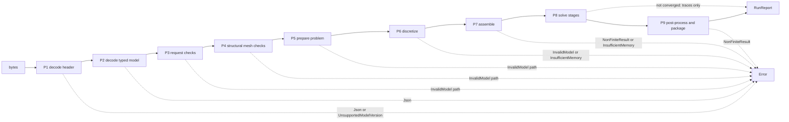
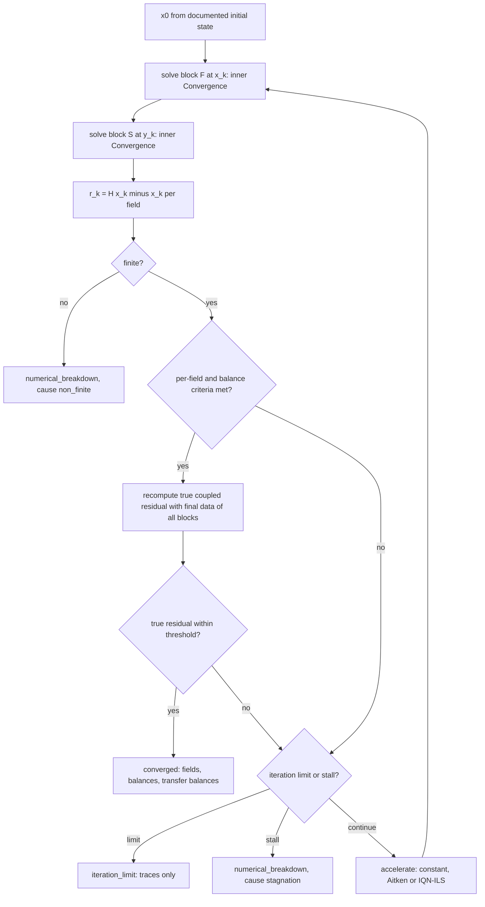
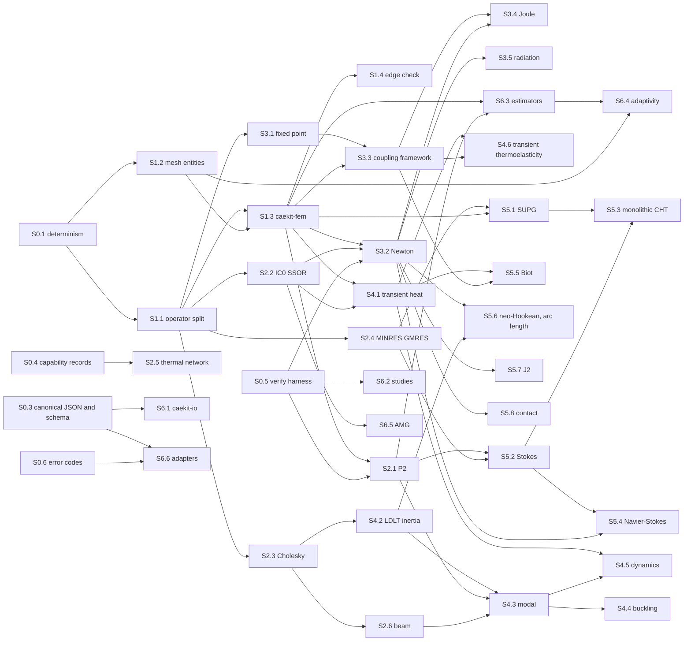

# Engineering blueprint

This page states how CAEKit must be built: the target architecture, the contracts between its parts,
the mathematics of every physics family it will solve, the numerical strategy, the verification method
and the order in which the pieces are built. It is direction, not a changelog. Requirements live in
[spec.md](spec.md); the survey of prior art and the literature behind them lives in
[landscape.md](landscape.md). Rules that bind every change live in [AGENTS.md](../../AGENTS.md).

## How to use this page

- **Before a change**, find its section here and the requirement IDs it cites. The IDs have the form
  `SPEC-<AREA>-NNN`, are defined only in [spec.md](spec.md), and link to the heading anchor there
  (`SPEC-DET-003` → [spec.md#spec-det-003](spec.md#spec-det-003)). Areas: `DOC` document contract,
  `PHY` physics kinds, `DIS` discretization, `SOL` solvers, `CNV` convergence and failure, `CON`
  conservation, `VER` verification, `DET` determinism, `OUT` outputs and interoperability, `BND`
  bindings, `EXT` extensibility, `EVD` documentation evidence, `AIA` automation by AI assistants.
  Non-goals have the form `NG-NN` and are listed in [spec.md › Non-goals](spec.md#non-goals).
- **Status labels.** **Implemented** means the repository contains it today, and the file is named.
  **Planned** means it is part of the target and carries a build step (`S0.1` … `S6.6`, see
  [section 15](#15-build-sequence)). **Later** means it is part of the target but not scheduled; it gets a
  build step before work on it starts. **Rejected** means it was considered and must not be proposed again
  without new evidence; it is marked *rejected* where it is discussed, and the major rejections are
  collected in [section 16](#16-design-decisions).
- **Open rulings.** A step that needs a ruling of [section 17.1](#171-rulings) does not start until the
  ruling's status there is `Accepted` or `Rejected`. Until then the text that depends on it is a proposal.
- **Precedence.** On a conflict, [AGENTS.md](../../AGENTS.md) wins on rules, the home pages below win on
  facts, and the code wins on present behaviour. The change that finds the conflict fixes this page. A
  change that implements a build step turns its `Planned` labels here into `Implemented` with the file.
- **Facts that change** (crate list, outputs, stage names, defaults, exit codes, host mappings, measured
  errors) have one home each: [ARCHITECTURE.md](../ARCHITECTURE.md), [model.md](../model.md),
  [python.md](../python.md), [wasm.md](../wasm.md), the pages in [docs/physics/](../physics/) and
  [provenance.md](../provenance.md). This page uses crate, kind and stage names as identifiers and does
  not restate their definitions.
- **Numbers.** Every number here is derived on this page, quoted from a cited source with its reference
  key, or stated as a design constant with its reason; in each case the page says how, as AGENTS.md §4
  requires. Values measured outside the repository are not quoted; a gate in
  [section 15](#15-build-sequence) says what CAEKit's own tests must measure. A number enters a page under
  `docs/physics/` only with the command that reproduces it, and a method enters
  [provenance.md](../provenance.md) when code implements it (AGENTS.md §4). The reference list of
  [section 19](#19-references) supports the design only.
- **Code blocks** on this page are `text` or `mermaid`. They are equations, pseudocode and layouts, not
  executed examples.

## Contents

1. [Scope and present state](#1-scope-and-present-state)
2. [Invariants](#2-invariants)
3. [Target architecture](#3-target-architecture)
4. [Document-to-report pipeline](#4-document-to-report-pipeline)
5. [Core abstractions and contracts](#5-core-abstractions-and-contracts)
6. [Mathematics by physics family](#6-mathematics-by-physics-family)
7. [Coupling](#7-coupling)
8. [Time integration](#8-time-integration)
9. [Solver strategy](#9-solver-strategy)
10. [Error control](#10-error-control)
11. [Verification method](#11-verification-method)
12. [Determinism](#12-determinism)
13. [Schema evolution](#13-schema-evolution)
14. [Errors and failure taxonomy](#14-errors-and-failure-taxonomy)
15. [Build sequence](#15-build-sequence)
16. [Design decisions](#16-design-decisions)
17. [Open rulings and risks](#17-open-rulings-and-risks)
18. [Playbook: adding a physics kind](#18-playbook-adding-a-physics-kind)
19. [References](#19-references)

---

## 1. Scope and present state

CAEKit is a deterministic, document-driven simulation kernel: a versioned JSON model goes in, a
reproducible run report with convergence evidence, signed balances and the requested quantities comes
out, and the same Rust solver runs natively, from Python and in WebAssembly. The present workspace,
its layering rules and its verification layers are described in [ARCHITECTURE.md](../ARCHITECTURE.md);
the documents in [model.md](../model.md).

### 1.1 What exists today

| Area | Implemented today | Where |
| --- | --- | --- |
| Model decode, validation, dispatch, digest, report packaging | `Model::from_json`, `Model::validate`, `caekit::solve`, `RunReport` | `crates/caekit/src/model.rs`, `crates/caekit/src/lib.rs`, `crates/caekit/src/result.rs` |
| Shared values | `Error`, `Output`, `Quantity`, `Balance`, `Solution`, `Pressure`, material provenance | `crates/caekit-types/src/` |
| Linear algebra | Row-wise `SparseAssembly`, `ConstrainedSystem` with symmetric elimination, Jacobi-preconditioned conjugate gradient with true-residual acceptance, restart and stagnation detection; `Convergence`, `StopReason` | `crates/caekit-numerics/src/lib.rs`, tests in `crates/caekit-numerics/tests/sparse_system.rs` |
| Meshes | `LineMesh`, `AxisFrame`, `TetraMesh`, `FaceRegion`, `GeometryRevision`, topology checks and metrics | `crates/caekit-mesh/src/line.rs`, `crates/caekit-mesh/src/tetra.rs` |
| Physics kinds | `axial_bar`, `elastic_solid`, `heat_conduction`, `multimaterial_heat_conduction`, `laminar_channel`, `cooling_channel`, `thermoelastic_solid` | [docs/physics/](../physics/); solvers in `crates/caekit-mechanics/src/`, `crates/caekit-thermal/src/`, `crates/caekit-fluids/src/`, `crates/caekit/src/physics/` |
| Coupling | One-way thermal → mechanical pass; partitioned Gauss–Seidel wall–coolant energy with a recomputed coupled residual; exact 1D overlap transfer | `crates/caekit/src/physics/thermoelastic_solid.rs`, `crates/caekit/src/physics/cooling_channel.rs`, `crates/caekit-thermal/src/lib.rs` (`solve_channel_energy`), `crates/caekit-thermal/src/interface.rs` |
| Identity guard | Frozen version 1 digests of every reference model | `crates/caekit/tests/model_identity.rs` |
| Cross-target agreement | Native against WASI on every reference model: both exit 0, every stage of both converged with its final true residual within its threshold, values within relative 1e-10 (AGENTS.md §2) with the floors set in the script | `scripts/verify-reference-cases.mjs`, `scripts/run-wasi.mjs` |
| Surfaces | CLI `check` and `run`; Python and WebAssembly packages | `crates/caekit-cli/`, `crates/caekit-py/`, `crates/caekit-wasm/` |
| Documentation contract | Kind ↔ page ↔ example ↔ tests ↔ README rows; outputs in the model page; links and anchors; Rust examples compiled | `scripts/check-docs.mjs`, `docs/doctests.rs` |

### 1.2 Gaps against the target

| Gap | Consequence | Closed by |
| --- | --- | --- |
| Platform-dependent `f64::hypot`, `powi`, `powf` in a stopping norm, a validation decision, element geometry, a reported metric and a balance-tolerance decision, and a signed-zero tie of `max` in each stage threshold ([section 12.3](#123-known-sites)) | A residual close to its threshold can be accepted on one target and rejected on another; exit code 0 can become 2 | S0.1 ([SPEC-DET-003](spec.md#spec-det-003)) |
| `scripts/verify-reference-cases.mjs` requires both targets to converge in every stage, but does not compare iteration counts or residual histories between them | A change in the iteration path, or a residual margin moving towards its threshold, stays invisible to the 1e-10 value comparison | S0.1 ([SPEC-DET-005](spec.md#spec-det-005)) |
| `elastic_solid` has no refinement study; its affine patch test is exactly representable by linear tetrahedra and cannot expose an order defect | AGENTS.md §2 refinement rule unmet for one kind | S0.5 ([SPEC-VER-002](spec.md#spec-ver-002), [SPEC-VER-003](spec.md#spec-ver-003)) |
| Indefiniteness in conjugate gradient (`pᵀAp ≤ 0`, `rᵀz ≤ 0`) ends as `numerical_breakdown` without a diagnostic (`crates/caekit-numerics/src/lib.rs`, the `break` of the PCG loop leaves `diagnostic` empty) | The user cannot tell a mechanism or inverted cell from a rounding floor | S0.2 ([SPEC-CNV-007](spec.md#spec-cnv-007)) |
| One linear method, P1 elements only, no nonlinear, time or eigen stage | Physics breadth is bounded by SPD linear steady problems | S1–S5 |
| No `clippy.toml`, no check of the WebAssembly dependency graph | Determinism rules are not machine-enforced | S0.1 ([SPEC-DET-004](spec.md#spec-det-004), [SPEC-DET-012](spec.md#spec-det-012)) |

---

## 2. Invariants

Every layer obeys these. They restate AGENTS.md where it already rules and add what the target needs.
Each has an enforcement point; an invariant without one is a wish.

| ID | Invariant | Enforced by | Requirement |
| --- | --- | --- | --- |
| INV-01 | `solve(model)` is a pure function of the model bytes and the crate version. Library crates use no threads, clocks, random numbers, environment or file access | `clippy.toml` disallowed methods and types (planned, S0.1, [section 12.2](#122-rules-and-enforcement)); a script that runs `cargo tree --locked -e normal --target wasm32-unknown-unknown` over the library packages and fails when `getrandom` appears (planned, S0.1) | [SPEC-DET-001](spec.md#spec-det-001), [SPEC-DET-012](spec.md#spec-det-012) |
| INV-02 | Dependencies point downward along the allowed-edge table of [section 3.3](#33-allowed-dependency-edges) | Machine check of `Cargo.toml` edges (planned, S1.4) | [SPEC-EXT-001](spec.md#spec-ext-001), [SPEC-EXT-002](spec.md#spec-ext-002) |
| INV-03 | A stage is accepted only on a residual recomputed from the system it solved. This holds for every method: Krylov, direct, Newton, fixed point, time step, eigenpair | Numerics tests per method | [SPEC-CNV-002](spec.md#spec-cnv-002) |
| INV-04 | The first non-converged stage sets the run's stop reason. Traces of executed stages remain. Physical quantities and balances are withheld for the whole run, including earlier output times of a transient run | Each domain or coupled solver returns no quantities or balances when a stage does not converge (implemented per kind, for example the empty `Solution` of `crates/caekit-mechanics/src/elastic_solid.rs`); `caekit::solve` sets the run stop reason from the first non-converged stage (implemented, `crates/caekit/src/lib.rs`); one test per kind. The report assembly in `caekit::solve` also clears quantities and balances on non-convergence | [SPEC-CNV-004](spec.md#spec-cnv-004) |
| INV-05 | Accept, reject, stop, branch, pivot and sort decisions and reported values use only IEEE 754 correctly rounded or exact operations: `+ − × ÷ sqrt mul_add abs copysign` and comparisons; `min` and `max` only where the operands cannot be zeros of opposite sign | `caekit_numerics::fmath` and Clippy (planned, S0.1) | [SPEC-DET-003](spec.md#spec-det-003), [SPEC-DET-004](spec.md#spec-det-004) |
| INV-06 | Iteration order is index order. Sorting uses `f64::total_cmp` with an index tie-break. Duplicate matrix contributions accumulate in insertion order | Review; bit-identity gates on refactors | [SPEC-DET-006](spec.md#spec-det-006), [SPEC-DET-008](spec.md#spec-det-008) |
| INV-07 | NaN and infinity never reach a report or a digest. A non-finite norm is `numerical_breakdown`, never convergence | `Quantity` finite gate (implemented, `crates/caekit-types/src/quantity.rs`, applied in `crates/caekit/src/lib.rs`); guard in every driver | [SPEC-CNV-009](spec.md#spec-cnv-009) |
| INV-08 | A valid version 1 document keeps its typed value, its serialized bytes, its `model_sha256` and its report key set | `crates/caekit/tests/model_identity.rs` (implemented); report key-set snapshots (Later) | [SPEC-DOC-003](spec.md#spec-doc-003), [SPEC-DOC-004](spec.md#spec-doc-004) |
| INV-09 | No input panics. `expect` and `unreachable!` state an invariant that earlier validation established and name it | Review and bounded reader and solver mutations in a non-required CI job | [SPEC-DOC-006](spec.md#spec-doc-006) |
| INV-10 | Every loop is bounded by a count, never by elapsed time. Simulated time is `t_k = k·Δt`, never an accumulated sum | Review | [SPEC-CNV-011](spec.md#spec-cnv-011), [SPEC-DET-009](spec.md#spec-det-009) |
| INV-11 | Library crates choose no backend: no BLAS provider, no thread pool, no SIMD feature, no relaxed SIMD | `default-features = false` pins; build flags in CI | [SPEC-DET-007](spec.md#spec-det-007) |
| INV-12 | Vocabularies in documents are closed: stop reasons, causes, condition kinds, outputs, methods. Unknown values are errors | `deny_unknown_fields` and closed enums (implemented) | [SPEC-DOC-001](spec.md#spec-doc-001), [SPEC-CNV-003](spec.md#spec-cnv-003) |
| INV-13 | Every number in a physical balance comes from the discrete fluxes the method conserves (residual reactions, face fluxes), not from recovered gradients | Domain tests | [SPEC-CON-003](spec.md#spec-con-003) |
| INV-14 | Every tolerance states its reason where it is set; a test band comes from a derivation or from a measured run that the page reproduces | AGENTS.md §4; review | [SPEC-EVD-002](spec.md#spec-evd-002) |

---

## 3. Target architecture

### 3.1 Layers

The present DAG and its rules stay ([ARCHITECTURE.md](../ARCHITECTURE.md)). The target adds one
discretization layer, `caekit-fem`, one translator crate, `caekit-io`, a domain crate only where a
physics field has no home (`caekit-electric`), and adapter crates outside the kernel (`caekit-mcp`, D-30).
Solid boxes exist today; dashed boxes are planned. The unpublished workspace member `caekit-docs`
(`docs/Cargo.toml`), which compiles the documentation examples, is not drawn.



### 3.2 Crate responsibilities

| Crate | Status | Owns | Must not contain |
| --- | --- | --- | --- |
| `caekit-types` | Implemented | `Error` and input checks, `Output`, `Quantity`, `Balance`, `Solution<Trace>`, material provenance, `Pressure` | numerics, meshes, physical laws |
| `caekit-numerics` | Implemented, extended | Sparse structures, operators, preconditioners, Krylov, direct, nonlinear, fixed point, time integrators, eigensolvers, traces, verification arithmetic, deterministic math | meshes, unit semantics, physics names; it does not depend on `caekit-types`, which is why `Solution<Trace>` is generic |
| `caekit-mesh` | Implemented, extended | Mesh document types (version 1 frozen), checks, affine simplex geometry, metrics; planned: entity numbering, cell partitions, deterministic bisection | function spaces, solvers |
| `caekit-fem` | Planned (S1.3) | Reference shapes, Lagrange P1 and P2 tabulation, quadrature rules, DOF maps, spaces and fields, assembly drivers, constraint building, residual reactions, sampling into `Quantity`, consistent and conservative transfer operators, physics-neutral weak-form blocks | units, sign conventions, material laws, boundary-condition meaning |
| `caekit-thermal` | Implemented | Conduction for one or several materials, wall and coolant energy; planned: radiation, networks, transient conduction | other domain crates |
| `caekit-mechanics` | Implemented | Axial bar, 3D elasticity, thermal strain; planned: modal, buckling, dynamics, hyperelasticity, plasticity, contact | other domain crates |
| `caekit-fluids` | Implemented | Laminar channel; planned: convection–diffusion, Stokes, Navier–Stokes, Darcy | other domain crates |
| `caekit-electric` | Planned (S3.4) | Steady current conduction: potential, charge balance, Joule power density | other domain crates |
| `caekit` | Implemented, extended | `Model` and version dispatch, `Physics`, validation including the coupling graph, `solve`, `RunReport`, coupled cases in `caekit::physics`; planned: `capabilities()`, study documents, `canonical_json()` | file or process I/O |
| `caekit-io` | Planned (S6.1) | Gmsh MSH 4.1 bytes → mesh document fragment; report and mesh → VTU bytes | file access, physics |
| `caekit-cli`, `caekit-py`, `caekit-wasm` | Implemented | Host translation, file I/O (CLI only), exit codes and host errors; planned: thin commands mirroring `canonicalize`, `capabilities`, `study`, `import`, `export` | physics, numerics |
| `caekit-mcp` | Planned (S6.6) | Model Context Protocol tools over `check`, `solve`, `capabilities`, the schema and example lookup ([SPEC-AIA-006](spec.md#spec-aia-006)) | physics, numerics; protocol types never enter the kernel |
| `caekit-docs` | Implemented (`docs/Cargo.toml`, unpublished) | Compiles the Rust examples of the Markdown pages as doctests (`docs/doctests.rs`) | anything a published crate needs |

An FMI adapter ([SPEC-OUT-012](spec.md#spec-out-012)) is an adapter crate of the same kind as `caekit-mcp`,
added at S6.6 with the crate rows of AGENTS.md §3.

A crate is added only when it gives a boundary that a module cannot enforce. `caekit-fem` qualifies:
domain crates may depend on it and it may not depend on them. Krylov, direct, nonlinear, time and eigen
code stay modules of `caekit-numerics`; separate crates would add publishing channels and release rows
without a dependency boundary to enforce (D-01).

### 3.3 Allowed dependency edges

The table covers `[dependencies]` only; dev-dependencies are governed by AGENTS.md §2 and `deny.toml`.
Rows marked (present) match the manifests of the repository today.

| From | May depend on |
| --- | --- |
| `caekit-types` | `serde`, `serde_json` (present) |
| `caekit-numerics` | `serde` (present); `libm` with `default-features = false` after ruling R-7 |
| `caekit-mesh` | `caekit-types`, `serde` (present) |
| `caekit-fem` | `caekit-mesh`, `caekit-numerics`, `caekit-types`, `serde` |
| domain crates | `caekit-fem`, `caekit-mesh`, `caekit-numerics`, `caekit-types`, `serde` (present without `caekit-fem`); never each other |
| `caekit` | the crates above, `serde`, `serde_json`, `serde_path_to_error`, `sha2` (present) |
| `caekit-io` | `caekit`, `caekit-mesh` |
| `caekit-cli` | `caekit`, `caekit-io`, `serde`, `serde_json` (present without `caekit-io`) |
| `caekit-py`, `caekit-wasm` | `caekit`, `caekit-io`, `serde_json` and their binding crates (`pyo3`; `wasm-bindgen`, `js-sys`) (present without `caekit-io`) |
| `caekit-mcp` | `caekit`, `caekit-io`, `serde_json` and its protocol crate |
| `caekit-docs` | none; `caekit` as a dev-dependency (present) |

The S1.4 check passes on the present workspace and fails on a deliberately added forbidden edge. A new
external dependency follows AGENTS.md §2 (pure Rust, builds for `wasm32-unknown-unknown`, licence in
`deny.toml`, recorded in [provenance.md](../provenance.md)).

### 3.4 Module layout of `caekit-numerics`

```text
fmath        norm2 (scaled sqrt), sq, cube (S0.1); transcendentals routed to libm (S2.5, ruling R-7)
sparse       SparseAssembly, ConstrainedSystem (implemented); Pattern, public CsrMatrix  S1.1
operator     LinearOperator, Symmetry, NullSpace                                     S1.1
precond      Jacobi (implemented inside pcg); Ssor, Ic0 { shift }; later SmoothedAggregation  S1.1, S2.2, S6.5
krylov       cg (implemented algorithm, unchanged); minres, gmres (MGS, restart m)   S2.4
direct       ordering::{amd, rcm}, cholesky, ldlt with inertia, iterative refinement S2.3, S4.2
nonlinear    newton, line_search, forcing (Eisenstat–Walker)                         S3.2
fixed_point  driver, aitken, anderson (QR with filter)                               S3.1
time         theta and backward Euler, bdf2, sdirk2, newmark, generalized_alpha     S4.1, S4.5
eigen        dense_symmetric, lanczos_shift_invert, sturm                            S4.3
trace        Convergence, StopReason (implemented, closed); Cause; record types      S0.2, S1.1
verify       observed_order (least squares), gci, taylor_remainder, monomial_exactness  S0.5
```

---

## 4. Document-to-report pipeline

Today the steps exist implicitly in `caekit::solve` and in the `prepare()` functions of the domain crates
(`SolidThermal::prepare`, `SolidMechanics::prepare`). The target names nine steps, each with one input
type, one output type, one owner and one error class.



| Step | Input → output | Owner | Failure | Status |
| --- | --- | --- | --- | --- |
| P1 Decode header | bytes → `schema_version` | `caekit::model` | `Error::Json`, `Error::UnsupportedModelVersion` | Implemented (`Model::from_json`) |
| P2 Decode typed model | bytes → `Model` | `caekit::model`, domain document types | `Error::Json` with recovered path | Implemented |
| P3 Request checks | `Model` → ok | `caekit` | `Error::InvalidModel { path }` | Implemented: outputs non-empty, unique, supported; settings ranges |
| P4 Structural checks | mesh documents → checked meshes and metrics | `caekit-mesh` | `InvalidModel { path }` | Implemented: orientation, conformity, connectivity, region ownership |
| P5 Prepare problem | document + checked mesh → borrowed problem type | domain crate; `caekit::physics` for coupled kinds | `InvalidModel { path }` | Implemented for material ranges, conflicting prescriptions, datum, rigid support; planned: coupling-graph check ([section 7.2](#72-interface-declarations-and-graph-validation)) |
| P6 Discretize | problem → space, DOF map, constraints, quadrature | `caekit-fem` | `InvalidModel`, `InsufficientMemory` | Planned (S1.3); inside domain crates today |
| P7 Assemble | space + kernels → operators and loads | `caekit-fem` drivers, domain kernels | `NonFiniteResult`, `InsufficientMemory` | Planned driver; assembly inside domain crates today |
| P8 Solve stages | operators → iterates + one `Convergence` per stage | `caekit-numerics`, orchestrated by the domain crate or the coupler | non-convergence returns `Ok` with traces only | Implemented for PCG and the cooling coupling |
| P9 Post-process and package | iterates → fields, residual reactions, balances, quantities → `RunReport` | domain crate (post-processing), `caekit::solve` (packaging) | `NonFiniteResult` | Implemented: finite gate, requested outputs only, first non-converged stage, digest, `Execution` |

Target entry-point shape (planned, removes the second validation inside each case's solve):

```text
solve(model):
    checked = model.check()?             # P3–P5 in one pass; ModelCheck metrics kept
    run     = checked.run()?             # P6–P9 post-processing: Solution<Convergence>
    return RunReport::package(model, checked, run)   # finite gate, outputs, stop reason, digest, Execution
```

`Model::validate` stays public and returns `ModelCheck`. The checked view borrows the mesh arrays and
never copies them.

### 4.1 Ownership and memory

- **Borrow chain**: `Model` (owned) → checked mesh (borrows vertices and cells) → prepared problem →
  space → owned operators and vectors → owned `Solution` → `RunReport`. No `Rc`, `RefCell` or global
  state; kernels are `FnMut` closures on one thread.
- **Coupled data** moves as plain slices with a stated unit and sample location. Temperatures and
  potentials use a datum + offset representation to limit cancellation (implemented for solid
  temperature in `crates/caekit-thermal/src/heat_conduction.rs`).
- **Allocation**: every `O(n)` or `O(nnz)` buffer uses `try_reserve`; failure is
  `Error::InsufficientMemory`. On `wasm32` the address space is 4 GiB (32-bit pointers); a DOF ceiling
  per surface is stated only after it is measured.
- **Report size**: fields appear only on request (implemented); transient fields only at listed output
  steps; nested traces are summarized in their parent ([section 5.8](#58-convergence-trace)); bulk
  visualization goes through VTU export, not larger JSON (D-14).
- **External meshes** (Later, schema-additive): an optional reference `{ sha256, format }` replaces
  inline arrays; the host passes the bytes, because the library reads no files, and the digest covers the
  reference hash (D-15, [SPEC-DOC-012](spec.md#spec-doc-012)).

---

## 5. Core abstractions and contracts

Shapes below are contracts, not final signatures. Every public item gets rustdoc stating unit, sign,
ordering and constraints (AGENTS.md §2).

### 5.1 Document type, problem type

Rule: a **document type** (serde, `deny_unknown_fields`, frozen once released) is converted by
`prepare()` into a **problem type** (borrowed, validated, solver-facing). The pattern exists today
(`SolidThermal::prepare → PreparedConduction`, `SolidMechanics::prepare → PreparedElasticSolid`).
Version 1 document types stay in their domain crates; version 2 collects document types in one module
(D-04, ruling R-4). A solver never reads a document type directly after `prepare()`.

### 5.2 Mesh and topology

| Item | Contract | Status |
| --- | --- | --- |
| `TetraMesh`, `FaceRegion`, `LineMesh`, `AxisFrame`, `GeometryRevision` | Version 1 document types; conventions on [model.md](../model.md) and the physics pages | Implemented, frozen |
| Checked tetrahedral view with topology | Positive orientation, face connectivity, manifold faces, region ownership | Implemented (`crates/caekit-mesh/src/tetra.rs`) |
| Entities | Edges as `(min, max)` vertex pairs in ascending lexicographic order; cell edges in local order (0,1),(0,2),(0,3),(1,2),(1,3),(2,3); faces as sorted triples, ascending; face `i` of a cell is opposite local vertex `i`. Built on request with sorted vectors and fallible reservation | Implemented by `CheckedTetraMesh::entities` |
| Cell partition | Named volume regions with per-cell ownership for any domain | Partly implemented for multimaterial conduction; generalized S1.2 |
| Mesh trait | Not introduced until a second volume cell type (hexahedron) is accepted | Planned with H8 |
| Refinement | Newest-vertex bisection with marking ties broken by cell index; bisection edge a pure function of vertex indices and level | Planned S6.4 |

No meshing from geometry: CAD and meshers stay upstream of the document; the geometry revision is the
link ([NG-17](spec.md#non-goals)).

### 5.3 Reference elements and quadrature

```text
Shape   = Interval | Triangle | Tetrahedron
Rule    = { shape, exact_degree, points (reference coordinates), weights }
rule(shape, degree) -> smallest positive-weight rule with exact_degree ≥ degree
Lagrange { shape, degree ∈ {1, 2} }: dofs() = 4 or 10 on a tetrahedron; tabulate(ξ) -> values, reference gradients
```

**Exactness requirement** on affine simplices, element degree `p`, coefficient degree `m`, data degree
`q` (degrees follow from the polynomial degree of each integrand on an affine map):

| Integral | Integrand degree | Rule degree |
| --- | --- | --- |
| Stiffness | `2p − 2 + m` | exact |
| Mass, Robin | `2p + m` | exact |
| Load with polynomial data | `p + q` | exact |
| Load with general data | not polynomial | at least `2p`; the load rule is part of the refinement study |
| Error norms in tests | not polynomial | at least `2p + 3` |

Theory needs less (exactness for `P_{2p−2}` keeps the energy rate on affine meshes [Ciarlet 2002]); the
table is stricter on purpose, so that integration error never has to be argued.

**Rules admitted** (positive weights, interior points only; negative-weight rules such as the 5-point
degree-3 tetrahedron rule are excluded because they can break positivity of mass matrices and of
nonlinear coefficient evaluation):

| Domain | Points | Exact degree | Construction |
| --- | --- | --- | --- |
| Tetrahedron | 1 | 1 | centroid |
| Tetrahedron | 4 | 2 | orbit of `(b, a, a, a)`, `a = (5 − √5)/20`, `b = 1 − 3a`, weights 1/4 |
| Tetrahedron | 14 | 5 | fully symmetric positive-weight rule with three orbits [Witherden, Vincent 2015]; admitted only after its monomial test. Keast's 14-point rule has degree 4 and his degree-5 rule has 15 points [Keast 1986] |
| Triangle | 1, 3, 6, 7 | 1, 2, 4, 5 | centroid; orbit of `(2/3, 1/6, 1/6)`, weights 1/3; 6- and 7-point rules of [Dunavant 1985] |

Derivation of the 4-point constant: with barycentric `λ`, `∫_T λ^α = |T| d! α! / (|α| + d)!` (`d = 3`),
so `∫_T λ₁² = |T|·2·6/120 = |T|/10`. The orbit rule gives `(|T|/4)(b² + 3a²)`. Setting
`b² + 3a² = 2/5` with `b = 1 − 3a` gives `12a² − 6a + 3/5 = 0`, so `a = (5 ± √5)/20`; the interior
root is `(5 − √5)/20`. Constants are written as decimal literals with at least 17 significant digits; a
test reconstructs them from the closed forms and a monomial test passes at the stated degree and fails at
degree + 1 ([SPEC-DIS-003](spec.md#spec-dis-003)).

**Mass lumping for P2**: row-sum lumping is *rejected* ([SPEC-DIS-009](spec.md#spec-dis-009)). For the corner function `λ(2λ − 1)`,
`∫ = 2·|T|/10 − |T|/4 = −|T|/20`; for the mid-edge function `4λ_iλ_j`, `∫ = 4|T|·3!/5! = |T|/5`
(check: `4(−1/20) + 6(1/5) = 1`). Negative corner masses are unusable; use the consistent mass or HRZ
diagonal scaling [Hinton, Rock, Zienkiewicz 1976].

### 5.4 Spaces, DOF maps and fields

| Item | Contract |
| --- | --- |
| DOF map P1 | DOF = vertex index (identical to the version 1 numbering) |
| DOF map P2 | vertices `[0, n_v)`, then `n_v + edge id` in entity order |
| Vector unknowns | node-major: index = `components · dof + c`, as the version 1 elastic layout |
| Field | `datum + offsets` over a space; sampling at vertices (`node`) and centroids (`cell`), the version 1 sample locations |
| P2 report locations | unchanged: vertex values and centroid values; mid-edge values only as an opt-in output (Later) |

### 5.5 Assembly

```text
CellValues { cell, volume_m3, points_m[q], weights_m3[q], phi[q][a], grad_phi[q][a] }
Accumulate: add(row, col, v), add_load(row, v)       implemented by ConstrainedSystem, SparseAssembly,
                                                     Pattern-backed CSR and a residual vector
assemble_cells(space, rule, into, kernel)
assemble_faces(space, region, rule, into, kernel)
residual(space, kernels, u_full) -> vector            reactions = entries at constrained DOFs
```

Contracts:

- **Loop order** is cells in cell order, local rows then local columns in local DOF order, faces in region
  order and then in `FaceRegion.faces` order. With the P1 kernels kept verbatim in the domain crates, the
  port to `caekit-fem` is bit-identical (gate of S1.3).
- **Pattern-first CSR** (`Pattern::from_dofmap`) with numeric fill in insertion order sums every entry's
  contributions in the same order as per-row ordered-map accumulation and keeps ascending column order.
  Explicit zeros must be dropped as `CsrMatrix::from_rows` drops them today, or a multiplication can differ
  in the sign of a zero. This is a testable claim and the S1.3 gate.
- **Residual reactions**: reactions and boundary heat rates come from the assembled residual at
  constrained DOFs (INV-13). They are conservative by construction [Hughes, Engel, Mazzei, Larson 2000]
  and, for smooth problems, converge at `O(h^{2p})` because they are functionals with a lifted test function
  [Babuška, Miller 1984].
- **Physics-neutral weak-form blocks** for new kinds: `mass(ρ)`, `diffusion(K tensor)`, `advection(a)`,
  `tensor_gradient(C)`. Existing kinds keep their kernels so that their reports keep their bits.
- No user-facing weak-form language, no JIT (D-03).

### 5.6 Boundary conditions and constraints

| Level | Representation | Owner |
| --- | --- | --- |
| Document | Tagged condition kinds per named region (implemented: thermal boundaries, solid boundaries, channel walls). A new condition kind is a new variant: additive | domain crate |
| Problem | Per-DOF prescription with a conflict check that reports the JSON path (implemented in conduction and elasticity); natural conditions as face kernels; Robin as face matrix plus load | domain crate with `caekit-fem` helpers |
| Algebra | Symmetric elimination (implemented, `ConstrainedSystem`); `NullSpace { vectors }` for pure Neumann and free bodies, passed to solvers and preconditioners, never silent regularization; master–slave multipoint constraints (Later), eliminated in index order | `caekit-numerics` |

Penalty enforcement of Dirichlet data is *rejected* ([SPEC-DIS-007](spec.md#spec-dis-007)): it adds `O(β)` to the condition number and an
`O(1/β)` consistency error (a penalty `β` on the diagonal scales the largest eigenvalue with `β`, and the
constraint is met only to `O(1/β)`). Nitsche's method [Nitsche 1971] is admitted only where elimination is
impossible. Every condition kind states its sign in rustdoc and on its physics page.

### 5.7 Linear operators, preconditioners and methods

```text
Symmetry = Spd | SymmetricIndefinite | General
LinearOperator { rows(), apply(x, y), symmetry(), diagonal() }     apply has no interior mutability
Preconditioner { apply(r, z), symmetric_positive(), id() }
LinearMethod (optional `linear_solver.method`, tagged by `kind`;
              absent ⇒ jacobi_preconditioned_conjugate_gradient):
    jacobi_preconditioned_conjugate_gradient   implemented algorithm, unchanged; same string as the
                                               Algorithm column of the model.md stage table
    ic0_conjugate_gradient { diagonal_shift }
    ssor_conjugate_gradient { relaxation }
    minres
    gmres { restart }
    sparse_cholesky | sparse_ldlt        accepted on the same true-residual threshold after bounded refinement
solve_linear(A, b, method, settings, stage, unit) -> (x, Convergence)
```

Method selection is explicit and typed; there is no automatic selection, because a threshold-based choice
would change what a document means (D-05, [SPEC-SOL-004](spec.md#spec-sol-004), [NG-12](spec.md#non-goals)).
`linear_solver.method` applies to every stage whose Settings column in the
[model.md stage table](../model.md#numerical-stages) is `linear_solver`; a stage governed by another
settings block (for example `physics.thermal_solver`) gets the field in that block, and a kind that needs
different methods for stages that share `linear_solver` adds a per-stage optional field. Strategy and
acceptance rules are in [section 9](#9-solver-strategy).

### 5.8 Convergence trace

The version 1 `Convergence` keys are frozen (`crates/caekit-numerics/src/lib.rs`; stage table on
[model.md](../model.md#numerical-stages)). `Convergence` already declares the optional key
`diagnostic` (free text). The rules for keys (all subject to ruling R-1):

- New optional keys are added with `skip_serializing_if`. They are emitted only by stages introduced after
  the freeze, or by existing stages when the model opts in through a new optional top-level field
  `"diagnostics": "extended"`.
- An existing stage on an existing failure path may populate `diagnostic`; it names the failed scalar or
  condition and its value. It emits `cause` and the other keys below only under `"diagnostics": "extended"`
  ([SPEC-CNV-007](spec.md#spec-cnv-007), [SPEC-CNV-008](spec.md#spec-cnv-008)).
- Reports of converged reference models keep their key set.

| Key (planned) | Content |
| --- | --- |
| `norm` | `l2`, `scaled_l2` or `energy` |
| `cause` | closed vocabulary: `indefinite_operator`, `indefinite_preconditioner`, `non_finite`, `stagnation`, `divergence`, `zero_pivot`, `line_search_failed`, `inverted_element`, `limit_point`, `active_set_cycle`, `no_steady_state` |
| `blocks` | per field: name, unit, threshold, true residual |
| `records` | bounded per-iteration table (contraction factor, relaxation or quasi-Newton columns and filter drops, step length, forcing term, inner iterations, step norm); a truncation is flagged |
| `steps` | per time step: index, iterations, worst inner true-residual ratio, energy imbalance |
| `inner` | summary of nested solves: count, total iterations, worst true residual relative to its threshold |
| `backward_error`, `energy_error_estimate` | normwise backward error; CG lower-bound energy estimate |

Hierarchy rule: `convergence` holds one entry per top-level stage, in execution order. Inner linear solves
of Newton, coupling blocks and time steps are summarized in their parent, which bounds the report size.
Stage names are stable identifiers listed in the [model.md](../model.md#numerical-stages) stage table.
`StopReason` stays the closed set of three values; specific causes go into `cause` (D-11).

### 5.9 Balances

- **Contract (implemented, frozen)**: `Balance { name, unit, terms (sorted by name), imbalance = signed
  sum }` in `crates/caekit-types/src/quantity.rs`. The rustdoc and physics page of each balance state its
  sign convention.
- **Relative imbalance** `imbalance / Σ|terms|` is to be defined on [model.md](../model.md) (Later) and
  computed by consumers in version 1, not added as a report key (D-24, [SPEC-CON-005](spec.md#spec-con-005)). Dividing by the net
  sum is wrong: it is near zero by construction.
- **What a closed balance proves (derived).** For a conforming FE solve, take the residual `r = Ku − f`,
  whose constrained entries are the reactions ([section 5.5](#55-assembly)), with every balance term
  integrated with the assembly quadrature and `Ke = 0` for the constant vector `e` of the operator part
  not listed as a balance term. Partition of unity `Σ_i φ_i = 1` gives `imbalance = −Σ_{i ∈ free} r_i`,
  hence `|imbalance| ≤ √n_free ‖r_free‖₂` by Cauchy–Schwarz. Example: a two-node bar, node 1 fixed, load
  `P` at node 2, `u₂ = (P + δ)/k`, gives `R₁ = −(P + δ)`, `r₂ = δ` and imbalance `P + R₁ = −δ = −r₂`. A
  closed balance therefore measures algebraic error only; a wrongly assembled load still balances.
  Balances are labelled *consistency* evidence, never *correctness* ([SPEC-CON-006](spec.md#spec-con-006)).
- **Classes**: global conservation (force, moment, energy, mass, charge); per region
  (`solid_energy:<region>`, implemented); interface and transfer (`transfer:<name>`, planned); per step
  with the scheme's weights; radiation enclosure; electric power two ways.
- New balances with many terms use compensated (Neumaier) summation [Higham 2002]; existing balances
  keep their summation, which keeps their bits.
- Modal effective mass is a completeness measure reported as a `Quantity`, not a conservation balance.

### 5.10 Outputs and quantities

New outputs are appended to `Output` in `caekit-types`; the relative order of existing variants is
frozen because it is the JSON key order of `quantities`. A new `Quantity` kind (planned: `time_series`,
`modes`) is reachable only from new outputs and updates the TypeScript declarations in
`crates/caekit-wasm/src/lib.rs` and the binding tests. Every output has a kind, a unit string, a sample
location and a sign statement on [model.md](../model.md#outputs).

---

## 6. Mathematics by physics family

Notation: `Ω` the domain, `n` the **outward** unit normal of the domain the equation lives on, SI units
throughout, `h` the mesh size, `p` the element degree. "Inward" heat rate means heat entering the solid,
the convention of the existing conduction kinds. Each family gives governing equations, units and signs,
weak form, discretization, balances, stage residual, analytical references, expected orders, failure
modes and status. Measured errors of implemented kinds live on their physics pages.

### 6.0 Expected orders for smooth solutions

For conforming elements of degree `p` on shape-regular meshes and sufficiently smooth solutions
[Brenner, Scott 2008; Ciarlet 2002]:

| Method | Quantity | Order in `h` |
| --- | --- | --- |
| P_p conforming, second-order problem | energy norm / L² | `p` / `p + 1` (L² needs full elliptic regularity [Nitsche 1968]) |
| P_p conforming | eigenvalue, smooth functional, residual reaction | `2p` [Babuška, Osborn 1989; Becker, Rannacher 2001] |
| P1 | cell gradient (stress, flux) at centroids | 1 in L² |
| Hermite beam or Kirchhoff plate (`m = 2`) | eigenvalue, buckling load | `2(p + 1 − m)` |
| Taylor–Hood P2–P1 | `‖u‖₁ + ‖p‖₀` / `‖u‖₀` | 2 / 3 on convex domains [Elman, Silvester, Wathen 2014] |
| RT_k mixed | flux, scalar | `k + 1`, `k + 1` [Raviart, Thomas 1977] |
| First-order upwind FV | smooth scalar | 1 |
| Two-point FV on orthogonal meshes | scalar in L² | 2 |
| Adaptive with Dörfler marking | energy error against DOF `N` | `N^{−p/d}` [Stevenson 2007; Cascón et al. 2008] |

Corner and load singularities limit the rate: in 2D the Laplace solution near a corner of angle `ω`
behaves as `r^{π/ω}` [Grisvard 2011], so on quasi-uniform meshes the energy rate is `min(p, π/ω)`. A
benchmark with a singular point cannot support an order claim ([SPEC-VER-002](spec.md#spec-ver-002)).

### 6.1 Steady heat conduction

**Status.** Implemented: `heat_conduction` and `multimaterial_heat_conduction`, P1 tetrahedra
(`crates/caekit-thermal/src/heat_conduction.rs` and its `region_energy.rs`, `volume.rs`). Pages:
[heat conduction](../physics/heat-conduction.md), [multimaterial](../physics/multimaterial-heat-conduction.md).
Planned: P2 (S2.1), `k(T)` (S3.2), radiation boundary (S3.5). Later: anisotropic `k`, contact resistance.

**Equations and signs.** Temperature `T` [K], conductivity `k` [W/(m·K)], source `s` [W/m³], inward
flux `q_in` [W/m²] positive into the solid, film coefficient `h` [W/(m²·K)], ambient `T_∞` [K]:

```text
−∇·(k ∇T) = s                 in Ω
T = T_D                       on Γ_D
k ∇T·n = q_in                 on Γ_N         (q_in > 0 enters the solid)
k ∇T·n = h (T_∞ − T)          on Γ_R
heat flux q = −k ∇T  [W/m²]
```

**Weak form** (residual unit W). Find `T ∈ T_D + V`, `V = {v ∈ H¹(Ω) : v = 0 on Γ_D}`:

```text
∫_Ω k ∇T·∇v dV + ∫_Γ_R h T v dA = ∫_Ω s v dV + ∫_Γ_N q_in v dA + ∫_Γ_R h T_∞ v dA     ∀ v ∈ V
```

**Discretization.** Conforming Lagrange P1 (implemented), P2 (planned) with the quadrature of
[section 5.3](#53-reference-elements-and-quadrature). SPD system after symmetric elimination; stage
`solid_heat_conduction`, residual in W. Multimaterial: per-cell `k`, continuous `T` across ideal contact;
a second SPD stage `solid_interface_equilibration` projects pairwise interface powers through a weighted
graph Laplacian so that regional balances close (implemented; derivation on the multimaterial page).

**Balance.** Signed energy balance with generation, inward flux, convection and temperature reactions
(implemented). Reactions from the residual (INV-13): with `Q_D = Σ_{i∈D} R_i`,
`imbalance = Q_D + ∫s + ∫q_in + ∫h(T_∞ − T_h) = −Σ_{i∈free} r_i` with `r = KT − F`
([section 5.9](#59-balances)).

**References.** Affine `T` (patch, exact for P1); flux and convection resistance circuit; quadratic
profile from a uniform source; two-layer resistance chain (implemented). Planned: sine Poisson
`T = Π sin(πx_i/L)`, `s = k d π² T/L²` on perturbed meshes; MMS with spatially varying `s` supplied as a
closure through the Rust problem API, not through documents.

**Extensions.**

- *Anisotropic `k`*: SPD tensor in a stated frame; affine `T` remains a patch test for any constant tensor.
- *`k(T)`*: the Kirchhoff transform `θ = (1/k_ref) ∫ k(T) dT` gives `∇·(k∇T) = k_ref ∇²θ`, so pure
  Dirichlet/Neumann problems have an independent linear reference. Trap: for `k = k₀(1 + βT)` on a slab,
  `θ = T + βT²/2` is linear in `x`, and with 1D two-node P1 elements the solution is nodally exact, so the
  reference must add a source or measure an integral norm. On tetrahedra the cell flux `k(T̄)∇T_h` is not
  `k₀∇θ_h`, so the slab is a weak refinement case, not a patch test ([section 11.3](#113-traps)).
- *Radiation boundary*: `k ∇T·n = εσ(T_sur⁴ − T⁴)`; `T⁴` is written `(t*t)*(t*t)`, never `powi(4)`
  (INV-05). Picard uses `h_r = εσ(T + T_s)(T² + T_s²)`, the exact factorization of `T_s⁴ − T⁴`; Newton
  uses `d(σT⁴)/dT = 4σT³`. Nonlinear residual in W.
- *Contact resistance* `R''` [m²·K/W]: temperature jump `ΔT = R'' q` on duplicated interface nodes;
  reference is the series resistance chain.

**Failure modes.** Missing datum (pure Neumann) → input error with path, or a declared null space,
never regularization. Solved `T ≤ 0 K` → `InvalidModel` (implemented behaviour). Coefficient contrast
→ slow PCG; preconditioner tier ([section 9.1](#91-linear-systems)).

### 6.2 Thermal and hydraulic networks

**Status.** Planned (S2.5, kind `thermal_network`). Lowest-risk next kind: no mesh, SPD, exact
rational references.

```text
Σ_j G_ij (T_i − T_j) = Q_i       nodes i, conductances G_ij [W/K], net injected heat Q_i [W]
G: conduction kA/L, convection hA, contact A/R'', linearized radiation h_r A,
   cylindrical shell 2πkL/ln(r₂/r₁), adiabatic-tip fin √(hPkA_c)·tanh(mL), m = √(hP/(kA_c))
```

The fin conductance follows from `θ'' = m²θ`, `θ'(L) = 0` [Bergman et al.]; `tanh` comes from the
single pure-Rust implementation, `libm`, admitted with ruling R-7 at this step
([section 12.2](#122-rules-and-enforcement)). After eliminating at least one
fixed-temperature node per connected component the weighted graph Laplacian is SPD. A component without a
fixed node, or a non-positive conductance, is `InvalidModel` with the path. Balances: per-node Kirchhoff
residual and `Σ Q_fixed + Σ Q_sources = 0`. References: series and parallel resistances.

Hydraulic analogue (Later): laminar resistances derived from the exact profiles, circular pipe
`Δp = 128 μ L Q/(π D⁴)`, parallel plates `Δp = 12 μ L Q/(W H³)` (the latter is what `laminar_channel`
reproduces). Turbulent edges need cited correlations with validity ranges, a reported regime number and an
input error outside the range (D-28).

### 6.3 Radiation enclosures

**Status.** Planned (S3.5). Validity: opaque, diffuse, gray, isothermal surfaces with uniform radiosity;
non-participating medium; steady [Bergman et al.; Modest, Mazumder 2021].

```text
Σ_j F_ij = 1,   A_i F_ij = A_j F_ji                          summation, reciprocity
J_i − (1 − ε_i) Σ_j F_ij J_j = ε_i σ T_i⁴                    radiosity J [W/m²]
Q_i = A_i ε_i/(1 − ε_i) (σ T_i⁴ − J_i)                       net rate leaving surface i [W], ε_i < 1
reported inward rate Q_in,i = −Q_i                            CAEKit sign convention
```

**Linear algebra (derived).** `M_ij = δ_ij − (1 − ε_i)F_ij` has diagonal `1 − (1 − ε_i)F_ii` and
off-diagonal absolute row sum `(1 − ε_i)(1 − F_ii)`; their difference is `ε_i`, so `M` is strictly row
diagonally dominant when every `ε_i > 0`. Scaling row `i` by `A_i/(1 − ε_i)` gives
`A_i/(1 − ε_i) δ_ij − A_iF_ij`, symmetric by reciprocity and SPD by dominance with positive diagonal; PCG
applies after `A_iF_ij` is symmetrized exactly. Black surfaces (`ε_i = 1`) have `J_i = σT_i⁴` and are
eliminated first.

**Balance (derived).** `Σ_i Q_i = Σ_i A_iJ_i − Σ_i Σ_j A_jF_jiJ_j = 0` using reciprocity and summation;
report `Σ Q_i` together with the reciprocity defect
`max_{i<j} |A_iF_ij − A_jF_ji| / max(A_iF_ij, A_jF_ji)` over the pairs with `max(A_iF_ij, A_jF_ji) > 0`
(pairs that do not see each other have zero defect, and no `0/0` arises) and the summation defect
`max |Σ_j F_ij − 1|`.

**View factors.** Version 1 accepts user-supplied `F_ij`, validated for summation and reciprocity within
a stated tolerance and then symmetrized; analytic factors only for a closed set of primitives (parallel
plates, Hottel crossed strings in 2D, coaxial disk `F = R²/(R² + L²)` for a differential area). Ray or
hemicube methods are excluded from library crates unless their sequence is a fixed deterministic function
of the model (INV-01).

**References (derived via the two-surface network).** Infinite parallel plates
`q = σ(T₁⁴ − T₂⁴)/(1/ε₁ + 1/ε₂ − 1)`; concentric cylinders or spheres
`Q₁₂ = σA₁(T₁⁴ − T₂⁴)/(1/ε₁ + (1 − ε₂)/ε₂ · A₁/A₂)`, `A₁/A₂ = r₁/r₂` or `(r₁/r₂)²`; conduction slab
with a radiating face solved by bisection of the scalar quartic. Participating media are deferred.

### 6.4 Linear elasticity

**Status.** Implemented: `axial_bar` (`crates/caekit-mechanics/src/axial_bar.rs`) and `elastic_solid`
(`crates/caekit-mechanics/src/elastic_solid.rs`), P1. Pages: [axial bar](../physics/axial-bar.md),
[elastic solid](../physics/elastic-solid.md). Planned: refinement study for `elastic_solid` (S0.5), P2
(S2.1), B-bar H8 when hexahedral meshes are accepted, locking acceptance test.

**Conventions.** Displacement `u` [m] along global axes; Cauchy stress `σ` [Pa], tension positive;
pressure positive compresses the surface, `t = −(p − p_amb) n`; body force `b` [N/m³]; reaction [N] is
the force the support exerts on the body, so applied plus reaction forces sum to zero in statics.

```text
−∇·σ = b                       in Ω
ε = ½(∇u + ∇uᵀ),   σ = λ tr(ε) I + 2μ ε
λ = Eν/((1 + ν)(1 − 2ν)),   μ = E/(2(1 + ν))
u = ū on Γ_u,   σ n = t̄ on Γ_t
weak (residual unit N):  ∫_Ω ε(v):σ(u) dV = ∫_Ω v·b dV + ∫_Γt v·t̄ dA     ∀ v ∈ V³
```

**Discretization.** P1 tetrahedra (constant strain), consistent loads, symmetric elimination; stage
`solid_elastic_equilibrium`, residual in N; a constant prescribed translation is removed before forming
the reduced system (implemented, documented on [model.md](../model.md)). Rigid support is checked at P5
(implemented); a mechanism is an input error naming the unrestrained structure.

**Balances.** Force per axis and moment about the first vertex with signed applied and reaction terms
(implemented). Static energy check for linear problems with zero prescribed displacement:
`½ fᵀd − Ψ_e = 0` (Clapeyron).

**References.** Implemented: affine uniaxial block (exact patch), pressure reversal, body-load integrals.
Planned (S0.5): a smooth non-polynomial reference on non-uniform meshes, either MMS or the Lamé thick
cylinder in plane strain

```text
u_r(r) = (1 + ν) p a² [(1 − 2ν) r + b²/r] / (E (b² − a²))        internal pressure p, radii a < b
```

(derived: `u_r = Ar + B/r` solves the plane-strain Navier equation; `σ_rr = 2(λ + μ)A − 2μB/r²` with
`σ_rr(b) = 0` and `σ_rr(a) = −p` gives `A = (1 + ν)(1 − 2ν)pa²/(E(b² − a²))` and
`B = (1 + ν)pa²b²/(E(b² − a²))`)

and the MacNeal–Harder distorted-patch test with interior nodes free [MacNeal, Harder 1985]. Element
requirements for every new element: rigid modes give zero force; constant strain reproduced on a distorted
patch; P2 reproduces quadratic fields with the matching body force; exactly six zero eigenvalues per
unconstrained 3D element (extra zero modes are hourglass modes) [Taylor et al. 1986].

**Expected orders.** P1: L² 2, energy 1; P2: L² 3, energy 2 ([section 6.0](#60-expected-orders-for-smooth-solutions)).

**Failure modes and remedies.**

| Symptom | Cause | Remedy | Detection test |
| --- | --- | --- | --- |
| Displacement far too small as `ν → ½` | volumetric locking of low-order displacement elements [Babuška, Suri 1992] | P2, B-bar on H8 [Hughes 1980], `u/p` mixed | Lamé cylinder swept to `ν = 0.4999` (design constant: `λ/μ = 2ν/(1 − 2ν) ≈ 5·10³`, where locking of P1 dominates the error) |
| Thin parts far too stiff | bending stiffness of constant-strain elements | P2 | slenderness sweep |
| CG slow on thin or nearly incompressible models | `κ` grows with `(L/t)²` and with `λ/μ` | stronger preconditioner or direct solve | iteration count against `L/t` and `ν` |
| `pᵀKp ≤ 0` | mechanism, inverted cell | input error; otherwise `diagnostic` naming `pᵀAp` and its value on the existing stage, and `cause: indefinite_operator` only on stages introduced after the freeze or under `"diagnostics": "extended"` ([section 5.8](#58-convergence-trace)) | cell volumes, rigid-mode check |

### 6.5 Structural elements: truss, beam, plate, shell

**Status.** `axial_bar` is the only implemented 1D element. Planned: Euler–Bernoulli beam (S2.6, after the
direct solver S2.3); total-Lagrangian truss (S5.6). Later: Timoshenko beam, plate, shell ([SPEC-PHY-019](spec.md#spec-phy-019)).

| Element | Equations | Key fact | Reference |
| --- | --- | --- | --- |
| Truss, total Lagrangian | `E_GL = (d·d − L²)/(2L²)`, `N = EA·E_GL`, `f₂ = (N/L)d = −f₁` | `K_T = [[1,−1],[−1,1]] ⊗ [(EA/L³) d dᵀ + (N/L) I]` (node-major order of [section 5.4](#54-spaces-dof-maps-and-fields)) | von Mises shallow truss: `P(w) = EA(2hw − w²)(h − w)/L₀³`, limit at `w = h(1 − 1/√3)`, `P_lim = 2EAh³/(3√3 L₀³)` (derived by setting `dP/dw = 0`) |
| Euler–Bernoulli beam | `EI w'''' = q`, Hermite cubic, DOFs `(w, θ = w')` | nodally exact for point loads on prismatic beams | cantilever modes `β_nL` roots of `cos x cosh x = −1` (derived: `w = A cos βx + B sin βx + C cosh βx + D sinh βx` with `w(0) = w'(0) = 0` and `w''(L) = w'''(L) = 0`) |
| Timoshenko beam | `(κGA(w' − θ))' + q = 0`, `(EIθ')' + κGA(w' − θ) = 0` | full integration locks in shear; one-point shear integration or interdependent interpolation | error must not grow with `L/t` up to `10⁴` (design constant: shear locking grows with `(L/t)²`, so four decades make it unmistakable) |
| Plate | `D∇⁴w = q`, `D = Et³/(12(1 − ν²))` | DKT/DKQ (Kirchhoff) or MITC4 [Bathe, Dvorkin 1985] | Navier series for the simply supported plate |
| Shell | flat facet with MITC shear and drilling rotation [Hughes, Brezzi 1989] | membrane locking; warped quadrilaterals fail rigid-body tests | obstacle course as regression only, never order evidence |

Shell benchmarks have few significant digits and non-smooth solutions; their targets depend on the shell
theory and must not be hard-coded as tolerances ([SPEC-VER-013](spec.md#spec-ver-013)).

### 6.6 Nonlinear solid mechanics

**Status.** Planned after Newton (S3.2) and sparse LDLᵀ with inertia (S4.2): neo-Hookean with arc length
(S5.6), J2 plasticity on tetrahedra (S5.7), frictionless contact on a rigid plane (S5.8). Later: B-bar H8
(needs a hexahedral mesh document), dual mortar contact, Coulomb friction ([SPEC-PHY-016](spec.md#spec-phy-016)).

**Finite strain, total Lagrangian.**

```text
F = I + ∂u/∂X,  J = det F > 0,  C = FᵀF,  E = ½(C − I),  b = FFᵀ
Div P + B = 0 in Ω₀,   P = F S,   σ = J⁻¹ F S Fᵀ
weak: ∫_Ω₀ S : δE(v) dV = ∫_Ω₀ v·B dV + ∫_Γ₀ v·T dA,   δE(v) = sym(Fᵀ Grad v)
linearization: δE(v):𝓒:δE(Δu) + S : sym(Grad vᵀ Grad Δu)     material + geometric
```

Follower pressure adds an unsymmetric load stiffness; such a system is never passed to CG.

**First material: compressible neo-Hookean** [Bonet, Wood 2008]:

```text
W = (μ/2)(tr C − 3 − 2 ln J) + (λ/2)(ln J)²
S = μ(I − C⁻¹) + λ ln J C⁻¹
σ = J⁻¹[μ(b − I) + λ ln J I]
𝓒_ABCD = λ C⁻¹_AB C⁻¹_CD + (μ − λ ln J)(C⁻¹_AC C⁻¹_BD + C⁻¹_AD C⁻¹_BC)
```

At `F = I` the tangent is `λ I⊗I + 2μ 𝕀ˢ`, so `elastic_solid` is the small-strain limit. St.
Venant–Kirchhoff is *rejected* beyond small strain (its stress does not grow without bound in compression).
`ln J` is never evaluated at `J ≤ 0`: the line search cuts the step, and a persisting `J ≤ 0` stops with
`cause: inverted_element`. References (derived): pure dilatation `F = αI` gives
`σ = α⁻³[μ(α² − 1) + 3λ ln α] I`; homogeneous states are patch tests; MMS for order.

**J2 plasticity, small strain, linear isotropic hardening** [Simo, Taylor 1985]:

```text
f = ‖s‖ − √(2/3)(σ_y + H ᾱ) ≤ 0,  s = dev σ
radial return:  sᵗʳ = 2μ dev(ε_{n+1} − εᵖ_n),  fᵗʳ = ‖sᵗʳ‖ − √(2/3)(σ_y + H ᾱ_n)
                Δγ = fᵗʳ/(2μ + (2/3)H),  n = sᵗʳ/‖sᵗʳ‖,  s_{n+1} = sᵗʳ − 2μ Δγ n
consistent tangent:  θ = 1 − 2μΔγ/‖sᵗʳ‖,  θ̄ = 1/(1 + H/(3μ)) − (1 − θ)
                     C_alg = κ I⊗I + 2μθ(𝕀ˢ − ⅓ I⊗I) − 2μθ̄ n⊗n
energy split:  Ψ_hard = ½ H ᾱ²,  D_p = ∫ σ_y ᾱ̇ dt ≥ 0
```

An inconsistent (continuum) tangent loses quadratic Newton convergence [Simo, Taylor 1985]; every material
has a tangent test against central differences of its stress. `H < 0` (softening) is *rejected* in the
first version because it is mesh dependent without regularization. References: uniaxial
`σ = σ_y + E_t(ε − σ_y/E)` with `E_t = EH/(E + H)`; plastic hinge ratio `M_p/M_y = 1.5` for a rectangle
(derived: width `b`, depth `t`, `M_y = σ_y bt²/6`, `M_p = σ_y bt²/4`).

**Contact.** Signorini `g ≥ 0, p_c ≥ 0, p_c g = 0` (gap `g > 0` open, `p_c ≥ 0` compressive), written as
`p_c − max(0, p_c − c g) = 0`. Order: frictionless contact on a rigid plane with a node-based active set;
then dual mortar [Popp et al. 2010]; Coulomb friction last (unsymmetric tangent). Node-to-segment
discretizations are *rejected* [El-Abbasi, Bathe 2001]. Report maximum penetration, complementarity
residual `max |p_c g|`, minimum active multiplier, action–reaction sum, active-set changes; a repeated set
stops with `cause: active_set_cycle`. Reference: Hertz [Johnson 1985], `a = (3FR/(4E*))^{1/3}`, `p₀ = 3F/(2πa²)`, valid
only for `a ≪ R`.

**Newton convergence for mechanics.** Converged only when force **and** energy pass:
`‖r‖₂ ≤ ε_f f_ref`, `f_ref = max(‖f_ext‖₂, ‖R‖₂, ‖f_int,abs‖₂)`, and `|Δdᵀr| ≤ ε_e |Δd₁ᵀr₁|`; the
increment norm is reported, never sufficient. `f_int,abs` (assembled absolute element contributions) gives
a scale when the external load is zero. The energy test is relative to the first increment of each load
step by design. It is the one exception to the physical-scale rule of
[section 9.2](#92-nonlinear-systems), because it only adds a requirement to the physical-scale force test
and so can never accept an iterate that the force test rejects.

**Path following.** Load control; arc length `‖Δd‖² = Δℓ²` [Riks 1979; Crisfield 1981] with the
predictor following the previous increment direction and roots chosen deterministically; limit points
detected from the LDLᵀ inertia and reported as `cause: limit_point`. Load path and step sequence are part
of the model and of the method metadata.

### 6.7 Structural eigenproblems: modal and buckling

**Status.** Planned (S4.3 modal, S4.4 buckling).

```text
modal:     K φ = ω² M φ,   φᵢᵀ M φⱼ = δᵢⱼ,  M consistent = ∫ ρ NᵀN dV
buckling:  (K + λ K_G(σ₀)) φ = 0  solved as  K_G φ = −(1/λ) K φ  with K factorized
pair bound: |λ − θ| ≤ ‖r‖_{M⁻¹}/‖x‖_M,   r = Kx − θMx
```

The bound follows from `B = M^{−1/2}KM^{−1/2}`, `y = M^{1/2}x`, `By − θy = M^{−1/2}r`. Completeness
of "the lowest `k` modes" requires a Sturm count from the inertia of `K − σM` [Grimes, Lewis, Simon 1994]
([SPEC-SOL-014](spec.md#spec-sol-014)). Free bodies: shift below zero and expect six zero modes in 3D, tested absolutely near zero.
Normalization: `xᵀMx = 1`, largest-magnitude component positive, ties to the lowest index; repeated
eigenvalues are reported as groups and compared across targets as subspaces, not vectors. Consistent mass
gives upper bounds `ω_h ≥ ω` (min–max principle); a lumped mass matrix does not guarantee `ω_h ≥ ω`.

References: fixed–fixed bar `ω_n = nπc/L`; its consistent-mass P1 discrete spectrum
`ω_h² = (6c²/h²)(1 − cos kh)/(2 + cos kh)` (relative error `≈ +(kh)²/12` in `ω²`); for the solid kind, a
prism `0 ≤ x ≤ L` with roller lateral faces (zero normal displacement, zero shear traction) and fixed
ends has the exact longitudinal modes `u = (sin(nπx/L), 0, 0)`, `ω_n = (nπ/L)√((λ + 2μ)/ρ)` (derived:
`u_x = f(x)` gives zero shear stress and `(λ + 2μ)f'' = −ρω²f`; the lateral normal stress `λf'` is carried
by the rollers); cantilever `ω_n = (β_nL)² √(EI/(ρAL⁴))` and pinned Euler column `P_cr = π²EI/L²` for the
beam elements of S2.6; cube Laplacian modes `λ = π²(a² + b² + c²)/L²` (integers `a, b, c`) to test
multiplicity. Expected eigenvalue order `2p` for P_p solids and `2(p + 1 − m)` for Hermite beams
([section 6.0](#60-expected-orders-for-smooth-solutions)). Linear buckling
overestimates imperfection-sensitive structures and must say so on its page. Participation
`Γᵢ = φᵢᵀMr` and cumulative effective mass against total mass `rᵀMr` are completeness quantities.

### 6.8 Structural dynamics

**Status.** Planned (S4.5). Semi-discrete `M a + C v + f_int(d) = f_ext(t)`; Rayleigh damping
`C = a₀M + a₁K` gives `ξ(ω) = a₀/(2ω) + a₁ω/2`. Schemes and their parameters are in
[section 8.3](#83-second-order-systems). Explicit central differences (`Δt_crit = 2/ω_max`), mass scaling
and hourglass control are out of scope for a reference kernel ([NG-13](spec.md#non-goals)). References:
SDOF step load `u = (F/k)(1 − cos ωt)`; time order measured against the exact modal solution of the same
semi-discrete system, which removes the spatial error; average acceleration conserves `½vᵀMv + ½dᵀKd` of
undamped linear systems up to the per-step algebraic residual, and to rounding only with a direct solve
([section 8.3](#83-second-order-systems)).

### 6.9 Fully developed laminar channel flow

**Status.** Implemented: `laminar_channel` (`crates/caekit-fluids/src/laminar_channel.rs`); page
[laminar channel](../physics/laminar-channel.md), which states the equation, the cell-centred
finite-volume method, the analytical profile and the measured order. Stages `axial_momentum` or
`unit_gradient_axial_momentum`, residual in Pa.

Design rules carried forward: the transverse operator is SPD and needs no pressure–velocity coupling; the
volume-driven case scales a unit-gradient solution, so its trace refers to the reference-gradient
equation; mass and axial-momentum balances come from face fluxes; Reynolds number is a regime report, not
a validity switch, until a correlation-based kind adds a range check.

### 6.10 Convection–diffusion with prescribed velocity

**Status.** Planned (S5.1). First nonsymmetric system; requires GMRES (S2.4).

```text
a·∇φ − ∇·(κ∇φ) + σφ = f,   ∇·a = 0,   a [m/s], κ = k/(ρ c_p) [m²/s]
inflow Γ⁻ = {a·n < 0}: Dirichlet data required; outflow: natural (zero diffusive flux)
advective heat rate leaving through a boundary: ∫ ρ c_p T (u·n) dA
```

**Why Galerkin fails (derived).** 1D `−κφ'' + aφ' = 0`, uniform P1, `Pe_h = ah/(2κ)`: the stencil
`(−1 − Pe_h)φ_{i−1} + 2φ_i + (−1 + Pe_h)φ_{i+1} = 0` is an M-matrix iff `Pe_h ≤ 1`; its characteristic
root `(1 + Pe_h)/(1 − Pe_h)` is negative for `Pe_h > 1` (node-to-node oscillation), while the exact nodal
ratio is `exp(2Pe_h)`. Adding diffusion `κ̃ = βah/2` gives `Pe' = Pe_h/(1 + βPe_h)`; demanding
`(1 + Pe')/(1 − Pe') = exp(2Pe_h)` yields `Pe' = tanh(Pe_h)` and the nodally exact
`β = coth(Pe_h) − 1/Pe_h`.

**SUPG** [Brooks, Hughes 1982]: `B_G(φ_h, w) + Σ_e ∫_e τ_e (a·∇w) R(φ_h) dV = ℓ(w)` with
`R = a·∇φ_h − ∇·(κ∇φ_h) + σφ_h − f`; consistent, so diffusion-dominated orders are kept. For P1 and
`σ = 0`, SUPG equals GLS [Hughes, Franca, Hulbert 1989]. `τ_e = (h_e/(2|a|))(coth Pe_e − 1/Pe_e)` from the
1D argument. The definitions of `τ_e` and `h_e` become part of the kind's frozen meaning at its first
release and are fixed on its page before then (D-28, [section 13.1](#131-allowed-and-forbidden-in-version-1)).

**Balance.** Boundary advective plus diffusive flux plus volume source, from the discrete residual.
**References.** 1D exponential `φ = (e^{ax/κ} − 1)/(e^{aL/κ} − 1)` (nodally exact with the optimal `τ` on a
uniform 1D P1 stencil: a patch-type test, not an order test; on tetrahedra it is nodally exact only on a
mesh whose assembled stencil along `a` reduces to the 1D one with the same `τ_e` in every cell, which the
test must show, and otherwise it is a refinement reference); MMS at `Pe_h < 1` for L² 2 and H¹ 1 with P1. **Failure modes.**
SUPG is not monotone: report the overshoot `max φ − max data` and undershoot as a diagnostic quantity
rather than hiding it [John, Knobloch 2007]; Dirichlet data at outflow creates a spurious layer.

### 6.11 Stokes and Navier–Stokes

**Status.** Planned: Stokes Taylor–Hood (S5.2), steady Navier–Stokes (S5.4).

```text
ρ(u·∇)u − ∇·(2μ ε(u)) + ∇p = f,   ∇·u = 0       u [m/s], p [Pa], μ [Pa·s], f [N/m³]
σ = −pI + 2μ ε(u);  traction t = σn on the fluid;  force on a wall by the fluid F = −∫ σ n_fluid dA
weak: a(u,v) + c(u;u,v) + b(v,p) = (f,v) + ∫_Γ_N t·v,   b(u,q) = 0
      a = ∫ 2μ ε(u):ε(v),  c(w;u,v) = ∫ ρ(w·∇)u·v,  b(v,q) = −∫ q ∇·v
```

- **Inf-sup.** `inf_q sup_v b(v,q)/(|v|₁‖q‖₀) ≥ β > 0` independent of `h`. Taylor–Hood P2–P1 is the
  first pair. On tetrahedra it is stable under a mesh assumption [Boffi 1997; Boffi, Brezzi, Fortin 2013];
  the form usually stated is that every tetrahedron has at least three edges not on the boundary
  (unverified against the full texts; confirm before the S5.2 page states it). P1–P1 only with a named
  stabilization ([Dohrmann, Bochev 2004] gives a parameter-free one; [SPEC-PHY-014](spec.md#spec-phy-014)).
- **Gauge.** With Dirichlet velocity everywhere, `p` is fixed by zero mean or a reference point, stated on
  the page; frozen at first release.
- **Outflow.** The stress form gives `σn = 0`, the gradient form `μ∂u/∂n − pn = 0`; they differ by
  `μ(∇u)ᵀn`. The choice is part of the kind's meaning.
- **Mass balance (derived).** If the discrete pressure space contains constants, `b(u_h, 1) = 0` gives
  `∫_∂Ω u_h·n = 0` to solver tolerance; report the net boundary volume flux against inflow and `‖∇·u_h‖`
  as a quantity, because Taylor–Hood is divergence-free only against P1.
- **Momentum balance (derived).** Take the residual
  `r_i = a(u_h, φ_i) + c(u_h; u_h, φ_i) + b(φ_i, p_h) − (f, φ_i) − ∫_Γ_N t·φ_i` with the reactions equal to
  `r` at the constrained velocity DOFs. Testing with a constant vector `e` (`ε(e) = 0`, `∇·e = 0`) gives,
  per axis, `Σ reactions·e + ∫f·e + ∫_Γ_N t·e − c(u_h; u_h, e) = −Σ_{i∈free} r_i·e`. For Stokes the
  reactions therefore balance body force and Neumann tractions to solver tolerance. For Navier–Stokes,
  `c(u_h; u_h, e) = ∮ρ(u_h·n)(u_h·e) dA − ∫ρ(∇·u_h)(u_h·e) dV`, evaluated with the assembly quadrature, is
  its own signed term: the boundary momentum flux, plus a divergence defect that Taylor–Hood leaves at
  discretization level. Drag and lift come from reactions.
- **Solvers.** Stokes is symmetric indefinite: Schur-complement PCG on `S = BA⁻¹Bᵀ` preconditioned by the
  pressure mass matrix, or MINRES with `diag(A, M_p)`; Oseen and Navier–Stokes are nonsymmetric: GMRES with
  block preconditioners [Elman, Silvester, Wathen 2014]. Picard first, Newton after the residual drops by a
  fixed factor; the switch rule is frozen with the kind. Beyond small data steady solutions may not exist or
  be unique: report non-convergence, never a last iterate.
- **References.** Couette and Poiseuille are reproduced exactly by Taylor–Hood (patch); rectangular-duct
  Fourier series [Shah, London 1978]; trigonometric MMS; Kovasznay flow
  `u = 1 − e^{λx}cos 2πy`, `v = (λ/2π)e^{λx} sin 2πy`, `p = ½(1 − e^{2λx})`,
  `λ = Re/2 − √(Re²/4 + 4π²)` [Kovasznay 1948], verified by substitution before use; lid-driven cavity
  [Ghia, Ghia, Shin 1982] as validation only. A large irrotational body force with `u = 0` exposes
  pressure-robustness defects [John et al. 2017].
- **Finite-volume SIMPLE** is prior art, not the path: its converged solution can depend on the
  under-relaxation factor through Rhie–Chow interpolation, which violates "one document, one meaning"
  (*rejected* for the tetrahedral kernel, D-28).

### 6.12 Conjugate heat transfer

**Status.** Implemented: `cooling_channel` (`crates/caekit/src/physics/cooling_channel.rs`,
`crates/caekit-thermal/src/lib.rs`, `crates/caekit-thermal/src/interface.rs`); page
[cooling channel](../physics/cooling-channel.md). Planned: Aitken acceleration as an optional
`coupling_solver` field (S3.1); monolithic CHT on one conforming mesh (S5.3). Later: the stated
Dirichlet–Neumann assignment and Biot limit on the cooling-channel page; a kind with a computed film
coefficient ([SPEC-PHY-011](spec.md#spec-phy-011)).

**Interface conditions.** `T_s = T_f`, `k_s∇T_s·n_s + k_f∇T_f·n_f = 0` on `Γ_I`; the directed interface
heat rate is positive from wall to coolant (implemented convention).

**Partitioned stability (derived, 1D lumped).** Solid conductance `K_s = k_s/L_s`, fluid `K_f = h`. Fluid
takes Dirichlet `T_I^k` and returns `q^k = K_f(T_I^k − T_b)`; solid takes Neumann `q^k` and returns
`T_I^{k+1} = T_h − q^k/K_s`. Error `e^{k+1} = −(K_f/K_s)e^k = −Bi·e^k`, `Bi = hL_s/k_s`: converges iff
`Bi < 1`; the reverse assignment iff `Bi > 1`; relaxation `ω` gives `e^{k+1} = (1 − ω(1 + Bi))e^k`, so
`ω_opt = 1/(1 + Bi)` [consistent with Giles 1997]. Aitken recovers `ω_opt` for a linear scalar map.

**Computed film coefficient (derived reference).** Parallel plates, gap `H`, `D_h = 2H`,
`u = 6Uη(1 − η)`, `η = y/H`, thermally fully developed, axial conduction and dissipation neglected. One
wall with uniform flux `q` into the fluid, other wall adiabatic: `θ = T − T_w`,
`θ'' = (qH/k)·6(η − η²)`, `θ(0) = 0`, `θ'(0) = −qH/k`, `θ'(1) = 0` give
`θ = (qH/k)(η³ − η⁴/2 − η)`; the bulk value `θ_b = 6∫₀¹ η(1 − η)θ dη = −(13/35)(qH/k)`, so
`h = 35k/(13H)` and `Nu_Dh = 70/13`. Both walls heated: `Nu_Dh = 140/17` by the same integration on the
half gap. A kind that resolves the transverse fluid temperature on the existing channel grid must converge
to these values at second order in the transverse cell size, sampled beyond the thermal entrance length.

**Monolithic CHT** (planned): one conforming tetrahedral mesh with solid and fluid regions; advection
(with SUPG) only in fluid cells; velocity from a prior flow stage (one-way). This is
`multimaterial_heat_conduction` plus an advection term, and reuses its regional balances.

### 6.13 Thermoelasticity

**Status.** Implemented: steady one-way `thermoelastic_solid`
(`crates/caekit/src/physics/thermoelastic_solid.rs`); page [thermoelastic solid](../physics/thermoelastic-solid.md).
Planned: transient two-way with the adiabatic split (S4.6).

```text
θ = T − T₀ [K],  β = (3λ + 2μ) α_T [Pa/K],  c_ε [J/(kg·K)]
σ = λ tr(ε) I + 2μ ε − β θ I,          ∇·σ + ρb = ρü   (ü = 0 quasi-static)
ρ c_ε θ̇ + T₀ β tr(ε̇) − ∇·(k∇θ) = Q
coupling number (uniaxial strain): δ = β² T₀ / (ρ c_ε (λ + 2μ))
```

Sign check: compression (`tr ε̇ < 0`) heats the body for `β > 0`. The steady problem is always one-way
because the coupling term contains `ε̇`; this is why the implemented kind is a block-triangular single pass.

**Monolithic backward-Euler structure (derived).** With `G_ij = ∫β(∇·φ_i)ψ_j`, mechanics `Ku − Gθ = f`
and thermal `T₀Gᵀ(u − u_n)/Δt + C(θ − θ_n)/Δt + K_tθ = g`. Multiplying the thermal row by `−Δt/T₀`
gives `[[K, −G], [−Gᵀ, −(C + ΔtK_t)/T₀]]`, symmetric indefinite: PCG does not apply. The isothermal split
is only conditionally stable; the adiabatic (isentropic) split is unconditionally stable and keeps SPD
blocks [Armero, Simo 1992] (D-08).

**References.** Steady (implemented): free expansion, axial restraint, linear gradient. Transient
uncoupled slab `θ = Θ sin(πx/L) e^{−aπ²t/L²}`, `a = k/(ρc)`; the P1 discrete mode is the same nodal sine
with `λ_h = (6a/h²)(1 − cos(πh/L))/(2 + cos(πh/L))`, so time error is measured against `e^{−λ_h t}` with no
spatial contamination. Coupled 0D oscillator `u̇ = v`, `m v̇ = −ku + gθ`, `c θ̇ = −gT₀v − hθ` (energy
`½mv² + ½ku² + cθ²/(2T₀)`, `dE/dt = −hθ²/T₀ ≤ 0`) solved exactly by the 3×3 matrix exponential; the
`δ → 0` limit must reproduce the one-way result. **Balances**: force, moment, and thermal energy per step
with the thermoelastic source `−T₀β∫tr ε̇` as its own signed term.

### 6.14 Joule heating

**Status.** Planned (S3.4): new crate `caekit-electric`, kind `joule_heating`; one-way first, then
Picard two-way with `σ_e(T)` and Aitken.

```text
∇·(σ_e(T) ∇φ) = 0,   J = −σ_e ∇φ [A/m²]
−∇·(k(T)∇T) = σ_e |∇φ|² + Q          (steady)
```

**Balances.** Charge `Σ_terminals I = 0`; electric power two ways, terminal sum `Σ φ_D,i I_i` from the
potential reactions and volume integral `φᵀK_σφ = ∫σ_e|∇φ_h|²`, which agree to solver tolerance because
they are the same quadratic form; Joule power equals boundary heat out.

**Physical non-existence.** 0D resistor `R(T) = R₀(1 + β_R(T − T₀))` with loss `hA(T − T_∞)`: current
drive has a steady state only if `hA > I²R₀β_R` (`β_R > 0`); otherwise the run ends with
`cause: no_steady_state`, not a solver failure. Voltage drive always contracts.

**References (derived).** Bar, constant properties, both ends at `T_b`, voltage `V`:
`T(x) = T_b + σ_eV²x(L − x)/(2kL²)`, bar length `L`. Geometry-independent nonlinear reference (Kohlrausch
relation): if `k(T) = 𝓛 T σ_e(T)` with any constant Lorenz number `𝓛 > 0` [W·Ω/K²], then from
`∇·(σ_e∇φ) = 0` and the heat equation, `∇·(σ_e∇(𝓛T²/2 + φ²/2)) = 0`; with two terminals at `φ = ±V/2` and
the same `T_b` and all other boundaries insulated, `T(x) = √(T_b² + (V²/4 − φ(x)²)/𝓛)` in **any** geometry
and for any `σ_e(T)`. This is a continuum identity. The discrete pair `(T_h, φ_h)` satisfies it only up to
discretization error, because the P1 flux `k(T_h)∇T_h` is not the gradient of the interpolated `𝓛T²/2`.
It is therefore a refinement reference for `‖T_h − √(T_b² + (V²/4 − φ_h²)/𝓛)‖` on unstructured meshes, and
it is exact at nodes only for the 1D bar with constant `σ_e`. Validity: steady, no Peltier or Thomson
effect, isothermal terminals; any convective boundary breaks it.

### 6.15 Poroelasticity

**Status.** Planned (S5.5, after S4.1 and S3.3), kind `biot_consolidation`.

```text
σ = C:ε − α p I,   ∇·σ + ρb = 0          total stress tension positive; p compression positive [Pa]
ζ = α ∇·u + p/M,   ∂ζ/∂t + ∇·q = s,   q = −(κ/μ_f)(∇p − ρ_f g)
BE monolithic: [[K, −Q], [−Qᵀ, −(S + ΔtH)]]   symmetric indefinite (same structure as 6.13)
```

**Split.** Fixed stress with `β_FS = α²/K_dr`, `K_dr = λ + 2μ/d`, unconditionally stable with SPD blocks
[Kim, Tchelepi, Juanes 2011; Mikelić, Wheeler 2013]. In uniaxial strain the exact problem is
`(1/M + α²/K_v)ṗ = (κ/μ_f)p_zz` with `K_v = λ + 2μ` (derived: constant total vertical stress gives
`ε̇_zz = αṗ/K_v`). The fixed-stress error `e` obeys

```text
(1/M + β) ė^{k+1} − (κ/μ_f) e^{k+1}_zz = (β − α²/K_v) ė^k
```

(derived: subtract the exact equation from the flow step
`(1/M + β)ṗ^{k+1} − (κ/μ_f)p^{k+1}_zz = s − αε̇_v^k + βṗ^k` with the mechanics step `ε̇_v^k = αṗ^k/K_v`).
The split is exact after one iteration only with `β = α²/K_v`, which equals `α²/K_dr` only for `d = 1`.
With the 3D `β_FS = α²/K_dr` the mean total stress is not constant in uniaxial strain, and the error
contracts per iteration by at most `(α²/K_dr − α²/K_v)/(1/M + α²/K_dr)`. The unit tests of the split are
one-iteration exactness with `β = α²/K_v` and this contraction bound with `β_FS`. P1–P1 without stabilization shows early-time pressure
oscillations; use Taylor–Hood or a named stabilization. The undrained initial state is computed and
reported as its own stage.

**Reference (derived, Terzaghi).** Column `0 ≤ z ≤ H`, drained top, impermeable base, load `σ₀` at
`t = 0⁺`: `p₀ = αMσ₀/(K_v + α²M)`, `c_v = (κ/μ_f)/(1/M + α²/K_v)`,

```text
p(z,t) = Σ_{m≥0} 4p₀(−1)^m/((2m+1)π) · cos((2m+1)πz/(2H)) · exp(−(2m+1)²π² c_v t/(4H²))
final settlement σ₀H/K_v
```

Balance: fluid volume per step `Δ∫ζ = Δt(∫s − ∮q·n)` with the scheme's weights.

### 6.16 Fluid–structure interaction

**Status.** Later, and last; requires transient Navier–Stokes and moving meshes. Before any CFD exists, the coupling
loop is tested on the 0D piston (derived): added mass `m_a = ρ_fL_f`; Dirichlet–Neumann sub-iteration in
an implicit Newmark step has amplification `μ = −m_a/(m_s + k_sβΔt²) → −m_a/m_s` as `Δt → 0`, so plain
iteration diverges for `m_a > m_s` however small the step [Causin, Gerbeau, Nobile 2005]. Remedies: Aitken,
IQN-ILS, Robin–Neumann [Badia, Nobile, Vergara 2008], monolithic.

### 6.17 Out of scope

The reasons are stated once in [spec.md › Non-goals](spec.md#non-goals); this table adds the physics
argument where one applies.

| Item | Physics or numerics argument | Non-goal |
| --- | --- | --- |
| RANS and LES turbulence kinds | model-form error that refinement does not remove; no independent analytical reference; wall treatment makes refinement non-convergent [Pope 2000]. Turbulent effects only through cited correlations with range checks ([SPEC-PHY-020](spec.md#spec-phy-020)) | [NG-14](spec.md#non-goals) |
| Explicit dynamics with mass scaling and hourglass control | tuned parameters defeat verifiability | [NG-13](spec.md#non-goals) |
| DG, hp-adaptivity, matrix-free high order | narrow benefit for the present elliptic kinds | [NG-15](spec.md#non-goals) |
| Topology and shape optimization in the kernel | hosts may build it on adjoints | [NG-16](spec.md#non-goals) |
| Meshing and CAD import | geometry revision is the link to external tools | [NG-17](spec.md#non-goals) |
| GPU solves | binary64 determinism | [NG-18](spec.md#non-goals) |

---

## 7. Coupling

### 7.1 Taxonomy and formulation

| Term | Meaning in CAEKit |
| --- | --- |
| One-way | Block-triangular; one ordered pass is exact (`thermoelastic_solid`, implemented) |
| Two-way partitioned | Fixed point on interface or volume data with acceleration and a true coupled residual (`cooling_channel`, implemented without acceleration) |
| Monolithic | One system for all fields; chosen only when a split stalls (D-08) |
| Serial (Gauss–Seidel) | Second field uses the first field's newest output; implemented form |
| Parallel (Jacobi) | Both fields use the previous iterate; needs per-field scaling of the accelerator |

Interface fixed point: `F: x ↦ y` (for example heat flux), `S: y ↦ x` (temperature), `H = S∘F`,
residual `r(x) = H(x) − x`. For affine `H(x) = Ax + b` plain iteration converges iff `ρ(A) < 1`, and for
Dirichlet–Neumann splitting `ρ(A)` is a material and geometry property, not a tolerance problem.

**Two-slab reference (derived).** Conductances `G₁`, `G₂`, outer temperatures `T_L`, `T_R`; slab 1 takes
Dirichlet `T_i` and returns `q = G₁(T_L − T_i)`; slab 2 takes Neumann `q` and returns `T_R + q/G₂`. Then
`H(T_i) = T_R + (G₁/G₂)(T_L − T_i)`, `dH/dT_i = −G₁/G₂`, exact `T_i* = (G₁T_L + G₂T_R)/(G₁ + G₂)`. Plain
iteration converges iff `G₁/G₂ < 1`, so the **Neumann condition goes to the side with the larger
conductance** (effusivity for transients), consistent with [Giles 1997]. The optimal constant relaxation
`ω* = 1/(1 + G₁/G₂)` converges in one step, and Aitken reaches the exact secant at its second update.
This is the S3.1 acceptance test, with iteration counts predicted exactly.

### 7.2 Interface declarations and graph validation

```text
InterfaceQuantity { name, unit, dimension: SI base exponents [i8; 7], extent: Intensive | Extensive,
                    transfer: Consistent | Conservative | ScaledConsistent,
                    writer: Participant, readers: [Participant], location }
CouplingGraph.validate() -> OneWay(order) | Cyclic(cycles)      at P5, planned S3.3
```

Static rules ([SPEC-CON-009](spec.md#spec-con-009)): exactly one writer and at least one reader per quantity; an extensive quantity
uses a conservative transfer; units and dimension exponents match; an acyclic graph runs as one ordered pass
without iteration; a cyclic graph requires a fixed-point stage with its settings. Violations are
`InvalidModel` at P5. Participant adapters live in `caekit::physics` as closures over concrete domain
methods; there is no cross-domain participant trait in domain crates (D-29).

### 7.3 Transfer operators

Consistent interpolation `u_F = H u_S` with rows of `H` summing to 1 reproduces constants; the conservative
map is its transpose, `f_S = Hᵀ f_F` (the same pairing of consistent and conservative mappings is
used by [preCICE]). Derivation [Farhat, Lesoinne, Le Tallec 1998]:
`δW_F = f_Fᵀ H δu_S = (Hᵀf_F)ᵀδu_S = δW_S` and `1ᵀHᵀf_F = (H1)ᵀf_F = 1ᵀf_F`, so total force and interface
virtual work are conserved exactly; moments additionally need `H` to reproduce linear fields. For surface
fluxes, the L² projection with the mixed mass matrix from the exact intersection of the two meshes
conserves `∫q dA` when constants are in both spaces; the implemented 1D overlap transfer
(`crates/caekit-thermal/src/interface.rs`) is its 1D case and moves to `caekit-fem` at S1.3. Quadrature on
the non-intersected mesh is *rejected* (loses exact conservation). Each transfer of an extensive quantity
adds a `transfer:<name>` balance: source total, target total and their signed difference ([SPEC-CON-004](spec.md#spec-con-004)).

### 7.4 Acceleration

```text
constant:  x^{k+1} = x^k + ω r^k
Aitken (Irons–Tuck vector form, r = H(x) − x):
           ω_{k+1} = −ω_k · rₖ·(r_{k+1} − r_k) / ‖r_{k+1} − r_k‖²,   x^{k+2} = x^{k+1} + ω_{k+1} r_{k+1}
IQN-ILS (Anderson):
           x̃_k = H(x_k), R_k = x̃_k − x_k
           W_k = [x̃_k − x̃_i], V_k = [R_k − R_i]  (i = 0..k−1, fixed column order)
           α_k = argmin ‖V_k α + R_k‖₂ by Householder or MGS QR;  x_{k+1} = x̃_k + W_k α_k
           first iteration: x_1 = x_0 + ω_0 R_0
```

Sources: [Irons, Tuck 1969; Küttler, Wall 2008; Degroote, Bathe, Vierendeels 2009; Walker, Ni 2011];
[preCICE] documents the same accelerators as prior art ([SPEC-SOL-010](spec.md#spec-sol-010)). For
affine `H` and no truncation, Anderson acceleration is essentially GMRES on `(I − A)x = b`, so it
terminates in at most `n + 1` iterations for `n` interface unknowns. Rules: guard
`‖r_{k+1} − r_k‖ = 0`; clamp `|ω|` to a documented interval and record each clamp; QR filtering of
near-dependent columns with a stated threshold; per-field scaling for mixed units; the reset policy of `ω`
at a new time step is a documented, frozen choice. All operations in fixed order, no pivoting on
near-ties without an index tie-break.

### 7.5 Convergence of a coupled stage

1. Gate on a per-field relative criterion **and** a balance-based absolute criterion in physical units,
   threshold `max(ε_abs, ε_rel · scale)`. The implemented cooling coupling scales by the residual norm at
   a fixed documented initial state (all temperatures at inlet), which is deterministic; new kinds use a
   physical scale such as total applied power, so the verdict does not depend on the initial guess.
2. After the loop, re-evaluate every block's residual with the other blocks' final data and report it as
   the stage's final true residual (implemented for `cooling_channel`; required of every coupled stage,
   [SPEC-CNV-002](spec.md#spec-cnv-002)).
3. Any non-finite norm stops with `numerical_breakdown`, never convergence: a relative test on overflowed
   vectors evaluates `∞ ≤ ε·∞` as true. Coupled stages introduced after the freeze report
   `cause: non_finite`; the existing `coupled_wall_coolant_energy` stage states the same fact in
   `diagnostic`, and emits `cause` only under `"diagnostics": "extended"` ([section 5.8](#58-convergence-trace)).
4. Inner tolerance of each block `≤ 0.01 ×` the coupling tolerance, validated at P5 (design constant: the
   inner algebraic error then stays two decades below the coupling threshold); inexact inner solves
   destroy secant information ([SPEC-CNV-013](spec.md#spec-cnv-013)).
5. Stall detection with a stated window and factor maps to `numerical_breakdown`, `cause: stagnation`
   ([SPEC-CNV-012](spec.md#spec-cnv-012)), with the same `cause` rule as item 3.
6. The trace records the measured contraction factor `‖r_{k+1}‖/‖r_k‖`, which predicts iteration counts and
   exposes a wrong Dirichlet–Neumann ordering.



### 7.6 Volume couplings

Two-way volume couplings use stable splits whose sub-blocks are SPD, so PCG still applies: adiabatic split
for thermoelasticity, fixed-stress split for Biot ([section 6.13](#613-thermoelasticity),
[section 6.15](#615-poroelasticity)). A monolithic solve with MINRES or LDLᵀ is selected only when a split
stalls, for example near-incompressible Biot. A converged implicit coupling has no splitting error; a
staggered (one-exchange) coupling is Lie splitting and first order in time ([section 8.6](#86-operator-splitting)).

---

## 8. Time integration

**Status.** Planned (S4.1 first-order, S4.5 second-order). Fixed steps only; no adaptivity until a
clock-free controller is designed whose accepted and rejected steps are part of the trace.

### 8.1 Stability notions

Test equation `y' = λy`, `z = λΔt`, `y_{n+1} = R(z)y_n`. A-stable: `|R(z)| ≤ 1` for `Re z ≤ 0`.
L-stable: A-stable and `R(z) → 0` as `z → −∞`. Diffusion and quasi-static coupling have a stiff real
negative spectrum up to `λ_max ∼ α/h²`, so L-stability matters; undamped elastodynamics has an imaginary
spectrum, so energy behaviour matters. No A-stable linear multistep method exceeds order 2 (Dahlquist's
second barrier) [Hairer, Wanner 1996].

### 8.2 First-order systems `M ẏ + K y = f`

| Scheme | Update | Order | Stability | Use |
| --- | --- | --- | --- | --- |
| θ-method | `(M + θΔtK)y_{n+1} = (M − (1−θ)ΔtK)y_n + Δt((1−θ)f_n + θf_{n+1})`, `R(z) = (1 + (1−θ)z)/(1 − θz)` | 2 iff `θ = ½`, else 1 | A-stable iff `θ ≥ ½`; L-stable only `θ = 1` | `θ = 1` (backward Euler) |
| Crank–Nicolson | `θ = ½` | 2 | `R(−∞) = −1`: stiff modes oscillate | not a default (D-20) |
| BDF2 | `(3y_{n+1} − 4y_n + y_{n−1})/(2Δt) = F(t_{n+1}, y_{n+1})` | 2 | A-stable; roots → 0 as `z → −∞` | default second order; one BE start step keeps global order 2 |
| SDIRK2 | `A = [[γ, 0], [1 − γ, γ]]`, `b = (1 − γ, γ)`, `c = (γ, 1)`, `γ = 1 − √2/2` | 2 | stiffly accurate, `R(∞) = 0` | one-step second order [Alexander 1977] |

SDIRK2 `γ` (derived): the order-2 condition `Σ bᵢcᵢ = ½` gives `(1 − γ)γ + γ = ½`, i.e.
`γ² − 2γ + ½ = 0`, `γ = 1 ± √2/2`; take `1 − √2/2` so that `c` lies in `[0, 1]`. Implicit Runge–Kutta
methods can show order reduction with time-dependent Dirichlet data, so one verification case uses such data
([SPEC-SOL-013](spec.md#spec-sol-013), [SPEC-PHY-007](spec.md#spec-phy-007)).

### 8.3 Second-order systems

Newmark's scheme is [Newmark 1959]; generalized-α is [Chung, Hulbert 1993].

```text
Newmark:  d_{n+1} = d_n + Δt v_n + Δt²[(½ − β)a_n + β a_{n+1}],   v_{n+1} = v_n + Δt[(1 − γ)a_n + γ a_{n+1}]
generalized-α (Chung–Hulbert 1993 notation, weights on the old level):
          M a_{n+1−α_m} + C v_{n+1−α_f} + f_int(d_{n+1−α_f}) = f_ext(t_{n+1−α_f}),  x_{n+1−α} = (1 − α)x_{n+1} + α x_n
          α_m = (2ρ∞ − 1)/(ρ∞ + 1),  α_f = ρ∞/(ρ∞ + 1),  γ = ½ − α_m + α_f,  β = ¼(1 − α_m + α_f)²
effective tangent: K* = (1 − α_f)K_T + ((1 − α_f)γ/(βΔt))C + ((1 − α_m)/(βΔt²))M
initial state: M a₀ = f_ext(0) − C v₀ − f_int(d₀)
```

`ρ∞ ∈ [0, 1]` is a **required** model field with no default: a silent value is a hidden damping choice.
The notation is named on the physics page because other papers put the weights on the new level; a test
checks that the spectral radius tends to `ρ∞` as `ωΔt → ∞`. Newmark (`α_m = α_f = 0`), HHT (`α_m = 0`) and
WBZ (`α_f = 0`) are special cases. Average acceleration (`β = ¼`, `γ = ½`) conserves discrete energy of
undamped linear systems (derived: multiplying the mean equilibrium equation by `[d] = Δt v̄` and using
`[v] = Δt ā` gives `[½vᵀMv + ½dᵀKd] = [d]ᵀf̄`). With step residuals
`r_n = f_n − Ma_n − Kd_n` the identity becomes `[½vᵀMv + ½dᵀKd] = [d]ᵀ(f̄ − r̄)`, `r̄ = (r_n + r_{n+1})/2`, so
with zero load the drift after `N` steps is `−Σ_n [d]_nᵀ r̄_n`. This is a rounding-level test with a direct
solve and a residual-bounded test with an iterative one. Energy
conservation does not carry to nonlinear problems; energy–momentum schemes [Simo, Tarnow 1992] are a later
option. Step-size guidance (derived): for average acceleration, the non-dissipative case, the amplification
matrix of `ü = −ω²u` has eigenvalues `(1 − Ω²/4 ± iΩ)/(1 + Ω²/4)` of modulus one and phase `ω̄Δt = 2 arctan(Ω/2)`, `Ω = ωΔt`; the period ratio is
`T̄/T = Ω/(2 arctan(Ω/2)) ≈ 1 + Ω²/12`, so a 1 %
period error needs `Ω ≈ √0.12 ≈ 0.35`, about 18 steps per period of the highest mode of interest.

### 8.4 Schedules, initial state and balances

- `Schedule { dt_s, steps, output_steps }`; `t_k = k·Δt` (INV-10). Output times are validated as step
  indices; values are never interpolated.
- Index-1 quasi-static couplings (thermoelastic, Biot) need a consistent initial state (adiabatic or
  undrained), computed and reported as its own stage; otherwise the first step carries an `O(1)` transient.
- **Discrete balances use the scheme's own weights** (derived): for backward-Euler conduction with `K` the
  conduction matrix (`1ᵀK = 0`; convection and radiation boundary terms are moved into `F` as signed
  terms), and with reactions `R_{n+1}` taken at the constrained rows of the step residual
  `ρ = C(T_{n+1} − T_n)/Δt + KT_{n+1} − F_{n+1}`, summing rows gives
  `1ᵀC(T_{n+1} − T_n) = Δt(1ᵀF_{n+1} + 1ᵀR_{n+1} + Σ_{i∈free} ρ_i)`. The step imbalance is bounded by
  `Δt √n_free ‖ρ_free‖₂` ([section 5.9](#59-balances)): it closes to solver tolerance, and to rounding only
  with a direct solve ([SPEC-CON-008](spec.md#spec-con-008)). Reported as cumulative terms plus a worst-step entry in the trace.
- One `time_integration` stage per run with bounded per-step summaries and the first failing step; a
  failed step withholds every field of the run, including earlier output times (INV-04).

### 8.5 Time verification

Measure the temporal order against the exact solution of the **same semi-discrete system** (a discrete
eigenmode or modal superposition), which removes the spatial error; measure the spatial order with a
temporally exact or very fine schedule. A spatial MMS uses a solution outside the discrete space in space;
a temporal one uses the opposite. References: lumped body `T = T_∞ + (T₀ − T_∞)e^{−hAt/(ρcV)}`; discrete
sine mode ([section 6.13](#613-thermoelasticity)); SDOF and bar against modal solutions; one case with
time-dependent Dirichlet data.

### 8.6 Operator splitting

For `y' = (A + B)y`, Lie splitting `e^{ΔtB}e^{ΔtA}` is first order and Strang
`e^{ΔtA/2}e^{ΔtB}e^{ΔtA/2}` second order [Strang 1968]. Overall order is the minimum of the splitting and
sub-integrator orders: Strang with backward-Euler sub-steps is first order. Which variable a split freezes
decides whether it inherits the contractivity of the full problem ([section 7.6](#76-volume-couplings)).

---

## 9. Solver strategy

### 9.1 Linear systems

| System | Method | Preconditioner | Status |
| --- | --- | --- | --- |
| SPD (all implemented kinds) | CG | Jacobi | Implemented |
| SPD, harder conditioning | CG | IC(0) with diagonal shift, SSOR | Planned S2.2 |
| SPD, reference sizes and cross-check | sparse Cholesky with AMD ordering | none; bounded iterative refinement | Planned S2.3 |
| SPD, large 3D P2 | CG | smoothed-aggregation AMG with near null space | Planned S6.5, only after a measured iteration-growth study |
| Symmetric indefinite, saddle point | MINRES [Paige, Saunders 1975]; Schur-complement CG for Stokes | SPD block diagonal | Planned S2.4 |
| Symmetric indefinite, small; inertia needed | sparse LDLᵀ, deterministic pivoting | none | Planned S4.2 |
| Nonsymmetric | GMRES(m) with modified Gram–Schmidt [Saad, Schultz 1986] | ILU(0) or block | Planned S2.4 |

**Rules.**

1. Acceptance for every method: `‖b − Ax‖₂ ≤ max(atol, rtol · ‖b‖₂)` recomputed from the solved system
   (implemented for CG; definitions and defaults on [model.md](../model.md)). Direct methods are accepted
   on the same threshold after at most a fixed number of refinement steps.
2. CG requires an SPD operator and an SPD preconditioner; a multigrid cycle inside CG must be symmetric.
3. GMRES and MINRES carry a divergence test; BiCGStab is not a default (erratic residual).
4. Orderings (AMD [Amestoy, Davis, Duff 1996], RCM [Cuthill, McKee 1969]) are implemented from the papers
   with ties broken by vertex index; the simplicial Cholesky and LDLᵀ factorizations follow [Davis 2006]
   as a textbook description. SuiteSparse and `sprs-ldl` code is not used (licences, D-06).
5. LDLᵀ returns the inertia `(n₊, n₋, n₀)` for Sturm counts, limit-point detection and certified "lowest k"
   claims; with opt-in diagnostics, direct solves report pivot growth, an `rcond` estimate and the normwise
   backward error.
6. Tier policy: Jacobi-CG → IC(0)/SSOR → sparse Cholesky → AMG, each step justified by a measured study.
   The default of an existing stage never changes in version 1 ([section 13](#13-schema-evolution)).
7. Jacobi scaling is within a factor of the maximum nonzeros per row of the best diagonal scaling
   [van der Sluis 1969]; Jacobi-PCG is CG on `D^{−1/2}AD^{−1/2}`. The CG error bound
   `‖e_k‖_A ≤ 2((√κ − 1)/(√κ + 1))^k ‖e₀‖_A` [Saad 2003] explains growth with `κ ∼ h^{−2}`.

### 9.2 Nonlinear systems

```text
F(x) = 0,   J_k s_k = −F_k,   x_{k+1} = x_k + λ_k s_k
inexact condition:  ‖F_k + J_k s_k‖ ≤ η_k ‖F_k‖
forcing (Eisenstat–Walker choice 2):  η_k = γ (‖F_k‖/‖F_{k−1}‖)^α,  safeguard η_k ← max(η_k, γ η_{k−1}^α) if γ η_{k−1}^α > 0.1,
                                      then η_k ← min(η_k, η_max)
defaults (model fields, reported):    γ = 0.9, α = (1 + √5)/2, η_0 = 0.5, η_max = 0.9
backtracking:  accept λ if ‖F(x + λs)‖ ≤ (1 − t λ (1 − η)) ‖F(x)‖,  t = 1e-4, λ_min = 1e-12
```

The forcing values are those of the experiments in [Eisenstat, Walker 1996], not values proven optimal; the
sufficient-decrease form is [Eisenstat, Walker 1994]; `t` and `λ_min` follow the PETSc backtracking defaults
[PETSc SNESLINESEARCHBT]. Every parameter appears in the trace.

- **Converged** means every field block satisfies `‖F_b‖ ≤ max(atol_b, rtol · s_b)` and the inner solve met
  its forcing tolerance on its true residual. `s_b` is a physical reference scale frozen per kind (for
  mechanics `f_ref` of [section 6.6](#66-nonlinear-solid-mechanics)); it is not `‖F₀‖`, because that makes
  the verdict depend on the initial guess. The one exception is the additional mechanics energy test of
  [section 6.6](#66-nonlinear-solid-mechanics), which is relative to the first increment of each load step
  and can only make acceptance stricter. A small step alone never establishes convergence. Never one norm
  over mixed units ([SPEC-CNV-010](spec.md#spec-cnv-010)).
- **Jacobians** are hand-derived or come from forward-mode dual numbers over a scalar trait in the domain
  kernel. Finite-difference Jacobian products are *rejected* (truncation error enters the residual); Enzyme
  is *rejected* (nightly only, no WebAssembly path). Every residual has a Taylor test:
  `‖F(x + εd) − F(x) − εJd‖` falls as `ε²` over a range of `ε` ([SPEC-SOL-012](spec.md#spec-sol-012)).
- **Globalization.** Backtracking by default; affine-covariant damping [Deuflhard 2011] where residual units
  are mixed; pseudo-transient continuation [Kelley, Keyes 1998] for steady states with stiff transients;
  arc length for folds. A fold surfaces as non-convergence, never as a last iterate.
- **Picard** iterations (radiation with `h_r`, `σ_e(T)`, Oseen) are fixed points and use the driver of
  [section 7.4](#74-acceleration).

### 9.3 Eigenproblems

Dense symmetric solver for reference sizes; then shift-invert Lanczos with full reorthogonalization over
sparse LDLᵀ [Ericsson, Ruhe 1980; Grimes, Lewis, Simon 1994]; LOBPCG only after AMG exists. The start vector
is a fixed formula of the DOF index; there is no random or saved seed. Converged means every requested pair
meets the bound of [section 6.7](#67-structural-eigenproblems-modal-and-buckling) and the Sturm count confirms
no missed mode.

---

## 10. Error control

### 10.1 Error components

| Component | Measured by | Reported as | Status |
| --- | --- | --- | --- |
| Modelling | validation against experiment, outside the kernel | assessment document, default "not characterized" | Planned ([SPEC-VER-011](spec.md#spec-ver-011)) |
| Discretization | refinement studies (code verification); estimators and GCI (solution verification) | physics pages; opt-in outputs; study documents | Refinement studies implemented for every kind with discretization error except `elastic_solid` (S0.5); estimators planned S6.3 |
| Algebraic | true residual per stage | `Convergence` | Implemented |
| Coupling | true coupled residual | coupled stage `Convergence` | Implemented for `cooling_channel` |
| Rounding | stagnation detection at the residual rounding scale | `numerical_breakdown` with diagnostic | Implemented |

The report states that convergence measures iterative error only ([model.md](../model.md)); engineering
error also depends on assumptions, geometry, mesh and properties.

### 10.2 Algebraic error

- **Residual scale is mesh dependent (derived).** For a fixed distributed load on a uniform mesh,
  `bᵢ ∼ h^d` over `n ∼ h^{−d}` entries, so `‖b‖₂ ∼ h^{d/2}`. An absolute tolerance in W or N therefore has
  no mesh-independent meaning; the page of each kind says so.
- **Relative test.** From `‖e‖_A ≤ ‖r‖₂/√λ_min` and `√λ_min ∼ h^{d/2}`, the relative test bounds
  `‖e‖_A ≤ C·tol` independently of `h`, while the discretization energy error falls as `h^p`; a fixed `tol`
  eventually under-solves very fine meshes and over-solves coarse ones.
- **Rounding floor.** The true residual stagnates near `ε‖A‖‖x‖` [Greenbaum 1997]; a relative tolerance below
  `ε‖A‖‖x‖/‖b‖` cannot be met, which is what the implemented stagnation path detects. Balancing
  `Ch^{p+1}` against `εh^{−2}` gives a useful limit `h* ∼ ε^{1/(p+3)}`.
- **Opt-in diagnostics** (Later, [SPEC-CNV-017](spec.md#spec-cnv-017)): normwise backward error `ω = ‖r‖/(‖A‖‖x‖ + ‖b‖)`
  [Rigal, Gaches 1967]; componentwise `max_i |r_i|/(|A||x| + |b|)_i` [Oettli, Prager 1964], whose scale
  `|b| + |A||x|` the implemented solver already evaluates for its rounding bound; CG energy lower bound
  `Σ_{i=k}^{k+d−1} γ_i r_iᵀz_i` [Hestenes, Stiefel 1952] with adaptive delay `d`
  [Meurant, Papež, Tichý 2021].

### 10.3 Discretization error estimators

| Family | Formula | Guarantee | Label |
| --- | --- | --- | --- |
| Residual | `η_K² = h_K²‖f + ∇·(k∇u_h)‖²_K + ½ Σ_F h_F‖[k∇u_h·n]‖²_F` | reliable and efficient up to unknown constants [Verfürth 2013] | indicator |
| Equilibrated flux | Prager–Synge | guaranteed upper bound, no unknown constants | bound |
| Recovery (SPR) | `‖σ* − σ_h‖_K` [Zienkiewicz, Zhu 1992] | none in general | indicator; a separately named output, never the solved field |
| Dual weighted residual | `J(e) ≈ Σ_K ρ_K ω_K` [Becker, Rannacher 2001] | estimate | goal-oriented indicator |

**Prager–Synge bound (derived).** For `−Δu = f`, `u = 0` on `∂Ω`, any `v ∈ H¹₀` and any `τ ∈ H(div)`
with `∇·τ = f`: `‖∇v + τ‖² = ‖∇(v − u)‖² + ‖τ + ∇u‖² + 2(∇(v − u), τ + ∇u)`, and integrating the last term
by parts gives `−2(v − u, ∇·(τ + ∇u)) = −2(v − u, f − f) = 0`. Hence `‖∇(u − u_h)‖ ≤ ‖∇u_h + τ_h‖`.
Patchwise RT construction [Braess, Schöberl 2008; Ern, Vohralík 2015].

Rules: every estimate states whether it is a bound or an indicator ([SPEC-DIS-013](spec.md#spec-dis-013)); the effectivity
`I_eff = η/‖e‖` is measured on the references and recorded on the physics page; a bound requires
`I_eff ≥ 1` on every reference; an indicator requires bounded `I_eff` over the refinement.

### 10.4 Adaptivity

Planned as a study driver outside a single run (S6.4): `SOLVE → ESTIMATE → MARK → REFINE` with Dörfler
marking (smallest set `M` with `Σ_M η_K² ≥ θ²Σ η_K²`) [Dörfler 1996] and newest-vertex bisection.
Determinism: sort by `η` with `total_cmp` descending, then ascending cell index; bound by level and DOF count
([SPEC-DIS-015](spec.md#spec-dis-015)); report DOF count, `η`, marked count, mesh metrics and a mesh digest per level.

Acceptance (derived): on tetrahedra the extruded L-shape `r^{2/3} sin(2φ/3)` (`r`, `φ` polar coordinates
about the re-entrant edge) is an edge singularity. Isotropic grading `h(r) = h·r^{1−μ}` towards the edge
gives `|u − u_h|₁² ≈ h^{2p} ∫ r^{2λ − 2pμ − 1} dr`, finite iff `μ < λ/p`, and `N ≈ h^{−3} ∫ r^{3μ − 2} dr`,
of order `h^{−3}` iff `μ > 1/3`. Isotropic bisection therefore reaches the optimal `N^{−p/3}` for an edge
singularity `r^λ` only if `λ > p/3`. The L-shape (`λ = 2/3`) accepts P1 at `N^{−1/3}`; for P2 it is the
borderline case, so P2 acceptance uses a vertex singularity or a smooth solution with an interior layer.
hp is out of scope ([NG-15](spec.md#non-goals)).

### 10.5 Conditioning and scaling

- P1 stiffness on quasi-uniform meshes: `κ ∼ h^{−2}`; fourth-order operators `κ ∼ h^{−4}`; thin structures
  add `(L/t)²`; near incompressibility adds `λ/μ`.
- Multi-field systems are nondimensionalized or scaled per block with a stated reference value; residuals of
  different units are never added in one norm.
- Mesh quality: large dihedral angles harm interpolation, small angles harm conditioning [Babuška, Aziz 1976;
  Shewchuk 2002]; an opt-in metric (Later) separates the two ([SPEC-DIS-016](spec.md#spec-dis-016)).

---

## 11. Verification method

### 11.1 Hierarchy

Every physics kind carries all levels that apply ([SPEC-VER-001](spec.md#spec-ver-001), [SPEC-VER-002](spec.md#spec-ver-002), [SPEC-VER-003](spec.md#spec-ver-003), [SPEC-VER-004](spec.md#spec-ver-004)):

1. **Patch test**: an exact solution that the discrete space reproduces, to rounding.
2. **Analytical reference** not in the discrete space, derived independently of the solver, with a
   refinement study.
3. **Manufactured solution** exercising every term: smooth non-polynomial fields, sources derived outside the
   solver and passed as closures through the Rust problem API [Salari, Knupp 2000; Roache 2002].
4. **Non-uniform meshes**: perturbed or unstructured families, because uniform meshes can cancel errors.
5. **Benchmarks** (NAFEMS LE10/LE11, cavity, Scordelis–Lo) as regression or validation targets, never the
   independent reference; targets and redistribution terms are checked against licensed copies first.

An exactly representable solution is a patch test, never an order test.

### 11.2 Refinement studies

Procedure: at least four self-similar levels with constant ratio `r`; algebraic error made negligible; observed
order fitted by least squares over the finest three levels and required within a two-sided band
`[p_f − δ, p_f + δ]` of the formal order `p_f` (a super-optimal result is also a defect); integral norms evaluated
with a rule of degree at least `2p + 3`; every coefficient, boundary-condition type and output tested.

**Band rule (ruling [R-9](#171-rulings)).** Every refinement study applies one rule, implemented and derived in
`caekit_numerics::verify::band_check`:

- the observed order `p̂` is the least-squares slope over the finest three levels, at constant `r` the mean of
  the two finest pairwise orders;
- `δ = Δp + 1.5 s`, where `Δp = 0.01` is the algebraic share derived below and `s` the spread of the two finest
  pairwise orders;
- the band is valid when the distances `d₂`, `d₃` of the two finest pairwise orders from `p_f` shrink by
  `ρ = d₂/d₃ ≥ 2` per level, the rate of a leading correction of order `h¹` or higher at `r ≥ 2`; the study
  checks it, and a finest distance `|d₃| ≤ Δp` needs no rate.

With `d₂` and `d₃` of one sign the three-level slope lies `s (ρ + 1)/(2(ρ − 1))` from `p_f`, at most `1.5 s` for
`ρ ≥ 2`. The physics page of each kind reports `p̂`, `s`, `δ` and `ρ` with the command that reproduces them
(INV-14). A page may also state a bound on `s` in advance and fail its study above it; that narrows the
acceptance and never widens the band. A `δ` is never chosen to make a measured order pass (AGENTS.md §4).

History: the rule first fitted all levels with `δ = Δp + s`, which on four levels lies at least `2.095 s` from
`p_f` under the same model (`(3p₁ + 4p₂ + 3p₃)/10`, minimum at `ρ = 2.83`) and so rejected every visibly
pre-asymptotic four-level study with `s > 0.0091`, however correct the scheme (2026-11-21).

```text
with an exact solution:   p̂ = ln(e_coarse/e_fine)/ln r
without (fine → coarse f₁, f₂, f₃):
    p̂ = ln[(f₃ − f₂)/(f₂ − f₁)]/ln r
    f_exact ≈ f₁ + (f₁ − f₂)/(r^p̂ − 1)
    GCI₁₂ = F_s |(f₁ − f₂)/f₁|/(r^p̂ − 1),   F_s = 1.25 for three or more grids, 3.0 for two
    asymptotic check: GCI₂₃/(r^p̂ GCI₁₂) ≈ 1
classification: monotone | oscillatory | divergent; no GCI unless monotone
```

Sources: [Roache 1994; NASA NPARC; Celik et al. 2008; Eça, Hoekstra 2014]. `F_s` values are from Roache via
NPARC; [Celik et al. 2008] calls `r > 1.3` desirable, from experience rather than derivation.

**Algebraic budget (derived).** If the computed error is `e_d(1 + δ)` with `|δ| ≤ δ_max` on both levels, then
`p̂ − p = [ln(1 + δ_c) − ln(1 + δ_f)]/ln r`, at most `2 artanh(δ_max)/ln r ≈ 2δ_max/ln r`. Keeping
`|p̂ − p| ≤ 0.01` at `r = 2` needs `δ_max ≤ tanh(0.005·ln 2) = 3.46572e-3`, which the first-order value
`0.005·ln 2 = 3.46574e-3` exceeds by a relative `4.0e-6` ([SPEC-VER-003](spec.md#spec-ver-003) rounds it down
to `3.4e-3`). Refinement stops before the error approaches the rounding floor of [section 10.2](#102-algebraic-error).

### 11.3 Traps

| Trap | Why it passes silently | Remedy |
| --- | --- | --- |
| 1D P1 with an exactly integrated load | nodally exact | measure L² and H¹ with quadrature |
| Inexact load quadrature | restores a nodal order artificially | state which load rule is under test |
| Kirchhoff slab with linear `k(T)` | nodally exact with 1D P1 elements (on tetrahedra only a weak refinement case) | add a source or use a norm |
| Linear fields in P1, Poiseuille in P2 | exactly representable | treat as patch tests |
| Uniform meshes | symmetric error cancellation | perturbed or unstructured meshes |
| Singular solutions | pre-asymptotic rate | smooth references for order claims; derive the band from a measured run |
| Nodes and centroids | superconvergent sample points | integral norms |
| Non-self-similar families | quality changes with level | report quality per level |

### 11.4 Evidence artefacts

| Artefact | Content | Home | Status |
| --- | --- | --- | --- |
| Capability record per kind | kind; method IDs; stages (name, unit, algorithm, settings path); outputs (name, kind, unit, SI dimension exponents, location); balances (names, terms, sign statement); reference IDs; expected orders with band, mesh family, measured value and command; validity limits; numerics revision | `const` data next to each solver, served by `caekit::capabilities()` and `caekit capabilities`; `check-docs.mjs` compares it with the physics page | Planned S0.4 ([SPEC-EVD-005](spec.md#spec-evd-005), [SPEC-AIA-005](spec.md#spec-aia-005)) |
| Reference catalogue | stable IDs `<KIND>-<NNN>`, each linked to its test function, derivation anchor and command; labelled *correctness* (analytical, MMS, patch) or *consistency* (golden, cross-target, balance) | one page generated or checked from code | Planned S0.4 ([SPEC-VER-007](spec.md#spec-ver-007)) |
| Golden reports | canonical report per reference model, per-quantity tolerance with its reason, iteration-history digest | `crates/caekit/tests/golden/` | Later ([SPEC-VER-008](spec.md#spec-ver-008)) |
| Study document | refinement study referencing reports by `model_sha256` and `solver_version`; observed order, GCI and classification; algebraic-budget check | math in `caekit_numerics::verify`, document in `caekit::study` | Planned S0.5, S6.2 ([SPEC-VER-010](spec.md#spec-ver-010), [SPEC-DOC-013](spec.md#spec-doc-013)) |
| Assessment document | context of use, domain checks against verified ranges, warnings, uncertainty "not characterized" by default; its structure follows the credibility and uncertainty reporting of [ASME V&V 20] and [NASA-STD-7009B] | `caekit::assessment` | Later ([SPEC-VER-011](spec.md#spec-ver-011)) |
| `caekit verify` | runs bundled references and prints target, computed, ratio, digest, pass or fail | CLI and bindings | Later ([SPEC-VER-009](spec.md#spec-ver-009)) |

Caching key for external drivers: `model_sha256` + `solver_version` + the kind's numerics revision
([SPEC-DET-013](spec.md#spec-det-013)).

### 11.5 Verification layers

The present layers are listed in [ARCHITECTURE.md](../ARCHITECTURE.md#verification-layers). The target adds:

| Layer | Proves | Where |
| --- | --- | --- |
| Quadrature exactness | each rule integrates all monomials to its degree and fails at degree + 1 | `caekit-fem` tests |
| Element tests | rigid modes give zero force; distorted constant-strain patch; quadratic reproduction for P2; null-space count | `caekit-fem`, `caekit-mechanics` |
| Operator self-tests | `⟨Av, w⟩ = ⟨v, Aᵀw⟩`; symmetry; Jacobian Taylor test | numerics and domain tests |
| Manufactured solutions | full operator coverage | `crates/caekit/tests/<kind>.rs` |
| Cross-target exactness | iteration counts and stop reasons equal; values at 1e-10; report digests recorded | WASI job, extended |
| Bit-identity gates | refactors S1.1 and S1.3 change no bit of any reference report or iteration history | numerics and kernel tests |
| Documentation | capability record ↔ physics page ↔ catalogue IDs; allowed dependency edges | `scripts/check-docs.mjs`, extended |
| Bounded mutations | No panic on mutated bytes or typed models with small iteration budgets | Non-required CI job |

---

## 12. Determinism

### 12.1 Levels

The levels R0, R1 and R2 are defined in [spec.md › Determinism](spec.md#determinism). This table states
how each is reached.

| Level | Status |
| --- | --- |
| R0 | Guaranteed by INV-01 and INV-06 |
| R1 | Measured in CI from S0.1; promoted to a contract after one release cycle without a difference (ruling R-2, [SPEC-DET-011](spec.md#spec-det-011)) |
| R2 | Contract today: relative 1e-10 in AGENTS.md §2, with the floors set in `scripts/verify-reference-cases.mjs` ([SPEC-DET-002](spec.md#spec-det-002)) |

### 12.2 Rules and enforcement

| Rule | Mechanism | Status |
| --- | --- | --- |
| IEEE-exact operations in result and decision paths | `fmath::norm2(x)`: with `s = maxᵢ abs(xᵢ)`, `0` if `s = 0`; `+∞` if any `xᵢ` is infinite; NaN propagates; otherwise `s·sqrt(Σ(xᵢ/s)²)` summed in index order (or Blue's accumulators [Blue 1978]); unit tests for the zero, infinite and subnormal cases. `sq(x) = x*x`; tetrahedron quality uses a squared portable cube root. `+ − × ÷ sqrt mul_add` are correctly rounded, and `a*b + c` is not contracted because each operation is specified with an IEEE 754 result [Rust RFC 3514]; `hypot`, `powi`, `powf`, `exp`, `ln` and the trigonometric functions are documented as non-deterministic in precision [Rust std f64] | Implemented |
| Transcendentals | every transcendental through `libm` with `default-features = false`, so every target compiles the same portable code; `libm`'s `arch` feature (on by default) enables architecture-specific routines | Planned S2.5, first user `tanh` of [section 6.2](#62-thermal-and-hydraulic-networks); ruling R-7 |
| No platform math in library code | The workspace `clippy.toml` disallows platform float methods. Clippy applies the policy to tests too. Independent references and measurements have scoped exceptions | Implemented |
| No unordered containers | `disallowed-types`: `std::collections::{HashMap, HashSet}`, with the same allow rule for test targets | Implemented |
| Insertion-order accumulation | Pattern-first CSR equals ordered-map accumulation bitwise (S1.3 gate) | Planned S1.3 |
| Fixed reduction order | serial dot products and norms in index order; MGS in column order; Anderson QR in fixed column order | Implemented for the serial PCG (`crates/caekit-numerics/src/lib.rs`); planned for new methods |
| No hidden state, no randomness | deterministic start vectors; no `static mut`, no `thread_local`; a script runs `cargo tree --locked -e normal --target wasm32-unknown-unknown -p caekit -p caekit-types -p caekit-numerics -p caekit-mesh -p caekit-thermal -p caekit-mechanics -p caekit-fluids` and fails if the output names `getrandom` (`cargo tree -i getrandom` exits with an error when the package is absent from `Cargo.lock`, so its output is not a testable pass condition; `-e normal` excludes dev-dependencies) | Planned S0.1 |
| Dev-only cross-checks | Cargo unifies dev-dependency features into every build of a package's test targets, so a dev-dependency can change the features of a shared crate in the build that runs the bit tests. `faer`'s default `std` feature enables `libm/arch`. The `faer` cross-check of S2.3 therefore lives in a crate outside the library packages' test graph, or uses `faer` with `default-features = false` and without `std`; `cargo tree -e features -i libm` shows no `arch` feature in any build that runs the bit tests (unverified until that command is run) | Planned S2.3 |
| Non-finite handling | rejected before reporting and hashing; NaN sign and payload are non-deterministic in Rust and WebAssembly [Rust RFC 3514; WebAssembly numerics] | Implemented for quantities (`crates/caekit-types/src/quantity.rs`); planned for every driver |
| SIMD and float modes | no relaxed SIMD (non-deterministic by definition [WebAssembly nondeterminism]); no `simd128` build without rerunning the comparison; no fast-math | Holds today (no `simd` or `target_feature` use under `crates/`); review |
| Cross-target comparison | `verify-reference-cases.mjs` compares `iterations` and every `stop_reason` exactly, values at 1e-10, and records both report digests (R1 telemetry) | Implemented |
| Eigenvectors | normalization rule; subspace comparison across targets | Planned S4.3 |

S0.1 uses the portable `libm` cube root for the reported tetrahedral mean ratio. The dependency
uses `default-features = false`, is recorded in [provenance.md](../provenance.md), and the
cube-root reference test runs on native and WASI. Apply the same feature configuration and
cross-target testing to any additional `libm` function used in result paths.

### 12.3 Known sites

The platform-dependent calls in library code today, with their lines and the path class each one
decides, are listed in the Status of [SPEC-DET-003](spec.md#spec-det-003). S0.1 replaces each one:

| Site | Replacement |
| --- | --- |
| `crates/caekit-numerics/src/lib.rs`, `norm` | `fmath::norm2` |
| `crates/caekit-numerics/src/lib.rs`, rounding bound beside the stagnation test | scaled sum with `sqrt` |
| `crates/caekit-mesh/src/line.rs`, unit-vector check of the axis frame | `norm2` |
| `crates/caekit-mesh/src/tetra.rs`, `length` | Three-component norm scaled by a power of two to preserve the reference stage decisions |
| `crates/caekit-mesh/src/tetra.rs`, mean-ratio quality | `x*x` and a squared portable cube root |
| `crates/caekit-mechanics/src/elastic_solid.rs`, thermal-strain variance | `x*x` |
| `crates/caekit-mechanics/src/elastic_solid.rs`, reaction-balance tolerance scale (coupled thermoelastic path only) | `norm2`, which must return `0` when only prescribed displacements load the body and the scale is zero |
| `.max` forming each stage threshold (`pcg`, the coupled energy stage, the reaction-balance tolerance) | an explicit comparison with a stated tie result, or the absolute operand normalized with `a + 0.0`, so that a `-0.0` absolute tolerance cannot give a target-dependent signed zero |

Expected effect: ulp-level movement of reported values and no change to any `model_sha256` (digests depend
on model bytes only). This is measured, not assumed: values must stay within the R2 contract of the previous
build, and the change is recorded on [model.md](../model.md) as a numerical lesson with the evidence
(AGENTS.md §3).

### 12.4 Platform scope

Claims exclude 32-bit x86 without SSE2 (x87 arithmetic, computed internally at a different precision) and
32-bit ARM, where NEON SIMD operations flush subnormals to zero [Rust RFC 3514]. NaN payloads also change
on all 32-bit x86 targets, which is irrelevant here because NaN never reaches a report (INV-07). Targets in
scope: the native release targets and `wasm32` on any full-profile host. The deterministic profile is
chosen by the host, not by CAEKit [WebAssembly profiles]; the library avoids every source of
non-determinism that profile removes (relaxed SIMD, NaN bit patterns), so its results do not depend on the
profile. The determinism contract becomes one page with the target list, toolchain, allowed functions and
NaN policy ([SPEC-DET-010](spec.md#spec-det-010)).

---

## 13. Schema evolution

The rules of AGENTS.md §2 ("Model and result documents") bind. This section turns them into mechanisms.

### 13.1 Allowed and forbidden in version 1

| Allowed | Mechanism | Guard |
| --- | --- | --- |
| New physics kind | new `Physics` variant | existing digests (`model_identity.rs`) |
| New optional model field | `Option<T>` with `#[serde(default, skip_serializing_if = "Option::is_none")]`; absent means version 1 behaviour. Also inside `linear_solver`, `coupling_solver`, `thermal_solver`, which are always serialized with their defaults | round-trip byte equality of every reference model |
| New condition kind or method variant | new variant of a tagged enum | existing documents cannot contain it |
| New output or `Quantity` kind | appended variants, reachable only when requested | report key-set snapshot |
| New optional report key | emitted only when the document contains a post-change construct, or under `diagnostics: "extended"` | report key-set snapshot |
| Populating the already-declared optional key `diagnostic` on an existing failure path (for example an indefinite CG stop) | report schema unchanged; only a non-converged report's key set grows | ruling R-1; key-set snapshot of the converged reports unchanged |
| Rounding-level revision of the default path (S0.1) | values move within R2; golden reports updated; CHANGELOG entry | cross-target comparison; golden diff with a reason |

**Forbidden in version 1**: changing a default, a sign, a unit or a sample location; renaming a key or a
value; reordering existing `Output` variants; changing the default algorithm of an existing stage or its
stopping rule; changing stabilization constants, `h_e` definitions, outflow-condition forms or pressure gauges
of a released kind; changing `StopReason` values; changing the digest construction.

### 13.2 Opt-in invariance

For every document `D` valid before a change `C`:

1. `decode(D)` yields the same typed value;
2. `serialize(typed(D))` yields the same bytes, hence the same `model_sha256`;
3. `report(D)` of a converged run has the same key set, and its values agree within R2 (within R1 once
   adopted); a non-converged report may additionally carry `diagnostic` (ruling R-1);
4. any other new key or value appears only if `D` contains a construct introduced by `C`;
5. existing stages emit `cause` and the other planned keys of [section 5.8](#58-convergence-trace) only
   under `"diagnostics": "extended"`.

Guards: `model_identity.rs` (implemented), a byte round-trip test per reference model and a key-set snapshot
per reference report, including a non-converging variant of each reference (Later, [SPEC-DOC-004](spec.md#spec-doc-004)).

### 13.3 Digest of fields added after the freeze

A post-freeze optional field is hashed as written when present and is absent from the serialization when
omitted. Two documents with the same meaning (field omitted, or set to its default) can therefore differ in
digest. [model.md](../model.md) states this, and `caekit canonicalize` (planned S0.3, [SPEC-DOC-008](spec.md#spec-doc-008)) prints the
exact bytes that are hashed. RFC 8785 canonicalization would change frozen digests and is a version 2 matter
([SPEC-DOC-010](spec.md#spec-doc-010), [NG-11](spec.md#non-goals)).

### 13.4 Analysis types

Version 1: a new analysis is a new kind (`transient_heat_conduction`, `modal_elastic_solid`,
`buckling_elastic_solid`, `joule_heating`): one kind, one page, one example, one reference set, one capability
record, matching what `scripts/check-docs.mjs` enforces ([SPEC-PHY-004](spec.md#spec-phy-004)). An optional `analysis` field on
existing kinds is *rejected* for version 1 because it changes their stages and outputs (D-22). Version 2 adds an orthogonal
`analysis` section with ordered steps: general steps carry state forward, linear perturbation steps (modal,
buckling, frequency response) linearize about a base state.

### 13.5 Version 2

Register ([SPEC-DOC-010](spec.md#spec-doc-010)), kept as one section of [model.md](../model.md) when the first item is accepted: RFC 6901 pointers as
the primary error path; `cause` on every stage; the `analysis` section; external mesh references; RFC 8785
digest if adopted; stronger default preconditioners; relative imbalance as a report key; document types in one
module (ruling R-4).

Mechanism ([SPEC-DOC-009](spec.md#spec-doc-009)): `caekit::model::v1` (frozen; bug fixes must not change meaning) and `caekit::model::v2` map onto the
same problem types; a total, tested `migrate_v1_to_v2` where `solve(v1)` and `solve(migrate(v1))` agree within
the contract on every reference model; version 1 documents keep producing version 1 reports until a documented
deprecation window ends; model and result schema versions stay separate constants; one generated JSON Schema
per version (`schemars` behind a `schema` feature, diffed in CI), with `check` remaining the authority because a
schema cannot express mesh topology (D-17, [SPEC-AIA-001](spec.md#spec-aia-001)).

### 13.6 Sibling documents

Capability, study and assessment documents ([SPEC-DOC-011](spec.md#spec-doc-011)) carry their own `schema_version` and `deny_unknown_fields` and
reference reports by `model_sha256` and `solver_version`. Adding them changes nothing in version 1.

---

## 14. Errors and failure taxonomy

Exit codes and host mappings (CLI exit status, Python exception, JavaScript behaviour) are defined on
[model.md](../model.md), [python.md](../python.md) and [wasm.md](../wasm.md) ([SPEC-CNV-005](spec.md#spec-cnv-005), [SPEC-BND-004](spec.md#spec-bnd-004)).
The table classifies each failure by the Rust outcome; every `Err` maps to the host's error path and every
`Ok` returns a report.

| Class | Example | Rust outcome | Report |
| --- | --- | --- | --- |
| Malformed or unknown | bad JSON, unknown field or kind | `Error::Json` | no |
| Unsupported version | `schema_version: 2` today | `Error::UnsupportedModelVersion` | no |
| Invalid input | negative modulus, unknown region, conflicting prescriptions | `Error::InvalidModel { path }` | no |
| Ill-posed structure | no datum, missing rigid support, network component without a fixed node, cyclic coupling without settings, extensive quantity with consistent transfer | `InvalidModel` at P5 | no |
| Computed-value violation | solved `T ≤ 0 K` | `InvalidModel` (version 1 behaviour kept) | no |
| Range or memory | non-finite quantity, buffer overflow | `NonFiniteResult`, `InsufficientMemory` | no |
| Numerical non-convergence | iteration limit, stagnation, indefinite operator | `Ok(RunReport)` with `stop_reason ≠ converged` | traces only |
| Physical non-existence (planned with the kinds that can meet it) | thermal runaway, load beyond a limit point | `Ok(RunReport)` with `cause: no_steady_state` or `limit_point` on a stage introduced after the freeze ([SPEC-CNV-015](spec.md#spec-cnv-015)) | traces only |
| Host cancellation (Later) | observer aborts | `Error::Cancelled`, never a report ([SPEC-CNV-018](spec.md#spec-cnv-018)) | no |

Planned additive improvements (S0.6, [SPEC-AIA-002](spec.md#spec-aia-002)): `Error::code()` with stable codes
(`model_json`, `unsupported_version`, `invalid_model`, `non_finite_result`, `insufficient_memory`); an optional
`rule` identifier on `InvalidModel` (for example `mesh.cell_orientation`); an RFC 6901 pointer derived from the
dotted path, whose text and `Display` output stay unchanged; binding attributes for `code`, `rule`, `pointer`;
an opt-in CLI `--error-format json`; enum errors listing the valid values; RFC 6902 JSON Patch against the
pointer as the documented repair format ([SPEC-AIA-003](spec.md#spec-aia-003)). Synchronous `solve` only; a future observer may abort, never produce a
partial report (D-25).

---

## 15. Build sequence

### 15.1 Steps

Schema impact: **none**; **opt** new optional field; **kind** new physics kind; **doc** new sibling document;
**ulp** default-path values move within R2.

| Step | Deliverable | Depends on | Gate (evidence CAEKit's own tests must produce) | Schema | Requirements |
| --- | --- | --- | --- | --- | --- |
| **S0.1** | Determinism hardening ([section 12.3](#123-known-sites)), `fmath`, `clippy.toml` with the test-target allow rule, the WebAssembly dependency-graph check, exact iteration and stop comparison native against WASI, R1 telemetry ([section 12.2](#122-rules-and-enforcement)) | — | digests unchanged; values within R2 of the previous build; both report digests per reference model printed by `scripts/verify-reference-cases.mjs` and the bit-equality result recorded on model.md as a numerical lesson; the Clippy command of AGENTS.md §5 passes; `norm2` unit tests for the zero, infinite and subnormal cases | ulp | [SPEC-DET-003](spec.md#spec-det-003), [SPEC-DET-004](spec.md#spec-det-004), [SPEC-DET-005](spec.md#spec-det-005), [SPEC-DET-012](spec.md#spec-det-012) |
| S0.2 | Diagnostics for silent CG breakdowns (`pᵀAp ≤ 0`, `rᵀz ≤ 0`) | R-1 | the `diagnostic` text of each breakdown names the failed scalar (`pᵀAp` or `rᵀz`) and its value; `cause` is not emitted without `"diagnostics": "extended"`; reports of converged reference models unchanged | none | [SPEC-CNV-007](spec.md#spec-cnv-007) |
| S0.3 | `Model::canonical_json`, `caekit canonicalize`; JSON Schema behind a feature, committed and diffed | R-8 | the schema accepts every `examples/*.json`; every document of `examples/*.json` and of the rejected-input fixtures in `crates/caekit/tests` that the schema rejects, `check` also rejects | doc | [SPEC-DOC-008](spec.md#spec-doc-008), [SPEC-AIA-001](spec.md#spec-aia-001) |
| S0.4 | Capability records, reference catalogue IDs, `check-docs.mjs` extension, `caekit capabilities` | — | checker passes, and fails on a deliberate mismatch | doc | [SPEC-EVD-005](spec.md#spec-evd-005), [SPEC-AIA-005](spec.md#spec-aia-005), [SPEC-VER-007](spec.md#spec-ver-007) |
| S0.5 | `numerics::verify` (least-squares order, GCI, Taylor test); MMS refinement study for `elastic_solid` | — | P1 `elastic_solid` displacement L² order within `2 ± δ` and energy order within `1 ± δ`, `δ` set by the band rule of [section 11.2](#112-refinement-studies), recorded on the physics page with the command | none | [SPEC-VER-002](spec.md#spec-ver-002), [SPEC-VER-003](spec.md#spec-ver-003), [SPEC-VER-004](spec.md#spec-ver-004), [SPEC-VER-010](spec.md#spec-ver-010) |
| S0.6 | Error codes, rules, pointers; binding attributes; `--error-format json` | — | text output unchanged; one test per code | none | [SPEC-AIA-002](spec.md#spec-aia-002) |
| **S1.1** | Operator split: public `CsrMatrix`, `LinearOperator`, `Preconditioner`, `trace`; CG on traits | S0.1 | bit-identical iteration histories on every reference model | none | [SPEC-SOL-001](spec.md#spec-sol-001), [SPEC-SOL-003](spec.md#spec-sol-003) |
| S1.2 | Mesh entities, cell partitions | S0.1 | deterministic numbering; invariance under region order | none | [SPEC-DIS-006](spec.md#spec-dis-006) |
| **S1.3** | `caekit-fem`: rules, P1/P2 tabulation, DOF maps, spaces, assembly drivers, residual reactions, sampling, transfer (overlap moved from thermal); P1 conduction and elasticity ported | S1.1, S1.2 | bit-identical reports for every reference model; quadrature and tabulation tests | none | [SPEC-DIS-002](spec.md#spec-dis-002), [SPEC-DIS-003](spec.md#spec-dis-003), [SPEC-DIS-010](spec.md#spec-dis-010) |
| S1.4 | Allowed-edge dependency check | S1.3 | passes on the present workspace and fails on a deliberately added forbidden edge | none | [SPEC-EXT-002](spec.md#spec-ext-002) |
| S2.1 | P2 tetrahedra through an optional `discretization` field on the tetrahedral kinds | S1.3, S0.5 | patch tests; MMS orders (L² 3, energy 2) within the band of [section 11.2](#112-refinement-studies); the R2 native–WASI comparison | opt | [SPEC-DIS-005](spec.md#spec-dis-005) |
| S2.2 | IC(0) with shift, SSOR; optional `linear_solver.method` | S1.1 | solutions agree within threshold; IC(0)-CG uses fewer iterations than Jacobi-CG on every 3D reference model at the same true residual; SSOR iteration counts reported | opt | [SPEC-SOL-004](spec.md#spec-sol-004), [SPEC-SOL-007](spec.md#spec-sol-007) |
| S2.3 | AMD and sparse Cholesky with iterative refinement; `faer` as a dev-only cross-check | S1.1 | agreement with CG within threshold; cross-target bit equality on reference sizes; the `faer` feature check of [section 12.2](#122-rules-and-enforcement) | opt | [SPEC-SOL-006](spec.md#spec-sol-006) |
| S2.4 | MINRES, GMRES(m) with MGS, divergence tests | S1.1 | MINRES on a saddle-point matrix `[[A, Bᵀ], [B, 0]]` with SPD `A` and full-rank `B` built in the test, GMRES(m) on the 1D convection–diffusion stencil of [section 6.10](#610-convectiondiffusion-with-prescribed-velocity) at `Pe_h = 10`, both accepted on the recomputed true residual; nonsymmetric breakdown and divergence each stop with their `cause` | none | [SPEC-SOL-008](spec.md#spec-sol-008) |
| S2.5 | `thermal_network`; `libm` provenance and the transcendental rule of [section 12.2](#122-rules-and-enforcement) | S0.4, R-7 | exact series/parallel references; fin conductance with `libm` `tanh` bit-equal native against WASI; singular component rejected with path | kind | [SPEC-PHY-006](spec.md#spec-phy-006) |
| S2.6 | Euler–Bernoulli beam element (Hermite cubic) and a beam kind | S2.3 | nodally exact tip deflection of a prismatic cantilever under a point load; reactions balance the load | kind | [SPEC-PHY-019](spec.md#spec-phy-019) |
| S3.1 | Fixed-point driver with Aitken and Anderson; optional `coupling_solver.acceleration` on `cooling_channel` | S1.1 | two-slab reference with predicted iteration counts; default path unchanged | opt | [SPEC-SOL-010](spec.md#spec-sol-010), [SPEC-CNV-012](spec.md#spec-cnv-012) |
| S3.2 | Newton with line search and Eisenstat–Walker; `k(T)` conduction | S1.3, S2.2, S0.5 | quadratic rate; Taylor test; Kirchhoff reference with a source | opt | [SPEC-SOL-011](spec.md#spec-sol-011), [SPEC-SOL-012](spec.md#spec-sol-012) |
| S3.3 | Coupling framework: declarations, graph validation, true coupled residual; existing coupled kinds declare interfaces | S3.1, S1.3 | reports of existing kinds unchanged; ill-posed graphs rejected | none | [SPEC-CON-009](spec.md#spec-con-009), [SPEC-CON-004](spec.md#spec-con-004), [SPEC-EXT-006](spec.md#spec-ext-006) |
| S3.4 | `caekit-electric`, `joule_heating` | S3.3, S3.2, R-6 | 1D bar; Kohlrausch relation as a refinement study on an unstructured mesh at the expected order ([section 6.14](#614-joule-heating)); runaway as a non-convergence test | kind | [SPEC-PHY-010](spec.md#spec-phy-010) |
| S3.5 | Radiation boundary and `radiation_enclosure` | S3.2 | parallel plates, concentric cylinders and spheres; enclosure `Σ Q_i` | kind or opt | [SPEC-PHY-012](spec.md#spec-phy-012) |
| S4.1 | Time module (BE, BDF2), `transient_heat_conduction`, time-series quantity | S1.3, S2.2 | lumped body; discrete sine mode (orders 1 and 2); time-dependent Dirichlet case; per-step balance closes within `Δt √n_free ‖ρ_free‖₂` ([section 8.4](#84-schedules-initial-state-and-balances)) | kind | [SPEC-PHY-007](spec.md#spec-phy-007), [SPEC-SOL-013](spec.md#spec-sol-013), [SPEC-CON-008](spec.md#spec-con-008) |
| S4.2 | Sparse LDLᵀ with inertia and deterministic pivoting | S2.3 | inertia correct on indefinite test matrices; cross-target | none | [SPEC-SOL-006](spec.md#spec-sol-006) |
| S4.3 | Eigensolvers and `modal_elastic_solid` | S4.2, S2.1, S2.6 | longitudinal prism modes of [section 6.7](#67-structural-eigenproblems-modal-and-buckling) at eigenvalue order `2p`; cantilever modes of the S2.6 beam at order `2(p + 1 − m) = 4`; Sturm count confirms no missed mode | kind | [SPEC-PHY-008](spec.md#spec-phy-008), [SPEC-SOL-014](spec.md#spec-sol-014) |
| S4.4 | Linear buckling | S4.3 | pinned Euler column with the S2.6 beam elements, buckling-load order 4; for the solid kind, the same column of P2 tetrahedra as a consistency case against the beam result, not an order test | kind | [SPEC-PHY-009](spec.md#spec-phy-009) |
| S4.5 | Newmark, generalized-α, SDIRK2 | S4.1, S4.3 | SDOF and bar against modal solutions; average-acceleration energy drift within the residual bound of [section 8.3](#83-second-order-systems); spectral radius tends to `ρ∞` | kind | [SPEC-PHY-015](spec.md#spec-phy-015), [SPEC-SOL-013](spec.md#spec-sol-013) |
| S4.6 | Transient two-way thermoelasticity (adiabatic split) | S4.1, S3.3 | 0D oscillator against the matrix exponential; `δ → 0` equals the one-way result | kind | [SPEC-PHY-017](spec.md#spec-phy-017) |
| S5.1 | Convection–diffusion with SUPG | S2.4, S1.3 | 1D exponential nodally exact on a mesh whose stencil reduces to the 1D one ([section 6.10](#610-convectiondiffusion-with-prescribed-velocity)); MMS at `Pe_h < 1`; overshoot diagnostic | kind | [SPEC-PHY-013](spec.md#spec-phy-013) |
| S5.2 | Stokes, Taylor–Hood | S2.1, S2.4 | Poiseuille exact; duct series; MMS (u H¹ 2, p L² 2) | kind | [SPEC-PHY-014](spec.md#spec-phy-014) |
| S5.3 | Monolithic CHT on one conforming mesh ([section 6.12](#612-conjugate-heat-transfer)) | S5.1, S5.2 | at zero velocity agrees with `multimaterial_heat_conduction` within the solver threshold; regional balances close; MMS with advection in the fluid cells at the P1 orders of [section 6.10](#610-convectiondiffusion-with-prescribed-velocity) | kind | — |
| S5.4 | Steady Navier–Stokes | S5.2, S3.2 | Kovasznay flow at the Taylor–Hood orders; momentum balance with the convective term as its own signed term ([section 6.11](#611-stokes-and-navierstokes)); non-existence reported as non-convergence | kind | [SPEC-PHY-014](spec.md#spec-phy-014) |
| S5.5 | Biot consolidation, fixed-stress split | S4.1, S3.3 | Terzaghi series; the fixed-stress unit tests of [section 6.15](#615-poroelasticity); fluid-volume balance per step | kind | [SPEC-PHY-017](spec.md#spec-phy-017) |
| S5.6 | Neo-Hookean solid, total-Lagrangian truss, arc length | S3.2, S4.2 | pure dilatation `σ = α⁻³[μ(α² − 1) + 3λ ln α] I`; tangent against central differences; quadratic Newton rate; von Mises truss limit point `w = h(1 − 1/√3)` detected through the LDLᵀ inertia | kind | [SPEC-PHY-016](spec.md#spec-phy-016) |
| S5.7 | J2 plasticity, small strain, on tetrahedra | S3.2 | uniaxial `σ = σ_y + E_t(ε − σ_y/E)`; consistent tangent against central differences; quadratic Newton rate; plastic dissipation non-negative | kind | [SPEC-PHY-016](spec.md#spec-phy-016) |
| S5.8 | Frictionless contact on a rigid plane, node-based active set | S3.2 | Hertz `a` and `p₀` as a refinement study for `a ≪ R`; complementarity residual reported; a repeated active set stops with `cause: active_set_cycle` | kind | [SPEC-PHY-016](spec.md#spec-phy-016) |
| S6.1 | `caekit-io`: Gmsh MSH 4.1 import, VTU export, CLI and binding commands | S0.3 | byte-stable output; round trip of reference meshes; duplicate and sparse tags | none | [SPEC-OUT-005](spec.md#spec-out-005), [SPEC-OUT-006](spec.md#spec-out-006), [SPEC-OUT-007](spec.md#spec-out-007) |
| S6.2 | Study documents and commands | S0.5 | NPARC example reproduced | doc | [SPEC-VER-010](spec.md#spec-ver-010), [SPEC-DOC-013](spec.md#spec-doc-013) |
| S6.3 | Residual indicator and equilibrated-flux bound for conduction | S1.3, S2.1 | `I_eff ≥ 1` for the bound on every reference; bounded `I_eff` for the indicator | opt | [SPEC-DIS-013](spec.md#spec-dis-013), [SPEC-DIS-014](spec.md#spec-dis-014) |
| S6.4 | h-adaptivity as a study driver | S6.3, S1.2 | L-shape recovers `N^{−1/3}` for P1; P2 on the reference of [section 10.4](#104-adaptivity) | doc | [SPEC-DIS-015](spec.md#spec-dis-015) |
| S6.5 | Smoothed-aggregation AMG with near null space; starts only after a measured iteration-growth study of IC(0)-CG on refined 3D P2 meshes shows the need | S2.2 | AMG-CG iterations grow more slowly with refinement than IC(0)-CG on that mesh family; solutions agree within threshold | opt | [SPEC-SOL-009](spec.md#spec-sol-009) |
| S6.6 | Adapters: MCP server (`caekit-mcp`), flattened strict-output schema profiles, Pyodide wheel, Dakota and OpenMDAO recipes, FMI adapter | S0.3, S0.6 | MCP: tool results equal the CLI reports of every reference model; profiles: every example validates against its flattened profile, each derived from the S0.3 schema; Pyodide: the Python package tests pass under Pyodide; recipes: each runs a reference model and uses `model_sha256` as cache key; FMI: a steady reference model wrapped as an FMI 3.0 co-simulation unit returns its report values within R2 | none | [SPEC-AIA-006](spec.md#spec-aia-006), [SPEC-AIA-007](spec.md#spec-aia-007), [SPEC-BND-008](spec.md#spec-bnd-008), [SPEC-OUT-008](spec.md#spec-out-008), [SPEC-OUT-012](spec.md#spec-out-012) |

A ruling in "Depends on" refers to [section 17.1](#171-rulings). Later (no step yet): Boussinesq natural
convection, which needs its own section in [section 6](#6-mathematics-by-physics-family) before it gets a
step; the other items labelled Later on this page.

### 15.2 Dependency graph



- **Critical path**: S0.1 → S1.1 → S1.3 → S2.1 → S4.3, with S2.3 → S4.2 and S2.3 → S2.6 feeding S4.3.
- **Independent of every other step**: S0.2 (after ruling R-1), S0.3 (after R-8), S0.4, S0.5, S0.6.
  **Parallel after S0.1**: S2.5 (after S0.4 and R-7), S3.1 (after S1.1), S6.1 (after S0.3), S6.2 (after
  S0.5).
- **Release placement**: S0 belongs before the first tag, because rounding-level value moves and structural
  changes are cheapest before any release. S1 is invisible to users and gated on bit identity. Every later step
  is user-observable and gets its own `CHANGELOG.md` entry under `Unreleased` ([SPEC-EVD-009](spec.md#spec-evd-009)).

---

## 16. Design decisions

| ID | Decision | Rejected alternatives and reason |
| --- | --- | --- |
| D-01 | Add `caekit-fem` as the only new layer; solver families stay modules of `caekit-numerics` | one crate for everything (loses enforced boundaries); one crate per numerics family (release overhead without a dependency boundary); finite elements inside `caekit-mesh` (mixes a document type with function spaces) |
| D-02 | `caekit-numerics` stays mesh- and physics-free; near-null-space vectors and coordinates are passed as arrays | numerics building rigid modes from a mesh |
| D-03 | Hand-written kernels over shared element, quadrature and assembly drivers; no user-facing weak-form language | UFL-, GWFL- or `.edp`-style form languages and JIT (break WebAssembly, make the digest meaningless, move verification to the user); copying kernels per crate (duplicated verification) |
| D-04 | Document type → `prepare()` → problem type; version 1 document types stay in domain crates | moving version 1 types now (churn and digest risk); one type for document and problem (couples schema versions to solver internals) |
| D-05 | Explicit, typed `linear_solver.method`; absent means `jacobi_preconditioned_conjugate_gradient`; no automatic selection; the field applies to the stages whose settings block is `linear_solver`, and a kind whose stages need different methods adds a per-stage optional field ([section 5.7](#57-linear-operators-preconditioners-and-methods)) | option strings warned after the run; size-based auto-selection (meaning changes with thresholds); one global method for stages that need different methods |
| D-06 | In-house simplicial sparse Cholesky and LDLᵀ with AMD; `faer` only as a dev cross-check, kept outside the library packages' test graph or without its `std` feature ([section 12.2](#122-rules-and-enforcement)) | `faer` as a library dependency (default features pull `getrandom` through `rand` and threads through `rayon`; supernodal and SIMD paths are not bit-stable across targets); SuiteSparse KLU/CHOLMOD code (LGPL or GPL parts); `sprs-ldl` (LGPL) |
| D-07 | MINRES for symmetric indefinite, GMRES(m) with MGS for nonsymmetric, all with true-residual acceptance | CG on saddle points or upwind systems; BiCGStab as default (erratic residual) |
| D-08 | Partitioned coupling with SPD blocks, deterministic acceleration and a monolithic residual evaluator; monolithic only when a split stalls | process peers over MPI or TCP (threads, I/O, LGPL coupling libraries); monolithic only (needs indefinite solvers, loses reuse of verified kinds) |
| D-09 | Declared interface quantities with static graph validation | coupling semantics implicit in code; checks only at run time |
| D-10 | The first non-converged stage stops the run; no "accept after max iterations" | continuing past non-convergence by default; returning state with an inaccuracy flag; counting a step as converged after N iterations |
| D-11 | Closed three-value `StopReason` plus an optional `cause` | widening `StopReason` in version 1 (breaks exhaustive matches in Rust and TypeScript); free text only (not machine-actionable) |
| D-12 | R1 measured from S0.1 and promoted after a clean release cycle; R2 stays the contract until then | platform libm (decisions can flip); compensated arithmetic everywhere (cost, unnecessary while serial) |
| D-13 | No threads in library crates, now or later | thread pools or shared-memory parallelism (order-dependent sums; WebAssembly threads need cross-origin isolation) |
| D-14 | JSON reports with fields on request; VTU export for visualization; HDF5 deferred to a feature-gated translator | HDF5 or XDMF in the kernel; binary sidecars in version 1 |
| D-15 | External meshes only by content hash, bytes supplied by the host | file paths in documents (I/O in the library, non-hermetic digest) |
| D-16 | MSH 4.1 reader and VTU writer written from the format descriptions in `caekit-io` | linking Gmsh (GPL) or LGPL bindings; unmaintained or partially documented readers; MED (LGPL) |
| D-17 | JSON Schema generated with `schemars` behind a feature, committed and diffed; `check` stays authoritative | hand-written schema (drift); unconditional dependency; schema-only validation (cannot express topology) |
| D-18 | P2 tetrahedra next through an optional `discretization` field; B-bar H8 when hexahedral meshes are accepted | H8 first (needs a new mesh document); hp or DG now; matrix-free (no gain at `p ≤ 2` on simplices) |
| D-19 | Newton with backtracking and Eisenstat–Walker; per-field physical scales; force and energy criteria for mechanics, the energy test relative to the first increment of each load step as the one stated exception ([section 6.6](#66-nonlinear-solid-mechanics)) | residual relative to the initial residual as the acceptance scale (depends on the guess); step-size-only tests; Jacobian-free Newton with finite-difference products |
| D-20 | Fixed-step BE, BDF2, SDIRK2; generalized-α with a required `ρ∞` | Crank–Nicolson as default (not L-stable); adaptive steps now; young external ODE crates as dependencies |
| D-21 | Dense eigensolver, then shift-invert Lanczos with full reorthogonalization, Sturm check and deterministic start | saved or random seeds; LOBPCG before AMG |
| D-22 | Version 1 analyses are new kinds; version 2 adds an orthogonal `analysis` section | optional `analysis` on existing kinds in version 1 (changes their stages and outputs) |
| D-23 | Capability records generated from code; catalogue IDs; correctness and consistency labels | verification only in prose; regression norms as the only evidence |
| D-24 | Relative imbalance derived by consumers in version 1 | a new `Balance` key (changes every report) |
| D-25 | Synchronous `solve`; a future observer may only abort with `Error::Cancelled` | async or threaded execution in the library; time-based limits; partial reports on cancellation |
| D-26 | Error codes, rule IDs and JSON Pointers beside the dotted path | changing the `path` text in version 1 |
| D-27 | Units stay suffix keys and unit strings; SI dimension exponents in capability records and coupling declarations | a typed units library in the kernel (heavy generic API); unit-less connections accepted with a warning |
| D-28 | No RANS kind in version 1; turbulent effects only through cited correlations with range checks; stabilization, gauge and outflow choices frozen at a kind's first release | SA or SST now (model-form error, no independent reference, mesh-dependent wall treatment); FV-SIMPLE with relaxation-dependent face interpolation |
| D-29 | A participant adapter per coupled case in `caekit::physics`; a generic driver in numerics | a cross-domain participant trait in domain crates (premature generality, hidden API coupling) |
| D-30 | MCP and FMI as adapter crates outside the kernel (`caekit-mcp`, [section 3.2](#32-crate-responsibilities)); Dakota and OpenMDAO as documented recipes | protocol types or the FMI state machine in the core ([NG-20](spec.md#non-goals)) |

---

## 17. Open rulings and risks

### 17.1 Rulings

A ruling is recorded here when it is made; a step that depends on it waits until its status is `Accepted`
or `Rejected`.

| ID | Question | Recommendation | Needed by | Status |
| --- | --- | --- | --- | --- |
| R-1 | May an existing failure path populate the already-declared optional key `diagnostic`, and may existing stages emit `cause` and the other extended keys under `"diagnostics": "extended"`? | Yes to both ([section 5.8](#58-convergence-trace), [section 13.2](#132-opt-in-invariance)); record the rule in AGENTS.md when accepted | S0.2 | Open |
| R-2 | Is R1 (bitwise native = WebAssembly) a product claim? | Measure from S0.1; promote after one release cycle | promotion of R1 | Open |
| R-3 | Does the S0.1 rounding-level movement need more than a golden update and a CHANGELOG entry? | No: within R2 and before the first tag | S0.1 release placement | Accepted by the owner on 2026-11-21 |
| R-4 | Where do version 2 document types live? | A module in `caekit`, unless the bindings need the schema without the solvers | version 2 | Open |
| R-5 | Add `cause` now or with version 2? | Now, for stages introduced after the freeze; existing stages only under `"diagnostics": "extended"` (R-1) | S0.2 and every new stage | Open |
| R-6 | A separate `caekit-electric`, or a generic scalar-diffusion kind? | Separate crate: units, signs and outputs are domain meaning; `caekit-fem` already shares the algebra | S3.4 | Open |
| R-7 | Accept `libm` (`default-features = false`) as a numeric dependency of library crates? | Yes, with a cross-target bit test per function before relying on it | S2.5 | Open. Used in the working tree under [next steps D1](next-steps.md#decisions) (`cbrt` in `caekit-mesh`, `log` and `pow` in `caekit_numerics::verify`); a bit test exists for `cbrt` only |
| R-8 | Does `schemars` handle the internally tagged `physics` enum with `deny_unknown_fields` correctly? | Test before S0.3 commits to the tool | S0.3 | Open |
| R-9 | Band rule of [section 11.2](#112-refinement-studies): the rule as written rejects every visibly pre-asymptotic four-level study. Amend it, or require more levels? | Amend it to the levels of the fit with a factor derived for a checked shrink rate, as `elastic_solid` does | S0.5 sign-off | Accepted by the maintainer on 2026-11-22, option A: every study uses one rule, the least-squares fit over the finest three levels in `p_f ± (0.01 + 1.5 s)`, valid for `ρ ≥ 2`, which the study checks; implemented as `caekit_numerics::verify::band_check` ([section 11.2](#112-refinement-studies)) |

### 17.2 Risks

| Risk | Effect | Mitigation |
| --- | --- | --- |
| Deterministic symmetric-indefinite pivoting in sparse LDLᵀ is the hardest numerics item | delays modal, buckling, arc length | Cholesky first (S2.3); Schur-complement CG for Stokes avoids a factorization; LDLᵀ isolated in S4.2 |
| Bit identity of the S1 refactors | silent change of results | before/after digests of reports and iteration histories |
| Ordered-map assembly cost at P2 3D sizes | slow solves in the browser | pattern-first CSR, bit-identical |
| Report size and `wasm32` memory | large models fail on the web | fields on request, summarized traces, measured DOF ceilings, VTU export |
| Frozen meaning of stabilization, gauge and outflow choices | a wrong choice cannot be fixed in version 1 | decide and document before the first release of each kind |
| Generalized-α notation varies between papers | wrong parameter mapping | name the Chung–Hulbert convention; test the spectral radius limit |
| `libm` bit equality beyond the functions tested | R1 not reached on transcendental paths | test per function used; keep R2 as the contract |
| A dev-dependency (`faer`) turns on `libm/arch` through Cargo feature unification in test builds | the bit tests measure a different `libm` than the one that ships | the dev-only cross-check outside the library test graph or without `std`; `cargo tree -e features -i libm` checked in CI (behaviour not yet reproduced with that command) |
| The Taylor–Hood mesh assumption on tetrahedra ([section 6.11](#611-stokes-and-navierstokes)) is not yet confirmed against the full texts of its sources | an unstable mesh accepted as a reference | confirm before the S5.2 page states it; reject meshes that fail the stated assumption at P4 |
| Benchmark targets and some secondary citations not yet checked against primary copies | wrong citation or target | confirm against the primary source before any `docs/physics/` or provenance entry |
| A closed balance read as correctness | overclaiming | consistency labels; assessment documents default to "not characterized" |

---

## 18. Playbook: adding a physics kind

This follows AGENTS.md §3 ("A physics kind, new or existing") and the "Where a change belongs" section of
[ARCHITECTURE.md](../ARCHITECTURE.md#where-a-change-belongs). `scripts/check-docs.mjs` reads the `Physics`
enum and checks the presence of the artefacts marked *(checked)* in steps 7 and 8; everything else is checked
only by review and by the commands of step 9. The physics page path is the kind with `_` replaced by `-`,
written `docs/physics/<kind-with-hyphens>.md` below (`axial_bar` → `docs/physics/axial-bar.md`); AGENTS.md §3
writes it `docs/physics/<kind>.md`.

1. **Decide the home.** Single-field physics goes into the domain crate that owns it; a coupling of two
   domains goes into `crates/caekit/src/physics/`. A new domain crate only when no existing crate owns the
   field (R-6 pattern), with the crate rows of AGENTS.md §3.
2. **Write the mathematics first**, as a draft of `docs/physics/<kind-with-hyphens>.md`: assumptions and validity limits;
   governing equations with SI units; the sign and direction convention of every input, output and balance
   term; weak form; discretization and quadrature degree ([section 5.3](#53-reference-elements-and-quadrature));
   stage names, residual units and the true-residual definition; balances with signed terms; the analytical
   reference derived independently of the solver; the expected order with its source
   ([section 6.0](#60-expected-orders-for-smooth-solutions)); failure modes. Freeze stabilization, gauge and
   outflow choices now (D-28).
3. **Define the document type** with `deny_unknown_fields`, unit-suffixed keys (`length_m`,
   `thermal_conductivity_w_m_k`), tagged condition kinds per named region, and rustdoc stating unit, sign,
   ordering and constraints. Optional fields follow [section 13.1](#131-allowed-and-forbidden-in-version-1).
   Required physical choices with no safe default (for example `ρ∞`) have no default.
4. **Validate before assembly** in `prepare()`: every input error is `Error::invalid(path, message)` with the
   JSON path; ill-posed structures (missing datum, mechanism, singular network component, ill-posed coupling
   graph) are rejected at P5. No input may panic; each `expect` names the invariant validation established.
5. **Implement** assembly with the shared drivers and residual reactions, the solve with a method of
   [section 9](#9-solver-strategy) that reports one `Convergence` per stage with threshold and recomputed true
   residual, and post-processing that computes balances from conserved discrete fluxes. Unconverged stages
   return traces only (INV-04). Use `BTreeMap`, no platform math (INV-05), `try_reserve` for large buffers.
6. **Register the kind**: the variant in `Physics` in `crates/caekit/src/model.rs` (`geometry`, `supports`,
   `validate`) and the dispatch in `caekit::solve`; new quantities appended to `Output` in
   `crates/caekit-types/src/quantity.rs`; an `OUTPUTS` constant for the case; the TypeScript declarations in
   `crates/caekit-wasm/src/lib.rs` when a new output or `Quantity` kind changes the result shape.
7. **Add the reference model and tests**:
   - `examples/<kind>.json` with synthetic inputs, `physics.kind` equal to the kind *(checked)*;
   - `crates/caekit/tests/<kind>.rs` *(checked: presence only)* with the patch test, the analytical reference, a refinement study over at
     least four levels with least-squares order inside a stated two-sided band, a manufactured solution where
     the reference does not cover every term, balance checks, rejected inputs with their paths, and a
     non-converging variant that withholds fields;
   - `check_and_run("<kind>.json")` in `crates/caekit-cli/tests/reference_cases.rs` *(checked)*;
   - an entry `<kind>(report, label) { … }` in the `references` object of `scripts/verify-reference-cases.mjs`,
     indented by two spaces, comparing against the analytical reference *(checked)*; the kind added to the
     stage-count list of that script when it has more than one stage (today a hard-coded list of the
     two-stage kinds); exact iteration and stop-reason comparison once S0.1 lands;
   - the digest entry `include_bytes!("../../../examples/<kind>.json")` in
     `crates/caekit/tests/model_identity.rs` *(checked)*.
8. **Finish the documentation**: `docs/physics/<kind-with-hyphens>.md` with measured errors and the commands
   that reproduce them (it must name the kind in backticks and show how to run `examples/<kind>.json`)
   *(checked)*; a row in the physics tables of `README.md` (linking the page) and `crates/caekit/README.md`
   *(checked)*; outputs and stages in
   [model.md](../model.md); the method and property sources in [provenance.md](../provenance.md); an entry
   under `Unreleased` in `CHANGELOG.md`; the capability record and catalogue IDs once S0.4 exists.
9. **Verify** with the commands of AGENTS.md §5, the WASI comparison of the README section
   [Reproduce CI locally](../../README.md#reproduce-ci-locally), and the package builds when the result shape
   changed. Every tolerance in the tests states its reason where it is set.
10. **Report** what works, what does not, the evidence and the open risks; a failure is reported as a failure.

Checklist of invariants for the review of a new kind: SI keys with unit suffixes; sign conventions stated in rustdoc and
on the page; per-stage `Convergence` with true residual; signed balances from conserved fluxes; fields withheld
on non-convergence; independent analytical reference; measured order inside its band; no change to any existing
digest or report key set; native and WASI agreement; no new dependency without provenance and licence check.

---

## 19. References

Keys in brackets in the text, `[Author year]`, refer to these entries. Derivations marked "derived" are
complete on this page and depend on no entry below.

### Finite elements, discretization and quadrature

- Babuška, I., Aziz, A. K. (1976). On the angle condition in the finite element method. *SIAM J. Numer. Anal.* 13, 214–226. https://doi.org/10.1137/0713021
- Babuška, I., Miller, A. (1984). The post-processing approach in the finite element method. *Int. J. Numer. Meth. Eng.* 20, 1085–1109 and 1111–1129. https://doi.org/10.1002/nme.1620200610
- Babuška, I., Osborn, J. (1989). Finite element-Galerkin approximation of the eigenvalues and eigenvectors of selfadjoint problems. *Math. Comp.* 52, 275–297. https://doi.org/10.1090/S0025-5718-1989-0962210-8
- Babuška, I., Suri, M. (1992). Locking effects in the finite element approximation of elasticity problems. *Numer. Math.* 62, 439–463. https://doi.org/10.1007/BF01396238
- Boffi, D. (1997). Three-dimensional finite element methods for the Stokes problem. *SIAM J. Numer. Anal.* 34, 664–670. https://doi.org/10.1137/S0036142994270193
- Boffi, D., Brezzi, F., Fortin, M. (2013). *Mixed Finite Element Methods and Applications*. Springer Series in Computational Mathematics 44. https://doi.org/10.1007/978-3-642-36519-5
- Brenner, S. C., Scott, L. R. (2008). *The Mathematical Theory of Finite Element Methods*, 3rd ed. Springer. https://doi.org/10.1007/978-0-387-75934-0
- Ciarlet, P. G. (2002). *The Finite Element Method for Elliptic Problems*. SIAM. https://doi.org/10.1137/1.9780898719208
- Dunavant, D. A. (1985). High degree efficient symmetrical Gaussian quadrature rules for the triangle. *Int. J. Numer. Meth. Eng.* 21, 1129–1148. https://doi.org/10.1002/nme.1620210612
- Grisvard, P. (2011). *Elliptic Problems in Nonsmooth Domains*. SIAM. https://doi.org/10.1137/1.9781611972030
- Hinton, E., Rock, T., Zienkiewicz, O. C. (1976). A note on mass lumping and related processes in the finite element method. *Earthq. Eng. Struct. Dyn.* 4, 245–249. https://doi.org/10.1002/eqe.4290040305
- Hughes, T. J. R., Engel, G., Mazzei, L., Larson, M. G. (2000). The continuous Galerkin method is locally conservative. *J. Comput. Phys.* 163, 467–488. https://doi.org/10.1006/jcph.2000.6577
- Keast, P. (1986). Moderate-degree tetrahedral quadrature formulas. *Comput. Methods Appl. Mech. Eng.* 55, 339–348. https://doi.org/10.1016/0045-7825(86)90059-9 (rule degrees and point counts as tabulated at https://people.sc.fsu.edu/~jburkardt/m_src/tetrahedron_keast_rule/tetrahedron_keast_rule.html)
- Nitsche, J. (1968). Ein Kriterium für die Quasi-Optimalität des Ritzschen Verfahrens. *Numer. Math.* 11, 346–348. https://doi.org/10.1007/BF02166687
- Nitsche, J. (1971). Über ein Variationsprinzip zur Lösung von Dirichlet-Problemen bei Verwendung von Teilräumen, die keinen Randbedingungen unterworfen sind. *Abh. Math. Sem. Univ. Hamburg* 36, 9–15. https://doi.org/10.1007/BF02995904
- Raviart, P.-A., Thomas, J.-M. (1977). A mixed finite element method for 2nd order elliptic problems. *Lecture Notes in Mathematics* 606, 292–315. https://doi.org/10.1007/BFb0064470
- Shewchuk, J. R. (2002). What is a good linear finite element? Preprint. https://people.eecs.berkeley.edu/~jrs/papers/elemj.pdf
- Witherden, F. D., Vincent, P. E. (2015). On the identification of symmetric quadrature rules for finite element methods. *Comput. Math. Appl.* 69, 1232–1241. https://doi.org/10.1016/j.camwa.2015.03.017
- Taylor, R. L., Simo, J. C., Zienkiewicz, O. C., Chan, A. C. H. (1986). The patch test: a condition for assessing FEM convergence. *Int. J. Numer. Meth. Eng.* 22, 39–62. https://doi.org/10.1002/nme.1620220105

### Solid and structural mechanics

- Armero, F., Simo, J. C. (1992). A new unconditionally stable fractional step method for non-linear coupled thermomechanical problems. *Int. J. Numer. Meth. Eng.* 35, 737–766. https://doi.org/10.1002/nme.1620350408
- Bathe, K.-J., Dvorkin, E. N. (1985). A four-node plate bending element based on Mindlin/Reissner plate theory and a mixed interpolation. *Int. J. Numer. Meth. Eng.* 21, 367–383. https://doi.org/10.1002/nme.1620210213
- Bonet, J., Wood, R. D. (2008). *Nonlinear Continuum Mechanics for Finite Element Analysis*, 2nd ed. Cambridge University Press. https://doi.org/10.1017/CBO9780511755446
- Chung, J., Hulbert, G. M. (1993). A time integration algorithm for structural dynamics with improved numerical dissipation: the generalized-α method. *J. Appl. Mech.* 60, 371–375. https://doi.org/10.1115/1.2900803
- Crisfield, M. A. (1981). A fast incremental/iterative solution procedure that handles "snap-through". *Comput. Struct.* 13, 55–62. https://doi.org/10.1016/0045-7949(81)90108-5
- El-Abbasi, N., Bathe, K.-J. (2001). Stability and patch test performance of contact discretizations and a new solution algorithm. *Comput. Struct.* 79, 1473–1486. https://doi.org/10.1016/S0045-7949(01)00048-7
- Grimes, R. G., Lewis, J. G., Simon, H. D. (1994). A shifted block Lanczos algorithm for solving sparse symmetric generalized eigenproblems. *SIAM J. Matrix Anal. Appl.* 15, 228–272. https://doi.org/10.1137/S0895479888151111
- Hughes, T. J. R. (1980). Generalization of selective integration procedures to anisotropic and nonlinear media. *Int. J. Numer. Meth. Eng.* 15, 1413–1418. https://doi.org/10.1002/nme.1620150914
- Hughes, T. J. R., Brezzi, F. (1989). On drilling degrees of freedom. *Comput. Methods Appl. Mech. Eng.* 72, 105–121. https://doi.org/10.1016/0045-7825(89)90124-2
- Johnson, K. L. (1985). *Contact Mechanics*. Cambridge University Press. https://doi.org/10.1017/CBO9781139171731
- MacNeal, R. H., Harder, R. L. (1985). A proposed standard set of problems to test finite element accuracy. *Finite Elem. Anal. Des.* 1, 3–20. Secondary source only; values not yet checked against the primary paper ([section 17.2](#172-risks)): https://help.altair.com/hwsolvers/os/topics/solvers/os/elements_macneal_harder_solid_patch_test_verification_r.htm
- Newmark, N. M. (1959). A method of computation for structural dynamics. *J. Eng. Mech. Div. ASCE* 85(3), 67–94. https://doi.org/10.1061/JMCEA3.0000098
- Popp, A., Gitterle, M., Gee, M. W., Wall, W. A. (2010). A dual mortar approach for 3D finite deformation contact with consistent linearization. *Int. J. Numer. Meth. Eng.* 83, 1428–1465. https://doi.org/10.1002/nme.2866
- Riks, E. (1979). An incremental approach to the solution of snapping and buckling problems. *Int. J. Solids Struct.* 15, 529–551. https://doi.org/10.1016/0020-7683(79)90081-7
- Simo, J. C., Taylor, R. L. (1985). Consistent tangent operators for rate-independent elastoplasticity. *Comput. Methods Appl. Mech. Eng.* 48, 101–118. https://doi.org/10.1016/0045-7825(85)90070-2
- Simo, J. C., Tarnow, N. (1992). The discrete energy-momentum method. Conserving algorithms for nonlinear elastodynamics. *Z. Angew. Math. Phys.* 43, 757–792. https://doi.org/10.1007/BF00913408

### Heat transfer and fluid flow

- Bergman, T. L., Lavine, A. S., Incropera, F. P., DeWitt, D. P. *Fundamentals of Heat and Mass Transfer*, 8th ed. Wiley. https://www.wileyplus.com/bergman-fundamentals-heat-mass-transfer-8e-eprof18094/
- Brooks, A. N., Hughes, T. J. R. (1982). Streamline upwind/Petrov–Galerkin formulations for convection dominated flows with particular emphasis on the incompressible Navier–Stokes equations. *Comput. Methods Appl. Mech. Eng.* 32, 199–259. https://doi.org/10.1016/0045-7825(82)90071-8
- Dohrmann, C. R., Bochev, P. B. (2004). A stabilized finite element method for the Stokes problem based on polynomial pressure projections. *Int. J. Numer. Meth. Fluids* 46, 183–201. https://doi.org/10.1002/fld.752
- Elman, H., Silvester, D., Wathen, A. (2014). *Finite Elements and Fast Iterative Solvers*, 2nd ed. Oxford University Press. https://doi.org/10.1093/acprof:oso/9780199678792.001.0001
- Ghia, U., Ghia, K. N., Shin, C. T. (1982). High-Re solutions for incompressible flow using the Navier–Stokes equations and a multigrid method. *J. Comput. Phys.* 48, 387–411. https://doi.org/10.1016/0021-9991(82)90058-4
- Giles, M. B. (1997). Stability analysis of numerical interface conditions in fluid–structure thermal analysis. *Int. J. Numer. Meth. Fluids* 25(4), 421–436. https://doi.org/10.1002/(SICI)1097-0363(19970830)25:4%3C421::AID-FLD557%3E3.0.CO;2-J ; preprint: Oxford NA report 95/12, https://people.maths.ox.ac.uk/~gilesm/files/NA-95-12.pdf
- Hughes, T. J. R., Franca, L. P., Hulbert, G. M. (1989). A new finite element formulation for computational fluid dynamics: VIII. The Galerkin/least-squares method for advective-diffusive equations. *Comput. Methods Appl. Mech. Eng.* 73, 173–189. https://doi.org/10.1016/0045-7825(89)90111-4
- John, V., Knobloch, P. (2007). On spurious oscillations at layers diminishing (SOLD) methods for convection–diffusion equations: Part I – A review. *Comput. Methods Appl. Mech. Eng.* 196, 2197–2215. https://doi.org/10.1016/j.cma.2006.11.013
- John, V., Linke, A., Merdon, C., Neilan, M., Rebholz, L. G. (2017). On the divergence constraint in mixed finite element methods for incompressible flows. *SIAM Rev.* 59, 492–544. https://wias-berlin.de/people/john/ELECTRONIC_PAPERS/JLMNR17.SIREV.pdf
- Kovasznay, L. I. G. (1948). Laminar flow behind a two-dimensional grid. *Math. Proc. Camb. Phil. Soc.* 44, 58–62. https://doi.org/10.1017/S0305004100023999
- Modest, M. F., Mazumder, S. (2021). *Radiative Heat Transfer*, 4th ed. Academic Press. https://shop.elsevier.com/books/radiative-heat-transfer/modest/978-0-12-818143-0
- Pope, S. B. (2000). *Turbulent Flows*. Cambridge University Press. https://pope.mae.cornell.edu/TurbulentFlows/
- Shah, R. K., London, A. L. (1978). *Laminar Flow Forced Convection in Ducts*. Academic Press. https://shop.elsevier.com/books/laminar-flow-forced-convection-in-ducts/shah/978-0-12-020051-1

### Coupling and time integration

- Alexander, R. (1977). Diagonally implicit Runge–Kutta methods for stiff O.D.E.'s. *SIAM J. Numer. Anal.* 14, 1006–1021. https://doi.org/10.1137/0714068
- Badia, S., Nobile, F., Vergara, C. (2008). Fluid–structure partitioned procedures based on Robin transmission conditions. *J. Comput. Phys.* 227, 7027–7051. https://doi.org/10.1016/j.jcp.2008.04.006
- Causin, P., Gerbeau, J.-F., Nobile, F. (2005). Added-mass effect in the design of partitioned algorithms for fluid–structure problems. *Comput. Methods Appl. Mech. Eng.* 194, 4506–4527. https://doi.org/10.1016/j.cma.2004.12.005
- Degroote, J., Bathe, K.-J., Vierendeels, J. (2009). Performance of a new partitioned procedure versus a monolithic procedure in fluid–structure interaction. *Comput. Struct.* 87, 793–801. https://doi.org/10.1016/j.compstruc.2008.11.013
- Farhat, C., Lesoinne, M., Le Tallec, P. (1998). Load and motion transfer algorithms for fluid/structure interaction problems with non-matching discrete interfaces. *Comput. Methods Appl. Mech. Eng.* 157, 95–114. https://doi.org/10.1016/S0045-7825(97)00216-8
- Hairer, E., Wanner, G. (1996). *Solving Ordinary Differential Equations II: Stiff and Differential-Algebraic Problems*, 2nd ed. Springer. https://doi.org/10.1007/978-3-642-05221-7
- Irons, B. M., Tuck, R. C. (1969). A version of the Aitken accelerator for computer iteration. *Int. J. Numer. Meth. Eng.* 1, 275–277. https://doi.org/10.1002/nme.1620010306
- Kim, J., Tchelepi, H. A., Juanes, R. (2011). Stability and convergence of sequential methods for coupled flow and geomechanics: fixed-stress and fixed-strain splits. *Comput. Methods Appl. Mech. Eng.* 200, 1591–1606. https://doi.org/10.1016/j.cma.2010.12.022
- Küttler, U., Wall, W. A. (2008). Fixed-point fluid–structure interaction solvers with dynamic relaxation. *Comput. Mech.* 43, 61–72. https://doi.org/10.1007/s00466-008-0255-5
- Mikelić, A., Wheeler, M. F. (2013). Convergence of iterative coupling for coupled flow and geomechanics. *Comput. Geosci.* 17, 455–461. https://doi.org/10.1007/s10596-012-9318-y
- preCICE: documentation of data mapping and acceleration. Data mapping: https://precice.org/docs/configuration/basics/mapping/ ; acceleration. https://precice.org/docs/configuration/basics/acceleration/
- Strang, G. (1968). On the construction and comparison of difference schemes. *SIAM J. Numer. Anal.* 5, 506–517. https://doi.org/10.1137/0705041
- Walker, H. F., Ni, P. (2011). Anderson acceleration for fixed-point iterations. *SIAM J. Numer. Anal.* 49, 1715–1735. https://doi.org/10.1137/10078356X

### Linear, nonlinear and eigen solvers

- Amestoy, P. R., Davis, T. A., Duff, I. S. (1996). An approximate minimum degree ordering algorithm. *SIAM J. Matrix Anal. Appl.* 17, 886–905. https://doi.org/10.1137/S0895479894278952
- Blue, J. L. (1978). A portable Fortran program to find the Euclidean norm of a vector. *ACM Trans. Math. Softw.* 4, 15–23. https://doi.org/10.1145/355769.355771
- Cuthill, E., McKee, J. (1969). Reducing the bandwidth of sparse symmetric matrices. *Proc. 24th ACM National Conference*, 157–172. https://doi.org/10.1145/800195.805928
- Davis, T. A. (2006). *Direct Methods for Sparse Linear Systems*. SIAM. https://doi.org/10.1137/1.9780898718881
- Deuflhard, P. (2011). *Newton Methods for Nonlinear Problems*. Springer. https://doi.org/10.1007/978-3-642-23899-4
- Eisenstat, S. C., Walker, H. F. (1994). Globally convergent inexact Newton methods. *SIAM J. Optim.* 4, 393–422. https://doi.org/10.1137/0804022
- Eisenstat, S. C., Walker, H. F. (1996). Choosing the forcing terms in an inexact Newton method. *SIAM J. Sci. Comput.* 17, 16–32. https://doi.org/10.1137/0917003
- Ericsson, T., Ruhe, A. (1980). The spectral transformation Lanczos method for the numerical solution of large sparse generalized symmetric eigenvalue problems. *Math. Comp.* 35, 1251–1268. https://doi.org/10.1090/S0025-5718-1980-0583502-2
- Greenbaum, A. (1997). Estimating the attainable accuracy of recursively computed residual methods. *SIAM J. Matrix Anal. Appl.* 18, 535–551. https://doi.org/10.1137/S0895479895284944
- Hestenes, M. R., Stiefel, E. (1952). Methods of conjugate gradients for solving linear systems. *J. Res. Natl. Bur. Stand.* 49, 409–436. https://doi.org/10.6028/jres.049.044
- Higham, N. J. (2002). *Accuracy and Stability of Numerical Algorithms*, 2nd ed. SIAM. https://doi.org/10.1137/1.9780898718027
- Kelley, C. T., Keyes, D. E. (1998). Convergence analysis of pseudo-transient continuation. *SIAM J. Numer. Anal.* 35, 508–523. https://doi.org/10.1137/S0036142996304796
- Meurant, G., Papež, J., Tichý, P. (2021). Accurate error estimation in CG. *Numer. Algorithms* 88, 1337–1359. https://doi.org/10.1007/s11075-021-01078-w
- Oettli, W., Prager, W. (1964). Compatibility of approximate solution of linear equations with given error bounds for coefficients and right-hand sides. *Numer. Math.* 6, 405–409. https://doi.org/10.1007/BF01386090
- Paige, C. C., Saunders, M. A. (1975). Solution of sparse indefinite systems of linear equations. *SIAM J. Numer. Anal.* 12, 617–629. https://doi.org/10.1137/0712047
- PETSc manual page `SNESLINESEARCHBT`. https://petsc.org/release/manualpages/SNES/SNESLINESEARCHBT/
- Rigal, J. L., Gaches, J. (1967). On the compatibility of a given solution with the data of a linear system. *J. ACM* 14, 543–548. https://doi.org/10.1145/321406.321416
- Saad, Y. (2003). *Iterative Methods for Sparse Linear Systems*, 2nd ed. SIAM. https://doi.org/10.1137/1.9780898718003
- Saad, Y., Schultz, M. H. (1986). GMRES: a generalized minimal residual algorithm for solving nonsymmetric linear systems. *SIAM J. Sci. Stat. Comput.* 7, 856–869. https://doi.org/10.1137/0907058
- van der Sluis, A. (1969). Condition numbers and equilibration of matrices. *Numer. Math.* 14, 14–23. https://doi.org/10.1007/BF02165096

### Error estimation, adaptivity and verification

- Becker, R., Rannacher, R. (2001). An optimal control approach to a posteriori error estimation in finite element methods. *Acta Numerica* 10, 1–102. https://doi.org/10.1017/S0962492901000010
- Braess, D., Schöberl, J. (2008). Equilibrated residual error estimator for edge elements. *Math. Comp.* 77, 651–672 (published online 2007). https://doi.org/10.1090/S0025-5718-07-02080-7
- Cascón, J. M., Kreuzer, C., Nochetto, R. H., Siebert, K. G. (2008). Quasi-optimal convergence rate for an adaptive finite element method. *SIAM J. Numer. Anal.* 46, 2524–2550. https://doi.org/10.1137/07069047X
- Celik, I. B., Ghia, U., Roache, P. J., Freitas, C. J. (2008). Procedure for estimation and reporting of uncertainty due to discretization in CFD applications. *J. Fluids Eng.* 130, 078001. https://doi.org/10.1115/1.2960953
- Dörfler, W. (1996). A convergent adaptive algorithm for Poisson's equation. *SIAM J. Numer. Anal.* 33, 1106–1124. https://doi.org/10.1137/0733054
- Eça, L., Hoekstra, M. (2014). A procedure for the estimation of the numerical uncertainty of CFD calculations based on grid refinement studies. *J. Comput. Phys.* 262, 104–130. https://doi.org/10.1016/j.jcp.2014.01.006
- Ern, A., Vohralík, M. (2015). Polynomial-degree-robust a posteriori estimates in a unified setting for conforming, nonconforming, discontinuous Galerkin, and mixed discretizations. *SIAM J. Numer. Anal.* 53, 1058–1081. https://doi.org/10.1137/130950100
- NASA Glenn Research Center, NPARC Alliance. Examining spatial (grid) convergence. https://www.grc.nasa.gov/www/wind/valid/tutorial/spatconv.html
- Prager, W., Synge, J. L. (1947). Approximations in elasticity based on the concept of function space. *Quart. Appl. Math.* 5, 241–269. https://doi.org/10.1090/qam/25902
- Roache, P. J. (1994). Perspective: a method for uniform reporting of grid refinement studies. *J. Fluids Eng.* 116, 405–413. https://doi.org/10.1115/1.2910291
- Roache, P. J. (2002). Code verification by the method of manufactured solutions. *J. Fluids Eng.* 124, 4–10. https://doi.org/10.1115/1.1436090
- Salari, K., Knupp, P. (2000). Code verification by the method of manufactured solutions. Sandia report SAND2000-1444. https://www.osti.gov/biblio/759450
- Stevenson, R. (2007). Optimality of a standard adaptive finite element method. *Found. Comput. Math.* 7, 245–269. https://doi.org/10.1007/s10208-005-0183-0
- Verfürth, R. (2013). *A Posteriori Error Estimation Techniques for Finite Element Methods*. Oxford University Press. https://doi.org/10.1093/acprof:oso/9780199679423.001.0001
- Zienkiewicz, O. C., Zhu, J. Z. (1992). The superconvergent patch recovery and a posteriori error estimates. Part 1: The recovery technique. *Int. J. Numer. Meth. Eng.* 33, 1331–1364. https://doi.org/10.1002/nme.1620330702

### Floating point, platforms and documents

- IEEE 754-2019, Standard for Floating-Point Arithmetic. https://standards.ieee.org/ieee/754/6210/
- Rust RFC 3514: float semantics. https://rust-lang.github.io/rfcs/3514-float-semantics.html
- Rust standard library, primitive `f64` (precision notes of `hypot`, `powi`, `powf`, `exp`, `ln`, trigonometric functions). https://doc.rust-lang.org/std/primitive.f64.html
- `libm` crate (pure-Rust math library, MIT). https://crates.io/crates/libm ; licence https://github.com/rust-lang/compiler-builtins/blob/master/libm/LICENSE.txt
- WebAssembly core specification, numerics. https://webassembly.github.io/spec/core/exec/numerics.html ; profiles https://webassembly.github.io/spec/core/appendix/profiles.html
- WebAssembly design, nondeterminism. https://github.com/WebAssembly/design/blob/main/Nondeterminism.md
- RFC 6901, JavaScript Object Notation (JSON) Pointer. https://www.rfc-editor.org/rfc/rfc6901.txt
- RFC 6902, JavaScript Object Notation (JSON) Patch. https://www.rfc-editor.org/rfc/rfc6902.txt
- RFC 8785, JSON Canonicalization Scheme. https://www.rfc-editor.org/rfc/rfc8785.html
- JSON Schema specification. https://json-schema.org/specification ; `schemars` crate https://docs.rs/schemars/latest/schemars/
- Gmsh reference manual (MSH file format). https://gmsh.info/doc/texinfo/gmsh.html
- VTK XML file formats. https://docs.vtk.org/en/latest/vtk_file_formats/vtkxml_file_format.html
- ASME V&V 20, Standard for Verification and Validation in Computational Fluid Dynamics and Heat Transfer. https://www.asme.org/codes-standards/find-codes-standards/standard-for-verification-and-validation-in-computational-fluid-dynamics-and-heat-transfer
- NASA-STD-7009B, Standard for Models and Simulations. https://standards.nasa.gov/sites/default/files/standards/NASA/B/1/NASA-STD-7009B-Final-3-5-2024.pdf
