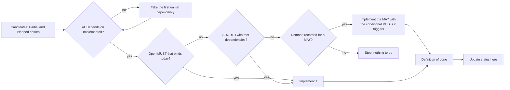

# CAEKit specification

This page is the requirement list of CAEKit. Every requirement has a stable identifier, a
priority, a status checked against the repository, measurable acceptance criteria, the test
or reference that verifies it, its dependencies and the section of the
[blueprint](blueprint.md) that governs its design. The [landscape](landscape.md) gives the
context of comparable systems; the blueprint gives the target architecture and the build
order; this page states what must be true and how to show it.

Repository rules that bind every change are in [AGENTS.md](../../AGENTS.md). The model and
result documents are defined in [model.md](../model.md); the crates and their layering in
[ARCHITECTURE.md](../ARCHITECTURE.md); each physics kind on its page in
[docs/physics](../physics/). This page links to those pages and does not restate them.

## How to use this page

- **Implementing.** Pick the next requirement with the procedure in
  [Choosing the next requirement](#choosing-the-next-requirement), meet its acceptance
  criteria, and finish with [Definition of done](#definition-of-done).
- **Reviewing.** A change that touches an area cites the identifiers it satisfies or
  changes. A change that weakens an Implemented MUST is wrong unless it is a new schema
  version with a migration ([SPEC-DOC-009](#spec-doc-009)).
- **Citing.** Refer to a requirement by its identifier, for example `SPEC-DET-003`. The
  heading anchor is the lower-case identifier (`#spec-det-003`). Identifiers are never
  reused or renumbered; a withdrawn requirement keeps its heading with status
  `Withdrawn` and the reason.
- **Status.** Each Status was checked at the commit that last changed its entry; an entry
  that no later commit has changed was checked at commit `e07f793`. A change that
  alters a status updates it here in the same change.
- **Citing in a change.** A change that implements a requirement names its identifier in
  the commit body ([SPEC-AIA-008](#spec-aia-008)).

## Contents

- [Conventions](#conventions)
- [Document contract](#document-contract) (`DOC`)
- [Physics kinds](#physics-kinds) (`PHY`)
- [Discretization](#discretization) (`DIS`)
- [Solvers](#solvers) (`SOL`)
- [Convergence and failure](#convergence-and-failure) (`CNV`)
- [Conservation](#conservation) (`CON`)
- [Verification](#verification) (`VER`)
- [Determinism](#determinism) (`DET`)
- [Outputs and interoperability](#outputs-and-interoperability) (`OUT`)
- [Bindings](#bindings) (`BND`)
- [Extensibility](#extensibility) (`EXT`)
- [Documentation evidence](#documentation-evidence) (`EVD`)
- [Automation by AI assistants](#automation-by-ai-assistants) (`AIA`)
- [Non-goals](#non-goals)
- [Summary of MUST requirements](#summary-of-must-requirements)
- [Choosing the next requirement](#choosing-the-next-requirement)
- [Definition of done](#definition-of-done)
- [References](#references)

## Conventions

### Keywords

The key words MUST, MUST NOT, REQUIRED, SHALL, SHALL NOT, SHOULD, SHOULD NOT, RECOMMENDED,
MAY and OPTIONAL are to be interpreted as described in BCP 14 (RFC 2119, RFC 8174) when,
and only when, they appear in capitals.

- **MUST**: without it CAEKit does not meet its stated purpose, to validate versioned JSON
  models, solve them with checked reference solvers and return a reproducible run report
  from the same solver natively, from Python and in WebAssembly. Most MUSTs already hold
  and are listed so that no later change weakens them.
- **SHOULD**: high value for that purpose at proportionate cost. Deviation needs a stated
  reason in the change.
- **MAY**: a legitimate extension, done when demand or a dependent requirement needs it.
- **Conditional MUST**: a MUST that starts to bind when the construct it names exists,
  written "When … exists, it MUST …". Until then its status is Planned and it blocks
  nothing. Once the construct exists, the entry binds like an unconditional MUST.
- **MUST inside a SHOULD or MAY entry**: a clause that binds whenever the optional
  construct of that entry is built, for example "`check` MUST stay the authority" in
  [SPEC-AIA-001](#spec-aia-001). It is part of that entry's acceptance and does not raise
  the entry's priority. A prohibition that binds today is written as its own priority,
  for example "MUST (no kernel state); MAY (studies)" in [SPEC-DOC-013](#spec-doc-013).

### Status values

| Status | Meaning |
| --- | --- |
| Implemented | The repository contains it; the cited path shows where. |
| Partial | Some of it exists; the entry names the gap and the path that shows it. |
| Planned | It does not exist; the cited path shows where its absence was checked or where it will live. |
| Withdrawn | No longer required; the entry keeps the reason. |

Every Status line starts with exactly one of these four values followed by a full stop;
qualifiers follow in the next sentence.

Where an acceptance criterion can only be decided once another requirement exists, the
Acceptance field is split into **Now:** (criteria that a check decides on today's tree)
and **Once [SPEC-…]:** (criteria that start to apply when that requirement is
Implemented). Implemented means that the Now criteria pass; the Once criteria are tracked
by the named requirement and do not make the entry depend on it.

Paths are relative to the repository root. A `file:line` reference is to the commit at
which its entry was last checked and may drift; the named item (function, enum, test) is
authoritative.

### Entry fields

Every requirement has these fields.

| Field | Content |
| --- | --- |
| Requirement | One normative statement in bold, followed by its details |
| Priority | MUST, SHOULD or MAY |
| Status | One value of the table above, with a path |
| Rationale | Why the requirement exists |
| Acceptance | Criteria that a test, a script or an inspection can decide |
| Verified by | The test, script or reference that decides them, existing or to be written |
| Depends on | Identifiers that must be Implemented before work on this entry starts, or `—`; an entry that is already Implemented stays so while a dependency is Partial only for a missing test of behaviour that exists, and that dependency's Status names the test |
| Governed by | The section of the [blueprint](blueprint.md) that holds the design |

### Physical conventions

Units and sign conventions are those of [AGENTS.md](../../AGENTS.md) and
[model.md › Outputs](../model.md#outputs), where each quantity is defined; this page does
not restate them. Requirements below that introduce a quantity name its sign and unit.

## Document contract

The model document is the only input of the kernel and the run report its only output.
Their fields are defined in [model.md](../model.md); the requirements here fix what may
and may not change.

### SPEC-DOC-001

**Strict, versioned model document.** A model MUST be UTF-8 JSON whose integer
`schema_version` is read before any other field; unknown versions, fields, physics kinds,
condition kinds and output names MUST be errors.

- Priority: MUST
- Status: Implemented. The reference-model tests inject an unknown key at every
  object level, including defaulted settings, and reject unknown discriminants,
  output names and schema versions. They also check that the version error takes
  precedence over invalid outputs.
- Rationale: a digest and a frozen meaning are only defined for a document that cannot carry
  ignored content.
- Acceptance: for every reference model, adding an unknown key at any object level, setting
  `schema_version` to 2, or using an unknown `kind` returns an error and no report.
- Verified by: `crates/caekit/tests/model_identity.rs`
  (`reference_models_reject_unknown_fields_discriminants_and_versions`).
- Depends on: —
- Governed by: [blueprint § 4. Document-to-report pipeline](blueprint.md#4-document-to-report-pipeline)

### SPEC-DOC-002

**SI units with unit-suffixed keys.** Every dimensional numeric model key MUST name its SI
unit as a suffix (`length_m`, `young_modulus_pa`, `inward_heat_flux_w_m2`), and `units`
MUST be `si`. The existing `absolute_residual_tolerance` of a linear settings block
inherits its unit from the stage, as defined in [model.md](../model.md).

- Priority: MUST
- Status: Implemented. The typed reference models, including defaulted fields, are
  checked for SI units, unit suffixes and explicit exceptions.
- Rationale: a unit carried by the key cannot be lost when a document is edited by hand,
  generated or patched.
- Acceptance: a test walks the serialized form of every reference model and fails on any
  numeric leaf whose key lacks a suffix from a closed list of unit suffixes kept next to
  the test. Dimensionless keys and inherited residual units are explicit exceptions.
- Verified by: `crates/caekit/tests/model_identity.rs`
  (`reference_models_use_si_and_unit_suffixed_numeric_keys`).
- Depends on: —
- Governed by: [blueprint § 4. Document-to-report pipeline](blueprint.md#4-document-to-report-pipeline)

### SPEC-DOC-003

**Model digest.** Every report MUST carry `model_sha256`, the SHA-256 of the compact
serialization of the typed model with defaults applied.

- Priority: MUST
- Status: Implemented. `crates/caekit/src/lib.rs:49` hashes `serde_json::to_vec(model)`;
  `crates/caekit/tests/model_identity.rs` freezes the digest of every reference model.
- Rationale: a reproducible report must name exactly what was run; the digest is also the
  cache key of external drivers ([SPEC-DET-013](#spec-det-013)).
- Acceptance: whitespace and object-key order do not change the digest; array order and
  any changed input do; the frozen digests of `examples/*.json` match.
- Verified by: `crates/caekit/tests/model_identity.rs`
  (`reference_models_keep_their_version_1_digest`, `the_digest_ignores_formatting_and_key_order`).
- Depends on: [SPEC-DOC-001](#spec-doc-001)
- Governed by: [blueprint § 13.3 Digest of fields added after the freeze](blueprint.md#133-digest-of-fields-added-after-the-freeze)

### SPEC-DOC-004

**Opt-in invariance of version 1.** For every document D valid before a change C:
decoding D MUST give the same typed value, serializing it MUST give the same bytes and
digest, its report MUST have the same key set with values inside the agreement contract
of [SPEC-DET-002](#spec-det-002), and a new key or value MUST appear only when D contains a
construct introduced by C.

- Priority: MUST
- Status: Implemented. The reference tests check compact model bytes against the
  frozen SHA-256 and round-trip them byte for byte. The committed report snapshot
  captures keys, output order and semantic labels from the v1 CLI for converged
  and stopped variants of each kind. Analytical and cross-target tests check values.
- Rationale: [AGENTS.md](../../AGENTS.md) freezes the meaning of version 1. A new optional
  field is serialized only when present (`#[serde(default, skip_serializing_if =
  "Option::is_none")]`), including inside the settings blocks `linear_solver`,
  `physics.coupling_solver` and `physics.thermal_solver`, which are always serialized with
  their defaults.
- Acceptance: (1) byte equality of `serialize(decode(D))` with the bytes hashed before C for
  every reference model; (2) a committed key-set snapshot of each reference report and of
  one non-converging variant per kind, compared in CI; (3) changing a default, a sign, a
  unit, a sample location, a key or value name, the order of `Output` variants, the default
  algorithm or stopping rule of an existing stage, or the digest construction fails one of
  these tests or [SPEC-DOC-003](#spec-doc-003).
- Verified by: `crates/caekit/tests/model_identity.rs`, with
  `crates/caekit/tests/common/report_contract_v1.json`, and the reference value tests.
- Depends on: [SPEC-DOC-003](#spec-doc-003)
- Governed by: [blueprint § 13.2 Opt-in invariance](blueprint.md#132-opt-in-invariance)

### SPEC-DOC-005

**Input errors name their path.** An input problem MUST return
`Error::invalid(path, message)` with the dotted JSON path of the field, or `Error::Json`
for a document that does not decode, and MUST NOT produce a report.

- Priority: MUST
- Status: Implemented. The rejection tests match the structured path on
  `Error::InvalidModel` and check the error variant on decoding failures. CLI
  tests check the displayed field, exit code and absence of a report.
- Rationale: a person or a program can only repair what is located.
- Acceptance: every rejection test asserts the path, for example
  `physics.mesh.cells[3]`; computed-value violations (a solved temperature at or below
  0 K) keep `InvalidModel` with a descriptive path as in version 1.
- Verified by: rejection tests in `crates/caekit/tests/<kind>.rs`; CLI exit code 1 in
  `crates/caekit-cli/tests/reference_cases.rs`.
- Depends on: [SPEC-DOC-001](#spec-doc-001)
- Governed by: [blueprint § 14. Errors and failure taxonomy](blueprint.md#14-errors-and-failure-taxonomy)

### SPEC-DOC-006

**No panic from any input.** No byte sequence passed to `Model::from_json` or model passed
to `solve` MUST cause a panic; `expect` and `unreachable!` MUST only state an invariant
that earlier validation established, and their message MUST name it.

- Priority: MUST
- Status: Implemented. The bounded mutation tests exercise the byte reader and the
  solver independently with fixed budgets and seeds. The standalone CI job runs
  them and the [model page](../model.md#input-mutation-checks) gives the counts
  and command.
- Rationale: the kernel runs inside hosts (Python, browsers) where a panic is a crash or an
  opaque trap.
- Acceptance: a fuzz target over `Model::from_json` and `solve` with small iteration
  budgets runs in a non-required CI job whose definition fixes the number of executions
  per target; the job fails on any panic; that number and the command that reproduces the
  run are recorded on [model.md](../model.md); every `expect` message names an invariant.
- Verified by: `crates/caekit/tests/model_mutations.rs`, the `model-mutations` job
  in `.github/workflows/verify.yml`, and review of the library's `expect` sites.
- Depends on: [SPEC-DOC-005](#spec-doc-005)
- Governed by: [blueprint § 14. Errors and failure taxonomy](blueprint.md#14-errors-and-failure-taxonomy)

### SPEC-DOC-007

**Typed, hashed solver settings.** Every numerical setting that affects a result MUST be a
typed, validated field of the model, covered by the digest; free-form option strings,
settings read from the environment, and automatic method selection that is not a pure,
reported function of the typed model MUST NOT exist.

- Priority: MUST
- Status: Implemented. `linear_solver`, `physics.coupling_solver` (`cooling_channel`) and
  `physics.thermal_solver` (`thermoelastic_solid`) are typed blocks ([model.md ›
  Numerical stages](../model.md#numerical-stages)).
- Rationale: the same document must mean the same computation on every surface.
- Acceptance: Now: every setting named in a stage's `Settings` column of the model page is
  a typed field with a range check and a path in its error;
  `grep -rnE "std::env::var|env::var" crates/caekit/src crates/caekit-mesh/src crates/caekit-numerics/src crates/caekit-mechanics/src crates/caekit-thermal/src crates/caekit-fluids/src crates/caekit-types/src`
  prints nothing. Once [SPEC-DET-004](#spec-det-004): the Clippy list forbids `std::env::var*`
  in library crates.
- Verified by: rejection tests per kind; the `grep` above; [SPEC-DET-004](#spec-det-004).
- Depends on: [SPEC-DOC-001](#spec-doc-001)
- Governed by: [blueprint § 9.1 Linear systems](blueprint.md#91-linear-systems)

### SPEC-DOC-008

**Canonical model output.** The kernel SHOULD expose the exact bytes that are hashed, as
`Model::canonical_json` and the command `caekit canonicalize`, with thin binding
functions.

- Priority: SHOULD
- Status: Planned. `crates/caekit-cli/src/main.rs` has only `check` and `run`; `check`
  returns the schema version and mesh metrics (`ModelCheck`, `crates/caekit/src/model.rs:123`),
  not the defaulted model.
- Rationale: users see the applied defaults, and a third party can recompute
  `model_sha256` with any SHA-256 tool.
- Acceptance: for every reference model, SHA-256 of the canonical output equals the
  report's `model_sha256`; canonicalizing the canonical output is the identity.
- Verified by: CLI test in `crates/caekit-cli/tests/`; binding tests.
- Depends on: [SPEC-DOC-003](#spec-doc-003)
- Governed by: [blueprint § 4. Document-to-report pipeline](blueprint.md#4-document-to-report-pipeline)

### SPEC-DOC-009

**Version 2 only with a migration.** When a change of meaning is needed, it MUST come as a
new schema version with frozen version 1 code, a total and tested migration from version 1,
and separate model and result schema version constants.

- Priority: MUST (conditional: binds when the first change of meaning is proposed)
- Status: Planned. Only version 1 exists (`crates/caekit/src/model.rs`).
- Rationale: [AGENTS.md](../../AGENTS.md) forbids changing what an existing document means.
- Acceptance: `migrate_v1_to_v2` is total on the version 1 types; on every reference model
  `solve(v1)` and `solve(migrate(v1))` agree within [SPEC-DET-002](#spec-det-002); version 1
  documents keep producing version 1 reports until a documented deprecation window ends;
  one generated JSON Schema file per version ([SPEC-AIA-001](#spec-aia-001)).
- Verified by: migration tests to be written per reference model.
- Depends on: [SPEC-DOC-004](#spec-doc-004)
- Governed by: [blueprint § 13.5 Version 2](blueprint.md#135-version-2)

### SPEC-DOC-010

**One register of version 2 candidates.** Changes that are wanted but forbidden in version
1 SHOULD be collected in one section of [model.md](../model.md), not scattered over pages.

- Priority: SHOULD
- Status: Planned. No such section exists in `docs/model.md`.
- Rationale: one fact, one home; a later schema version starts from a known list.
- Acceptance: the section exists and lists, as candidates: RFC 6901 pointers as the primary
  error path, a `cause` on every stage, an orthogonal `analysis` section with steps,
  external mesh references, RFC 8785 canonicalization of the digest, default algorithm
  changes, relative imbalance as a report field, diagnostics on the existing breakdown
  exits without an opt-in ([SPEC-CNV-007](#spec-cnv-007)), and any `StopReason` widening.
- Verified by: inspection; `node scripts/check-docs.mjs` for its links.
- Depends on: —
- Governed by: [blueprint § 13.5 Version 2](blueprint.md#135-version-2)

### SPEC-DOC-011

**Sibling documents.** Capability records, refinement-study documents and assessment
documents SHOULD each carry their own `schema_version` and `deny_unknown_fields`, and
reference run reports by `model_sha256` and `solver_version`, without changing the model or
the run report.

- Priority: SHOULD
- Status: Planned. No sibling document type exists (`crates/caekit/src/`).
- Rationale: evidence and credibility statements need a home that does not touch the frozen
  version 1 report.
- Acceptance: each sibling type rejects unknown fields; its digest references resolve to
  reports in the same study; adding it leaves [SPEC-DOC-004](#spec-doc-004) green.
- Verified by: tests of each sibling type.
- Depends on: [SPEC-DOC-004](#spec-doc-004)
- Governed by: [blueprint § 13.6 Sibling documents](blueprint.md#136-sibling-documents)

### SPEC-DOC-012

**External mesh by content hash.** A model MAY reference a mesh by `{ sha256, format }`
instead of inline arrays; the host MUST then supply the bytes, and the kernel MUST verify
the hash before decoding.

- Priority: MAY
- Status: Planned. Meshes are inline only (`crates/caekit-mesh/src/tetra.rs`,
  `docs/model.md`).
- Rationale: large meshes without bloating documents; the library reads no files
  ([SPEC-DET-001](#spec-det-001)), so the digest still covers the geometry through the
  hash.
- Acceptance: a wrong hash is an input error with the path of the reference; the digest of
  the model changes when the referenced bytes change; inline documents keep their digest.
- Verified by: tests with an in-memory resource map.
- Depends on: [SPEC-DOC-004](#spec-doc-004), [SPEC-OUT-006](#spec-out-006)
- Governed by: [blueprint § 4.1 Ownership and memory](blueprint.md#41-ownership-and-memory)

### SPEC-DOC-013

**Parameter studies outside the kernel.** Sweeps, sensitivities and optimization loops MAY
be described by sibling documents that reference models by digest; the kernel MUST NOT
hold state between runs.

- Priority: MUST (no kernel state); MAY (studies)
- Status: Implemented. `caekit::solve` is a pure function of one model
  (`crates/caekit/src/lib.rs`), and the library crates' `src` contains no `static mut`,
  `thread_local!`, `OnceLock`, `OnceCell` or `LazyLock` (the `grep` of the Acceptance). The
  study clause (MAY) is Planned.
- Rationale: outer loops belong to drivers ([SPEC-OUT-008](#spec-out-008)); state kept
  between runs would make a report depend on earlier calls (NG-09 in
  [Non-goals](#non-goals)).
- Acceptance: Now: `grep -rnE "static mut|thread_local!|OnceLock|OnceCell|LazyLock"` over
  the library crates' `src` prints nothing. Once a study
  document exists: running the same study twice yields reports with identical digests and
  values within [SPEC-DET-002](#spec-det-002).
- Verified by: the `grep` above; study tests when a study document exists.
- Depends on: [SPEC-DOC-011](#spec-doc-011) (study clause only)
- Governed by: [blueprint § 13.6 Sibling documents](blueprint.md#136-sibling-documents)

## Physics kinds

A physics kind is one variant of `Physics` in `crates/caekit/src/model.rs`. The kinds of
today are steady or static and linear; the candidates below are each a new kind, so none
changes an existing digest. Each candidate names the independent analytical reference that
must exist before it is merged ([SPEC-VER-001](#spec-ver-001)).

### SPEC-PHY-001

**The seven version 1 kinds keep their contract.** `axial_bar`, `laminar_channel`,
`cooling_channel`, `elastic_solid`, `heat_conduction`, `multimaterial_heat_conduction` and
`thermoelastic_solid` MUST keep their inputs, stages, outputs, balances and digests.

- Priority: MUST
- Status: Implemented. `enum Physics` in `crates/caekit/src/model.rs`; pages
  [axial-bar](../physics/axial-bar.md), [laminar-channel](../physics/laminar-channel.md),
  [cooling-channel](../physics/cooling-channel.md),
  [elastic-solid](../physics/elastic-solid.md),
  [heat-conduction](../physics/heat-conduction.md),
  [multimaterial-heat-conduction](../physics/multimaterial-heat-conduction.md),
  [thermoelastic-solid](../physics/thermoelastic-solid.md).
- Rationale: these are the reference cases on which every other claim rests.
- Acceptance: Now: the frozen digests of `crates/caekit/tests/model_identity.rs`, the
  library tests and [SPEC-DET-002](#spec-det-002) pass for all seven `examples/<kind>.json`.
  Once [SPEC-DOC-004](#spec-doc-004): its round-trip and key-set tests also pass for them.
- Verified by: `crates/caekit/tests/<kind>.rs`, `crates/caekit/tests/model_identity.rs`,
  `scripts/verify-reference-cases.mjs`.
- Depends on: —
- Governed by: [blueprint § 1.1 What exists today](blueprint.md#11-what-exists-today)

### SPEC-PHY-002

**Admission of a kind.** A new kind MUST arrive with its physics page, example, library
test with an independently derived analytical reference, refinement study where the
discretization has error, CLI test, reference verifier entry, frozen digest, README rows,
provenance entry and changelog entry, in the same change.

- Priority: MUST
- Status: Implemented. `scripts/check-docs.mjs` fails when any of the page, example,
  library test, identity digest, CLI test, verifier entry or README rows is missing for a
  `Physics` variant; the remaining items are in the [AGENTS.md](../../AGENTS.md) change
  table.
- Rationale: a kind without its evidence is an unchecked solver.
- Acceptance: `node scripts/check-docs.mjs` passes; the library test of each new kind
  contains the reference, the refinement study and rejected inputs
  ([SPEC-VER-002](#spec-ver-002)). The rule binds new kinds; the missing `elastic_solid`
  study is tracked by SPEC-VER-002 and does not block it.
- Verified by: `scripts/check-docs.mjs`; review against the AGENTS.md table.
- Depends on: [SPEC-VER-001](#spec-ver-001)
- Governed by: [blueprint § 18. Playbook: adding a physics kind](blueprint.md#18-playbook-adding-a-physics-kind)

### SPEC-PHY-003

**Assumptions, signs and limits per kind.** Each kind MUST state its assumptions, the sign
and direction of every input, output and balance term, and its validity limits, in the
rustdoc of the type and on its physics page.

- Priority: MUST
- Status: Implemented. Limits such as omitted channel side walls, entrance effects,
  turbulence, phase change, contact, large deformation and tetrahedral stiffness in bending
  are stated on the pages in `docs/physics/`; signs are stated in [model.md ›
  Outputs](../model.md#outputs).
- Rationale: a convention never changes within a schema version, so it must be written
  where it is defined.
- Acceptance: every output row and balance term of a kind has a sign statement reachable
  from its physics page; once capability records exist the statement is also data
  ([SPEC-EVD-005](#spec-evd-005)).
- Verified by: review; `scripts/check-docs.mjs` (page existence and kind naming).
- Depends on: —
- Governed by: [blueprint § 6. Mathematics by physics family](blueprint.md#6-mathematics-by-physics-family)

### SPEC-PHY-004

**New analyses are new kinds in version 1.** A transient, modal, buckling or other new
analysis type MUST be a new kind; an optional `analysis` field on an existing kind MUST NOT
be added in version 1.

- Priority: MUST
- Status: Implemented. No existing kind has an analysis selector (`crates/caekit/src/model.rs`).
- Rationale: an analysis field would change the stages and outputs of a frozen kind and
  break the one-kind, one-page, one-reference structure that the documentation check
  relies on. An orthogonal analysis section with ordered steps is a version 2 candidate
  ([SPEC-DOC-010](#spec-doc-010)).
- Acceptance: Now: no existing `Physics` variant has a field that selects an analysis type
  (inspection of `enum Physics` in `crates/caekit/src/model.rs`) and the frozen digests
  pass. Once [SPEC-DOC-004](#spec-doc-004): no existing variant gains a field that changes
  its stage list, as its key-set snapshots show.
- Verified by: review; [SPEC-DOC-004](#spec-doc-004) key-set snapshots.
- Depends on: —
- Governed by: [blueprint § 13.4 Analysis types](blueprint.md#134-analysis-types)

### SPEC-PHY-005

**Frozen numerical choices of a kind.** When a kind uses a stabilization, a pressure gauge,
an outflow condition or an upwinding rule, its constants and forms MUST be decided,
documented and frozen before the first release that contains the kind.

- Priority: MUST (conditional; the construct exists in `cooling_channel`)
- Status: Implemented. `cooling_channel` uses first-order upwind finite-volume fluxes for the
  fluid energy equation, stated on [its page](../physics/cooling-channel.md), and
  `thermal_mesh_refinement_recovers_first_order_enthalpy_advection`
  (`crates/caekit/tests/cooling_channel.rs`) fixes its first order. No kind uses a
  stabilization, a pressure gauge or an outflow condition.
- Rationale: these choices are part of a kind's meaning and cannot be corrected in version 1.
- Acceptance: the physics page states each form and constant (for SUPG: the `τ` formula and
  the element length `h_e`; for upwinding: the face value taken from the upstream cell) and
  a test fixes it.
- Verified by: the kind's library test.
- Depends on: —
- Governed by: [blueprint § 6. Mathematics by physics family](blueprint.md#6-mathematics-by-physics-family)

### SPEC-PHY-006

**Thermal network kind.** CAEKit MAY add `thermal_network`: conductances, sources and fixed
temperatures on a graph without a mesh.

- Priority: MAY
- Status: Planned.
- Rationale: lowest-risk new kind; reuses the graph Laplacian and conjugate gradient.
- Acceptance: series and parallel networks match exact rational solutions; a component
  without a fixed temperature is rejected with its path; the energy balance closes per node.
- Verified by: `crates/caekit/tests/thermal_network.rs` (to be written).
- Depends on: [SPEC-PHY-002](#spec-phy-002), [SPEC-DET-003](#spec-det-003) (for any
  transcendental conductance such as a fin `tanh`)
- Governed by: [blueprint § 6.2 Thermal and hydraulic networks](blueprint.md#62-thermal-and-hydraulic-networks)

### SPEC-PHY-007

**Transient heat conduction.** CAEKit MAY add `transient_heat_conduction` with fixed-step
backward Euler and BDF2 ([SPEC-SOL-013](#spec-sol-013)) and outputs at listed step indices.

- Priority: MAY
- Status: Planned.
- Rationale: the first transient kind whose time error can be separated from the space
  error exactly.
- Acceptance: a lumped body matches its exponential decay; a single discrete sine mode of
  the semi-discrete system gives temporal orders 1 (BE) and 2 (BDF2) by least-squares fit
  ([SPEC-VER-003](#spec-ver-003)); one case with time-dependent Dirichlet data exposes
  order reduction; the per-step energy balance closes to rounding
  ([SPEC-CON-008](#spec-con-008)).
- Verified by: `crates/caekit/tests/transient_heat_conduction.rs` (to be written).
- Depends on: [SPEC-SOL-013](#spec-sol-013), [SPEC-CON-008](#spec-con-008),
  [SPEC-DET-009](#spec-det-009), [SPEC-OUT-004](#spec-out-004), [SPEC-VER-003](#spec-ver-003)
- Governed by: [blueprint § 8. Time integration](blueprint.md#8-time-integration)

### SPEC-PHY-008

**Modal analysis of solids.** CAEKit MAY add `modal_elastic_solid`: consistent mass, the
lowest k modes confirmed by an inertia count, participation factors and effective mass.

- Priority: MAY
- Status: Planned.
- Rationale: the most common structural analysis missing today; introduces the mass matrix
  reused by dynamics.
- Acceptance: bar and cantilever modes match closed-form frequencies; eigenvalue error
  converges at order `2p` for degree-`p` elements on the second-order elasticity operator
  (Babuška and Osborn 1989); the Sturm count confirms that no mode below the highest
  reported one is missing; effective modal mass is reported as a quantity, not as a
  conservation balance.
- Verified by: `crates/caekit/tests/modal_elastic_solid.rs` (to be written).
- Depends on: [SPEC-SOL-006](#spec-sol-006), [SPEC-SOL-014](#spec-sol-014),
  [SPEC-DIS-005](#spec-dis-005)
- Governed by: [blueprint § 6.7 Structural eigenproblems: modal and buckling](blueprint.md#67-structural-eigenproblems-modal-and-buckling)

### SPEC-PHY-009

**Linear buckling.** CAEKit MAY add `buckling_elastic_solid` with a geometric stiffness
from a prestress stage.

- Priority: MAY
- Status: Planned.
- Rationale: a small increment over modal analysis.
- Acceptance: the Euler column load is recovered with a measured order under refinement;
  the prestress stage reports its own `Convergence`.
- Verified by: library test (to be written).
- Depends on: [SPEC-PHY-008](#spec-phy-008)
- Governed by: [blueprint § 6.7 Structural eigenproblems: modal and buckling](blueprint.md#67-structural-eigenproblems-modal-and-buckling)

### SPEC-PHY-010

**Joule heating.** CAEKit MAY add `joule_heating`, first one-way, then two-way with an
electric conductivity `σ(T)`, in a new domain crate `caekit-electric`.

- Priority: MAY
- Status: Planned. No electric domain crate exists (`Cargo.toml` members).
- Rationale: the cheapest two-way coupling with an exact nonlinear reference on arbitrary
  tetrahedral meshes.
- Acceptance: a 1D bar matches its closed form; the Kohlrausch potential–temperature
  relation holds on an arbitrary mesh between equipotential, isothermal electrodes; a lumped
  case with `h A ≤ I² R₀ β_R` (no steady state, derived from the linear resistance law
  `R = R₀(1 + β_R ΔT)` against convective loss `h A ΔT`) ends as non-convergence with cause
  `no_steady_state` ([SPEC-CNV-015](#spec-cnv-015)); electric power computed as terminal
  sum and as volume integral agree to the solver tolerance.
- Verified by: `crates/caekit/tests/joule_heating.rs` (to be written).
- Depends on: [SPEC-SOL-010](#spec-sol-010), [SPEC-CON-009](#spec-con-009),
  [SPEC-EXT-003](#spec-ext-003)
- Governed by: [blueprint § 6.14 Joule heating](blueprint.md#614-joule-heating)

### SPEC-PHY-011

**Channel with a computed film coefficient.** CAEKit MAY add a conjugate channel kind that
solves the transverse fluid energy equation on the existing channel grid instead of taking
a prescribed film coefficient.

- Priority: MAY
- Status: Planned. `cooling_channel` takes a prescribed film coefficient
  ([cooling-channel](../physics/cooling-channel.md)), and its meaning is frozen.
- Rationale: removes the largest modelling assumption of the coupled channel.
- Acceptance: the fully developed Nusselt number based on the hydraulic diameter `2·gap`
  converges to `140/17` with both walls at uniform heat flux and to `70/13` with one wall at
  uniform flux and the other adiabatic, both derived on the physics page from the parabolic
  velocity profile; the refinement order is measured.
- Verified by: library test (to be written).
- Depends on: [SPEC-PHY-002](#spec-phy-002)
- Governed by: [blueprint § 6.12 Conjugate heat transfer](blueprint.md#612-conjugate-heat-transfer)

### SPEC-PHY-012

**Thermal radiation.** CAEKit MAY add a radiation boundary condition and a radiation
enclosure with user view factors.

- Priority: MAY
- Status: Planned.
- Rationale: first nonlinear stage with clean scalar references.
- Acceptance: view factors are validated for reciprocity and summation with stated
  tolerances; parallel plates, concentric cylinders and concentric spheres match their
  closed forms; the enclosure balance `Σ Q_i` closes; `T⁴` is evaluated as `(t·t)·(t·t)`
  ([SPEC-DET-003](#spec-det-003)).
- Verified by: library test (to be written).
- Depends on: [SPEC-SOL-011](#spec-sol-011)
- Governed by: [blueprint § 6.3 Radiation enclosures](blueprint.md#63-radiation-enclosures)

### SPEC-PHY-013

**Convection–diffusion.** CAEKit MAY add convection–diffusion with a prescribed velocity on
tetrahedra, stabilized by SUPG with frozen `τ` and `h_e` ([SPEC-PHY-005](#spec-phy-005)).

- Priority: MAY
- Status: Planned.
- Rationale: introduces nonsymmetric systems.
- Acceptance: the 1D exponential boundary-layer solution; a manufactured solution at mesh
  Péclet number below 1 with measured order; an overshoot diagnostic reported as a quantity.
- Verified by: library test (to be written).
- Depends on: [SPEC-SOL-008](#spec-sol-008), [SPEC-DIS-002](#spec-dis-002)
- Governed by: [blueprint § 6.10 Convection–diffusion with prescribed velocity](blueprint.md#610-convectiondiffusion-with-prescribed-velocity)

### SPEC-PHY-014

**Stokes and laminar Navier–Stokes.** CAEKit MAY add Stokes flow with Taylor–Hood P2–P1
elements, then steady Navier–Stokes (Picard, then Newton), monolithic conjugate heat
transfer and Boussinesq buoyancy.

- Priority: MAY
- Status: Planned.
- Rationale: general laminar flow; finite elements are preferred over a finite-volume
  pressure-correction scheme whose Rhie–Chow interpolation depends on relaxation factors.
- Acceptance: Poiseuille flow is reproduced exactly; duct-series references; a manufactured
  solution gives velocity H¹ order 2 and pressure L² order 2.
- Verified by: library tests (to be written).
- Depends on: [SPEC-DIS-005](#spec-dis-005), [SPEC-SOL-008](#spec-sol-008)
- Governed by: [blueprint § 6.11 Stokes and Navier–Stokes](blueprint.md#611-stokes-and-navierstokes)

### SPEC-PHY-015

**Structural dynamics.** CAEKit MAY add implicit structural dynamics with Newmark average
acceleration and generalized-α ([SPEC-SOL-013](#spec-sol-013)).

- Priority: MAY
- Status: Planned.
- Rationale: transient structures with verified time integration.
- Acceptance: a single-degree-of-freedom oscillator and a bar match the modal solution;
  average acceleration conserves energy to rounding on a linear undamped system (exact for
  that scheme, derived on the page); the generalized-α spectral radius tends to the input
  `ρ∞` at large `ωΔt`.
- Verified by: library tests (to be written).
- Depends on: [SPEC-PHY-008](#spec-phy-008), [SPEC-SOL-013](#spec-sol-013)
- Governed by: [blueprint § 6.8 Structural dynamics](blueprint.md#68-structural-dynamics)

### SPEC-PHY-016

**Nonlinear solid mechanics.** CAEKit MAY add compressible neo-Hookean hyperelasticity
(total Lagrangian), arc-length continuation, J2 plasticity with a consistent tangent and
frictionless contact against a rigid plane.

- Priority: MAY
- Status: Planned.
- Rationale: the largest engineering value and the largest verification cost.
- Acceptance: homogeneous deformation states match closed forms; Newton converges
  quadratically near the solution ([SPEC-SOL-011](#spec-sol-011)); every residual passes a
  Taylor test ([SPEC-SOL-012](#spec-sol-012)); a limit point surfaces as non-convergence
  with cause `limit_point`, never as a last iterate.
- Verified by: library tests (to be written).
- Depends on: [SPEC-SOL-006](#spec-sol-006), [SPEC-SOL-011](#spec-sol-011),
  [SPEC-SOL-012](#spec-sol-012)
- Governed by: [blueprint § 6.6 Nonlinear solid mechanics](blueprint.md#66-nonlinear-solid-mechanics)

### SPEC-PHY-017

**Poroelasticity and two-way thermoelasticity.** CAEKit MAY add Biot consolidation with the
fixed-stress split and transient two-way thermoelasticity with the adiabatic split.

- Priority: MAY
- Status: Planned. `thermoelastic_solid` is one-way and steady
  ([thermoelastic-solid](../physics/thermoelastic-solid.md)).
- Rationale: coupled transient porous and thermal mechanics with SPD sub-blocks, so the
  existing conjugate gradient still applies.
- Acceptance: Terzaghi consolidation; a 0D coupled oscillator against the matrix
  exponential; the coupling-coefficient → 0 limit equals the one-way result; the
  consistent undrained or adiabatic initial state is its own stage.
- Verified by: library tests (to be written).
- Depends on: [SPEC-PHY-007](#spec-phy-007), [SPEC-SOL-010](#spec-sol-010)
- Governed by: [blueprint § 6.15 Poroelasticity](blueprint.md#615-poroelasticity)

### SPEC-PHY-018

**Prescribed temperature field for thermoelasticity.** CAEKit MAY add a kind that takes a
prescribed nodal temperature field instead of solving conduction.

- Priority: MAY
- Status: Planned.
- Rationale: enables benchmarks defined by a temperature field (NAFEMS LE11) as regression
  cases ([SPEC-VER-013](#spec-ver-013)).
- Acceptance: free expansion and axial restraint match the closed forms of the existing
  thermoelastic page.
- Verified by: library test (to be written).
- Depends on: [SPEC-PHY-002](#spec-phy-002)
- Governed by: [blueprint § 6.13 Thermoelasticity](blueprint.md#613-thermoelasticity)

### SPEC-PHY-019

**Structural elements.** CAEKit MAY add trusses, frames, Timoshenko beams and MITC plates
and shells.

- Priority: MAY
- Status: Planned. Only `axial_bar` exists among line elements.
- Rationale: structural breadth; shells have the weakest independent references.
- Acceptance: closed-form beam deflections including shear deformation; a shell reference
  only with a derivation on the page, never a remembered benchmark value.
- Verified by: library tests (to be written).
- Depends on: [SPEC-SOL-006](#spec-sol-006)
- Governed by: [blueprint § 6.5 Structural elements: truss, beam, plate, shell](blueprint.md#65-structural-elements-truss-beam-plate-shell)

### SPEC-PHY-020

**Turbulence only through cited correlations.** Turbulent effects MAY enter only as cited
correlations with checked validity ranges; a RANS or LES kind MUST NOT be added in version 1
([Non-goals](#non-goals)).

- Priority: MUST NOT (RANS or LES kind in version 1); MAY (cited correlations)
- Status: Implemented. No RANS or LES kind exists; all flow kinds are laminar
  ([laminar-channel](../physics/laminar-channel.md), `enum Physics` in
  `crates/caekit/src/model.rs`). The correlation clause (MAY) is Planned.
- Rationale: turbulence models have model-form error and no independent analytical
  reference.
- Acceptance: Now: `enum Physics` has no turbulence-model variant. Once a correlation
  exists: a correlation outside its cited Reynolds or Prandtl range is an input error with
  the path of the offending input.
- Verified by: review of `enum Physics`; the kind's rejection tests.
- Depends on: —
- Governed by: [blueprint § 6.17 Out of scope](blueprint.md#617-out-of-scope)

## Discretization

Today each domain crate assembles its own operators: linear line elements for the bar and
the wall, linear tetrahedra for conduction and elasticity, cell-centred finite volumes for
channel momentum and first-order upwind finite volumes for coolant transport
([ARCHITECTURE.md](../ARCHITECTURE.md), the pages in `docs/physics/`).

### SPEC-DIS-001

**Discretization and formal order stated per kind.** Each kind MUST state its element or
cell type, quadrature, unknown layout and the formal order of every reported quantity on its
physics page, with the source of the order.

- Priority: MUST
- Status: Implemented. Each page in `docs/physics/` names its discretization; measured
  orders are on the pages of the kinds that have a refinement study.
- Rationale: an order test needs a stated expected order and its source.
- Acceptance: every page names the discretization and, for each quantity with a refinement
  test, the expected and measured order and the command that reproduces it.
- Verified by: review; [SPEC-VER-002](#spec-ver-002).
- Depends on: —
- Governed by: [blueprint § 6.0 Expected orders for smooth solutions](blueprint.md#60-expected-orders-for-smooth-solutions)

### SPEC-DIS-002

**Shared finite-element layer.** Reference shapes, Lagrange tabulation, quadrature rules,
DOF maps, assembly drivers, constraint building, residual reactions, field sampling and
transfer operators SHOULD live in one crate, `caekit-fem`, between `caekit-mesh`/
`caekit-numerics` and the domain crates, and the port of the existing linear kernels SHOULD
be bit-identical.

- Priority: SHOULD
- Status: Planned. Kernels are assembled per crate from tetrahedron gradients
  (`crates/caekit-thermal/src/heat_conduction.rs`, `crates/caekit-mechanics/src/elastic_solid.rs`);
  the overlap transfer is private to `crates/caekit-thermal/src/interface.rs`.
- Rationale: quadratic elements and new kinds need one verified home for element and
  assembly code instead of copies per crate.
- Acceptance: every reference report is bit-identical before and after the port (equal
  report digests as defined in [SPEC-VER-008](#spec-ver-008), which include the iteration
  histories); the crate depends only on `caekit-mesh`, `caekit-numerics` and
  `caekit-types`; it contains no units, signs, material laws or boundary-condition
  semantics.
- Verified by: bit-identity test over the reference models; [SPEC-EXT-002](#spec-ext-002).
- Depends on: [SPEC-SOL-003](#spec-sol-003), [SPEC-DIS-006](#spec-dis-006),
  [SPEC-DET-003](#spec-det-003), [SPEC-VER-008](#spec-ver-008)
- Governed by: [blueprint § 3.1 Layers](blueprint.md#31-layers)

### SPEC-DIS-003

**Positive-weight quadrature with exactness tests.** When a quadrature rule beyond the
current closed-form and one-point integrals is added, it MUST have only positive weights,
its constants MUST be decimal literals with at least 17 significant digits reconstructed by
a test from their closed forms, and a test MUST show that it integrates every monomial up
to its stated degree exactly and fails at degree + 1.

- Priority: MUST (conditional)
- Status: Planned. No general rule table exists (`crates/caekit-mesh/src/tetra.rs`).
- Rationale: an order test relies on exact integration; negative weights (the 5-point
  degree-3 tetrahedron rule of Keast 1986, whose centroid weight is −0.8 of the volume; its
  11-point degree-4 rule also has a negative weight) can destroy positivity of mass
  matrices. Candidate rules, each with its source recorded in
  [provenance.md](../provenance.md): tetrahedron 1 point (degree 1), 4 points (degree 2)
  and 14 points (degree 5, Witherden and Vincent 2015; Keast's 14-point rule is only of
  degree 4); triangle 1, 3, 6 and 7 points (degrees 1, 2, 4, 5; Dunavant 1985, Witherden
  and Vincent 2015). 17 significant digits suffice to round-trip any binary64 value:
  `⌈1 + 53·log₁₀ 2⌉ = 17` (IEEE 754-2019).
- Acceptance: every added rule has only positive weights; a test reconstructs each
  constant from its closed form to the last bit; a test integrates every monomial up to the
  stated degree exactly and finds a nonzero error at degree + 1.
- Verified by: monomial exactness tests in `caekit-fem` (to be written).
- Depends on: [SPEC-DIS-002](#spec-dis-002)
- Governed by: [blueprint § 5.3 Reference elements and quadrature](blueprint.md#53-reference-elements-and-quadrature)

### SPEC-DIS-004

**Integration degree per form.** When quadrature is selected by degree, the degree MUST be
at least `2p − 2 + m` for stiffness, `2p + m` for mass and Robin terms and `p + q` for loads,
for element degree `p`, coefficient degree `m` and load degree `q` on affine cells, and at
least `2p + 3` for error norms in tests.

- Priority: MUST (conditional)
- Status: Planned.
- Rationale: on affine simplices the products of shape functions and gradients are
  polynomials of exactly these degrees; the error-norm margin keeps quadrature error below
  discretization error in order tests.
- Acceptance: a test assembles each form with the selected rule and with the next higher
  rule and finds identical matrices to rounding.
- Verified by: `caekit-fem` tests (to be written).
- Depends on: [SPEC-DIS-003](#spec-dis-003)
- Governed by: [blueprint § 5.3 Reference elements and quadrature](blueprint.md#53-reference-elements-and-quadrature)

### SPEC-DIS-005

**Quadratic tetrahedra.** P2 tetrahedra SHOULD be added through an optional
`discretization` field on `heat_conduction`, `multimaterial_heat_conduction`,
`elastic_solid` and `thermoelastic_solid`; absent means the version 1 linear element, and
reported fields keep the version 1 sample locations (vertices and centroids).

- Priority: SHOULD
- Status: Planned. Only linear tetrahedra exist (`crates/caekit-mesh/src/tetra.rs`).
- Rationale: the largest accuracy gain for existing physics and the documented remedy for
  the bending and near-incompressibility stiffness of linear tetrahedra
  ([elastic-solid](../physics/elastic-solid.md)).
- Acceptance: patch tests pass; a manufactured solution gives L² order 3 and H¹ order 2
  (Ciarlet 2002; Brenner and Scott 2008) within a derived band; documents without the field
  keep their digest ([SPEC-DOC-004](#spec-doc-004)); native and WASI agree
  ([SPEC-DET-002](#spec-det-002)).
- Verified by: `crates/caekit/tests/<kind>.rs` extensions.
- Depends on: [SPEC-DIS-002](#spec-dis-002), [SPEC-DIS-003](#spec-dis-003),
  [SPEC-VER-004](#spec-ver-004), [SPEC-DOC-004](#spec-doc-004)
- Governed by: [blueprint § 5.4 Spaces, DOF maps and fields](blueprint.md#54-spaces-dof-maps-and-fields)

### SPEC-DIS-006

**Deterministic DOF and entity numbering.** DOFs and mesh entities MUST be numbered by a
documented rule that depends only on the document: P1 DOF = vertex index; vector unknowns
node-major (`index = components · dof + c`); for P2, vertices first, then `nv + edge id`
with edges as `(min, max)` vertex pairs in ascending lexicographic order and faces as
sorted triples.

- Priority: MUST
- Status: Implemented. P1 unknowns use vertex and node-major layouts.
  `CheckedTetraMesh::entities` supplies global edge and face IDs and local
  maps, with no dependence on the boundary region order. The P2 numbering
  rule applies when P2 spaces are introduced.
- Rationale: numbering determines summation order and therefore bits
  ([SPEC-DET-006](#spec-det-006)).
- Acceptance: numbering is invariant under reordering of region lists; a test fixes the
  numbering of a small mesh.
- Verified by: `tetrahedral_entity_ids_follow_vertex_indices_and_ignore_region_order`
  in `caekit-mesh` and by the physics reference tests for the P1 layouts.
- Depends on: —
- Governed by: [blueprint § 5.2 Mesh and topology](blueprint.md#52-mesh-and-topology)

### SPEC-DIS-007

**Dirichlet conditions by symmetric elimination.** Prescribed values MUST be imposed by
symmetric elimination; penalty imposition MUST NOT be used; Nitsche's method MAY be used
only where elimination is impossible, with its parameter stated.

- Priority: MUST
- Status: Implemented. `ConstrainedSystem` in `crates/caekit-numerics/src/lib.rs`;
  `eliminates_prescribed_degrees_of_freedom_and_recovers_the_full_vector` in
  `crates/caekit-numerics/tests/sparse_system.rs`.
- Rationale: a penalty `β` adds `O(β)` to the condition number and `O(1/β)` consistency
  error.
- Acceptance: prescribed values appear exactly in the returned field; the reduced operator
  is symmetric.
- Verified by: `crates/caekit-numerics/tests/sparse_system.rs`.
- Depends on: —
- Governed by: [blueprint § 5.6 Boundary conditions and constraints](blueprint.md#56-boundary-conditions-and-constraints)

### SPEC-DIS-008

**Mechanisms are rejected, never regularized.** An operator with an unconstrained null
space MUST be rejected at validation with the path of the conditions, or handled through an
explicitly declared null space; silent regularization or automatic constraint addition MUST
NOT exist.

- Priority: MUST
- Status: Implemented. `elastic_solid` rejects supports that do not restrain all six rigid
  modes (`crates/caekit-mechanics/src/elastic_solid.rs:384`); conduction requires at least
  one `temperature` or `convection` condition (rustdoc of `prepare` in
  `crates/caekit-thermal/src/heat_conduction.rs`;
  [heat-conduction](../physics/heat-conduction.md)).
- Rationale: an automatically constrained mechanism hides a modelling error behind a
  plausible field.
- Acceptance: under-constrained cases return `InvalidModel` naming
  `physics.boundary_conditions` or the thermal equivalent.
- Verified by: `crates/caekit/tests/elastic_solid.rs`
  (`diagnoses_inverted_cells_duplicate_faces_and_underconstrained_modes`).
- Depends on: [SPEC-DOC-005](#spec-doc-005)
- Governed by: [blueprint § 5.6 Boundary conditions and constraints](blueprint.md#56-boundary-conditions-and-constraints)

### SPEC-DIS-009

**Mass lumping rule.** When a P2 mass matrix is lumped, it MUST use consistent mass or the
HRZ scheme (Hinton, Rock and Zienkiewicz 1976); row-sum lumping MUST NOT be used for P2.

- Priority: MUST (conditional)
- Status: Planned.
- Rationale: row sums of the P2 tetrahedron mass matrix give negative corner masses.
- Acceptance: lumped masses are positive and sum to the element mass; a test shows it.
- Verified by: `caekit-fem` test (to be written).
- Depends on: [SPEC-DIS-005](#spec-dis-005)
- Governed by: [blueprint § 5.3 Reference elements and quadrature](blueprint.md#53-reference-elements-and-quadrature)

### SPEC-DIS-010

**Pattern-first sparse assembly.** Assembly SHOULD move from per-row ordered maps to a
pattern built from the DOF map with numeric fill in insertion order, giving the same bits.

- Priority: SHOULD
- Status: Planned. `SparseAssembly` keeps one `BTreeMap` per row and
  `CsrMatrix::from_rows` drops explicit zeros (`crates/caekit-numerics/src/lib.rs`).
- Rationale: ordered-map accumulation costs `O(nnz log nnz)`, which matters at P2 sizes in
  the browser.
- Acceptance: for every reference model, matrices are bit-identical and report digests
  ([SPEC-VER-008](#spec-ver-008)) are equal; explicit zeros are dropped as before so that no
  product differs in the sign of a zero.
- Verified by: bit-identity test.
- Depends on: [SPEC-SOL-003](#spec-sol-003), [SPEC-VER-008](#spec-ver-008)
- Governed by: [blueprint § 5.5 Assembly](blueprint.md#55-assembly)

### SPEC-DIS-011

**Volumetric locking.** CAEKit MAY add an acceptance test at Poisson ratio 0.4999 and a
remedy (mixed `u/p` or B-bar on hexahedra).

- Priority: MAY
- Status: Planned. The limit is documented on [elastic-solid](../physics/elastic-solid.md).
- Rationale: correct near-incompressible solids.
- Acceptance: the Lamé thick cylinder at `ν = 0.4999` within a band derived on the page.
- Verified by: library test (to be written).
- Depends on: [SPEC-DIS-005](#spec-dis-005), [SPEC-SOL-008](#spec-sol-008)
- Governed by: [blueprint § 6.4 Linear elasticity](blueprint.md#64-linear-elasticity)

### SPEC-DIS-012

**Recovered stress as a separate output.** Superconvergent patch recovery (Zienkiewicz and
Zhu 1992) MAY be offered as a separately named output and MUST NOT replace the solved
centroid stress.

- Priority: MAY
- Status: Planned. Only centroid stress exists ([model.md › Outputs](../model.md#outputs)).
- Rationale: point-value comparisons need recovery; replacing the solved field would change
  a frozen output.
- Acceptance: recovered stress is exact for a linear stress field on a patch.
- Verified by: library test (to be written).
- Depends on: [SPEC-DIS-002](#spec-dis-002)
- Governed by: [blueprint § 5.4 Spaces, DOF maps and fields](blueprint.md#54-spaces-dof-maps-and-fields)

### SPEC-DIS-013

**Error estimates are labelled.** When an a posteriori error estimate is reported, it MUST
state whether it is a guaranteed bound or an indicator, and a reported bound MUST be tested
for an effectivity index `I_eff ≥ 1` on every reference.

- Priority: MUST (conditional)
- Status: Planned. No estimator exists.
- Rationale: an indicator presented as a bound overclaims accuracy.
- Acceptance: the output name or unit string carries the label; effectivity tests pass.
- Verified by: library tests (to be written).
- Depends on: —
- Governed by: [blueprint § 10.3 Discretization error estimators](blueprint.md#103-discretization-error-estimators)

### SPEC-DIS-014

**A posteriori estimators.** CAEKit MAY add a residual indicator and an equilibrated-flux
guaranteed bound for conduction (Prager and Synge 1947; Ern and Vohralík 2015) as opt-in
outputs.

- Priority: MAY
- Status: Planned.
- Rationale: discretization-error evidence for a user's own mesh.
- Acceptance: [SPEC-DIS-013](#spec-dis-013); the indicator's effectivity stays bounded
  under refinement on every reference.
- Verified by: library tests (to be written).
- Depends on: [SPEC-DIS-013](#spec-dis-013), [SPEC-DIS-005](#spec-dis-005)
- Governed by: [blueprint § 10.3 Discretization error estimators](blueprint.md#103-discretization-error-estimators)

### SPEC-DIS-015

**Bounded deterministic adaptivity.** h-adaptivity MAY be added as a study driver with
Dörfler marking and newest-vertex bisection; it MUST be bounded by a refinement level and a
DOF count and break marking ties by cell index.

- Priority: MAY
- Status: Planned.
- Rationale: efficient accuracy without non-reproducible meshes.
- Acceptance: the L-shaped domain recovers the optimal rate `N^{−p/d}`; repeated runs give
  identical meshes.
- Verified by: study tests (to be written).
- Depends on: [SPEC-DIS-014](#spec-dis-014), [SPEC-DIS-006](#spec-dis-006)
- Governed by: [blueprint § 10.4 Adaptivity](blueprint.md#104-adaptivity)

### SPEC-DIS-016

**Mesh quality split by effect.** Mesh metrics MAY separate interpolation-relevant measures
(largest dihedral angle) from conditioning-relevant ones (smallest angle), following
Shewchuk 2002.

- Priority: MAY
- Status: Partial. One quality metric is reported by `check`
  (`crates/caekit-mesh/src/tetra.rs:461`).
- Rationale: explains whether a mesh limits accuracy or iteration counts.
- Acceptance: metrics are added only as opt-in fields; existing metrics keep their values
  within [SPEC-DET-002](#spec-det-002).
- Verified by: mesh tests.
- Depends on: [SPEC-DET-003](#spec-det-003)
- Governed by: [blueprint § 5.2 Mesh and topology](blueprint.md#52-mesh-and-topology)

## Solvers

`caekit-numerics` holds one algorithm today: Jacobi-preconditioned conjugate gradient with
true-residual acceptance, restart and a stagnation test. The coupled channel adds a
partitioned Gauss–Seidel sweep in `caekit-thermal`. Acceptance rules for every method are in
[Convergence and failure](#convergence-and-failure).

### SPEC-SOL-001

**Numerics knows no physics and no mesh.** `caekit-numerics` MUST NOT depend on any other
CAEKit crate or know units, meshes or physics names; the caller names the stage and the
residual unit.

- Priority: MUST
- Status: Implemented. `crates/caekit-numerics/Cargo.toml` depends on `serde` only.
- Rationale: one verified algebra serves every domain; `Solution<Trace>` in
  `caekit-types` is generic for this reason.
- Acceptance: Now: `cargo tree -p caekit-numerics --edges normal` lists no CAEKit crate; a
  new dependency satisfies [SPEC-EXT-007](#spec-ext-007). Once
  [SPEC-EXT-002](#spec-ext-002): the edge check fails on any CAEKit dependency of
  `caekit-numerics`.
- Verified by: `cargo tree`; review; [SPEC-EXT-002](#spec-ext-002).
- Depends on: —
- Governed by: [blueprint § 5.7 Linear operators, preconditioners and methods](blueprint.md#57-linear-operators-preconditioners-and-methods)

### SPEC-SOL-002

**The version 1 default algorithm is frozen.** The default method of every existing stage,
its preconditioner and its stopping rule MUST NOT change in version 1.

- Priority: MUST
- Status: Implemented. Algorithm identifiers are listed in [model.md › Numerical
  stages](../model.md#numerical-stages).
- Rationale: changing the default changes the meaning of a frozen document; a stronger
  default is a version 2 candidate ([SPEC-DOC-010](#spec-doc-010)).
- Acceptance: Now: the `algorithm` of every stage of every reference report is the
  identifier listed in [model.md › Numerical stages](../model.md#numerical-stages), and
  `scripts/verify-reference-cases.mjs` passes. Once [SPEC-DOC-004](#spec-doc-004): its
  key-set snapshot passes. Replacing the implementation of a norm or another kernel
  operation is not a change of the stopping rule when, on every reference model,
  `iterations` and `stop_reason` of every stage are unchanged against the previous build;
  the change records both.
- Verified by: `scripts/verify-reference-cases.mjs`; [SPEC-DOC-004](#spec-doc-004).
- Depends on: —
- Governed by: [blueprint § 5.7 Linear operators, preconditioners and methods](blueprint.md#57-linear-operators-preconditioners-and-methods)

### SPEC-SOL-003

**Operator, preconditioner and method are separate.** The numerics crate SHOULD expose a
public sparse matrix, a `LinearOperator` with `apply` and an optional diagonal and no
interior mutability, a `Preconditioner` with a symmetric-positive flag, and Krylov methods
written against these traits.

- Priority: SHOULD
- Status: Planned. `CsrMatrix` is private and Jacobi is built into the conjugate gradient
  routine (`crates/caekit-numerics/src/lib.rs`).
- Rationale: every later solver and preconditioner plugs in without touching physics.
- Acceptance: iteration histories of every reference model are bit-identical before and
  after the refactor (equal report digests, [SPEC-VER-008](#spec-ver-008)).
- Verified by: bit-identity test; `crates/caekit-numerics/tests/sparse_system.rs`.
- Depends on: [SPEC-DET-003](#spec-det-003), [SPEC-VER-008](#spec-ver-008)
- Governed by: [blueprint § 5.7 Linear operators, preconditioners and methods](blueprint.md#57-linear-operators-preconditioners-and-methods)

### SPEC-SOL-004

**Explicit linear method.** A stage SHOULD accept an optional, typed `linear_solver.method`
whose absence means the version 1 algorithm; the method MUST NOT be chosen automatically.

- Priority: SHOULD
- Status: Planned. `linear_solver` holds stopping settings only ([model.md](../model.md)).
- Rationale: users and drivers need other methods without a change of meaning; automatic
  selection by size or heuristics changes the computation as thresholds move.
- Acceptance: documents without the field keep their digest; every method variant is
  accepted only on the true residual ([SPEC-CNV-002](#spec-cnv-002)); the report's
  `algorithm` names the method.
- Verified by: library tests per method; [SPEC-DOC-004](#spec-doc-004).
- Depends on: [SPEC-SOL-003](#spec-sol-003), [SPEC-DOC-004](#spec-doc-004)
- Governed by: [blueprint § 5.7 Linear operators, preconditioners and methods](blueprint.md#57-linear-operators-preconditioners-and-methods)

### SPEC-SOL-005

**Conjugate gradient only on SPD systems.** Conjugate gradient MUST be used only with a
symmetric positive definite operator and preconditioner; a multigrid cycle inside it MUST be
symmetric; an indefinite step MUST end the iteration, and the stage MUST then count as
converged only when the true residual recomputed after the stop meets the threshold
([SPEC-CNV-002](#spec-cnv-002)), otherwise as `numerical_breakdown`.

- Priority: MUST
- Status: Implemented. The routine leaves its loop when `rᵀz ≤ 0` or `pᵀAp ≤ 0` or a scalar is
  not finite (`pcg` in `crates/caekit-numerics/src/lib.rs`); after the loop it recomputes
  `b − A x`, reports it as `final_true_residual_l2` and sets `converged` only when it meets
  the threshold. A non-positive Jacobi diagonal returns before any iteration, with no
  threshold and no true residual. The sparse-system tests exercise both exits.
- Rationale: CG theory (Hestenes and Stiefel 1952) requires SPD; on an indefinite operator
  its iterates are meaningless, but an iterate whose recomputed residual meets the
  threshold is a solution regardless of how it was reached.
- Acceptance: a singular test matrix (zero diagonal) ends with `numerical_breakdown` and no
  true residual; an indefinite test matrix with a positive diagonal (for example
  `A = [[1, 2], [2, 1]]`, eigenvalues 3 and −1, `b = [1, −1]`, for which `pᵀAp = −2` in
  the first iteration) ends with `numerical_breakdown`, `iterations = 0` and the true
  residual `‖b‖₂ = √2` of the zero iterate.
- Verified by: `crates/caekit-numerics/tests/sparse_system.rs`
  (`distinguishes_an_iteration_limit_from_a_numerical_breakdown` and
  `rejects_an_indefinite_search_direction_with_a_verified_residual`); diagnostic content by
  [SPEC-CNV-007](#spec-cnv-007).
- Depends on: —
- Governed by: [blueprint § 5.7 Linear operators, preconditioners and methods](blueprint.md#57-linear-operators-preconditioners-and-methods)

### SPEC-SOL-006

**Deterministic sparse direct solvers.** CAEKit SHOULD provide a simplicial sparse Cholesky
and an LDLᵀ factorization implemented from the literature (Davis 2006; Bunch and Kaufman
1977), with AMD or RCM ordering (Amestoy, Davis and Duff 1996; Cuthill and McKee 1969) and ties broken by
index, no threads, signed inertia `(n₊, n₋, n₀)`, pivot growth and a reciprocal condition
estimate on request.

- Priority: SHOULD
- Status: Planned.
- Rationale: one investment unlocks indefinite systems, inertia (Sturm) counts for modal
  analysis, buckling and limit-point detection, and an independent cross-check of every
  conjugate gradient reference result.
- Acceptance: agreement with conjugate gradient within the stage threshold on every
  reference model; inertia correct on constructed indefinite matrices; native and WASI
  bit-identical on the reference sizes ([SPEC-DET-005](#spec-det-005)); acceptance on
  `‖b − A x‖₂ ≤ threshold` after at most `max_refinement_steps` iterative-refinement steps,
  a typed `linear_solver` setting whose default is stated on [model.md](../model.md).
- Verified by: numerics tests (to be written).
- Depends on: [SPEC-SOL-003](#spec-sol-003), [SPEC-DET-008](#spec-det-008),
  [SPEC-DET-005](#spec-det-005)
- Governed by: [blueprint § 9.1 Linear systems](blueprint.md#91-linear-systems)

### SPEC-SOL-007

**Stronger preconditioners.** CAEKit MAY add IC(0) (Meijerink and van der Vorst 1977) with a
diagonal shift that makes the factorization exist for any SPD matrix (Manteuffel 1980) and
SSOR as `linear_solver.method` variants.

- Priority: MAY
- Status: Planned.
- Rationale: fewer iterations on larger meshes at low cost.
- Acceptance: solutions agree with the default within the threshold; the iteration
  reduction is measured on the reference models and recorded with the command.
- Verified by: numerics tests (to be written).
- Depends on: [SPEC-SOL-004](#spec-sol-004)
- Governed by: [blueprint § 9.1 Linear systems](blueprint.md#91-linear-systems)

### SPEC-SOL-008

**Krylov methods for indefinite and nonsymmetric systems.** CAEKit MAY add MINRES (Paige and
Saunders 1975) with an SPD block preconditioner for saddle-point systems and GMRES(m) with
modified Gram–Schmidt (Saad and Schultz 1986) for nonsymmetric ones, each with a divergence
test.

- Priority: MAY (becomes required by the first kind that needs it)
- Status: Planned.
- Rationale: needed by Stokes, mixed `u/p`, SUPG and upwind transport on meshes.
- Acceptance: reference matrices with known solutions; true-residual acceptance; a
  divergence test that maps to `numerical_breakdown` with a diagnostic.
- Verified by: numerics tests (to be written).
- Depends on: [SPEC-SOL-003](#spec-sol-003)
- Governed by: [blueprint § 9.1 Linear systems](blueprint.md#91-linear-systems)

### SPEC-SOL-009

**Algebraic multigrid only on measured need.** Smoothed-aggregation AMG (Vaněk, Mandel and
Brezina 1996) with a rigid-body near null space MAY be added only after a measured
iteration-growth study shows that the existing preconditioners block a target mesh size;
aggregation MUST be deterministic.

- Priority: MAY
- Status: Planned.
- Rationale: AMG is costly to verify and to keep deterministic; it is not needed at current
  sizes.
- Acceptance: the study (command, hardware, toolchain) is recorded on the model page;
  iteration counts stay bounded under refinement; native and WASI agree exactly in
  iteration counts.
- Verified by: numerics tests and the recorded study.
- Depends on: [SPEC-SOL-007](#spec-sol-007), [SPEC-DET-008](#spec-det-008)
- Governed by: [blueprint § 9.1 Linear systems](blueprint.md#91-linear-systems)

### SPEC-SOL-010

**Accelerated coupling iterations.** Partitioned couplings SHOULD offer Aitken Δ²
relaxation with explicit bounds (Irons and Tuck 1969; Küttler and Wall 2008) and then
Anderson / IQN-ILS acceleration with QR filtering and per-field scaling (Anderson 1965;
Degroote, Bathe and Vierendeels 2009), through an optional
`coupling_solver.acceleration` whose absence keeps plain Gauss–Seidel.

- Priority: SHOULD
- Status: Planned. `cooling_channel` uses plain Gauss–Seidel sweeps without relaxation
  (`crates/caekit-thermal/src/lib.rs`, coupled energy solve).
- Rationale: robust strong coupling for every future two-way kind; the default path and
  its digests are unchanged.
- Acceptance: a two-slab Dirichlet–Neumann problem converges in the iteration count derived
  on the page (Aitken's Δ² extrapolation is exact for an affine scalar interface map);
  every iteration records the relaxation factor or column count and filter drops, and the
  contraction factor `‖r_{k+1}‖/‖r_k‖`; the column order is fixed.
- Verified by: numerics and `crates/caekit/tests/cooling_channel.rs` extensions.
- Depends on: [SPEC-SOL-003](#spec-sol-003), [SPEC-CNV-012](#spec-cnv-012)
- Governed by: [blueprint § 7.4 Acceleration](blueprint.md#74-acceleration)

### SPEC-SOL-011

**Newton's method.** CAEKit MAY add Newton's method with backtracking line search (Armijo
constant `1e-4`, Dennis and Schnabel 1996) and Eisenstat–Walker forcing choice 2,
`η_k = γ (‖F_k‖/‖F_{k−1}‖)^α` with `γ = 0.9` and `α = (1 + √5)/2` (Eisenstat and Walker
1996), every parameter reported. The initial forcing term `η₀` and the cap `η_max` are
typed settings whose defaults are either confirmed against the section of Eisenstat and
Walker 1996 that uses them, cited by section, or stated as CAEKit choices with their
reason on the method page; `powf` comes from `libm` ([SPEC-DET-003](#spec-det-003)).

- Priority: MAY (becomes SHOULD when the first nonlinear kind is chosen)
- Status: Planned.
- Rationale: the first nonlinear capability with a uniform report shape.
- Acceptance: quadratic convergence on a smooth problem near the solution, measured; each
  iteration records `‖F‖`, step length `λ`, forcing `η` and inner iterations; convergence
  follows [SPEC-CNV-010](#spec-cnv-010) per field, plus an energy criterion `|Δdᵀ r|` for
  mechanics; a small step alone never counts as convergence.
- Verified by: numerics tests and the first nonlinear kind.
- Depends on: [SPEC-SOL-003](#spec-sol-003), [SPEC-SOL-012](#spec-sol-012),
  [SPEC-CNV-013](#spec-cnv-013), [SPEC-DET-003](#spec-det-003)
- Governed by: [blueprint § 9.2 Nonlinear systems](blueprint.md#92-nonlinear-systems)

### SPEC-SOL-012

**Exact Jacobians with a Taylor test.** When a nonlinear residual exists, its Jacobian MUST
be hand-derived or computed by forward-mode dual numbers in the domain kernel, and a test
MUST show the Taylor remainder `‖F(x + εv) − F(x) − ε J v‖` decaying as `ε²`.
Finite-difference Jacobian products MUST NOT be used.

- Priority: MUST (conditional)
- Status: Planned.
- Rationale: finite-difference truncation error enters the residual; the compiler-based
  automatic differentiation of Rust (`std::autodiff`, built on Enzyme) is an unstable,
  nightly-only feature, outside the stable toolchain that `rust-version` pins.
- Acceptance: the Taylor test passes for every residual over at least three decades of `ε`.
- Verified by: domain tests (to be written).
- Depends on: —
- Governed by: [blueprint § 9.2 Nonlinear systems](blueprint.md#92-nonlinear-systems)

### SPEC-SOL-013

**Fixed-step time integration.** CAEKit MAY add backward Euler, BDF2 started by one backward
Euler step, and SDIRK2 with `γ = 1 − √2/2` (Alexander 1977) for first-order systems, and
Newmark (Newmark 1959) and generalized-α (Chung and Hulbert 1993) for second-order systems.

- Priority: MAY
- Status: Planned.
- Rationale: transient kinds with stated stability properties. Crank–Nicolson is not a
  default: its amplification `R(z) = (1 + z/2)/(1 − z/2)` tends to −1 as `z → −∞`, so stiff
  modes are not damped.
- Acceptance: generalized-α requires an explicit `rho_infinity` with no default and names
  the Chung–Hulbert parameterization on the page; consistent initial acceleration
  `M a₀ = f(0) − C v₀ − f_int(d₀)` is computed as its own stage; step sizes are fixed and
  output times are step indices ([SPEC-DET-009](#spec-det-009)).
- Verified by: numerics tests and [SPEC-PHY-007](#spec-phy-007),
  [SPEC-PHY-015](#spec-phy-015).
- Depends on: [SPEC-SOL-003](#spec-sol-003)
- Governed by: [blueprint § 8. Time integration](blueprint.md#8-time-integration)

### SPEC-SOL-014

**Deterministic eigensolvers.** CAEKit MAY add a dense symmetric eigensolver for reference
sizes, then shift-invert Lanczos with full reorthogonalization (Ericsson and Ruhe 1980;
Grimes, Lewis and Simon 1994) over the sparse LDLᵀ.

- Priority: MAY
- Status: Planned.
- Rationale: modal and buckling analyses.
- Acceptance: the start vector is a fixed formula of the DOF index; every pair satisfies a
  residual bound `‖r‖_{M⁻¹}/‖x‖_M` below its threshold; the inertia of `K − σM` confirms the
  count of eigenvalues below the shift; vectors are normalized to `xᵀMx = 1` with the
  largest-magnitude component positive and ties to the lowest index; clusters are reported
  as groups and compared across targets as subspaces.
- Verified by: numerics tests (to be written).
- Depends on: [SPEC-SOL-006](#spec-sol-006), [SPEC-DET-008](#spec-det-008)
- Governed by: [blueprint § 9.3 Eigenproblems](blueprint.md#93-eigenproblems)

### SPEC-SOL-015

**External numeric libraries outside the reproducibility claim.** A third-party sparse or
dense numeric library SHOULD be used only as a development cross-check; if one becomes a
library dependency, it MUST build with `default-features = false`, pull no threads or
random numbers, and sit outside any bitwise claim with a stated tolerance contract.

- Priority: SHOULD
- Status: Implemented. No such dependency exists (`Cargo.toml`, `[workspace.dependencies]`).
- Rationale: default features of candidate libraries pull `getrandom` or thread pools, and
  SIMD and supernodal code paths are not guaranteed to give the same bits on every target.
- Acceptance: [SPEC-DET-012](#spec-det-012) passes; any such dependency is recorded in
  [provenance.md](../provenance.md) with its tolerance contract.
- Verified by: `cargo deny check`; [SPEC-DET-012](#spec-det-012).
- Depends on: [SPEC-EXT-007](#spec-ext-007)
- Governed by: [blueprint § 12. Determinism](blueprint.md#12-determinism)

## Convergence and failure

A run either converges in every stage, stops without convergence and returns traces only,
or fails with an error and no report. The stage table and default settings are in
[model.md › Numerical stages](../model.md#numerical-stages).

### SPEC-CNV-001

**One convergence record per stage.** Every numerical stage MUST report a `Convergence`
with its stage name, algorithm, stop reason, iteration count, residual unit, threshold,
residual history and final true residual, and MAY add a `diagnostic`.

- Priority: MUST
- Status: Implemented. `pub struct Convergence` in `crates/caekit-numerics/src/lib.rs:105`.
- Rationale: [AGENTS.md](../../AGENTS.md) requires the threshold and the true residual of
  every stage.
- Acceptance: every entry of `convergence` in every reference report has all keys; the
  stage names are those of the model page's stage table.
- Verified by: `scripts/verify-reference-cases.mjs`; `crates/caekit/tests/<kind>.rs`.
- Depends on: —
- Governed by: [blueprint § 5.8 Convergence trace](blueprint.md#58-convergence-trace)

### SPEC-CNV-002

**Acceptance only on a recomputed true residual.** A stage MUST count as converged only when
a residual recomputed from the solved system with the returned iterate is finite and at or
below the stated threshold. This MUST hold for every method, including direct, nonlinear,
fixed-point, time-stepping and eigen stages.

- Priority: MUST
- Status: Implemented. For the existing stages: conjugate gradient recomputes `b − A x`
  before accepting (`crates/caekit-numerics/src/lib.rs`); the coupled channel recomputes
  the wall and coolant residuals from the final state of each sweep
  (`crates/caekit-thermal/src/lib.rs`, `solve_channel_energy`).
- Rationale: a recursive or estimated residual can drift from the true one; an accepted
  estimate is not evidence.
- Acceptance: `final_true_residual_l2 ≤ residual_threshold` in every converged stage of every
  reference report; a test with an unattainable threshold never reports convergence.
- Verified by: `crates/caekit-numerics/tests/sparse_system.rs`
  (`solves_a_sparse_spd_system_with_a_verified_residual`,
  `unattainable_true_residual_stops_after_repeated_roundoff_limited_corrections`);
  `scripts/verify-reference-cases.mjs`.
- Depends on: [SPEC-CNV-001](#spec-cnv-001)
- Governed by: [blueprint § 5.8 Convergence trace](blueprint.md#58-convergence-trace)

### SPEC-CNV-003

**Closed stop-reason set.** `stop_reason` MUST be one of `converged`, `iteration_limit` and
`numerical_breakdown` in version 1; the set MUST NOT grow in version 1.

- Priority: MUST
- Status: Implemented. `pub enum StopReason` in `crates/caekit-numerics/src/lib.rs:88`.
- Rationale: exhaustive matches in Rust and TypeScript and every driver depend on the
  closed set; finer causes go to [SPEC-CNV-008](#spec-cnv-008).
- Acceptance: the TypeScript type `StopReason` in `crates/caekit-wasm/src/lib.rs` lists
  exactly the three values; the Python stubs, if they type the field, do the same.
- Verified by: `crates/caekit-wasm/tests/typings_test.mjs`; review.
- Depends on: —
- Governed by: [blueprint § 5.8 Convergence trace](blueprint.md#58-convergence-trace)

### SPEC-CNV-004

**The first non-converged stage stops the run and withholds results.** The run's
`stop_reason` MUST be that of the first stage that did not converge; the traces of executed
stages MUST be returned; physical quantities and balances MUST be withheld for the whole
run, including earlier output times of a transient run.

- Priority: MUST
- Status: Implemented. `caekit::solve` takes the run's stop reason from the first
  non-converged stage and withholds quantities and balances for the whole run.
  Tests cover the executed stage traces for all seven kinds.
- Rationale: no unconverged number can then be mistaken for a result.
- Acceptance: for each kind, a run with a too-small iteration budget has empty `quantities`
  and `balances` and exactly the traces of the stages that ran.
- Verified by: `crates/caekit/tests/axial_bar.rs`
  (`separates_model_identity_and_execution_outcome`),
  `crates/caekit/tests/thermoelastic_solid.rs`
  (`iteration_limits_preserve_only_the_executed_stage_traces`),
  `crates/caekit/tests/cooling_channel.rs` (`stops_with_trace_if_coupling_fails_to_converge`);
  `crates/caekit/tests/stopped_reports.rs` (laminar flow, elasticity and both conduction kinds).
- Depends on: [SPEC-CNV-001](#spec-cnv-001)
- Governed by: [blueprint § 5.8 Convergence trace](blueprint.md#58-convergence-trace)

### SPEC-CNV-005

**Exit codes and host mapping.** The CLI MUST exit 0 for a converged run, 2 for a run that
did not converge (with its report written), and 1 for input, range or I/O errors; Python
and WebAssembly MUST return the report of a non-converged run and raise or throw for errors.

- Priority: MUST
- Status: Implemented. `crates/caekit-cli/src/main.rs` (exit 2 at line 31); Python
  exceptions `CaekitError`, `InvalidModelError`, `CalculationError` in
  `crates/caekit-py/src/lib.rs`. The user-facing contract is the outcome table of
  [model.md › Run outcomes](../model.md#run-outcomes), which [python.md](../python.md) and
  [wasm.md](../wasm.md) link. The "Once SPEC-CNV-006" clause holds with two stated exceptions:
  an allocation failure outside the two checked buffers aborts the process (no exit code 0, 1
  or 2 and no `CaekitError`; untested), and Python raises `TypeError` or `OSError` for an
  unreadable model or a bad argument. Numerical breakdown, non-finite results and insufficient
  memory reach the CLI and the bindings by the code paths the table names; only the Rust tests
  drive a breakdown, and no test drives the other two.
- Rationale: drivers act on a typed signal without parsing text.
- Acceptance: Now: the CLI test checks exit codes 0, 1 and 2, and the Python and
  WebAssembly tests check a returned non-converged report and a raised or thrown input
  error. Once [SPEC-CNV-006](#spec-cnv-006): each outcome of its table maps to one exit
  code and one host behaviour on all four surfaces.
- Verified by: `crates/caekit-cli/tests/reference_cases.rs`;
  `crates/caekit-py/tests/test_caekit.py`; `crates/caekit-wasm/tests/`.
- Depends on: [SPEC-CNV-004](#spec-cnv-004)
- Governed by: [blueprint § 14. Errors and failure taxonomy](blueprint.md#14-errors-and-failure-taxonomy)

### SPEC-CNV-006

**Guarantee per outcome, written once.** [model.md](../model.md) SHOULD hold one table that
states, for each outcome (converged; iteration limit; numerical breakdown; input error;
non-finite result; insufficient memory), what the report contains, the exit code and the
host behaviour.

- Priority: SHOULD
- Status: Implemented. One table in [model.md › Run outcomes](../model.md#run-outcomes) states,
  for converged, iteration limit, numerical breakdown, input error, non-finite result,
  insufficient memory and an unreadable model or bad argument, the report, the Rust result, the
  CLI exit code and the Python and WebAssembly behaviour. It names the two allocations that are
  checked and which rows the tests cover. [python.md](../python.md), [wasm.md](../wasm.md) and
  both package READMEs link to it instead of restating it.
- Rationale: one home for the contract that every driver and automated client relies on.
- Acceptance: the table exists; the binding pages link to it instead of restating it.
- Verified by: inspection; `node scripts/check-docs.mjs`.
- Depends on: [SPEC-CNV-005](#spec-cnv-005)
- Governed by: [blueprint § 14. Errors and failure taxonomy](blueprint.md#14-errors-and-failure-taxonomy)

### SPEC-CNV-007

**Every breakdown explains itself.** Stages introduced after the freeze SHOULD always carry a
`diagnostic` on `numerical_breakdown` that names the failed scalar or condition: `rᵀz ≤ 0`,
`pᵀAp ≤ 0`, a non-finite scalar, stagnation, or invalid solve input. Existing stages MAY
add one to their other breakdown exits only under the model opt-in of
[SPEC-CNV-008](#spec-cnv-008).

- Priority: SHOULD (new stages); MAY (existing stages, under the opt-in)
- Status: Partial. The stagnation exit of the existing conjugate gradient writes a
  diagnostic (`crates/caekit-numerics/src/lib.rs:345`); its indefinite and non-finite exits
  stop without one; no stage introduced after the freeze exists yet.
- Rationale: an indefinite operator points to a model error (an inverted cell, a
  mechanism); stagnation points to the rounding floor. `Convergence.diagnostic` is omitted
  from JSON when absent (`skip_serializing_if = "Option::is_none"`), so a new diagnostic on
  an existing exit adds a key to the report of an unchanged version 1 document, which
  [SPEC-DOC-004](#spec-doc-004) forbids without an opt-in. Diagnostics on the existing exits
  without an opt-in are a version 2 candidate ([SPEC-DOC-010](#spec-doc-010)).
- Acceptance: each breakdown path of a new stage, and of an existing stage under the
  opt-in, has a test asserting its diagnostic text; reports of version 1 documents without
  the opt-in keep their key set.
- Verified by: `crates/caekit-numerics/tests/sparse_system.rs` extensions.
- Depends on: [SPEC-SOL-005](#spec-sol-005)
- Governed by: [blueprint § 5.8 Convergence trace](blueprint.md#58-convergence-trace)

### SPEC-CNV-008

**Machine-readable cause.** Stages introduced after the freeze SHOULD report an optional
closed `cause` code (`indefinite_operator`, `indefinite_preconditioner`, `non_finite`,
`stagnation`, `divergence`, `zero_pivot`, `line_search_failed`, `inverted_element`,
`limit_point`, `active_set_cycle`, `no_steady_state`); existing stages MAY emit it only
under an explicit model opt-in.

- Priority: SHOULD
- Status: Planned. `Convergence` has no `cause` (`crates/caekit-numerics/src/lib.rs:105`).
- Rationale: automated clients need a code, not prose; widening `StopReason` would break
  [SPEC-CNV-003](#spec-cnv-003).
- Acceptance: reports of version 1 documents without the opt-in keep their key set
  ([SPEC-DOC-004](#spec-doc-004)); unknown cause values are impossible by construction.
- Verified by: key-set snapshot; numerics tests per cause.
- Depends on: [SPEC-DOC-004](#spec-doc-004), [SPEC-CNV-007](#spec-cnv-007)
- Governed by: [blueprint § 5.8 Convergence trace](blueprint.md#58-convergence-trace)

### SPEC-CNV-009

**Non-finite values never reach a report.** NaN or infinity MUST NOT appear in a report or a
digest; a non-finite input is an input error; a non-finite norm MUST end a stage as
`numerical_breakdown`, never as convergence.

- Priority: MUST
- Status: Implemented. Quantities and imbalances are checked before reporting
  (`crates/caekit-types/src/quantity.rs:243-269`; `crates/caekit/src/lib.rs:52`); the
  solver loops stop on non-finite scalars.
- Rationale: NaN bit patterns are not deterministic, and an overflowed relative test can
  look converged.
- Acceptance: `fully_prescribed_systems_still_check_for_nonfinite_input` and finite-input
  rejection tests pass; `Error::NonFiniteResult` names the quantity.
- Verified by: `crates/caekit-numerics/tests/sparse_system.rs`; rejection tests per kind.
- Depends on: —
- Governed by: [blueprint § 12. Determinism](blueprint.md#12-determinism)

### SPEC-CNV-010

**Thresholds use fixed or physical scales.** A stage threshold MUST be
`max(absolute, relative · s)` with `s` a documented scale that does not depend on the
iterate history; new stages MUST use a physical reference scale defined and frozen per kind;
a system with mixed units MUST gate each field block separately and never on one norm over
mixed units.

- Priority: MUST
- Status: Implemented. Conjugate gradient uses `‖b‖₂` ([model.md](../model.md)); the
  coupled channel scales by the norm at a fixed documented state, all temperatures at inlet
  (`crates/caekit-thermal/src/lib.rs`). Per-field gating binds with the first mixed-unit
  stage; none exists.
- Rationale: a scale from the initial guess makes the verdict depend on the start, not on
  the solution.
- Acceptance: every stage's scale is stated on the model page or the physics page; a
  mixed-unit stage reports one threshold and one true residual per block.
- Verified by: review; tests of each new stage.
- Depends on: [SPEC-CNV-002](#spec-cnv-002)
- Governed by: [blueprint § 9.2 Nonlinear systems](blueprint.md#92-nonlinear-systems)

### SPEC-CNV-011

**Iterations are bounded by count.** Every iteration MUST be bounded by a count from the
model or a stated constant; elapsed time MUST NOT bound or influence any computation.

- Priority: MUST
- Status: Implemented. `max_iterations` in `LinearSettings` and in the coupling settings;
  library crates read no clock (`grep -rn "Instant\|SystemTime" crates/*/src` finds none).
- Rationale: a time limit makes the outcome depend on the machine.
- Acceptance: Now: every loop of a numerical stage is bounded by a `max_iterations` field or
  a named constant (review), and `grep -rnE "Instant|SystemTime"` over the library crates'
  `src` prints nothing. Once [SPEC-DET-004](#spec-det-004): its Clippy list forbids
  `std::time` in library crates.
- Verified by: the `grep` above; review; [SPEC-DET-004](#spec-det-004).
- Depends on: —
- Governed by: [blueprint § 12. Determinism](blueprint.md#12-determinism)

### SPEC-CNV-012

**Stall detection for coupling iterations.** Coupling and fixed-point stages SHOULD detect
stagnation over a window of `w` iterations in which the true residual falls by less than a
ratio `ρ`, and end as `numerical_breakdown` with a diagnostic instead of exhausting
`max_iterations`. `w` and `ρ` are named constants or typed settings, stated with their
reason on the model page or the physics page and fixed by a test.

- Priority: SHOULD
- Status: Planned. The coupled channel sweeps until convergence or the limit
  (`crates/caekit-thermal/src/lib.rs`).
- Rationale: early, explained failure.
- Acceptance: a constructed non-contracting map stops before the limit with the diagnostic;
  the default path of `cooling_channel` reports unchanged traces on its reference model.
- Verified by: numerics tests; `crates/caekit/tests/cooling_channel.rs`.
- Depends on: [SPEC-CNV-002](#spec-cnv-002)
- Governed by: [blueprint § 7.5 Convergence of a coupled stage](blueprint.md#75-convergence-of-a-coupled-stage)

### SPEC-CNV-013

**Inner tolerances below outer tolerances.** When a stage nests linear solves inside a
nonlinear or coupling iteration, the inner relative tolerance SHOULD be at most 0.01 times
the outer one, validated at input or reported as a warning field of the stage.

- Priority: SHOULD
- Status: Planned. No existing stage nests iterative solves; the coupled channel blocks are
  closed-form (`crates/caekit-thermal/src/lib.rs`).
- Rationale: an inexact inner solve corrupts secant information and can fake outer
  convergence; the preCICE acceleration documentation asks for an inner convergence
  measure two orders of magnitude stricter than the coupling convergence measure, which is
  the factor 0.01.
- Acceptance: a model violating the rule is rejected with the path of the inner setting.
- Verified by: tests of the first nested stage.
- Depends on: —
- Governed by: [blueprint § 7.5 Convergence of a coupled stage](blueprint.md#75-convergence-of-a-coupled-stage)

### SPEC-CNV-014

**Nested solves are summarized in their parent.** The `convergence` list SHOULD hold one
entry per top-level stage in execution order; inner solves, coupling blocks and time steps
SHOULD be summarized in bounded per-iteration records with a truncation flag.

- Priority: SHOULD
- Status: Planned. Every current stage is top-level ([model.md](../model.md)).
- Rationale: bounded report size with traceable failures.
- Acceptance: a transient or Newton reference reports the count, total inner iterations and
  worst inner true residual relative to its threshold, and the index of the first failing
  step.
- Verified by: tests of the first nested stage.
- Depends on: [SPEC-CNV-001](#spec-cnv-001)
- Governed by: [blueprint § 5.8 Convergence trace](blueprint.md#58-convergence-trace)

### SPEC-CNV-015

**No steady state is a non-convergence.** When a problem has no solution in the requested
regime (thermal runaway, a load beyond a limit point), the run MUST end as non-converged with
a cause, never return the last iterate as a field.

- Priority: MUST (conditional)
- Status: Planned. No current kind is nonlinear.
- Rationale: physical non-existence must not look like a result.
- Acceptance: [SPEC-PHY-010](#spec-phy-010) runaway case; [SPEC-PHY-016](#spec-phy-016)
  limit-point case.
- Verified by: those kinds' tests.
- Depends on: [SPEC-CNV-008](#spec-cnv-008)
- Governed by: [blueprint § 14. Errors and failure taxonomy](blueprint.md#14-errors-and-failure-taxonomy)

### SPEC-CNV-016

**Convergence means algebraic error only.** The documentation MUST state that convergence
measures iterative error, not discretization or modelling error.

- Priority: MUST
- Status: Implemented. [model.md](../model.md) and [README.md](../../README.md#scope-and-limits).
- Rationale: prevents over-reading of a converged run.
- Acceptance: the statement is on the model page and in the README scope section.
- Verified by: inspection.
- Depends on: —
- Governed by: [blueprint § 10.1 Error components](blueprint.md#101-error-components)

### SPEC-CNV-017

**Opt-in solve-quality diagnostics.** A stage SHOULD report, on request, the normwise
backward error `‖b − A x‖ / (‖A‖ ‖x‖ + ‖b‖)` (Rigal and Gaches 1967), and MAY report a
conjugate gradient energy-error lower bound (Hestenes and Stiefel 1952; Strakoš and Tichý
2002) and a condition estimate from the CG coefficients.

- Priority: SHOULD (backward error); MAY (the others)
- Status: Planned. The rounding bound `|b| + |A||x|` exists internally for the stagnation
  test (`residual_roundoff_l2` in `crates/caekit-numerics/src/lib.rs`).
- Rationale: scale-free quality measures that a threshold alone does not give.
- Acceptance: available only as requested outputs or under the opt-in of
  [SPEC-CNV-008](#spec-cnv-008); values on a constructed system match a dense computation.
- Verified by: numerics tests.
- Depends on: [SPEC-SOL-003](#spec-sol-003)
- Governed by: [blueprint § 10.2 Algebraic error](blueprint.md#102-algebraic-error)

### SPEC-CNV-018

**Synchronous solve; abort without a report.** `solve` MUST stay synchronous and
single-threaded; a future host observer MAY only abort, which MUST return an error and no
partial report.

- Priority: MUST (synchronous); MAY (abort)
- Status: Implemented. `solve` is synchronous and single-threaded (`crates/caekit/src/lib.rs`).
  The abort clause (MAY) is Planned.
- Rationale: partial reports would break [SPEC-CNV-004](#spec-cnv-004).
- Acceptance: an aborted run returns an error on every surface and exit code 1 in the CLI.
- Verified by: tests when abort exists.
- Depends on: [SPEC-CNV-004](#spec-cnv-004)
- Governed by: [blueprint § 14. Errors and failure taxonomy](blueprint.md#14-errors-and-failure-taxonomy)

## Conservation

### SPEC-CON-001

**Signed per-term balances in every converged report.** Every solver MUST report the
conservation balances of what it solved as `{ name, unit, terms, imbalance }`, with the
signed terms sorted by name and the signed imbalance equal to their sum.

- Priority: MUST
- Status: Implemented. `Balance` in `crates/caekit-types/src/quantity.rs:279-289`; terms are
  a `BTreeMap`.
- Rationale: balances are the clearest evidence a report gives beyond a residual.
- Acceptance: every reference report has the balances listed on its physics page;
  `imbalance` equals the sum of `terms` to rounding.
- Verified by: `crates/caekit/tests/<kind>.rs`; `scripts/verify-reference-cases.mjs`
  (compares balances at relative 1e-10 with unit floors).
- Depends on: [SPEC-CNV-004](#spec-cnv-004)
- Governed by: [blueprint § 5.9 Balances](blueprint.md#59-balances)

### SPEC-CON-002

**Sign convention per balance term.** The sign of every balance term MUST be stated in the
rustdoc of the code that forms it and on the physics page.

- Priority: MUST
- Status: Implemented. For example the force balance of `elastic_solid` with `applied` and
  `reaction` terms (`crates/caekit-mechanics/src/elastic_solid.rs`) and the energy balances
  of conduction ([heat-conduction](../physics/heat-conduction.md)).
- Rationale: a signed sum without a stated sign cannot be checked by a reader.
- Acceptance: every term name of every reference report appears with its sign on the
  physics page.
- Verified by: review; capability records once they exist ([SPEC-EVD-005](#spec-evd-005)).
- Depends on: [SPEC-CON-001](#spec-con-001)
- Governed by: [blueprint § 5.9 Balances](blueprint.md#59-balances)

### SPEC-CON-003

**Balances from the discrete fluxes the method conserves.** Reactions, boundary heat rates
and balance terms MUST be computed from the assembled residual at constrained DOFs or the
discrete fluxes of the scheme, not from recovered gradients.

- Priority: MUST
- Status: Implemented. Prescribed-temperature reactions are accumulated from element
  contributions (`crates/caekit-thermal/src/heat_conduction.rs:608-709`); support reactions
  of `elastic_solid` come from the internal force vector
  (`crates/caekit-mechanics/src/elastic_solid.rs`). The "Once SPEC-CON-006" clause holds where
  the bound applies: `crates/caekit/tests/balance_bounds.rs` checks every balance that meets the
  premise of [SPEC-CON-006](#spec-con-006) against `√n_free · ‖r‖₂` plus a stated binary64
  allowance. `channel_mass`, `interface_energy` and `solid_energy:<region>` do not meet the
  premise and keep the tolerances their tests state; the per-kind tests keep their fixed
  tolerances, which lie above the bound.
- Rationale: residual reactions converge at `O(h^{2p})` for smooth problems and close the
  balance to the algebraic error, while recovered gradients do not.
- Acceptance: Now: reactions and boundary heat rates are formed from the assembled residual
  or the scheme's fluxes (review of the cited code), and every reference balance closes
  within the tolerance its test states. Once [SPEC-CON-006](#spec-con-006): the tolerance is
  derived from its bound.
- Verified by: `crates/caekit/tests/heat_conduction.rs`
  (`shared_prescribed_nodes_contribute_once_to_the_energy_balance`),
  `crates/caekit/tests/multimaterial_heat_conduction.rs`, `crates/caekit/tests/balance_bounds.rs`.
- Depends on: [SPEC-CON-001](#spec-con-001)
- Governed by: [blueprint § 5.9 Balances](blueprint.md#59-balances)

### SPEC-CON-004

**Interface and transfer balances for couplings.** A coupled kind SHOULD declare, for each
exchanged quantity, whether it is extensive (transferred conservatively) or intensive
(transferred consistently), and SHOULD report a `transfer:<name>` balance of source total
minus target total for each extensive transfer.

- Priority: SHOULD
- Status: Partial. `cooling_channel` transfers heat across nonmatching meshes with a
  conservative overlap operator (`crates/caekit-thermal/src/interface.rs`) and reports an
  interface energy balance ([cooling-channel](../physics/cooling-channel.md)); no general
  declaration or transfer balance exists.
- Rationale: conservation of interface quantities by construction and by report; the
  conservative map is the transpose of the consistent one (Farhat, Lesoinne and Le Tallec
  1998; Jiao and Heath 2004).
- Acceptance: on every coupled reference, the transfer balance closes to rounding; a
  consistent map reproduces constants exactly.
- Verified by: `crates/caekit/tests/cooling_channel.rs`
  (`solves_nonmatching_meshes_and_closes_energy_balances`) and extensions.
- Depends on: [SPEC-DIS-002](#spec-dis-002)
- Governed by: [blueprint § 7.3 Transfer operators](blueprint.md#73-transfer-operators)

### SPEC-CON-005

**Relative imbalance defined, derived by consumers.** [model.md](../model.md) SHOULD define
the relative imbalance `|imbalance| / Σ|terms|`, to be derived by consumers. Adding it as a
key of existing balances is forbidden in version 1 by [SPEC-DOC-004](#spec-doc-004).

- Priority: SHOULD
- Status: Planned. `Balance` has no scale field (`crates/caekit-types/src/quantity.rs`), and
  the model page has no definition.
- Rationale: a signed sum can hide cancelling errors, and an absolute imbalance has no
  scale; a new key would change every report.
- Acceptance: the definition is on the model page; a consumer example computes it from a
  reference report.
- Verified by: inspection; a Python or JavaScript example in the package documentation
  tests.
- Depends on: [SPEC-CON-001](#spec-con-001)
- Governed by: [blueprint § 5.9 Balances](blueprint.md#59-balances)

### SPEC-CON-006

**What a closed balance proves.** The documentation SHOULD state that for a conforming
finite-element balance whose test functions sum to one, the imbalance equals the sum of the
algebraic residual entries at the free DOFs, so Cauchy–Schwarz gives
`|imbalance| ≤ √n_free · ‖r‖₂`; such a balance is consistency evidence, not correctness
evidence.

- Priority: SHOULD
- Status: Implemented. [model.md › What a closed balance proves](../model.md#what-a-closed-balance-proves)
  derives imbalance = `w_Fᵀ r`, hence `|imbalance| ≤ √n_free · ‖r‖₂` (`ρ · √n_free · ‖r‖₂` for
  moments through a rigid-rotation test vector, a `W L s` factor for the channel momentum, cell
  indicators for the finite-volume energy balances), and labels such a balance consistency
  evidence, not correctness evidence. It lists the balances that meet the premise and the three
  that do not (`channel_mass`, `interface_energy`, `solid_energy:<region>`).
  `crates/caekit/tests/balance_bounds.rs` checks every applicable balance of the seven reference
  models; only `heat_conduction`, whose single free equation is solved to `‖r‖₂ = 0`, relies on
  the stated binary64 allowance.
- Rationale: prevents reading a closed balance as proof of an accurate field.
- Acceptance: the derivation is on the model page; reference tests check the bound.
- Verified by: inspection; `crates/caekit/tests/balance_bounds.rs`.
- Depends on: [SPEC-CON-003](#spec-con-003)
- Governed by: [blueprint § 10.2 Algebraic error](blueprint.md#102-algebraic-error)

### SPEC-CON-007

**Compensated summation for new many-term balances.** A balance introduced after this page
that sums many terms SHOULD use compensated (Neumaier 1974) summation in a fixed order;
existing balances MUST keep their summation so that their bits do not change.

- Priority: SHOULD
- Status: Planned.
- Rationale: summation error grows with the number of terms; existing bits are part of the
  agreement record.
- Acceptance: a test with cancelling terms shows the compensated sum exact to rounding.
- Verified by: numerics or domain test.
- Depends on: [SPEC-CON-001](#spec-con-001)
- Governed by: [blueprint § 5.9 Balances](blueprint.md#59-balances)

### SPEC-CON-008

**Transient balances use the scheme's weights.** When a transient kind exists, its energy or
momentum balance MUST be formed with the time scheme's own weights, reported cumulatively
with the worst step identified in the trace.

- Priority: MUST (conditional)
- Status: Planned.
- Rationale: with the scheme weights the discrete balance closes to rounding and is a real
  check; with other weights it carries the time error.
- Acceptance: the cumulative imbalance of every transient reference is at rounding level
  relative to `Σ|terms|`.
- Verified by: [SPEC-PHY-007](#spec-phy-007) tests.
- Depends on: [SPEC-SOL-013](#spec-sol-013)
- Governed by: [blueprint § 8.4 Schedules, initial state and balances](blueprint.md#84-schedules-initial-state-and-balances)

### SPEC-CON-009

**Static validation of coupling graphs.** When couplings become composable, `check` MAY
validate the coupling graph: exactly one writer and at least one reader per quantity,
matching units and SI dimension exponents, a conservative transfer for every extensive
quantity, a single ordered pass for an acyclic graph and a fixed-point stage with settings
for a cyclic one.

- Priority: MAY
- Status: Planned. Couplings are fixed per kind in `crates/caekit/src/physics/`.
- Rationale: rejects ill-posed couplings before any numerics.
- Acceptance: each violation is rejected with the path of the offending declaration;
  existing coupled kinds declare their interfaces and keep their reports.
- Verified by: tests in `crates/caekit/` (to be written).
- Depends on: [SPEC-CON-004](#spec-con-004), [SPEC-OUT-010](#spec-out-010)
- Governed by: [blueprint § 7.2 Interface declarations and graph validation](blueprint.md#72-interface-declarations-and-graph-validation)

### SPEC-CON-010

**Model checkout quantities.** CAEKit SHOULD offer, as opt-in outputs or through `check`,
load and reaction resultants, total mass and centroid, and a rigid-body support check, and
MUST NOT repair a model silently.

- Priority: SHOULD
- Status: Partial. `check` validates and reports mesh metrics (`crates/caekit/src/model.rs`,
  `ModelCheck`); force and moment balances exist for `elastic_solid`; the rigid-mode check
  is an input error (`crates/caekit-mechanics/src/elastic_solid.rs:384`).
- Rationale: catches modelling errors that convergence cannot.
- Acceptance: on every structural reference the resultants equal the analytical totals.
- Verified by: library tests.
- Depends on: [SPEC-CON-001](#spec-con-001)
- Governed by: [blueprint § 5.9 Balances](blueprint.md#59-balances)

## Verification

Code verification shows that the equations are solved correctly; it does not validate a
model of a user's geometry ([README.md](../../README.md#scope-and-limits)). The verification
layers of today are listed in [ARCHITECTURE.md › Verification
layers](../ARCHITECTURE.md#verification-layers).

### SPEC-VER-001

**Independent analytical reference per kind.** Every kind MUST have an analytical reference
derived independently of the solver, and a patch test when the discretization can represent
the solution exactly.

- Priority: MUST
- Status: Implemented. All seven kinds have one, for example
  `completes_the_three_dimensional_patch_test` (`crates/caekit/tests/elastic_solid.rs`),
  `linear_temperature_profile_flux_and_reactions` (`crates/caekit/tests/heat_conduction.rs`),
  `layered_conduction_matches_the_series_resistance_solution`
  (`crates/caekit/tests/multimaterial_heat_conduction.rs`); `scripts/verify-reference-cases.mjs`
  repeats the references against the built executables.
- Rationale: the "checked reference solver" claim.
- Acceptance: each physics page shows the derivation; the test compares with tolerances
  whose reasons are stated ([SPEC-EVD-002](#spec-evd-002)).
- Verified by: the tests named above and their siblings.
- Depends on: —
- Governed by: [blueprint § 11.1 Hierarchy](blueprint.md#111-hierarchy)

### SPEC-VER-002

**Refinement study with the expected order.** Where the discretization has an error, a test
MUST measure a refinement study and require the expected order.

- Priority: MUST
- Status: Implemented. Every kind whose reported quantities carry a discretization error has a
  study in the form of [SPEC-VER-003](#spec-ver-003): `laminar_channel`
  (`grid_refinement_recovers_second_order_pressure_loss`,
  `grid_refinement_recovers_second_order_velocity_in_the_l2_norm`), `cooling_channel`
  (`thermal_mesh_refinement_recovers_first_order_enthalpy_advection`), `heat_conduction`
  (`uniform_source_converges_inside_elements_and_leaves_the_solid`),
  `multimaterial_heat_conduction`
  (`a_curved_profile_converges_in_temperature_and_in_each_layer_flux`), `thermoelastic_solid`
  (`a_temperature_gradient_drives_the_local_displacement_and_converges_with_refinement`) and
  `elastic_solid` (`lame_thick_cylinder_converges_at_the_formal_orders_in_l2_and_energy`: the
  Lamé thick cylinder through schema version 1 inputs only, on four graded levels n = 4, 8, 16,
  32 with 384 to 24,576 tetrahedra; displacement L² fitted order 1.976164 inside 2 ± 0.042677 and
  energy-norm order 0.986007 inside 1 ± 0.028063, see
  [elastic-solid](../physics/elastic-solid.md#refinement-study)). `axial_bar` is nodally exact
  for its loads (no discretization error in the reported quantities,
  [axial-bar](../physics/axial-bar.md)). The study goes through schema version 1 (decision D7 of
  [next-steps](next-steps.md#decisions)), so [SPEC-VER-004](#spec-ver-004) stays Planned.
- Rationale: [AGENTS.md](../../AGENTS.md) requires it; a patch test cannot show order.
- Acceptance: `elastic_solid` gains a study with a smooth, non-polynomial exact solution (a
  manufactured solution through the Rust API, or the Lamé thick cylinder) on at least four
  non-uniform levels, measuring displacement in L² (expected order 2) and in the energy norm
  (expected order 1) for linear tetrahedra (Ciarlet 2002), with the measured orders and the
  command on [elastic-solid](../physics/elastic-solid.md); the study follows
  [SPEC-VER-003](#spec-ver-003).
- Verified by: `crates/caekit/tests/elastic_solid.rs`
  (`lame_thick_cylinder_converges_at_the_formal_orders_in_l2_and_energy`,
  `the_order_study_rejects_the_affine_cylinder`) and the refinement test of each other kind
  named above.
- Depends on: [SPEC-VER-003](#spec-ver-003); [SPEC-VER-004](#spec-ver-004) only for the
  manufactured-solution route, which the Lamé study does not take.
- Governed by: [blueprint § 11.2 Refinement studies](blueprint.md#112-refinement-studies)

### SPEC-VER-003

**Order studies that can fail.** A refinement study MUST use a solution outside the discrete
space (an exactly representable solution is a patch test, not an order test), MUST measure in
integral norms or at points that are not superconvergent, SHOULD use non-uniform or perturbed
meshes and at least four self-similar levels with a least-squares fit of the observed order
and a two-sided band derived on the page, and MUST keep the relative algebraic error of
the measured error norm at or below `δ = Δp · ln r / 2` at each level, with `Δp = 0.01`
and refinement ratio `r` (`δ = 3.4·10⁻³` at `r = 2`, rounded down).

- Priority: MUST (with the SHOULD parts as stated)
- Status: Implemented. The six studies of [SPEC-VER-002](#spec-ver-002) measure a solution
  outside the discrete space in integral norms on non-uniform or perturbed self-similar levels
  (`r = 2`) and apply the one band rule of [blueprint § 11.2](blueprint.md#112-refinement-studies)
  (ruling R-9, accepted 2026-11-22, option A) through `caekit_numerics::verify::band_check`:
  the least-squares order over the finest three levels inside `p_f ± (0.01 + 1.5 s)`, with `s`
  the spread of the two finest pairwise orders, valid for a shrink factor `ρ ≥ 2` of their
  distances from `p_f` or a finest distance of at most 0.01, which the study checks. They
  re-solve every level at the relative tolerance divided by 100
  (largest relative change of a measured error norm: 1.27e-10 `heat_conduction`, 1.360e-8
  `multimaterial_heat_conduction`, 5.661e-11 `thermoelastic_solid`, 1.378e-10 `elastic_solid`,
  9.846e-13 `laminar_channel`, 3.686e-9 `cooling_channel`, all below `δ = 3.4·10⁻³`), and fail
  on a trap. Where the kind has a source the trap removes it (`heat_conduction`,
  `multimaterial_heat_conduction`); otherwise it is another exactly represented case: uniform
  temperature (`thermoelastic_solid`), equal inner and outer pressure (`elastic_solid`), an
  isothermal hot face (`cooling_channel`), and the prescribed volume flow and the round-off
  momentum imbalance (`laminar_channel`, whose only source, the pressure gradient, validation
  forbids to be zero). No page derives a band of its own. Where a trap's noise spread makes
  its band wide, the study rejects the trap through the shrink condition (`laminar_channel`
  momentum imbalance) or the algebraic check (`multimaterial_heat_conduction` temperature and
  right flux), as the kind's page states.
- Rationale: a two-sided band also catches super-optimal results from exactness traps. The
  budget follows from the observed order `p̂ = ln(e₁/e₂)/ln r`: relative perturbations
  `±δ` of both errors move `p̂` by at most `ln((1+δ)/(1−δ))/ln r = 2 artanh(δ)/ln r`, so
  `|Δp̂| ≤ Δp` needs `δ ≤ tanh(Δp · ln r / 2)`, which is `Δp · ln r / 2` to first order; at
  `r = 2`, `0.01 · ln 2 / 2 = 3.466·10⁻³`, and the exact bound is smaller by a relative
  `(Δp ln r)²/12 = 4.0·10⁻⁶`, which the rounding down to `3.4·10⁻³` covers.
  `Δp = 0.01` keeps the algebraic shift below one third of the narrowest order margin among
  the existing studies: `grid_refinement_recovers_second_order_pressure_loss`
  (`crates/caekit/tests/laminar_channel.rs`) accepts error ratios in `3.8..4.1` at `r = 2`,
  that is observed orders `log₂ 3.8 = 1.926` to `log₂ 4.1 = 2.036`, an upper margin of
  `0.036` above the expected order 2.
- Acceptance: each study reports levels, errors, fitted order and band; each level is
  solved again with the relative solver tolerance divided by 100, and the relative change of
  the measured error norm is at most `δ`; the study fails on a solution the scheme represents
  exactly: with the source term removed where the kind has one, otherwise with another exactly
  represented case (trap check). The trap was widened from source removal on 2026-11-21 because
  `cooling_channel` has no source and `laminar_channel` cannot remove its only one.
- Verified by: the refinement tests of each kind named in [SPEC-VER-002](#spec-ver-002) and
  their trap tests (`the_source_study_rejects_the_exact_linear_solution`,
  `the_band_rejects_the_study_without_the_source_term`, `the_order_study_rejects_the_affine_cylinder`,
  `the_study_fails_for_quantities_the_scheme_reproduces_exactly`,
  `the_order_study_rejects_a_solution_the_scheme_represents_exactly`, and the trap inside
  `a_temperature_gradient_drives_the_local_displacement_and_converges_with_refinement`);
  [SPEC-VER-010](#spec-ver-010) for the fitting and band functions (`fitted_order`,
  `band_check`).
- Depends on: [SPEC-VER-010](#spec-ver-010)
- Governed by: [blueprint § 11.2 Refinement studies](blueprint.md#112-refinement-studies)

### SPEC-VER-004

**Manufactured-solution harness.** Tests SHOULD be able to pass spatially varying sources and
non-homogeneous boundary data as closures through the Rust problem API, without a schema
change, with source quadrature of high enough degree ([SPEC-DIS-004](#spec-dis-004)).

- Priority: SHOULD
- Status: Planned. Version 1 documents allow only uniform sources; no test harness exists
  (`crates/caekit/tests/common/`).
- Rationale: the cheapest route to order evidence for `elastic_solid`,
  `thermoelastic_solid` and `multimaterial_heat_conduction` (Roache 2002; Salari and Knupp
  2000).
- Acceptance: a manufactured solution exercises every term of each operator; the harness is
  test-only and changes no document.
- Verified by: the studies that use it.
- Depends on: —
- Governed by: [blueprint § 11.1 Hierarchy](blueprint.md#111-hierarchy)

### SPEC-VER-005

**Operator self-tests.** Assembled operators SHOULD be tested for symmetry where claimed and
for the dot-product identity `⟨A v, w⟩ = ⟨v, Aᵀ w⟩` with deterministic vectors.

- Priority: SHOULD
- Status: Planned.
- Rationale: catches assembly and transpose errors before order tests.
- Acceptance: tests pass to a tolerance stated from the operator norm and the vector sizes.
- Verified by: numerics and domain tests (to be written).
- Depends on: [SPEC-SOL-003](#spec-sol-003)
- Governed by: [blueprint § 11. Verification method](blueprint.md#11-verification-method)

### SPEC-VER-006

**Element tests.** Every solid element SHOULD be tested for zero force under rigid motion,
exactly six zero eigenvalues of the unconstrained element stiffness in 3D, and constant strain
on a distorted patch with free interior nodes (MacNeal and Harder 1985).

- Priority: SHOULD
- Status: Partial. Rigid translation is tested for the bar
  (`rigid_translation_preserves_axial_stress_and_force_balance`, `crates/caekit/tests/axial_bar.rs`);
  the 3D element tests do not exist.
- Rationale: element defects are cheapest to find on one element.
- Acceptance: the tests pass for P1 and, when it exists, P2.
- Verified by: `caekit-mechanics` or `caekit-fem` tests.
- Depends on: —
- Governed by: [blueprint § 11. Verification method](blueprint.md#11-verification-method)

### SPEC-VER-007

**Reference catalogue with stable IDs.** Every reference case SHOULD have a stable ID
`<KIND>-<NNN>` linked to its test function, derivation anchor, model digest and command, and
labelled *correctness* (analytical, manufactured, patch) or *consistency* (golden report,
native against WASI, balance closure); the catalogue SHOULD be one page generated or checked
by `scripts/check-docs.mjs` and shipped per release as machine-readable data.

- Priority: SHOULD
- Status: Planned. References live in tests, pages and `scripts/verify-reference-cases.mjs`
  without IDs.
- Rationale: verification evidence as data; consistency evidence never poses as correctness.
- Acceptance: the checker fails on a case ID without a test, a test without an ID, or a
  digest mismatch.
- Verified by: `scripts/check-docs.mjs` extension.
- Depends on: [SPEC-DOC-003](#spec-doc-003), [SPEC-VER-002](#spec-ver-002)
- Governed by: [blueprint § 11.4 Evidence artefacts](blueprint.md#114-evidence-artefacts)

### SPEC-VER-008

**Golden reports.** Canonical reports of every reference model SHOULD be stored and compared
between commits with per-quantity tolerances whose reasons are stated, together with a digest
of each iteration history, labelled *consistency*.

- Priority: SHOULD
- Status: Planned. The native/WASI comparison is across targets, not across commits
  (`scripts/verify-reference-cases.mjs`).
- Rationale: detects unintended numeric drift; enables the bit-identity gates of
  [SPEC-SOL-003](#spec-sol-003) and [SPEC-DIS-002](#spec-dis-002).
- Acceptance: the canonical report is `serde_json::to_vec` of the run report with
  `execution` removed, because `execution` records the architecture, the operating system
  and `solver_version` (`crates/caekit/src/result.rs`), which differ between machines and
  releases; its SHA-256 is the report digest that the bit-identity gates compare; a
  deliberate ulp-level change is reported with the quantity and the size; an update of a
  golden file names its reason in the change.
- Verified by: golden tests in `crates/caekit/tests/` (to be written).
- Depends on: [SPEC-DET-005](#spec-det-005)
- Governed by: [blueprint § 11.4 Evidence artefacts](blueprint.md#114-evidence-artefacts)

### SPEC-VER-009

**User-runnable verification.** A `caekit verify` command and matching binding functions
SHOULD run the bundled reference models and print, per case, ID, target, computed value,
ratio, digest and pass or fail.

- Priority: SHOULD
- Status: Planned. `crates/caekit-cli/src/main.rs` has `check` and `run` only.
- Rationale: users confirm an installation or a host's WebAssembly runtime themselves.
- Acceptance: the command passes on the native, WASI, Python and npm builds and exits non-zero
  on a failed case.
- Verified by: CLI and binding tests.
- Depends on: [SPEC-VER-007](#spec-ver-007)
- Governed by: [blueprint § 11. Verification method](blueprint.md#11-verification-method)

### SPEC-VER-010

**Solution-verification functions.** Pure functions SHOULD compute the observed order by
least squares over three or more levels, Richardson extrapolation and the grid convergence
index (Roache 1994; Celik et al. 2008; least-squares variants: Eça and Hoekstra 2014), and
classify a sequence as monotone, oscillatory or divergent; a GCI MUST NOT be reported unless
the sequence is monotone. `ln` and `powf` come from `libm`
([SPEC-DET-003](#spec-det-003)).

- Priority: SHOULD
- Status: Implemented in Rust. `caekit_numerics::verify` (`crates/caekit-numerics/src/verify.rs`)
  provides the two-level, pairwise and least-squares observed order, Richardson extrapolation,
  `GCI₁₂` and `GCI₂₃` with `F_s = 1.25` and the asymptotic ratio, and the monotone, oscillatory
  and divergent classification; `grid_convergence` returns `NotMonotone` instead of a GCI. It
  also gives the algebraic budget of [SPEC-VER-003](#spec-ver-003),
  `AlgebraicCheck::warning` when a solve at the tolerance divided by 100 moves the error norm
  by more than that budget, and `band_check`, the band rule of a refinement study
  ([blueprint § 11.2](blueprint.md#112-refinement-studies)). `ln` and `pow` come from `libm`. The NASA NPARC example is reproduced:
  `p = 1.786170`, `f(h=0) = 0.97130`, `GCI₁₂ = 0.103083 %`, `GCI₂₃ = 0.356249 %`. Python and
  WebAssembly bindings of these functions do not exist yet.
- Rationale: users estimate their own discretization error with the same code in Rust,
  Python and WebAssembly.
- Acceptance: the observed order and `GCI₁₂` of the NASA NPARC worked example of spatial
  convergence are reproduced to the digits the example page prints (three grids, order
  ≈ 1.786, `GCI₁₂` ≈ 0.103 % with safety factor 1.25); a warning is returned when the
  iterative error is not below the budget of [SPEC-VER-003](#spec-ver-003).
- Verified by: `crates/caekit-numerics/src/verify.rs`
  (`reproduces_the_nparc_spatial_convergence_example`,
  `classifies_monotone_oscillatory_and_divergent_sequences`,
  `grid_convergence_refuses_sequences_that_are_not_monotone`,
  `algebraic_check_warns_above_the_budget` and six more).
- Depends on: [SPEC-DET-003](#spec-det-003)
- Governed by: [blueprint § 11.2 Refinement studies](blueprint.md#112-refinement-studies)

### SPEC-VER-011

**Assessment document.** An assessment document SHOULD reference reports by digest and state
the context of use, checks against the verified parameter ranges, warnings and an uncertainty
statement that defaults to *not characterized*.

- Priority: SHOULD
- Status: Planned.
- Rationale: credibility statements in the style of NASA-STD-7009B and ASME V&V 40, with
  the verification and validation terms of ASME V&V 10 (solid mechanics) and V&V 20 (fluid
  dynamics and heat transfer), without changing the frozen report.
- Acceptance: an assessment of a model outside the verified range carries a warning; no
  default value claims validation.
- Verified by: tests of the assessment type.
- Depends on: [SPEC-DOC-011](#spec-doc-011), [SPEC-EVD-005](#spec-evd-005)
- Governed by: [blueprint § 11.4 Evidence artefacts](blueprint.md#114-evidence-artefacts)

### SPEC-VER-012

**No validation claims.** CAEKit MUST NOT claim in any report, page or package description
that a result validates a user's engineering model.

- Priority: MUST
- Status: Implemented. [README.md › Scope and limits](../../README.md#scope-and-limits).
- Rationale: verification against analytical references is not validation against
  experiment (Oberkampf and Roy 2010).
- Acceptance: no page states or implies validation of user models; the README scope
  statement stays.
- Verified by: review.
- Depends on: —
- Governed by: [blueprint § 11. Verification method](blueprint.md#11-verification-method)

### SPEC-VER-013

**External benchmarks as regression only.** NAFEMS LE10 and LE11, the MacNeal–Harder set and
similar benchmarks MAY be added as regression cases; they MUST NOT replace the independent
analytical reference, and their targets MUST NOT be copied until their redistribution terms
and values are checked against a licensed copy.

- Priority: MAY
- Status: Planned.
- Rationale: familiar evidence for engineers; theory-dependent targets and unclear rights.
- Acceptance: each benchmark case cites its source and terms in [provenance.md](../provenance.md).
- Verified by: review; regression tests.
- Depends on: [SPEC-DIS-005](#spec-dis-005), [SPEC-PHY-018](#spec-phy-018)
- Governed by: [blueprint § 11.3 Traps](blueprint.md#113-traps)

### SPEC-VER-014

**Numerics tests never claim convergence wrongly.** The numerics crate MUST have tests that
show, for invalid dimensions, out-of-range indices, non-finite input, singular systems,
iteration limits and unattainable thresholds, that no stage reports `converged`.

- Priority: MUST
- Status: Implemented. `crates/caekit-numerics/tests/sparse_system.rs` (seven tests,
  including `inconsistent_dimensions_and_indices_never_report_convergence` and
  `invalid_stopping_settings_cannot_accept_the_zero_iterate`).
- Rationale: false convergence is the worst failure a solver can report.
- Acceptance: every new method adds the same family of tests.
- Verified by: the file above.
- Depends on: —
- Governed by: [blueprint § 11. Verification method](blueprint.md#11-verification-method)

## Determinism

Reproducibility levels used below:

| Level | Claim |
| --- | --- |
| R0 | The same binary and document give identical bits. |
| R1 | Native and WASI builds give identical bits on the supported targets ([blueprint § 12.4 Platform scope](blueprint.md#124-platform-scope)). The `wasm32-unknown-unknown` build shipped to browsers and Node is covered only once CI runs the same comparison on it. |
| R2 | Native and WASI builds agree to a relative 1e-10 with unit-specific absolute floors near zero ([AGENTS.md](../../AGENTS.md)). |

R2 is the public contract today. R0 follows from [SPEC-DET-001](#spec-det-001) and
[SPEC-DET-006](#spec-det-006).

"Library crates" below are the crates that [ARCHITECTURE.md](../ARCHITECTURE.md) places
below the surfaces: today `caekit`, `caekit-fluids`, `caekit-mechanics`, `caekit-mesh`,
`caekit-numerics`, `caekit-thermal` and `caekit-types`. The surfaces `caekit-cli`,
`caekit-py` and `caekit-wasm`, and the documentation test package `caekit-docs` in
`docs/`, are not library crates. A `grep` "over the library crates' `src`" means over
`crates/<crate>/src` of each library crate.

### SPEC-DET-001

**Library crates are pure computation.** Library crates MUST use no threads, clocks, random
numbers, environment variables or file access, and MUST use ordered collections.

- Priority: MUST
- Status: Implemented. `grep -rn "HashMap\|HashSet\|thread\|Instant\|SystemTime\|std::fs"`
  over the library crates' `src` finds no use; `std::env::consts` in
  `crates/caekit/src/result.rs` is a compile-time constant, not environment access.
- Rationale: the reproducibility claim depends on it, and the crates build for
  `wasm32-unknown-unknown`.
- Acceptance: Now: `grep -rnE "HashMap|HashSet|std::thread|Instant|SystemTime|std::fs|std::env::var"`
  over the library crates' `src` prints nothing. Once [SPEC-DET-004](#spec-det-004): Clippy
  enforces it mechanically.
- Verified by: the `grep` above; Clippy once [SPEC-DET-004](#spec-det-004) is Implemented.
- Depends on: —
- Governed by: [blueprint § 12. Determinism](blueprint.md#12-determinism)

### SPEC-DET-002

**Native and WASI agree on every reference model.** For every reference model, the native
and `wasm32-wasip1` builds MUST meet the analytical references and agree on every quantity
and balance to a relative 1e-10, with unit-specific absolute floors near zero, in CI and in
the release workflow.

- Priority: MUST
- Status: Implemented. `scripts/verify-reference-cases.mjs` runs in
  `.github/workflows/verify.yml:166` and `.github/workflows/release.yml:270`; the physics
  tests also run under `wasm32-wasip1` (`.github/workflows/verify.yml:160`).
- Rationale: "the same solver everywhere" made measurable.
- Acceptance: the script passes on every reference model; the reasons of its unit floors
  are covered by [SPEC-EVD-002](#spec-evd-002).
- Verified by: `scripts/verify-reference-cases.mjs`; [README.md › Reproduce CI
  locally](../../README.md#reproduce-ci-locally).
- Depends on: [SPEC-DET-001](#spec-det-001)
- Governed by: [blueprint § 12. Determinism](blueprint.md#12-determinism)

### SPEC-DET-003

**Only IEEE-exact operations in decision and result paths.** Library code MUST compute
decisions (accept, reject, stop, branch, pivot, sort) and reported values only with
operations that IEEE 754 defines as correctly rounded or exact: `+ − × ÷`, `sqrt`,
`mul_add`, `abs`, `copysign` and comparisons. `min` and `max` MAY be used only where the
operands cannot be zeros of opposite sign; otherwise an explicit comparison decides. Any
transcendental function MUST come from one portable pure-Rust implementation (the `libm`
crate with `default-features = false`) and be tested for bit equality across targets
before a result relies on it.

- Priority: MUST
- Status: Implemented. The library uses scaled norms and explicit squares. Tetrahedral
  geometry scales by a power of two to preserve the reference stage decisions. Reported
  mean ratio uses portable `libm::cbrt`, tested on native and WASI. Zero tolerances are
  normalized when computing thresholds.

- Rationale: a residual within a few ulps of its threshold can give `converged` on one target
  and `iteration_limit` on another (exit 0 against 2); a platform-dependent face area
  changes loads and therefore fields. The relative 1e-10 comparison cannot see a flipped
  decision that happens not to move values beyond the floor. A threshold of `-0.0` on one
  target and `0.0` on another serializes differently.
- Acceptance: every `hypot`, `powi` and `powf` site above uses a scaled norm
  `s · sqrt(Σ (xᵢ/s)²)` with `s = max |xᵢ|`, defined as `0` when `s = 0` and as `s` when `s`
  is not finite, a power-of-two scaled norm for geometry, `x * x`, or a portable
  cube root squared for the reported mean ratio;
  every threshold `max` either uses an explicit comparison with a stated tie result
  or normalizes zero operands inside the computation. Validation keeps accepting `-0.0`, because
  rejecting or rewriting it at decode would change the meaning or the digest of a valid
  version 1 document ([SPEC-DOC-004](#spec-doc-004)); all `model_sha256` values are
  unchanged; on every reference model the
  `iterations` and `stop_reason` of every stage are unchanged and reported values move by
  at most the R2 contract against the previous build ([SPEC-SOL-002](#spec-sol-002)); the
  change and its measured effect are recorded on [model.md](../model.md) as a numerical
  lesson; `libm`, if adopted, is recorded in [provenance.md](../provenance.md).
- Verified by:
  `grep -rnE "\.(hypot|powi|powf|exp|exp2|ln|log|log2|log10|cbrt|sin|cos|tan|asin|acos|atan|atan2|sinh|cosh|tanh|exp_m1|ln_1p)\(|f64::(hypot|powi|powf)"`
  over the library crates' `src` prints nothing; `crates/caekit/tests/model_identity.rs`;
  `scripts/verify-reference-cases.mjs`; a numerics test with a zero right-hand side and a
  `-0.0` absolute tolerance. [SPEC-DET-004](#spec-det-004) and
  [SPEC-DET-005](#spec-det-005) keep it true afterwards and may land in the same change.
- Depends on: —
- Governed by: [blueprint § 12.3 Known sites](blueprint.md#123-known-sites)

### SPEC-DET-004

**Determinism enforced by Clippy.** A `clippy.toml` MUST forbid, in library crates,
`f64::{hypot, powi, powf, exp, exp2, ln, log, log2, log10, cbrt, sin, cos, tan, asin, acos,
atan, atan2, sinh, cosh, tanh, exp_m1, ln_1p}`, `std::collections::{HashMap, HashSet}`,
`std::time`, `std::thread`, `std::fs` and `std::env::var*`.

- Priority: MUST
- Status: Implemented. The root Clippy configuration bans the listed methods and types.
  The host surfaces and documentation have local configurations. A compile-fail probe
  reported a disallowed-method or disallowed-type error for each configured entry.
- Rationale: a rule without enforcement regresses with the next contribution.
- Acceptance: a root `clippy.toml` sets `disallowed-methods` (the `f64` methods above,
  `std::env::var`, `std::env::var_os`, `std::env::vars`, `std::thread::spawn` and the
  `std::fs` functions, each by full path, since the lint takes no wildcard) and
  `disallowed-types` (`std::collections::HashMap`, `std::collections::HashSet`,
  `std::time::Instant`, `std::time::SystemTime`, `std::fs::File`). Clippy reads the nearest
  `clippy.toml` from the crate directory upward, so `crates/caekit-cli`, `crates/caekit-py`,
  `crates/caekit-wasm` and `docs/` (`caekit-docs`) each hold their own `clippy.toml` with
  empty lists. `--all-targets` also lints tests, whose analytical references use `exp`,
  `powi` and similar functions (for example `crates/caekit/tests/cooling_channel.rs`
  and `crates/caekit/tests/laminar_channel.rs`). Scope each test exception to the
  lint and reference or timing measurement that needs it. Then
  `cargo clippy --workspace --all-targets --locked -- -D warnings` passes on the tree and
  fails on a deliberate use of each item in `crates/caekit-numerics/src`.
- Verified by: the CI Clippy job; a one-off check with a deliberate use of each item,
  recorded in the change.
- Depends on: [SPEC-DET-003](#spec-det-003)
- Governed by: [blueprint § 12.2 Rules and enforcement](blueprint.md#122-rules-and-enforcement)

### SPEC-DET-005

**Cross-target comparison of decisions.** The native/WASI comparison MUST also require equal
iteration counts and equal stop reasons in every stage, and SHOULD compare the residual
histories exactly and record the report digests of both builds.

- Priority: MUST
- Status: Implemented. `scripts/verify-reference-cases.mjs` compares stage names,
  iteration counts and stop reasons exactly. It prints exact residual-history agreement
  and the two SHA-256 report digests with platform-specific execution fields normalized.
- Rationale: the evidence for [SPEC-DET-003](#spec-det-003); a determinism rule without a
  test does not meet [AGENTS.md](../../AGENTS.md) §4.
- Acceptance: the script fails when the WASI build reports one iteration more on any stage;
  the recorded digests show whether R1 holds.
- Verified by: `scripts/verify-reference-cases.mjs` extension.
- Depends on: [SPEC-DET-003](#spec-det-003)
- Governed by: [blueprint § 12.2 Rules and enforcement](blueprint.md#122-rules-and-enforcement)

### SPEC-DET-006

**Fixed reduction and accumulation order.** Dot products and norms MUST be serial in index
order; duplicate matrix contributions MUST accumulate in insertion order; iteration over
collections MUST follow key or index order; sorting MUST use `total_cmp` with an index
tie-break.

- Priority: MUST
- Status: Implemented. Serial `dot` and `norm` and `BTreeMap` rows in
  `crates/caekit-numerics/src/lib.rs`.
- Rationale: floating-point addition is not associative; order defines bits.
- Acceptance: the bit-identity gates of [SPEC-SOL-003](#spec-sol-003) and
  [SPEC-DIS-010](#spec-dis-010) pass.
- Verified by: review; bit-identity tests.
- Depends on: —
- Governed by: [blueprint § 12. Determinism](blueprint.md#12-determinism)

### SPEC-DET-007

**Library crates choose no backend.** Library crates MUST NOT enable BLAS providers, thread
pools, SIMD target features, relaxed SIMD or fast-math options; a `simd128` build MUST NOT be
shipped without rerunning [SPEC-DET-002](#spec-det-002) and [SPEC-DET-005](#spec-det-005) on
it.

- Priority: MUST
- Status: Implemented. No such dependency or feature exists (`Cargo.toml`,
  `crates/*/Cargo.toml`).
- Rationale: vector width and reassociation change results.
- Acceptance: `cargo tree` of the library crates shows no such crate; CI build flags set no
  target feature.
- Verified by: review; [SPEC-DET-012](#spec-det-012).
- Depends on: —
- Governed by: [blueprint § 12. Determinism](blueprint.md#12-determinism)

### SPEC-DET-008

**Deterministic tie-breaks, start vectors and seeds.** When an algorithm needs a start
vector, an aggregation, a pivot choice or a seed, it MUST derive it from the model by a
documented formula or take it as an explicit model input, and break ties by index.

- Priority: MUST (conditional)
- Status: Planned. No current algorithm needs one.
- Rationale: hidden seeds (ARPACK's saved state, random coarsening) make results
  irreproducible.
- Acceptance: two runs and two targets give identical choices; the formula is on the page of
  the method.
- Verified by: tests of each such method.
- Depends on: [SPEC-DET-006](#spec-det-006)
- Governed by: [blueprint § 12. Determinism](blueprint.md#12-determinism)

### SPEC-DET-009

**Discrete simulated time.** When a transient kind exists, simulated time MUST be
`t_k = k · Δt`, never an accumulated sum; output times MUST be validated as step indices and
values MUST NOT be interpolated.

- Priority: MUST (conditional)
- Status: Planned.
- Rationale: accumulated time drifts by rounding and differs between step sequences.
- Acceptance: a run of `n` steps reports `t_n` equal to `n · Δt` in binary64.
- Verified by: tests of the first transient kind.
- Depends on: —
- Governed by: [blueprint § 8.4 Schedules, initial state and balances](blueprint.md#84-schedules-initial-state-and-balances)

### SPEC-DET-010

**One determinism contract page.** One page SHOULD state the supported targets, the toolchain
policy, the allowed math functions, the NaN policy, the SIMD policy and the excluded targets
(x87 / i586 and 32-bit ARM NEON with flush-to-zero), and the other pages SHOULD link to it.

- Priority: SHOULD
- Status: Planned. The rules are spread over [AGENTS.md](../../AGENTS.md),
  [ARCHITECTURE.md](../ARCHITECTURE.md) and [README.md](../../README.md).
- Rationale: one checkable statement instead of conditions on several pages.
- Acceptance: the page exists; every claim on it names its test.
- Verified by: inspection; `node scripts/check-docs.mjs`.
- Depends on: [SPEC-DET-003](#spec-det-003)
- Governed by: [blueprint § 12.4 Platform scope](blueprint.md#124-platform-scope)

### SPEC-DET-011

**R1 measured before it is claimed.** Bitwise agreement between native and WebAssembly
builds SHOULD be measured in CI from the moment [SPEC-DET-003](#spec-det-003) is Implemented
and MAY be promoted to a public claim only after one release cycle without a difference.

- Priority: SHOULD
- Status: Planned.
- Rationale: a bitwise claim is stronger than the claims of the systems in the
  [landscape](landscape.md); it must rest on evidence.
- Acceptance: the recorded digests of [SPEC-DET-005](#spec-det-005) are equal for every
  reference model across one release cycle; the claim then goes on the page of
  [SPEC-DET-010](#spec-det-010).
- Verified by: CI records.
- Depends on: [SPEC-DET-005](#spec-det-005)
- Governed by: [blueprint § 12.1 Levels](blueprint.md#121-levels)

### SPEC-DET-012

**No random-number or thread crates in the WebAssembly graph.** CI SHOULD check that
`cargo tree -i getrandom --target wasm32-unknown-unknown` is empty for the library crates and
that no thread-pool crate is in their graph.

- Priority: SHOULD
- Status: Planned. No such CI step exists (`.github/workflows/verify.yml`).
- Rationale: the most common way a new dependency breaks WebAssembly or the no-threads rule.
- Acceptance: the step fails when such a dependency is added.
- Verified by: the CI step.
- Depends on: —
- Governed by: [blueprint § 12. Determinism](blueprint.md#12-determinism)

### SPEC-DET-013

**Numerics revision and cache key.** Each kind SHOULD carry a numerics revision that changes
whenever its numbers can change at fixed `solver_version`; external caches SHOULD key on
`model_sha256`, `solver_version` and that revision.

- Priority: SHOULD
- Status: Partial. Reports carry `solver_version` in `execution`
  (`crates/caekit/src/result.rs`); no per-kind revision exists.
- Rationale: safe result caching across releases without misses across machines.
- Acceptance: the revision appears in the capability record ([SPEC-EVD-005](#spec-evd-005));
  a change that moves values bumps it, checked in review against the golden reports
  ([SPEC-VER-008](#spec-ver-008)).
- Verified by: review; golden-report diff.
- Depends on: [SPEC-EVD-005](#spec-evd-005), [SPEC-VER-008](#spec-ver-008)
- Governed by: [blueprint § 11. Verification method](blueprint.md#11-verification-method)

## Outputs and interoperability

### SPEC-OUT-001

**Exactly the requested quantities, with units and locations.** A report MUST hold exactly
the requested outputs, each with a unit string and, for fields, `positions_m` in the global
frame in the order of `values`; an unsupported or repeated name MUST be an input error.

- Priority: MUST
- Status: Implemented. `crates/caekit/src/lib.rs` retains only requested outputs; the output
  table is [model.md › Outputs](../model.md#outputs); `scripts/check-docs.mjs` requires
  `docs/model.md` to name every variant of `enum Output`
  (`crates/caekit-types/src/quantity.rs`) in backticks, not a table row per variant.
- Rationale: report size and meaning are under the caller's control.
- Acceptance: every reference report's `quantities` keys equal its `outputs`.
- Verified by: `crates/caekit/tests/<kind>.rs`; `scripts/check-docs.mjs`.
- Depends on: —
- Governed by: [blueprint § 5.10 Outputs and quantities](blueprint.md#510-outputs-and-quantities)

### SPEC-OUT-002

**Output vocabulary order is frozen.** Existing `Output` variants MUST keep their relative
order, which is the JSON key order of `quantities`; new variants MUST be appended.

- Priority: MUST
- Status: Implemented. `enum Output` in `crates/caekit-types/src/quantity.rs`.
- Rationale: reordering changes serialized reports of version 1 documents.
- Acceptance: Now: in the diff of every change, the existing variants of `enum Output` keep
  their order and new ones are appended (inspection; no test fixes the key order of
  `quantities` today). Once [SPEC-DOC-004](#spec-doc-004): its report key-set snapshot also
  fixes the key order.
- Verified by: review of `enum Output`; [SPEC-DOC-004](#spec-doc-004).
- Depends on: —
- Governed by: [blueprint § 13. Schema evolution](blueprint.md#13-schema-evolution)

### SPEC-OUT-003

**Report metadata.** A report MUST carry the model and result schema versions, model name,
`model_sha256`, geometry revisions, mesh metrics, method, the `execution` record (backend,
precision, architecture, operating system, threads and `solver_version`), the run stop
reason, the convergence list, balances and quantities.

- Priority: MUST
- Status: Implemented. The TypeScript test compares the declarations with the
  reports of all reference models. The installed Python package test checks
  the complete report and execution key sets for the same models.
- Rationale: a reproducible report names what ran, where and how.
- Acceptance: the TypeScript declarations list the report fields and `typings_test.mjs`
  checks them against the reference reports; a Python test asserts the key set of the
  report and of `execution` for every reference model.
- Verified by: `crates/caekit-wasm/tests/typings_test.mjs`; `crates/caekit-py/tests/test_caekit.py`.
- Depends on: —
- Governed by: [blueprint § 5.10 Outputs and quantities](blueprint.md#510-outputs-and-quantities)

### SPEC-OUT-004

**Bounded report size.** Fields MUST appear only on request; transient fields MUST appear
only at requested steps; nested traces MUST be summarized ([SPEC-CNV-014](#spec-cnv-014));
large-field visualization MUST go through export ([SPEC-OUT-007](#spec-out-007)), not larger
JSON.

- Priority: MUST; the transient and nested clauses bind with the first transient or nested
  stage
- Status: Implemented for steady reports. The reference test checks output
  omission, entity counts and per-stage trace limits. The transient and nested
  clauses bind when their stages are introduced.
- Rationale: 32-bit WebAssembly memory is limited to 4 GiB (memory64 of WebAssembly 3.0
  lifts the limit), and JSON size grows with every field and step.
- Acceptance: [model.md](../model.md) states the size bound of a report: the requested
  outputs times their entity counts, plus per stage a fixed record and the bound of its
  residual history in terms of `max_iterations`; a test checks the bound on every reference
  report.
- Verified by: `reference_reports_are_bounded_by_requested_entities_and_iteration_limits`
  in `crates/caekit/tests/model_identity.rs`; tests of the first transient kind when introduced.
- Depends on: [SPEC-OUT-001](#spec-out-001)
- Governed by: [blueprint § 4.1 Ownership and memory](blueprint.md#41-ownership-and-memory)

### SPEC-OUT-005

**Translators are pure byte functions.** When a translator exists, it MUST live outside the
library physics (a crate `caekit-io` above `caekit`), map bytes to documents or documents to
bytes without file access, write deterministic bytes (no timestamps, fixed little-endian, no
compression), and be written from the format description only.

- Priority: MUST (conditional)
- Status: Planned. No translator crate exists (`Cargo.toml` members).
- Rationale: the CLI and bindings do the I/O; byte-stable output makes exports comparable;
  copying GPL or LGPL readers is forbidden ([SPEC-EXT-008](#spec-ext-008)).
- Acceptance: exporting the same report twice gives identical bytes; the crate builds for
  `wasm32-unknown-unknown`; its format sources are in [provenance.md](../provenance.md).
- Verified by: `caekit-io` tests.
- Depends on: [SPEC-EXT-003](#spec-ext-003)
- Governed by: [blueprint § 18. Playbook: adding a physics kind](blueprint.md#18-playbook-adding-a-physics-kind)

### SPEC-OUT-006

**Gmsh MSH 4.1 import.** CAEKit SHOULD import Gmsh MSH 4.1 meshes into a mesh document
fragment, mapping physical groups to named regions and renumbering sparse tags
deterministically with the map reported.

- Priority: SHOULD
- Status: Planned. MSH 4.1 is the format of the stable Gmsh manual; the development manual
  describes a revision 4.2, so the reader states the revisions it accepts and rejects
  others with an input error.
- Rationale: writing tetrahedral meshes by hand is the largest adoption barrier; the reader is
  written from the Gmsh manual, never from Gmsh code (GPL).
- Acceptance: round trip of every reference mesh; duplicate and sparse tags handled; a
  malformed file is an input error with a byte offset or section name.
- Verified by: `caekit-io` tests; CLI `import` test.
- Depends on: [SPEC-OUT-005](#spec-out-005)
- Governed by: [blueprint § 3.2 Crate responsibilities](blueprint.md#32-crate-responsibilities)

### SPEC-OUT-007

**VTU export.** CAEKit SHOULD export a report and its mesh as VTK XML unstructured grid
(VTU) with unit-suffixed array names.

- Priority: SHOULD
- Status: Planned.
- Rationale: open post-processing in ParaView and similar tools.
- Acceptance: byte-stable output per [SPEC-OUT-005](#spec-out-005); a reference export opens
  in a VTK reader with the expected arrays.
- Verified by: `caekit-io` tests; CLI `export` test.
- Depends on: [SPEC-OUT-005](#spec-out-005)
- Governed by: [blueprint § 3.2 Crate responsibilities](blueprint.md#32-crate-responsibilities)

### SPEC-OUT-008

**Outer-loop driver recipes.** Documentation SHOULD show CAEKit as an evaluator for Dakota
(exit 2 mapped to Dakota's `fail`) and as an OpenMDAO component, using `model_sha256` as the
evaluation cache key.

- Priority: SHOULD
- Status: Planned.
- Rationale: optimizers and uncertainty drivers get a pure `document → report` function with
  a typed failure signal.
- Acceptance: the examples run in the package tests or are fenced as `text` with the command
  that runs them.
- Verified by: package documentation tests.
- Depends on: [SPEC-CNV-005](#spec-cnv-005), [SPEC-DET-013](#spec-det-013)
- Governed by: [blueprint § 3.2 Crate responsibilities](blueprint.md#32-crate-responsibilities)

### SPEC-OUT-009

**Large-data formats as feature-gated translators.** HDF5, VTKHDF and Exodus II MAY be added
as feature-gated translators in `caekit-io` when transient kinds need them.

- Priority: MAY
- Status: Planned.
- Rationale: large or temporal fields.
- Acceptance: pure-Rust implementation; [SPEC-OUT-005](#spec-out-005).
- Verified by: `caekit-io` tests.
- Depends on: [SPEC-OUT-005](#spec-out-005), [SPEC-PHY-007](#spec-phy-007)
- Governed by: [blueprint § 3.2 Crate responsibilities](blueprint.md#32-crate-responsibilities)

### SPEC-OUT-010

**SI dimension exponents.** Capability records and coupling declarations MAY carry SI base
dimension exponents next to each unit string.

- Priority: MAY
- Status: Partial. Unit suffixes and unit strings exist ([model.md](../model.md)).
- Rationale: machine dimension checks for coupled quantities and hosts.
- Acceptance: every unit string used in reports maps to one exponent vector in a table
  tested against the strings.
- Verified by: tests of the capability record.
- Depends on: [SPEC-EVD-005](#spec-evd-005)
- Governed by: [blueprint § 5.10 Outputs and quantities](blueprint.md#510-outputs-and-quantities)

### SPEC-OUT-011

**Provenance export.** A translator MAY map a model, its report and host-supplied identity and
time data to W3C PROV or a Workflow Run RO-Crate.

- Priority: MAY
- Status: Planned.
- Rationale: provenance graphs in workflow systems; the library reads no clock, so time
  comes from the host.
- Acceptance: the export validates against the target profile.
- Verified by: `caekit-io` tests.
- Depends on: [SPEC-OUT-005](#spec-out-005)
- Governed by: [blueprint § 3.2 Crate responsibilities](blueprint.md#32-crate-responsibilities)

### SPEC-OUT-012

**FMI co-simulation adapter.** An adapter crate MAY wrap steady kinds as FMI 3.0
co-simulation units with `model_sha256` as the instantiation token.

- Priority: MAY
- Status: Planned. Whether a WebAssembly build can be packaged as an FMU is unverified.
- Rationale: access to system-simulation tools.
- Acceptance: the FMU passes the FMI cross-check tools for its declared capabilities.
- Verified by: adapter tests.
- Depends on: [SPEC-BND-001](#spec-bnd-001)
- Governed by: [blueprint § 3.2 Crate responsibilities](blueprint.md#32-crate-responsibilities)

## Bindings

### SPEC-BND-001

**One kernel, physics-free surfaces.** The Rust API, the CLI, the Python package and the
WebAssembly package MUST run the same `caekit::solve` and exchange the same two JSON
documents; surfaces MUST contain no physics and no numerics.

- Priority: MUST
- Status: Implemented. [ARCHITECTURE.md › Rules of the layering](../ARCHITECTURE.md#rules-of-the-layering);
  `crates/caekit-cli/src/main.rs`, `crates/caekit-py/src/lib.rs`, `crates/caekit-wasm/src/lib.rs`.
- Rationale: a new kind, field or output reaches every surface without a change to it.
- Acceptance: each surface's tests run every reference model and meet the same references.
- Verified by: `crates/caekit-cli/tests/reference_cases.rs`, `crates/caekit-py/tests/test_caekit.py`,
  `crates/caekit-wasm/tests/examples_test.mjs`.
- Depends on: —
- Governed by: [blueprint § 3.2 Crate responsibilities](blueprint.md#32-crate-responsibilities)

### SPEC-BND-002

**Python surface.** The Python package MUST expose `check`, `solve`, the versions and schema
constants, accept mappings, JSON text, bytes and paths, and release the interpreter lock
during computation.

- Priority: MUST
- Status: Implemented. Both entry points use `py.detach` and the installed-package
  tests cover every documented input form. A second Python thread runs between
  profiler entry and return events of the native solve.
- Rationale: Python users and threaded hosts.
- Acceptance: the package tests cover each input form
  (`test_every_input_form_gives_the_same_report`) and show that another thread can
  obtain the interpreter lock before the solve returns
  (`test_solve_releases_the_interpreter_lock`).
- Verified by: `crates/caekit-py/tests/test_caekit.py`.
- Depends on: [SPEC-BND-001](#spec-bnd-001)
- Governed by: [blueprint § 3.2 Crate responsibilities](blueprint.md#32-crate-responsibilities)

### SPEC-BND-003

**WebAssembly surface.** The npm package MUST expose `check`, `solve` and `version`, accept
objects, JSON text and UTF-8 bytes, and ship Node and browser glue with TypeScript
declarations that match the result document.

- Priority: MUST
- Status: Implemented. `crates/caekit-wasm/src/lib.rs` (functions at lines 179-201,
  `typescript_custom_section`); [wasm.md](../wasm.md).
- Rationale: solving in Node.js and browsers.
- Acceptance: declarations compile against reference reports; package smoke test passes.
- Verified by: `crates/caekit-wasm/tests/typings_test.mjs`, `package_smoke.mjs`,
  `examples_test.mjs`.
- Depends on: [SPEC-BND-001](#spec-bnd-001)
- Governed by: [blueprint § 3.2 Crate responsibilities](blueprint.md#32-crate-responsibilities)

### SPEC-BND-004

**Host mapping of outcomes.** Both bindings MUST return the report of a non-converged run and
map invalid input to an invalid-model error and calculation-range or memory failures to a
calculation error.

- Priority: MUST
- Status: Implemented. Python `InvalidModelError` and `CalculationError` under `CaekitError`
  (`crates/caekit-py/src/lib.rs`); [python.md › Errors](../python.md#errors),
  [wasm.md › Errors](../wasm.md#errors).
- Rationale: hosts branch on types, not on text.
- Acceptance: tests cover each error class and a non-converged run on both packages.
- Verified by: `crates/caekit-py/tests/test_caekit.py`; `crates/caekit-wasm/tests/`.
- Depends on: [SPEC-CNV-005](#spec-cnv-005)
- Governed by: [blueprint § 3.2 Crate responsibilities](blueprint.md#32-crate-responsibilities)

### SPEC-BND-005

**`unsafe` confined to binding macros.** `unsafe` MUST be forbidden outside the binding
crates, where only the binding macros may generate it.

- Priority: MUST
- Status: Implemented. `unsafe_code = "forbid"` in the workspace lints (`Cargo.toml:29`).
- Rationale: memory safety of the kernel.
- Acceptance: `grep -rn "unsafe" crates/*/src` finds no hand-written `unsafe` block.
- Verified by: the compiler lint; review.
- Depends on: —
- Governed by: [blueprint § 3.2 Crate responsibilities](blueprint.md#32-crate-responsibilities)

### SPEC-BND-006

**Bounded memory with a typed failure.** Every buffer of size `O(n)` or `O(nnz)` SHOULD be
reserved with `try_reserve`, mapping failure to `Error::InsufficientMemory`; the largest model
size per surface SHOULD be stated after measurement, never assumed.

- Priority: SHOULD
- Status: Partial. `try_reserve` is used in `crates/caekit/src/physics/cooling_channel.rs` and
  `crates/caekit-mechanics/src/elastic_solid.rs`, not throughout.
- Rationale: a browser tab must get an error, not an abort.
- Acceptance: a test with an oversized request returns `InsufficientMemory`; measured DOF
  ceilings state hardware, operating system, toolchain and method
  ([SPEC-EVD-007](#spec-evd-007)).
- Verified by: tests; recorded measurements.
- Depends on: —
- Governed by: [blueprint § 4.1 Ownership and memory](blueprint.md#41-ownership-and-memory)

### SPEC-BND-007

**New commands mirrored in the bindings.** Every CLI command added after `check` and `run`
(`canonicalize`, `verify`, `capabilities`, `import`, `export`) SHOULD have a thin function in
both bindings.

- Priority: SHOULD
- Status: Planned.
- Rationale: one capability set on every surface.
- Acceptance: binding tests call each function on a reference model.
- Verified by: package tests.
- Depends on: [SPEC-DOC-008](#spec-doc-008)
- Governed by: [blueprint § 3.2 Crate responsibilities](blueprint.md#32-crate-responsibilities)

### SPEC-BND-008

**Pyodide wheel.** The Python package SHOULD also be built as a `pyemscripten` wheel (PEP 783)
from the same crate, for Pyodide and JupyterLite.

- Priority: SHOULD
- Status: Planned. Toolchain support for the platform tag is unverified.
- Rationale: a second browser channel for Python users.
- Acceptance: the package tests run in Pyodide and meet the references.
- Verified by: a CI job when the toolchain supports it.
- Depends on: [SPEC-BND-002](#spec-bnd-002)
- Governed by: [blueprint § 3.2 Crate responsibilities](blueprint.md#32-crate-responsibilities)

### SPEC-BND-009

**In-browser demonstration.** A static page MAY run the reference models with
`caekit-wasm` and show the same digests and targets as CI.

- Priority: MAY
- Status: Planned.
- Rationale: adoption; pairs with [SPEC-VER-009](#spec-ver-009).
- Acceptance: the page contains no physics; its results equal the package results.
- Verified by: a page test.
- Depends on: [SPEC-VER-009](#spec-ver-009)
- Governed by: [blueprint § 3.2 Crate responsibilities](blueprint.md#32-crate-responsibilities)

### SPEC-BND-010

**Free-threaded CPython.** The Python package MAY be audited and built for free-threaded
CPython.

- Priority: MAY
- Status: Planned. Not checked.
- Rationale: future Python builds; the interpreter lock is already released and no Python
  state is touched during a solve.
- Acceptance: the package tests pass on a free-threaded interpreter.
- Verified by: a CI job.
- Depends on: [SPEC-BND-002](#spec-bnd-002)
- Governed by: [blueprint § 3.2 Crate responsibilities](blueprint.md#32-crate-responsibilities)

## Extensibility

### SPEC-EXT-001

**Dependencies point downward.** Crates MUST follow the layering of
[ARCHITECTURE.md](../ARCHITECTURE.md): domain crates never depend on each other, coupling
between physics lives in `caekit::physics`, and surfaces depend on `caekit` only (plus a
translator crate when it exists).

- Priority: MUST
- Status: Implemented. [ARCHITECTURE.md › Crates](../ARCHITECTURE.md#crates) and the
  manifests under `crates/`.
- Rationale: domain crates stay independently verifiable; coupling has one home.
- Acceptance: Now: `cargo tree -p <crate> --edges normal --depth 1` of each domain crate
  lists no other domain crate, and the surfaces list `caekit` as their only CAEKit
  dependency. Once [SPEC-EXT-002](#spec-ext-002): the edge check enforces it mechanically.
- Verified by: `cargo tree`; review; the edge check once it exists.
- Depends on: —
- Governed by: [blueprint § 3.3 Allowed dependency edges](blueprint.md#33-allowed-dependency-edges)

### SPEC-EXT-002

**Machine check of allowed dependency edges.** `scripts/check-docs.mjs` SHOULD compare the
`[dependencies]` of every workspace crate with an allowed-edge table and fail on any other
edge.

- Priority: SHOULD
- Status: Planned. The checker verifies crate READMEs and mentions, not edges
  (`scripts/check-docs.mjs`, section "Workspace crates").
- Rationale: a layering rule that a program can check should be checked.
- Acceptance: the check fails on a deliberately added edge from one domain crate to another.
- Verified by: `node scripts/check-docs.mjs`.
- Depends on: [SPEC-EXT-001](#spec-ext-001)
- Governed by: [blueprint § 3.3 Allowed dependency edges](blueprint.md#33-allowed-dependency-edges)

### SPEC-EXT-003

**A crate only for a boundary.** A new crate SHOULD be added only when it gives a dependency
boundary that a module cannot enforce: `caekit-fem` (shared discretization, see
[SPEC-DIS-002](#spec-dis-002)), `caekit-io` (translators, see [SPEC-OUT-005](#spec-out-005))
and a domain crate for a physics field without a home (`caekit-electric`, see
[SPEC-PHY-010](#spec-phy-010)); solver families stay modules of `caekit-numerics`.

- Priority: SHOULD
- Status: Implemented. The workspace has one crate per boundary (`Cargo.toml` members).
- Rationale: every crate adds a publishing channel, a README and a release-table row.
- Acceptance: each new crate updates [ARCHITECTURE.md](../ARCHITECTURE.md), the README
  workspace table, its own README and the channel table of [RELEASING.md](../RELEASING.md)
  in the same change.
- Verified by: `scripts/check-docs.mjs` (READMEs and mentions).
- Depends on: [SPEC-EXT-001](#spec-ext-001)
- Governed by: [blueprint § 3.2 Crate responsibilities](blueprint.md#32-crate-responsibilities)

### SPEC-EXT-004

**Document type, prepared problem, solve.** Each kind SHOULD keep the split: a frozen
document type, a `prepare` step that validates it against a checked mesh into a borrowed
problem type, and solve methods on the problem type.

- Priority: SHOULD
- Status: Implemented. `prepare` in `crates/caekit-thermal/src/heat_conduction.rs:315`,
  `crates/caekit-mechanics/src/elastic_solid.rs:347`,
  `crates/caekit/src/physics/thermoelastic_solid.rs:102`.
- Rationale: validation happens once, mesh arrays are never copied, and document versions
  stay separate from solver internals.
- Acceptance: a new kind follows the split; validation is not repeated inside solve.
- Verified by: review.
- Depends on: —
- Governed by: [blueprint § 5.1 Document type, problem type](blueprint.md#51-document-type-problem-type)

### SPEC-EXT-005

**Extension checklists.** Each kind of extension MUST bring the items listed for it:

| Extension | Must provide |
| --- | --- |
| Physics kind | [SPEC-PHY-002](#spec-phy-002) |
| Condition kind | A new tagged variant, its sign statement, validation with path, a test per term |
| Output | An appended `Output` variant, a row in [model.md › Outputs](../model.md#outputs), TypeScript declarations |
| Quantity kind | Reachable only from new outputs; TypeScript declarations; Python and WebAssembly tests |
| Element or quadrature rule | [SPEC-DIS-003](#spec-dis-003), a patch test, a manufactured order test, provenance of the rule |
| Linear method or preconditioner | [SPEC-CNV-002](#spec-cnv-002), [SPEC-VER-014](#spec-ver-014), its symmetric-positive flag, exact cross-target iteration equality, a row in the stage table |
| Coupled case | Interface declarations, a true coupled residual, transfer balances ([SPEC-CON-004](#spec-con-004)), and the items of a physics kind |
| Translator | [SPEC-OUT-005](#spec-out-005) |
| Surface or adapter | No physics, no numerics; the pages of [SPEC-EXT-003](#spec-ext-003) |
| Sibling document | [SPEC-DOC-011](#spec-doc-011) |

- Priority: MUST
- Status: Implemented. `scripts/check-docs.mjs` checks the physics-kind and output
  rows and that the contributor rules link this checklist. [AGENTS.md](../../AGENTS.md)
  requires review of every other applicable row and a record of checks and evidence
  in the change description.
- Rationale: an extension without its evidence and pages is not done.
- Acceptance: Now: `node scripts/check-docs.mjs` passes for the physics-kind and output
  rows; every other row is decided by review against this table. Each further row moves
  from review to a named check in `scripts/check-docs.mjs` or a test, recorded here when it
  does.
- Verified by: `scripts/check-docs.mjs`; review.
- Depends on: —
- Governed by: [blueprint § 18. Playbook: adding a physics kind](blueprint.md#18-playbook-adding-a-physics-kind)

### SPEC-EXT-006

**Coupling through adapters in `caekit::physics`.** A coupled case SHOULD wrap concrete
methods of the domain problem types as fixed-point maps inside `caekit::physics`, exchanging
plain slices with a stated unit and location, and domain crates SHOULD NOT gain a
cross-domain participant trait.

- Priority: SHOULD
- Status: Partial. `thermoelastic_solid` passes nodal temperatures as slices and
  `cooling_channel` passes the mass flow (`crates/caekit/src/physics/`); no generic
  fixed-point driver exists.
- Rationale: reuses verified single-physics solvers without coupling their APIs.
- Acceptance: a second two-way kind uses the same driver without changes to domain crates
  other than new concrete methods.
- Verified by: review; tests of the coupled kinds.
- Depends on: [SPEC-SOL-010](#spec-sol-010)
- Governed by: [blueprint § 7.6 Volume couplings](blueprint.md#76-volume-couplings)

### SPEC-EXT-007

**Dependency admission.** A new dependency MUST be pure Rust, build for
`wasm32-unknown-unknown` when a library crate uses it, have a licence that `deny.toml`
allows, be recorded in [provenance.md](../provenance.md), and be a workspace dependency when
shared.

- Priority: MUST
- Status: Implemented. Every dependency has a licence that the `allow` list of `deny.toml`
  admits, checked by `cargo deny check`; direct dependencies are listed in
  [provenance.md](../provenance.md).
- Rationale: the kernel embeds anywhere under `MIT OR Apache-2.0`.
- Acceptance: `cargo deny check` passes; the WebAssembly build passes.
- Verified by: CI (`cargo deny`, WebAssembly jobs); [SPEC-DET-012](#spec-det-012).
- Depends on: —
- Governed by: [blueprint § 2. Invariants](blueprint.md#2-invariants)

### SPEC-EXT-008

**Licence boundary for code.** Code MUST NOT be copied or ported from sources whose licence is
incompatible with `MIT OR Apache-2.0` (GPL, LGPL, AGPL solvers and libraries such as Gmsh,
SuiteSparse's GPL or LGPL modules, `sprs-ldl`); papers, textbooks and permissively licensed
code MAY be used with a citation in [provenance.md](../provenance.md).

- Priority: MUST
- Status: Implemented. Rule in [AGENTS.md](../../AGENTS.md) and
  [CONTRIBUTING.md](../../CONTRIBUTING.md); copyleft licences absent from `deny.toml`.
- Rationale: licence hygiene of an embeddable kernel.
- Acceptance: every method added cites its source in provenance.
- Verified by: review; `cargo deny check` for dependencies.
- Depends on: —
- Governed by: [blueprint § 2. Invariants](blueprint.md#2-invariants)

### SPEC-EXT-009

**Algorithm provenance table.** [provenance.md](../provenance.md) SHOULD hold a table of
method → paper or book → licence of any consulted code → verifying test.

- Priority: SHOULD
- Status: Implemented. [provenance.md › Methods and cited sources](../provenance.md#methods-and-cited-sources)
  has one row per method with where it is used, its source, a DOI, ISBN or URL and the verifying
  test, and states that no source code of a cited work was consulted. Both algorithm
  identifiers of the stage table, `jacobi_preconditioned_conjugate_gradient` and
  `partitioned_gauss_seidel`, have a row.
- Rationale: auditable licence hygiene as the numerics grow.
- Acceptance: every algorithm identifier in the stage table has a row.
- Verified by: `node scripts/check-docs.mjs`, which requires every algorithm that the solver
  crates report to be in the stage table of `docs/model.md` and the first column of a methods
  row, and every row to name an identifier and a verifying test.
- Depends on: —
- Governed by: [blueprint § 2. Invariants](blueprint.md#2-invariants)

### SPEC-EXT-010

**Minimum Rust version policy.** The minimum Rust version MUST be `rust-version` in
`Cargo.toml`, raised only on purpose in a change of its own.

- Priority: MUST
- Status: Implemented. `rust-version` in `Cargo.toml`; `scripts/check-docs.mjs` checks
  versions quoted in prose against it.
- Rationale: downstream users pin toolchains.
- Acceptance: the CI job that builds with the minimum version passes.
- Verified by: CI; `node scripts/check-docs.mjs`.
- Depends on: —
- Governed by: [blueprint § 2. Invariants](blueprint.md#2-invariants)

## Documentation evidence

### SPEC-EVD-001

**Every number is measured or derived.** Every number in the documentation MUST come with the
command that reproduces it or its derivation; expected or remembered values MUST NOT be
written.

- Priority: MUST
- Status: Implemented for the "Now" acceptance. On 2026-11-21 every number on the seven
  physics pages, in the physics tables of `README.md` and `crates/caekit/README.md` and in
  `docs/model.md` was reviewed: each sits next to the command that reproduces it or its
  derivation, and every refinement-study command was run once with matching output.
  `node scripts/check-docs.mjs` checks the mechanical part: every refinement-study section
  names a `cargo test` command whose file and test filters exist. The multimaterial solve-time
  and peak-RSS columns are labelled as measured on Linux and not repeated. The
  "Once SPEC-VER-007" clause waits for that requirement.
- Rationale: documentation is evidence, not narrative.
- Acceptance: Now: each number on a physics page is next to a command or derivation
  (review of every page in `docs/physics/`). Once [SPEC-VER-007](#spec-ver-007): the values
  of the reference catalogue are generated from tests.
- Verified by: review; `node scripts/check-docs.mjs`; [SPEC-VER-007](#spec-ver-007).
- Depends on: —
- Governed by: [blueprint § 11. Verification method](blueprint.md#11-verification-method)

### SPEC-EVD-002

**Tolerances state their reason.** Every tolerance in code and tests MUST state its reason
where it is set; a tolerance MUST NOT be weakened to make a test pass.

- Priority: MUST
- Status: Implemented. Every tolerance, bound and allowance in the tests of `caekit` and
  `caekit-cli`, the numerics, mesh, thermal, mechanics and fluids code and tests, the library
  default settings, the Python and WebAssembly tests, the executed README examples and
  `scripts/verify-reference-cases.mjs` is a named constant with rustdoc or has a comment on its
  line or the line above that states its reason: a scale, a derivation or a measured margin with
  how it was measured. Each unit floor of the reference comparison states its scale `S` and its
  margin `k`. No value was loosened; one unexercised allowance (`THIN_BAR_STRESS_TOL_PA`) was
  tightened to the rule of its file. Weakest reasons, recorded where they are set: the
  stagnation constants 0.75 and 8 of `pcg` have no derivation (they decide only when a hopeless
  solve stops), the margins `k` of the unit floors follow no single rule, and the measured margins
  were taken natively on Windows only.
- Rationale: an unexplained tolerance hides a defect.
- Acceptance: every numeric literal used as a tolerance has a comment or a named constant
  with rustdoc stating the reason.
- Verified by: review; `node scripts/check-docs.mjs` for the tests of `crates/caekit` and
  `crates/caekit-cli` and for `scripts/verify-reference-cases.mjs` (its scope is stated in the
  script).
- Depends on: —
- Governed by: [blueprint § 11. Verification method](blueprint.md#11-verification-method)

### SPEC-EVD-003

**Documentation in the same change.** A change MUST update the pages that describe it in the
same change, as the change table of [AGENTS.md](../../AGENTS.md) lists.

- Priority: MUST
- Status: Implemented. `scripts/check-docs.mjs` enforces the checkable part: kinds,
  outputs, crates, versions, links, anchors, required files, that every page with Rust
  examples is included from `docs/doctests.rs` (`cargo test` compiles those examples), that
  MUST statuses match the summary, that test tolerances state a reason
  ([SPEC-EVD-002](#spec-evd-002)), that the provenance methods table covers every reported
  algorithm ([SPEC-EXT-009](#spec-ext-009)) and that every refinement study names a command
  ([SPEC-EVD-001](#spec-evd-001)).
- Rationale: one fact, one home, always true.
- Acceptance: `node scripts/check-docs.mjs` passes.
- Verified by: `scripts/check-docs.mjs` in CI.
- Depends on: —
- Governed by: [blueprint § 11. Verification method](blueprint.md#11-verification-method)

### SPEC-EVD-004

**Examples are executed.** Code blocks tagged `rust` or `rust,no_run` MUST compile as
doctests through `docs/doctests.rs`; blocks tagged `python` MUST run in the Python tests and
blocks tagged `js` under Node in the WebAssembly tests. Blocks with any other tag (`text`,
`sh`, `html`, `mermaid`) are not executed; equations and pseudocode use `text`.

- Priority: MUST
- Status: Implemented. `docs/doctests.rs`; `test_documentation_example_runs` in
  `crates/caekit-py/tests/test_caekit.py`; `crates/caekit-wasm/tests/docs_test.mjs`.
- Rationale: examples that do not run drift.
- Acceptance: the doctest, Python and WebAssembly test jobs pass.
- Verified by: those tests.
- Depends on: —
- Governed by: [blueprint § 11. Verification method](blueprint.md#11-verification-method)

### SPEC-EVD-005

**Capability record per kind.** Each kind SHOULD expose a generated record of its method
identifiers, stages (name, unit, algorithm, settings path), outputs (name, quantity kind,
unit, sample location), balances (names, term names, sign statement), reference-case IDs,
expected orders (quantity, norm, order, band, measured value, command), validity limits and
numerics revision, through `caekit::capabilities()` and `caekit capabilities`, and
`scripts/check-docs.mjs` SHOULD compare it with the physics page.

- Priority: SHOULD
- Status: Planned. This information is prose on the physics pages; the checker ties kinds to
  pages only.
- Rationale: documented limits and orders become checkable data that cannot drift.
- Acceptance: the checker fails on a deliberate mismatch between record and page.
- Verified by: `scripts/check-docs.mjs` extension; CLI test.
- Depends on: [SPEC-VER-007](#spec-ver-007)
- Governed by: [blueprint § 11. Verification method](blueprint.md#11-verification-method)

### SPEC-EVD-006

**Numerical lessons are recorded.** A stagnation, a scaling problem or a tolerance that had to
move MUST be recorded on the physics page or [model.md](../model.md) with the measured
evidence and the reason.

- Priority: MUST
- Status: Implemented. The stagnation rule is documented on [model.md](../model.md).
- Rationale: knowledge the code does not show belongs in the documentation.
- Acceptance: the change that introduces such a lesson contains the page update.
- Verified by: review.
- Depends on: —
- Governed by: [blueprint § 11. Verification method](blueprint.md#11-verification-method)

### SPEC-EVD-007

**Performance figures state their context.** Time and memory figures MUST state the hardware,
the operating system, the toolchain and how they were taken.

- Priority: MUST
- Status: Implemented. No page publishes a time or memory figure.
- Rationale: a figure without context cannot be reproduced.
- Acceptance: each figure has the four items next to it.
- Verified by: review.
- Depends on: —
- Governed by: [blueprint § 11. Verification method](blueprint.md#11-verification-method)

### SPEC-EVD-008

**Citations are confirmed at the source.** The source of every method and property value MUST
be cited in [provenance.md](../provenance.md) or on the physics page after confirmation
against the primary source; inputs of reference models are synthetic unless the page says
otherwise.

- Priority: MUST
- Status: Partial. [provenance.md › Methods and cited sources](../provenance.md#methods-and-cited-sources)
  collects every cited method with a DOI, ISBN or resolving URL, the physics pages cite through
  it, and the page records how each was confirmed: every DOI against its Crossref record on
  2026-11-21. Missing: the book-length and paywalled sources (Saad, Higham, Ciarlet, Hetnarski
  and Eslami, Shah and London, Bergman et al., Liu and Joe, Roache, Celik et al., Eça and
  Hoekstra, Stern et al., Grundmann and Möller, Duffy, Timoshenko and Goodier) are confirmed by
  their bibliographic record, not against the primary text; the Liu and Joe formula was matched
  against secondary sources; the Bergman et al. ISBN comes from retailer listings; von Mises
  (1913) is cited through its NASA translation. Implemented once the primary texts are read,
  or a maintainer accepts record-level confirmation.
- Rationale: a wrong citation or a remembered value is unverifiable.
- Acceptance: every citation has a DOI, a standard number or a URL that resolves.
- Verified by: review.
- Depends on: —
- Governed by: [blueprint § 11. Verification method](blueprint.md#11-verification-method)

### SPEC-EVD-009

**Changelog entry for user-observable changes.** Every user-observable change MUST have an
entry under `## [Unreleased]` in `CHANGELOG.md`.

- Priority: MUST
- Status: Implemented. `scripts/check-docs.mjs` requires the heading.
- Rationale: release notes come from it ([RELEASING.md](../RELEASING.md)).
- Acceptance: the heading exists; the entry names the observable behaviour.
- Verified by: `scripts/check-docs.mjs`; review.
- Depends on: —
- Governed by: [blueprint § 15. Build sequence](blueprint.md#15-build-sequence)

### SPEC-EVD-010

**Release only from a verified commit.** A release MUST be built from a commit that passed the
full native and WASI comparison and follow [RELEASING.md](../RELEASING.md) with a maintainer's
approval.

- Priority: MUST
- Status: Implemented. `.github/workflows/release.yml:270` runs
  `scripts/verify-reference-cases.mjs`.
- Rationale: a release is a verified state.
- Acceptance: the release workflow fails when the comparison fails.
- Verified by: the release workflow.
- Depends on: [SPEC-DET-002](#spec-det-002)
- Governed by: [blueprint § 15. Build sequence](blueprint.md#15-build-sequence)

### SPEC-EVD-011

**Citable releases.** Each release MAY be archived with a DOI and a citation file.

- Priority: MAY
- Status: Planned.
- Rationale: citations and a reproducible software state for publications.
- Acceptance: the DOI resolves to the tagged sources.
- Verified by: release checklist in [RELEASING.md](../RELEASING.md).
- Depends on: —
- Governed by: [blueprint § 15. Build sequence](blueprint.md#15-build-sequence)

## Automation by AI assistants

AI coding and modelling assistants use CAEKit in two ways: as a client that writes model
documents and reads reports, and as an implementer of this specification. The requirements
below make both safe without trusting the assistant's judgment of physical correctness.

### SPEC-AIA-001

**Generated JSON Schema.** A JSON Schema (draft 2020-12) of the model document SHOULD be
generated from the Rust types behind a `schema` feature, committed, diffed in CI and shipped
with the packages; `check` MUST stay the authority.

- Priority: SHOULD
- Status: Planned. No schema is generated (`crates/caekit/Cargo.toml` has no schema
  dependency). Support for internally tagged enums with `deny_unknown_fields` in the
  candidate generator (`schemars`) is unverified and is tested first.
- Rationale: editors, hosts and assistants validate documents without running Rust; a
  schema cannot express mesh topology, so `check` decides.
- Acceptance: every example validates; every document the schema rejects is also rejected by
  `check`; the committed schema equals the generated one.
- Verified by: schema test and CI diff.
- Depends on: [SPEC-DOC-001](#spec-doc-001), [SPEC-EXT-007](#spec-ext-007)
- Governed by: [blueprint § 16. Design decisions](blueprint.md#16-design-decisions)

### SPEC-AIA-002

**Structured errors.** Errors SHOULD carry a stable code (`Error::code()`, for example
`model_json`, `unsupported_version`, `invalid_model`, `non_finite_result`,
`insufficient_memory`), an optional rule identifier, and an RFC 6901 JSON Pointer derived
from the dotted path, beside the unchanged `path` text and `Display` output; enum errors
SHOULD list the valid values.

- Priority: SHOULD
- Status: Planned. `Error::InvalidModel` has `path` and `message` only
  (`crates/caekit-types/src/error.rs`).
- Rationale: an automated repair loop needs a location it can patch and a code it can branch
  on.
- Acceptance: text output is unchanged for every existing error test; bindings expose `code`,
  `rule` and `pointer`; the CLI offers an opt-in `--error-format json`.
- Verified by: tests per code; binding tests.
- Depends on: [SPEC-DOC-005](#spec-doc-005)
- Governed by: [blueprint § 14. Errors and failure taxonomy](blueprint.md#14-errors-and-failure-taxonomy)

### SPEC-AIA-003

**Documented repair loop.** The documentation SHOULD describe one loop for automated clients:
write a document, `check`, apply an RFC 6902 JSON Patch at the reported pointer, `run`, and
accept by code ([SPEC-AIA-004](#spec-aia-004)).

- Priority: SHOULD
- Status: Planned.
- Rationale: one documented loop instead of ad hoc parsing of messages.
- Acceptance: a runnable example in the Python or WebAssembly documentation tests repairs a
  broken reference model.
- Verified by: package documentation tests.
- Depends on: [SPEC-AIA-002](#spec-aia-002)
- Governed by: [blueprint § 16. Design decisions](blueprint.md#16-design-decisions)

### SPEC-AIA-004

**Acceptance by machine-readable status only.** A client, human or automated, MUST accept a
result only when the run's `stop_reason` is `converged` (CLI exit code 0); it MUST NOT treat a
closed balance as proof of correctness or a converged run as validation, and the
documentation MUST say so.

- Priority: MUST
- Status: Implemented. [model.md › Automated clients](../model.md#automated-clients), next to
  the outcome table of [SPEC-CNV-006](#spec-cnv-006), tells clients to accept a result only when
  `stop_reason` is `converged` (CLI exit code 0, or a returned report in Python and
  WebAssembly), treats exit codes 2 and 1 as failures, says that a closed balance is not proof
  of correctness (linking the [SPEC-CON-006](#spec-con-006) derivation) and that a converged run
  is not validation.
- Rationale: a plausible number from a failed or mis-posed run is the typical error of
  automated use; withholding fields makes the safe path the only path.
- Acceptance: the page of [SPEC-CNV-006](#spec-cnv-006) has a paragraph for automated clients
  that names `stop_reason`, the exit codes and the meaning of balances
  ([SPEC-CON-006](#spec-con-006)).
- Verified by: inspection.
- Depends on: [SPEC-CNV-006](#spec-cnv-006), [SPEC-CON-006](#spec-con-006)
- Governed by: [blueprint § 16. Design decisions](blueprint.md#16-design-decisions)

### SPEC-AIA-005

**Capability discovery.** Automated clients SHOULD discover kinds, outputs, stages, limits and
verified ranges from the capability records of [SPEC-EVD-005](#spec-evd-005), not from prose.

- Priority: SHOULD
- Status: Planned.
- Rationale: generated data cannot drift from the code.
- Acceptance: `caekit capabilities` and the binding equivalents return the records as JSON.
- Verified by: CLI and binding tests.
- Depends on: [SPEC-EVD-005](#spec-evd-005)
- Governed by: [blueprint § 16. Design decisions](blueprint.md#16-design-decisions)

### SPEC-AIA-006

**Model Context Protocol server.** A separate crate MAY expose `check`, `solve`, the schema
and example lookup as Model Context Protocol tools, with errors as tool errors and a
deterministic tool order; protocol types MUST stay out of the kernel.

- Priority: MAY
- Status: Planned.
- Rationale: assistant access through a standard protocol.
- Acceptance: the server passes the protocol's conformance checks for the tools it lists;
  its dependencies satisfy [SPEC-EXT-007](#spec-ext-007).
- Verified by: server tests.
- Depends on: [SPEC-AIA-001](#spec-aia-001), [SPEC-AIA-002](#spec-aia-002)
- Governed by: [blueprint § 16. Design decisions](blueprint.md#16-design-decisions)

### SPEC-AIA-007

**Flattened per-kind schemas.** Derived per-kind schemas that fit the structured-output limits
of language-model interfaces MAY be generated from [SPEC-AIA-001](#spec-aia-001).

- Priority: MAY
- Status: Planned.
- Rationale: assistants emit valid documents directly.
- Acceptance: every document valid under a flattened schema decodes as the full model.
- Verified by: schema tests.
- Depends on: [SPEC-AIA-001](#spec-aia-001)
- Governed by: [blueprint § 16. Design decisions](blueprint.md#16-design-decisions)

### SPEC-AIA-008

**Implementation discipline.** A contributor, human or automated, implementing a requirement
of this page MUST follow [AGENTS.md](../../AGENTS.md), select work with [Choosing the next
requirement](#choosing-the-next-requirement), meet [Definition of done](#definition-of-done),
name the identifier in the commit body, update its Status here, mark anything not run as
not run, report a failed test with its output, and never weaken a test or tolerance to
pass. A change that addresses no requirement of this page is bound by AGENTS.md alone.

- Priority: MUST
- Status: Implemented. [AGENTS.md](../../AGENTS.md) links the selection and
  completion rules and requires status, summary and commit-body updates.
  `scripts/check-docs.mjs` checks the links and the agreement of MUST entries
  with the summary.
- Rationale: the same evidence rules for every contributor; rules belong where the
  repository directs contributors first.
- Acceptance: the §1 table of AGENTS.md links this page for "what to build next and how to
  show it is done"; its §3 table lists "a requirement of `docs/design/spec.md`" with "its
  Status line and its row in the summary table"; each change that implements a requirement
  names its identifier in the commit body.
- Verified by: inspection of AGENTS.md; review of commit bodies.
- Depends on: —
- Governed by: [blueprint § 16. Design decisions](blueprint.md#16-design-decisions)

### SPEC-AIA-009

**Assistant benchmark scored by physics.** A benchmark of assistants writing CAEKit
documents MAY score results by agreement with the reference catalogue, not by successful
execution.

- Priority: MAY
- Status: Planned.
- Rationale: execution success overstates physical correctness.
- Acceptance: scores use the catalogue's targets and digests.
- Verified by: the benchmark's own tests.
- Depends on: [SPEC-VER-007](#spec-ver-007), [SPEC-AIA-001](#spec-aia-001)
- Governed by: [blueprint § 16. Design decisions](blueprint.md#16-design-decisions)

## Non-goals

These are outside CAEKit's purpose or conflict with a rule above. A proposal that needs one of
them is either rejected or comes with a change to this section and its reason. The
[blueprint](blueprint.md#16-design-decisions) records the alternatives that were weighed.

| ID | Non-goal | Reason |
| --- | --- | --- |
| NG-01 | Models as executable code: weak-form languages, JIT-compiled forms, in-document expressions, a Turing-complete input language | Cannot be digested, schema-checked or run in WebAssembly; moves verification to the user ([SPEC-DOC-001](#spec-doc-001)) |
| NG-02 | Free-form solver option strings, per-component opt-in validation, option inheritance across files, warnings about unused options after a run | Weaker than global rejection ([SPEC-DOC-007](#spec-doc-007)) |
| NG-03 | Cases spread over several files, or hierarchical inputs hashed unresolved | One document, one digest ([SPEC-DOC-003](#spec-doc-003)) |
| NG-04 | Reference values per architecture | Concedes platform dependence ([SPEC-DET-002](#spec-det-002)) |
| NG-05 | Continuing past non-convergence, returning a state flagged "inaccurate", or counting a step as converged after N iterations | Contradicts [SPEC-CNV-004](#spec-cnv-004) |
| NG-06 | Silent repair of models (automatic constraints) or silent tolerance relaxation | Contradicts [SPEC-DIS-008](#spec-dis-008) and [SPEC-EVD-002](#spec-evd-002) |
| NG-07 | Residual normalization that depends on the initial field or on early iterations | Contradicts [SPEC-CNV-010](#spec-cnv-010) |
| NG-08 | Threads, MPI, thread pools, random seeds, random coarsening or start vectors, relaxed SIMD in library crates | Contradicts [SPEC-DET-001](#spec-det-001), [SPEC-DET-007](#spec-det-007), [SPEC-DET-008](#spec-det-008) |
| NG-09 | Restart files, binary state databases, recorded GUI macros, a dependency on a hosted service | The document is the source of truth; the kernel holds no state between runs |
| NG-10 | Secondary benchmark targets used as the reference or hard-coded as tolerances | [SPEC-VER-013](#spec-ver-013) |
| NG-11 | RFC 8785 canonicalization of the version 1 digest | Would change frozen digests; a version 2 candidate only ([SPEC-DOC-010](#spec-doc-010)) |
| NG-12 | Automatic method selection that is not a pure, reported function of the typed model | [SPEC-SOL-004](#spec-sol-004) |
| NG-13 | Explicit dynamics, mass scaling, hourglass control | Tuned parameters defeat independent verification |
| NG-14 | RANS or LES turbulence kinds in version 1 | No independent analytical reference; mesh-dependent wall treatment ([SPEC-PHY-020](#spec-phy-020)) |
| NG-15 | Discontinuous Galerkin, hp-adaptivity and matrix-free high-order operators, until a kind requires them | Narrow benefit for the current elliptic kinds at element degree ≤ 2 |
| NG-16 | Topology and shape optimization in the kernel | Hosts may build it on adjoint sensitivities |
| NG-17 | CAD import, geometry kernels and mesh generation in CAEKit | Outside the purpose and licence traps (Gmsh GPL, OpenCASCADE LGPL); the geometry revision links to external CAD |
| NG-18 | GPU solving (wgpu, WebGPU) | Web GPUs expose binary32 only, with reassociation and flush-to-zero; incompatible with binary64 determinism. Visualization in hosts is unaffected |
| NG-19 | MED, XDMF and CGNS readers or writers | LGPL libraries or weak specifications; users convert externally |
| NG-20 | Out-of-process peer coupling (preCICE-style, MPI or TCP) and an FMI state machine in the kernel | Contradicts [SPEC-DET-001](#spec-det-001); an FMI adapter lives outside the kernel ([SPEC-OUT-012](#spec-out-012)) |
| NG-21 | Asynchronous or time-limited solves, partial reports on cancellation | [SPEC-CNV-011](#spec-cnv-011), [SPEC-CNV-018](#spec-cnv-018) |
| NG-22 | Validation of a user's engineering model by the kernel | [SPEC-VER-012](#spec-ver-012) |

## Summary of MUST requirements

Maintained by hand from the entries above; an entry's own block is authoritative. Conditional
MUSTs bind only when their construct exists.

82 entries have the priority MUST: 70 unconditional (69 Implemented, 1 Partial) and 12 conditional (1 Implemented because its construct exists, 11 Planned). Entries whose priority is split (for example MUST for a synchronous solve and MAY for an abort) are listed under the stronger keyword. MUST clauses inside SHOULD and MAY entries bind with their entry's construct ([Keywords](#keywords)) and are not listed.

| ID | Area | Requirement | Binds | Status |
| --- | --- | --- | --- | --- |
| [SPEC-DOC-001](#spec-doc-001) | Document contract | Strict, versioned model document | Unconditional | Implemented |
| [SPEC-DOC-002](#spec-doc-002) | Document contract | SI units with unit-suffixed keys | Unconditional | Implemented |
| [SPEC-DOC-003](#spec-doc-003) | Document contract | Model digest | Unconditional | Implemented |
| [SPEC-DOC-004](#spec-doc-004) | Document contract | Opt-in invariance of version 1 | Unconditional | Implemented |
| [SPEC-DOC-005](#spec-doc-005) | Document contract | Input errors name their path | Unconditional | Implemented |
| [SPEC-DOC-006](#spec-doc-006) | Document contract | No panic from any input | Unconditional | Implemented |
| [SPEC-DOC-007](#spec-doc-007) | Document contract | Typed, hashed solver settings | Unconditional | Implemented |
| [SPEC-DOC-009](#spec-doc-009) | Document contract | Version 2 only with a migration | Conditional | Planned |
| [SPEC-DOC-013](#spec-doc-013) | Document contract | Parameter studies outside the kernel | Unconditional (studies: MAY) | Implemented |
| [SPEC-PHY-001](#spec-phy-001) | Physics kinds | The seven version 1 kinds keep their contract | Unconditional | Implemented |
| [SPEC-PHY-002](#spec-phy-002) | Physics kinds | Admission of a kind | Unconditional | Implemented |
| [SPEC-PHY-003](#spec-phy-003) | Physics kinds | Assumptions, signs and limits per kind | Unconditional | Implemented |
| [SPEC-PHY-004](#spec-phy-004) | Physics kinds | New analyses are new kinds in version 1 | Unconditional | Implemented |
| [SPEC-PHY-005](#spec-phy-005) | Physics kinds | Frozen numerical choices of a kind | Conditional (construct exists) | Implemented |
| [SPEC-PHY-020](#spec-phy-020) | Physics kinds | Turbulence only through cited correlations | Unconditional (correlations: MAY) | Implemented |
| [SPEC-DIS-001](#spec-dis-001) | Discretization | Discretization and formal order stated per kind | Unconditional | Implemented |
| [SPEC-DIS-003](#spec-dis-003) | Discretization | Positive-weight quadrature with exactness tests | Conditional | Planned |
| [SPEC-DIS-004](#spec-dis-004) | Discretization | Integration degree per form | Conditional | Planned |
| [SPEC-DIS-006](#spec-dis-006) | Discretization | Deterministic DOF and entity numbering | Unconditional | Implemented |
| [SPEC-DIS-007](#spec-dis-007) | Discretization | Dirichlet conditions by symmetric elimination | Unconditional | Implemented |
| [SPEC-DIS-008](#spec-dis-008) | Discretization | Mechanisms are rejected, never regularized | Unconditional | Implemented |
| [SPEC-DIS-009](#spec-dis-009) | Discretization | Mass lumping rule | Conditional | Planned |
| [SPEC-DIS-013](#spec-dis-013) | Discretization | Error estimates are labelled | Conditional | Planned |
| [SPEC-SOL-001](#spec-sol-001) | Solvers | Numerics knows no physics and no mesh | Unconditional | Implemented |
| [SPEC-SOL-002](#spec-sol-002) | Solvers | The version 1 default algorithm is frozen | Unconditional | Implemented |
| [SPEC-SOL-005](#spec-sol-005) | Solvers | Conjugate gradient only on SPD systems | Unconditional | Implemented |
| [SPEC-SOL-012](#spec-sol-012) | Solvers | Exact Jacobians with a Taylor test | Conditional | Planned |
| [SPEC-CNV-001](#spec-cnv-001) | Convergence and failure | One convergence record per stage | Unconditional | Implemented |
| [SPEC-CNV-002](#spec-cnv-002) | Convergence and failure | Acceptance only on a recomputed true residual | Unconditional | Implemented |
| [SPEC-CNV-003](#spec-cnv-003) | Convergence and failure | Closed stop-reason set | Unconditional | Implemented |
| [SPEC-CNV-004](#spec-cnv-004) | Convergence and failure | The first non-converged stage stops the run and withholds results | Unconditional | Implemented |
| [SPEC-CNV-005](#spec-cnv-005) | Convergence and failure | Exit codes and host mapping | Unconditional | Implemented |
| [SPEC-CNV-009](#spec-cnv-009) | Convergence and failure | Non-finite values never reach a report | Unconditional | Implemented |
| [SPEC-CNV-010](#spec-cnv-010) | Convergence and failure | Thresholds use fixed or physical scales | Unconditional | Implemented |
| [SPEC-CNV-011](#spec-cnv-011) | Convergence and failure | Iterations are bounded by count | Unconditional | Implemented |
| [SPEC-CNV-015](#spec-cnv-015) | Convergence and failure | No steady state is a non-convergence | Conditional | Planned |
| [SPEC-CNV-016](#spec-cnv-016) | Convergence and failure | Convergence means algebraic error only | Unconditional | Implemented |
| [SPEC-CNV-018](#spec-cnv-018) | Convergence and failure | Synchronous solve; abort without a report | Unconditional (abort: MAY) | Implemented |
| [SPEC-CON-001](#spec-con-001) | Conservation | Signed per-term balances in every converged report | Unconditional | Implemented |
| [SPEC-CON-002](#spec-con-002) | Conservation | Sign convention per balance term | Unconditional | Implemented |
| [SPEC-CON-003](#spec-con-003) | Conservation | Balances from the discrete fluxes the method conserves | Unconditional | Implemented |
| [SPEC-CON-008](#spec-con-008) | Conservation | Transient balances use the scheme's weights | Conditional | Planned |
| [SPEC-VER-001](#spec-ver-001) | Verification | Independent analytical reference per kind | Unconditional | Implemented |
| [SPEC-VER-002](#spec-ver-002) | Verification | Refinement study with the expected order | Unconditional | Implemented |
| [SPEC-VER-003](#spec-ver-003) | Verification | Order studies that can fail | Unconditional | Implemented |
| [SPEC-VER-012](#spec-ver-012) | Verification | No validation claims | Unconditional | Implemented |
| [SPEC-VER-014](#spec-ver-014) | Verification | Numerics tests never claim convergence wrongly | Unconditional | Implemented |
| [SPEC-DET-001](#spec-det-001) | Determinism | Library crates are pure computation | Unconditional | Implemented |
| [SPEC-DET-002](#spec-det-002) | Determinism | Native and WASI agree on every reference model | Unconditional | Implemented |
| [SPEC-DET-003](#spec-det-003) | Determinism | Only IEEE-exact operations in decision and result paths | Unconditional | Implemented |
| [SPEC-DET-004](#spec-det-004) | Determinism | Determinism enforced by Clippy | Unconditional | Implemented |
| [SPEC-DET-005](#spec-det-005) | Determinism | Cross-target comparison of decisions | Unconditional | Implemented |
| [SPEC-DET-006](#spec-det-006) | Determinism | Fixed reduction and accumulation order | Unconditional | Implemented |
| [SPEC-DET-007](#spec-det-007) | Determinism | Library crates choose no backend | Unconditional | Implemented |
| [SPEC-DET-008](#spec-det-008) | Determinism | Deterministic tie-breaks, start vectors and seeds | Conditional | Planned |
| [SPEC-DET-009](#spec-det-009) | Determinism | Discrete simulated time | Conditional | Planned |
| [SPEC-OUT-001](#spec-out-001) | Outputs and interoperability | Exactly the requested quantities, with units and locations | Unconditional | Implemented |
| [SPEC-OUT-002](#spec-out-002) | Outputs and interoperability | Output vocabulary order is frozen | Unconditional | Implemented |
| [SPEC-OUT-003](#spec-out-003) | Outputs and interoperability | Report metadata | Unconditional | Implemented |
| [SPEC-OUT-004](#spec-out-004) | Outputs and interoperability | Bounded report size | Unconditional (transient and nested clauses: conditional) | Implemented |
| [SPEC-OUT-005](#spec-out-005) | Outputs and interoperability | Translators are pure byte functions | Conditional | Planned |
| [SPEC-BND-001](#spec-bnd-001) | Bindings | One kernel, physics-free surfaces | Unconditional | Implemented |
| [SPEC-BND-002](#spec-bnd-002) | Bindings | Python surface | Unconditional | Implemented |
| [SPEC-BND-003](#spec-bnd-003) | Bindings | WebAssembly surface | Unconditional | Implemented |
| [SPEC-BND-004](#spec-bnd-004) | Bindings | Host mapping of outcomes | Unconditional | Implemented |
| [SPEC-BND-005](#spec-bnd-005) | Bindings | `unsafe` confined to binding macros | Unconditional | Implemented |
| [SPEC-EXT-001](#spec-ext-001) | Extensibility | Dependencies point downward | Unconditional | Implemented |
| [SPEC-EXT-005](#spec-ext-005) | Extensibility | Extension checklists | Unconditional | Implemented |
| [SPEC-EXT-007](#spec-ext-007) | Extensibility | Dependency admission | Unconditional | Implemented |
| [SPEC-EXT-008](#spec-ext-008) | Extensibility | Licence boundary for code | Unconditional | Implemented |
| [SPEC-EXT-010](#spec-ext-010) | Extensibility | Minimum Rust version policy | Unconditional | Implemented |
| [SPEC-EVD-001](#spec-evd-001) | Documentation evidence | Every number is measured or derived | Unconditional | Implemented |
| [SPEC-EVD-002](#spec-evd-002) | Documentation evidence | Tolerances state their reason | Unconditional | Implemented |
| [SPEC-EVD-003](#spec-evd-003) | Documentation evidence | Documentation in the same change | Unconditional | Implemented |
| [SPEC-EVD-004](#spec-evd-004) | Documentation evidence | Examples are executed | Unconditional | Implemented |
| [SPEC-EVD-006](#spec-evd-006) | Documentation evidence | Numerical lessons are recorded | Unconditional | Implemented |
| [SPEC-EVD-007](#spec-evd-007) | Documentation evidence | Performance figures state their context | Unconditional | Implemented |
| [SPEC-EVD-008](#spec-evd-008) | Documentation evidence | Citations are confirmed at the source | Unconditional | Partial |
| [SPEC-EVD-009](#spec-evd-009) | Documentation evidence | Changelog entry for user-observable changes | Unconditional | Implemented |
| [SPEC-EVD-010](#spec-evd-010) | Documentation evidence | Release only from a verified commit | Unconditional | Implemented |
| [SPEC-AIA-004](#spec-aia-004) | Automation by AI assistants | Acceptance by machine-readable status only | Unconditional | Implemented |
| [SPEC-AIA-008](#spec-aia-008) | Automation by AI assistants | Implementation discipline | Unconditional | Implemented |

## Choosing the next requirement

Apply the rules in order and take the first requirement that remains. Candidates are the
entries of this page whose Status is Partial or Planned.

1. **Never start a requirement whose dependencies are not Implemented.** Follow `Depends on`
   transitively; a SHOULD or MAY that an open MUST depends on is taken as part of that MUST.
2. **Open MUSTs first**: the Partial and Planned rows of the
   [summary table](#summary-of-must-requirements) that bind today, that is the unconditional
   ones and any conditional one whose construct exists, in dependency order. Among those
   free to start, take the Determinism (`DET`) entries first, because they move reported
   values at the ulp level and are cheapest before the first release tag; then the order of
   the blueprint's [build sequence](blueprint.md#15-build-sequence); then the entry that the
   most other entries depend on; then the lowest identifier.
3. **Then SHOULDs whose dependencies are Implemented**, in the order of the blueprint's
   [build sequence](blueprint.md#15-build-sequence). Among SHOULDs that the sequence does not
   order, take the one that the most entries depend on, then the lowest identifier.
4. **MAYs only on demand**: a user request recorded in an issue, or a SHOULD or MUST that
   depends on them. A new kind is chosen by demand among [SPEC-PHY-006](#spec-phy-006) to
   [SPEC-PHY-020](#spec-phy-020); the conditional MUSTs it triggers are taken with it.
   Without demand, nothing remains to do.
5. **One requirement per change** where possible; a change that must satisfy several cites
   each identifier. [SPEC-DET-003](#spec-det-003) and [SPEC-DET-004](#spec-det-004) may land
   in one change that cites both.
6. **When a requirement is wrong**, change its entry here in the same change, with the reason,
   instead of working around it. Withdrawing a MUST needs a maintainer's approval.

## Definition of done

A requirement is done when all of the following hold in one change:

1. Every acceptance criterion of its entry is decided by the named test, script or inspection,
   and the result was observed, not assumed.
2. The repository's definition of done holds as [AGENTS.md](../../AGENTS.md) §6 states it,
   with the commands of its §5, the pages of its §3 change table (including the physics page
   with measured orders and the reproducing command) and the `CHANGELOG.md` entry.
3. Every `model_sha256` of the reference models is unchanged, unless the change is a new schema
   version with a migration ([SPEC-DOC-009](#spec-doc-009)).
4. When physics or numerics changed, the native/WASI comparison passes
   ([SPEC-DET-002](#spec-det-002)).
5. The entry's **Status** on this page and its row in the
   [summary table](#summary-of-must-requirements) are updated with the path that shows it,
   any `file:line` reference in the entries the change touches is refreshed, any newly met
   dependency is noted on the entries that depended on it, and the commit body names the
   identifier ([SPEC-AIA-008](#spec-aia-008)).
6. What works, what does not, the evidence and the open risks are reported; a failure is
   reported as a failure, and anything not run is marked as not run.

## References

Standards and specifications

- Bradner, S. *Key words for use in RFCs to Indicate Requirement Levels*. RFC 2119, 1997. <https://www.rfc-editor.org/rfc/rfc2119>
- Leiba, B. *Ambiguity of Uppercase vs Lowercase in RFC 2119 Key Words*. RFC 8174, 2017. <https://www.rfc-editor.org/rfc/rfc8174>
- Bryan, P., Zyp, K., Nottingham, M. *JavaScript Object Notation (JSON) Pointer*. RFC 6901, 2013. <https://www.rfc-editor.org/rfc/rfc6901>
- Bryan, P., Nottingham, M. *JavaScript Object Notation (JSON) Patch*. RFC 6902, 2013. <https://www.rfc-editor.org/rfc/rfc6902>
- Rundgren, A., Jordan, B., Erdtman, S. *JSON Canonicalization Scheme (JCS)*. RFC 8785, 2020. <https://www.rfc-editor.org/rfc/rfc8785>
- JSON Schema specification, draft 2020-12. <https://json-schema.org/specification>
- IEEE. *IEEE Standard for Floating-Point Arithmetic*, IEEE 754-2019. doi:[10.1109/IEEESTD.2019.8766229](https://doi.org/10.1109/IEEESTD.2019.8766229)
- The Rust standard library, primitive type `f64` (precision notes of `hypot`, `powi`, `powf` and the transcendental functions; signed-zero note of `min` and `max`). <https://doc.rust-lang.org/std/primitive.f64.html>
- The Rust standard library, unstable module `std::autodiff` (nightly only). <https://doc.rust-lang.org/nightly/std/autodiff/index.html>
- Clippy configuration (lookup of `clippy.toml`, `disallowed-methods`, `disallowed-types`). <https://doc.rust-lang.org/clippy/configuration.html>
- `libm` crate (MIT). <https://github.com/rust-lang/compiler-builtins/tree/master/libm>
- WebAssembly 3.0 announcement, 2025-09-17. <https://webassembly.org/news/2025-09-17-wasm-3.0/>
- PEP 783, Emscripten packaging. <https://peps.python.org/pep-0783/>
- Gmsh reference manual (MSH file format 4.1). <https://gmsh.info/doc/texinfo/gmsh.html>
- Gmsh development reference manual (MSH revision 4.2). <https://gmsh.info/dev/doc/texinfo/gmsh.html>
- VTK XML file formats. <https://docs.vtk.org/en/latest/vtk_file_formats/vtkxml_file_format.html>
- W3C. *PROV-DM: The PROV Data Model*. <https://www.w3.org/TR/prov-dm/>
- Workflow Run RO-Crate profiles. <https://www.researchobject.org/workflow-run-crate/profiles/>
- Modelica Association. *Functional Mock-up Interface 3.0.2*. <https://fmi-standard.org/docs/3.0.2/>
- Model Context Protocol, tools specification, revision 2026-07-28. <https://modelcontextprotocol.io/specification/2026-07-28/server/tools>
- preCICE documentation, acceleration (inner-solver tolerance guidance). <https://precice.org/docs/configuration/basics/acceleration/>
- `schemars` crate. <https://docs.rs/schemars/latest/schemars/>

Verification and credibility

- ASME V&V 10, *Standard for Verification and Validation in Computational Solid Mechanics*. <https://www.asme.org/codes-standards/find-codes-standards/standard-for-verification-and-validation-in-computational-solid-mechanics>
- ASME V&V 20, *Standard for Verification and Validation in Computational Fluid Dynamics and Heat Transfer*. <https://www.asme.org/codes-standards/find-codes-standards/standard-for-verification-and-validation-in-computational-fluid-dynamics-and-heat-transfer>
- ASME V&V 40, *Assessing Credibility of Computational Modeling through Verification and Validation: Application to Medical Devices*. <https://www.asme.org/codes-standards/find-codes-standards/assessing-credibility-of-computational-modeling-through-verification-and-validation-application-to-medical-devices>
- NASA. *Standard for Models and Simulations*, NASA-STD-7009B, 2024-03-05. <https://standards.nasa.gov/sites/default/files/standards/NASA/B/1/NASA-STD-7009B-Final-3-5-2024.pdf>
- Celik, I. B., et al. Procedure for estimation and reporting of uncertainty due to discretization in CFD applications. *J. Fluids Eng.* 130(7), 078001, 2008. doi:[10.1115/1.2960953](https://doi.org/10.1115/1.2960953)
- Eça, L., Hoekstra, M. A procedure for the estimation of the numerical uncertainty of CFD calculations based on grid refinement studies. *J. Comput. Phys.* 262, 104–130, 2014. doi:[10.1016/j.jcp.2014.01.006](https://doi.org/10.1016/j.jcp.2014.01.006)
- MacNeal, R. H., Harder, R. L. A proposed standard set of problems to test finite element accuracy. *Finite Elem. Anal. Des.* 1, 3–20, 1985. doi:[10.1016/0168-874X(85)90003-4](https://doi.org/10.1016/0168-874X(85)90003-4)
- NASA Glenn Research Center, NPARC Alliance. *Examining Spatial (Grid) Convergence*. <https://www.grc.nasa.gov/www/wind/valid/tutorial/spatconv.html>
- Oberkampf, W. L., Roy, C. J. *Verification and Validation in Scientific Computing*. Cambridge University Press, 2010. doi:[10.1017/CBO9780511760396](https://doi.org/10.1017/CBO9780511760396)
- Roache, P. J. Perspective: a method for uniform reporting of grid refinement studies. *J. Fluids Eng.* 116(3), 405–413, 1994. doi:[10.1115/1.2910291](https://doi.org/10.1115/1.2910291)
- Roache, P. J. Code verification by the method of manufactured solutions. *J. Fluids Eng.* 124(1), 4–10, 2002. doi:[10.1115/1.1436090](https://doi.org/10.1115/1.1436090)
- Salari, K., Knupp, P. *Code Verification by the Method of Manufactured Solutions*. Sandia report SAND2000-1444, 2000. <https://www.osti.gov/biblio/759450>

Discretization and error estimation

- Babuška, I., Osborn, J. E. Finite element-Galerkin approximation of the eigenvalues and eigenvectors of selfadjoint problems. *Math. Comp.* 52, 275–297, 1989. doi:[10.1090/S0025-5718-1989-0962210-8](https://doi.org/10.1090/S0025-5718-1989-0962210-8)
- Brenner, S. C., Scott, L. R. *The Mathematical Theory of Finite Element Methods*, 3rd ed. Springer, 2008. doi:[10.1007/978-0-387-75934-0](https://doi.org/10.1007/978-0-387-75934-0)
- Ciarlet, P. G. *The Finite Element Method for Elliptic Problems*. SIAM, 2002. doi:[10.1137/1.9780898719208](https://doi.org/10.1137/1.9780898719208)
- Dörfler, W. A convergent adaptive algorithm for Poisson's equation. *SIAM J. Numer. Anal.* 33, 1106–1124, 1996. doi:[10.1137/0733054](https://doi.org/10.1137/0733054)
- Dunavant, D. A. High degree efficient symmetrical Gaussian quadrature rules for the triangle. *Int. J. Numer. Methods Eng.* 21, 1129–1148, 1985. doi:[10.1002/nme.1620210612](https://doi.org/10.1002/nme.1620210612)
- Ern, A., Vohralík, M. Polynomial-degree-robust a posteriori estimates in a unified setting. *SIAM J. Numer. Anal.* 53, 1058–1081, 2015. doi:[10.1137/130950100](https://doi.org/10.1137/130950100)
- Hinton, E., Rock, T., Zienkiewicz, O. C. A note on mass lumping and related processes in the finite element method. *Earthq. Eng. Struct. Dyn.* 4(3), 245–249, 1976. doi:[10.1002/eqe.4290040305](https://doi.org/10.1002/eqe.4290040305)
- Keast, P. Moderate-degree tetrahedral quadrature formulas. *Comput. Methods Appl. Mech. Eng.* 55, 339–348, 1986. doi:[10.1016/0045-7825(86)90059-9](https://doi.org/10.1016/0045-7825(86)90059-9)
- Prager, W., Synge, J. L. Approximations in elasticity based on the concept of function space. *Quart. Appl. Math.* 5, 241–269, 1947. doi:[10.1090/qam/25902](https://doi.org/10.1090/qam/25902)
- Shewchuk, J. R. What is a good linear finite element? Interpolation, conditioning, anisotropy, and quality measures. Preprint, 2002. <https://people.eecs.berkeley.edu/~jrs/papers/elemj.pdf>
- Witherden, F. D., Vincent, P. E. On the identification of symmetric quadrature rules for finite element methods. *Comput. Math. Appl.* 69, 1232–1241, 2015. doi:[10.1016/j.camwa.2015.03.017](https://doi.org/10.1016/j.camwa.2015.03.017)
- Zienkiewicz, O. C., Zhu, J. Z. The superconvergent patch recovery and a posteriori error estimates. *Int. J. Numer. Methods Eng.* 33, 1331–1364, 1992. doi:[10.1002/nme.1620330702](https://doi.org/10.1002/nme.1620330702)

Linear algebra and floating point

- Amestoy, P. R., Davis, T. A., Duff, I. S. An approximate minimum degree ordering algorithm. *SIAM J. Matrix Anal. Appl.* 17(4), 886–905, 1996. doi:[10.1137/S0895479894278952](https://doi.org/10.1137/S0895479894278952)
- Bunch, J. R., Kaufman, L. Some stable methods for calculating inertia and solving symmetric linear systems. *Math. Comp.* 31, 163–179, 1977. doi:[10.1090/S0025-5718-1977-0428694-0](https://doi.org/10.1090/S0025-5718-1977-0428694-0)
- Cuthill, E., McKee, J. Reducing the bandwidth of sparse symmetric matrices. *Proc. 24th ACM National Conference*, 157–172, 1969. doi:[10.1145/800195.805928](https://doi.org/10.1145/800195.805928)
- Davis, T. A. *Direct Methods for Sparse Linear Systems*. SIAM, 2006. doi:[10.1137/1.9780898718881](https://doi.org/10.1137/1.9780898718881)
- Hestenes, M. R., Stiefel, E. Methods of conjugate gradients for solving linear systems. *J. Res. Natl. Bur. Stand.* 49, 409–436, 1952. doi:[10.6028/jres.049.044](https://doi.org/10.6028/jres.049.044)
- Manteuffel, T. A. An incomplete factorization technique for positive definite linear systems. *Math. Comp.* 34(150), 473–497, 1980. doi:[10.1090/S0025-5718-1980-0559197-0](https://doi.org/10.1090/S0025-5718-1980-0559197-0)
- Meijerink, J. A., van der Vorst, H. A. An iterative solution method for linear systems of which the coefficient matrix is a symmetric M-matrix. *Math. Comp.* 31, 148–162, 1977. doi:[10.1090/S0025-5718-1977-0438681-4](https://doi.org/10.1090/S0025-5718-1977-0438681-4)
- Neumaier, A. Rundungsfehleranalyse einiger Verfahren zur Summation endlicher Summen. *ZAMM* 54, 39–51, 1974. doi:[10.1002/zamm.19740540106](https://doi.org/10.1002/zamm.19740540106)
- Paige, C. C., Saunders, M. A. Solution of sparse indefinite systems of linear equations. *SIAM J. Numer. Anal.* 12, 617–629, 1975. doi:[10.1137/0712047](https://doi.org/10.1137/0712047)
- Rigal, J. L., Gaches, J. On the compatibility of a given solution with the data of a linear system. *J. ACM* 14, 543–548, 1967. doi:[10.1145/321406.321416](https://doi.org/10.1145/321406.321416)
- Saad, Y., Schultz, M. H. GMRES: a generalized minimal residual algorithm for solving nonsymmetric linear systems. *SIAM J. Sci. Stat. Comput.* 7, 856–869, 1986. doi:[10.1137/0907058](https://doi.org/10.1137/0907058)
- Strakoš, Z., Tichý, P. On error estimation in the conjugate gradient method and why it works in finite precision computations. *Electron. Trans. Numer. Anal.* 13, 56–80, 2002. <https://etna.math.kent.edu/vol.13.2002/pp56-80.dir/abstr56-80.pdf>
- Vaněk, P., Mandel, J., Brezina, M. Algebraic multigrid by smoothed aggregation for second and fourth order elliptic problems. *Computing* 56, 179–196, 1996. doi:[10.1007/BF02238511](https://doi.org/10.1007/BF02238511)

Nonlinear solvers, coupling and time integration

- Alexander, R. Diagonally implicit Runge–Kutta methods for stiff O.D.E.'s. *SIAM J. Numer. Anal.* 14(6), 1006–1021, 1977. doi:[10.1137/0714068](https://doi.org/10.1137/0714068)
- Anderson, D. G. Iterative procedures for nonlinear integral equations. *J. ACM* 12, 547–560, 1965. doi:[10.1145/321296.321305](https://doi.org/10.1145/321296.321305)
- Chung, J., Hulbert, G. M. A time integration algorithm for structural dynamics with improved numerical dissipation: the generalized-α method. *J. Appl. Mech.* 60(2), 371–375, 1993. doi:[10.1115/1.2900803](https://doi.org/10.1115/1.2900803)
- Degroote, J., Bathe, K.-J., Vierendeels, J. Performance of a new partitioned procedure versus a monolithic procedure in fluid–structure interaction. *Comput. Struct.* 87, 793–801, 2009. doi:[10.1016/j.compstruc.2008.11.013](https://doi.org/10.1016/j.compstruc.2008.11.013)
- Dennis, J. E., Schnabel, R. B. *Numerical Methods for Unconstrained Optimization and Nonlinear Equations*. SIAM, 1996. doi:[10.1137/1.9781611971200](https://doi.org/10.1137/1.9781611971200)
- Eisenstat, S. C., Walker, H. F. Choosing the forcing terms in an inexact Newton method. *SIAM J. Sci. Comput.* 17, 16–32, 1996. doi:[10.1137/0917003](https://doi.org/10.1137/0917003)
- Ericsson, T., Ruhe, A. The spectral transformation Lanczos method for the numerical solution of large sparse generalized symmetric eigenvalue problems. *Math. Comp.* 35, 1251–1268, 1980. doi:[10.1090/S0025-5718-1980-0583502-2](https://doi.org/10.1090/S0025-5718-1980-0583502-2)
- Farhat, C., Lesoinne, M., Le Tallec, P. Load and motion transfer algorithms for fluid/structure interaction problems with non-matching discrete interfaces. *Comput. Methods Appl. Mech. Eng.* 157, 95–114, 1998. doi:[10.1016/S0045-7825(97)00216-8](https://doi.org/10.1016/S0045-7825(97)00216-8)
- Grimes, R. G., Lewis, J. G., Simon, H. D. A shifted block Lanczos algorithm for solving sparse symmetric generalized eigenproblems. *SIAM J. Matrix Anal. Appl.* 15, 228–272, 1994. doi:[10.1137/S0895479888151111](https://doi.org/10.1137/S0895479888151111)
- Irons, B. M., Tuck, R. C. A version of the Aitken accelerator for computer iteration. *Int. J. Numer. Methods Eng.* 1, 275–277, 1969. doi:[10.1002/nme.1620010306](https://doi.org/10.1002/nme.1620010306)
- Jiao, X., Heath, M. T. Common-refinement-based data transfer between non-matching meshes in multiphysics simulations. *Int. J. Numer. Methods Eng.* 61(14), 2402–2427, 2004. doi:[10.1002/nme.1147](https://doi.org/10.1002/nme.1147)
- Küttler, U., Wall, W. A. Fixed-point fluid–structure interaction solvers with dynamic relaxation. *Comput. Mech.* 43(1), 61–72, 2008. doi:[10.1007/s00466-008-0255-5](https://doi.org/10.1007/s00466-008-0255-5)
- Newmark, N. M. A method of computation for structural dynamics. *J. Eng. Mech. Div. ASCE* 85(3), 67–94, 1959. doi:[10.1061/JMCEA3.0000098](https://doi.org/10.1061/JMCEA3.0000098)
